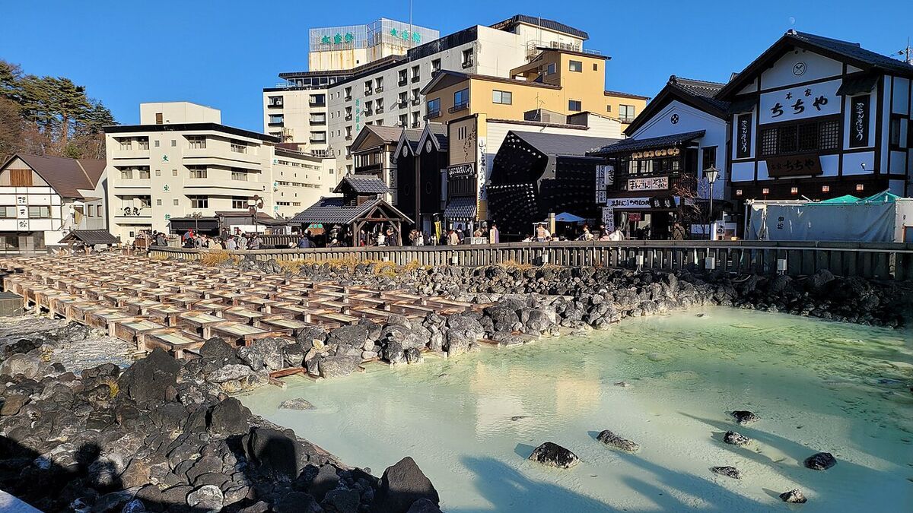

# Bathing Handbook: Onsen, Sentō and Ryokan

Japan has more than 27,000 hot-spring sources (MoE 2024a) and a bathing culture that is older than any of them as a business. This handbook explains it in three parts:

- **Hot springs:** what the law counts as an *onsen*, where the heat comes from, and how to read the analysis sheet on the changing-room wall.
- **Bathhouses:** temple baths, the bathhouses of Edo, and the neighbourhood *sentō*, which is disappearing.
- **Going:** onsen towns, staying at a *ryokan*, bath etiquette, tattoos, health advice and the Japanese you will see and need.

It is written for a reader who wants to understand as well as to bathe. Dates and numbers are given where the sources give them.

<figure>

<figcaption>The Yubatake ("hot-water field") at the centre of Kusatsu Onsen, Gunma, where spring water flows through wooden channels at about 4,000 litres a minute (Kusatsu Town, n.d.). Image: Aspere, <a href="https://creativecommons.org/publicdomain/zero/1.0/">CC0</a>, via <a href="https://commons.wikimedia.org/wiki/File:251130_Yubatake%2C_Kusatsu_10.jpg">Wikimedia Commons</a>.</figcaption>
</figure>

## How this handbook treats facts

- **Every factual statement comes from a named source**, cited in brackets, such as (MoE 2024a), and listed at the end of each chapter.
- **Four kinds of source are used:**
  - **Laws and official bodies:** the Ministry of the Environment, which administers the Hot Springs Act; the Ministry of Health, Labour and Welfare, for public baths and inns; the Japan Tourism Agency and the Japan National Tourism Organization (JNTO); Cabinet answers to the House of Representatives; the Tokyo Metropolitan Archives.
  - **Science agencies:** the Geological Survey of Japan.
  - **Peer-reviewed scholarship** on the history of bathing, mostly on J-STAGE and in university repositories. Quotations from Japanese are translated.
  - **Official sites of towns and baths:** Kusatsu, Beppu and Dōgo Onsen, for their own springs and buildings.
- **Two articles by specialists** on nippon.com are also used: a sentō researcher, and a journalist reading an Edo-period encyclopaedia. They are named where they are used.
- **Encyclopaedias, travel blogs and review sites are not used as sources.** Terms are linked to Wikipedia (marked ↗) only as further reading.
- **Numbers carry dates.** Prices, rules and opening times change; practical information is dated November 2026. Check with the bath or inn before you go.

## Pictures

Bathing in Japan is done naked, so this handbook shows **no bathers**. It uses freely licensed photographs of buildings, empty baths, signs and towns, and six diagrams drawn from the cited sources. Every picture is credited in its caption and again on the [sources page](14-sources.md).

## The three parts

### Part I: Hot springs

| Chapter | What it explains |
|---|---|
| [1. What counts as an onsen](01-definition.md) | The Hot Springs Act of 1948: 25 °C or 19 substances; therapeutic springs |
| [2. Where the heat comes from](02-heat.md) | Volcanic and non-volcanic springs, Tokyo's deep hot water, the onsen map in numbers |
| [3. Reading the label](03-label.md) | Spring types, temperature, pH and tonicity; added water, reheating and circulation |

### Part II: Bathhouses

| Chapter | What it explains |
|---|---|
| [4. Temple baths](04-temples.md) | Charity baths, the legend of Empress Kōmyō, the bath halls of Zen temples |
| [5. The bathhouses of Edo](05-edo.md) | The first bathhouse of 1591, the *zakuroguchi*, fees, shares, and the bans on mixed bathing |
| [6. The sentō](06-sento.md) | The Meiji "improved bath", temple-roofed bathhouses, Mount Fuji on the wall, and the decline |

### Part III: Going

| Chapter | What it explains |
|---|---|
| [7. Onsen towns and *tōji*](07-towns.md) | Kusatsu, Beppu and Dōgo; curative stays old and new |
| [8. Staying at a ryokan](08-ryokan.md) | What the law calls an inn, rates with meals, futon, yukata and curfews |
| [9. Bath etiquette](09-etiquette.md) | The steps of a bath, and why each rule exists |
| [10. Tattoos](10-tattoos.md) | What a national survey found, what the government said, and what you can do |
| [11. Bathing safely](11-health.md) | The Ministry of the Environment's official precautions |
| [12. Bath Japanese](12-language.md) | The signs at the door and phrases for the front desk |

Finally, a [glossary](13-glossary.md) and the [complete list of sources and image credits](14-sources.md).

This handbook connects with the course's [Cuisine handbook](../cuisine/00-start.md) for ryokan meals, and with [Signs in the wild](../signs/00-gallery.md) for the signs you will see at the door.

➡️ Begin with [Chapter 1: What counts as an onsen](01-definition.md)
