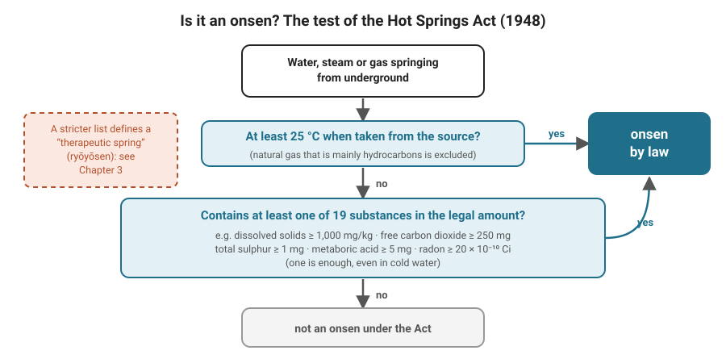
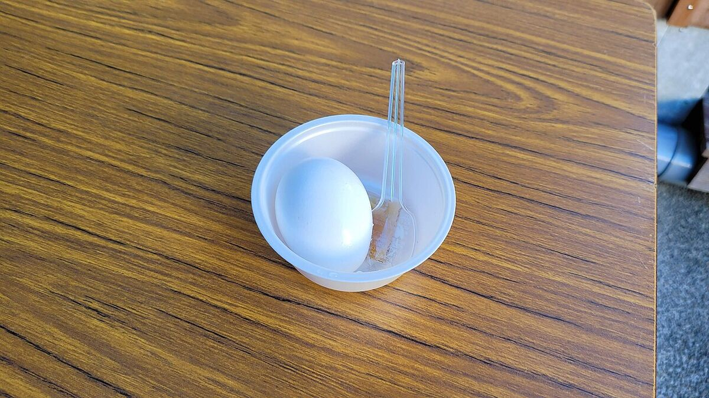

# 1. What Counts as an Onsen

In everyday Japanese, 温泉 (*onsen*) means a hot spring, and also a resort built around one. In law it means something more precise, and more surprising: an onsen does not have to be hot. This chapter explains the legal definition, and the stricter one for springs that may be used for treatment.

## 1.1 The Hot Springs Act

Japan's ***[Hot Springs Act](https://en.wikipedia.org/wiki/Onsen)*** (温泉法, *Onsen-hō*) was enacted in **1948** (Shōwa 23). It is administered by the Ministry of the Environment, whose explanation is followed here (MoE n.d.-a).

Under the Act, an onsen is **hot water, mineral water, steam or other gas springing from underground**. Natural gas whose main component is hydrocarbons is excluded. To count, the water or gas must meet **at least one** of two conditions (MoE n.d.-a):

1. **Temperature:** at least **25 °C** when taken from the source; or
2. **Substances:** at least the stated amount of **any one of 19 substances** per kilogram.

So a spring at 10 °C is an onsen if it carries enough of one of the listed substances. A spring at 25 °C is an onsen even if it is almost pure water.

<figure class="diagram">

<figcaption>The legal test, as explained by the Ministry of the Environment (MoE n.d.-a). <span class="credit">Diagram drawn for this handbook from the sources cited in the chapter.</span></figcaption>
</figure>

## 1.2 The 19 substances

The Act's table lists these substances and minimum amounts per kilogram of water (MoE n.d.-a):

| Substance | At least |
|---|---|
| Dissolved substances (excluding gases), total | 1,000 mg |
| Free carbon dioxide | 250 mg |
| Lithium ion | 1 mg |
| Strontium ion | 10 mg |
| Barium ion | 5 mg |
| Iron (ferrous or ferric) ion | 10 mg |
| Manganese ion | 10 mg |
| Hydrogen ion | 1 mg |
| Bromide ion | 5 mg |
| Iodide ion | 1 mg |
| Fluoride ion | 2 mg |
| Hydrogen arsenate ion | 1.3 mg |
| Metarsenious acid | 1 mg |
| Total sulphur | 1 mg |
| Metaboric acid | 5 mg |
| Metasilicic acid | 50 mg |
| Sodium hydrogen carbonate | 340 mg |
| Radon | 20 × 10⁻¹⁰ curie |
| Radium salt (as Ra) | 1 × 10⁻⁸ mg |

The table explains why a spa sign can say 温泉 even when the water must be heated: it qualifies by what it contains, not by its temperature.

## 1.3 The stricter test: the therapeutic spring

A second, stricter list defines the **療養泉** (*ryōyōsen*, "therapeutic spring"): an onsen (not steam or gas) that is especially suitable for treatment. It must be at least 25 °C, or contain at least one of seven substances in these amounts per kilogram (MoE n.d.-a):

- dissolved substances (excluding gases), total: 1,000 mg;
- free carbon dioxide: 1,000 mg;
- iron ion: 20 mg;
- hydrogen ion: 1 mg;
- iodide ion: 10 mg;
- total sulphur: 2 mg;
- radon: 30 × 10⁻¹⁰ curie (111 becquerels).

Only therapeutic springs are given one of the **spring types** posted at the bath, such as "chloride spring" or "sulphur spring". Chapter 3 explains them.

## 1.4 What the definition does not say

The definition is about the water at its source. It says nothing about what happens on the way to the bath. Water may be cooled, heated, diluted or recirculated and still be called onsen. Since 2005, a bath must say so when it does any of these things (MoE 2005). Chapter 3 shows how to read that notice.

The word *onsen* in a place name, such as Kusatsu Onsen, names the resort area. The Ministry counts these areas separately from sources: in March 2024 Japan had **2,857 onsen areas with lodging** and **27,920 sources** (MoE 2024a).

<figure>

<figcaption>An <em>onsen tamago</em> ("hot-spring egg") at Kusatsu Onsen, 2025. <span class="credit">Image: Aspere, <a href="https://creativecommons.org/publicdomain/zero/1.0/">CC0</a>, via <a href="https://commons.wikimedia.org/wiki/File:251128_Onsen_Tamago_at_Kusatsu_Onsen.jpg">Wikimedia Commons</a>.</span></figcaption>
</figure>

## Self-check

```quiz
? Which water counts as an onsen under the Hot Springs Act?
- Any water at 25 °C or more at the source, or with enough of one of 19 substances *
- Only water above 42 °C
- Only water from a volcanic area
> One condition is enough: temperature or a single listed substance (MoE n.d.-a).

? Can a spring at 12 °C be an onsen?
- Yes, if it contains enough of one listed substance *
- No, never
- Only if it is heated before use
> The substance test is independent of temperature.

? When was the Hot Springs Act enacted?
- 1948 *
- 1868
- 2005
> Shōwa 23, i.e. 1948 (MoE n.d.-a).

? What is a ryōyōsen?
- A therapeutic spring, defined by a stricter list *
- A spring used only for drinking
- A private bath at a ryokan
> It must be at least 25 °C or meet one of seven higher thresholds.
```

## Sources for this chapter

1. **MoE n.d.-a.** Ministry of the Environment 環境省. 温泉の定義 (The definition of an onsen). [env.go.jp](https://www.env.go.jp/nature/onsen/point/index.html).
2. **MoE 2005.** Ministry of the Environment 環境省. Leaflet on the compulsory posting of added water, heating, circulation, bath additives and disinfection (in Japanese), March 2005. [env.go.jp](https://www.env.go.jp/content/900492867.pdf).
3. **MoE 2024a.** Ministry of the Environment 環境省. 令和5年度温泉利用状況 (Onsen use in fiscal 2023, as of the end of March 2024). [env.go.jp](https://www.env.go.jp/nature/onsen/pdf/5-6_p_1.pdf).

➡️ Next: [Chapter 2: Where the heat comes from](02-heat.md)
