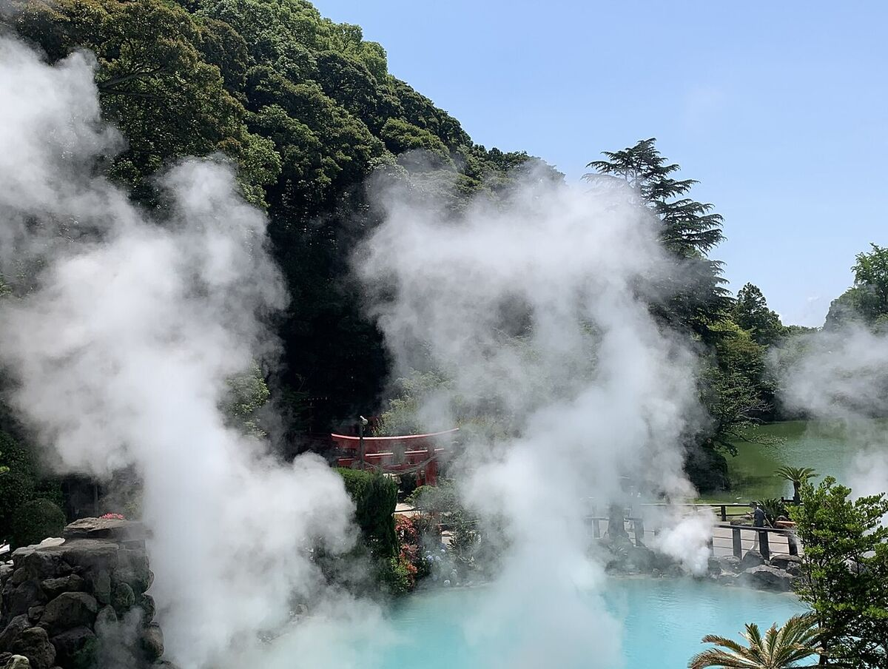
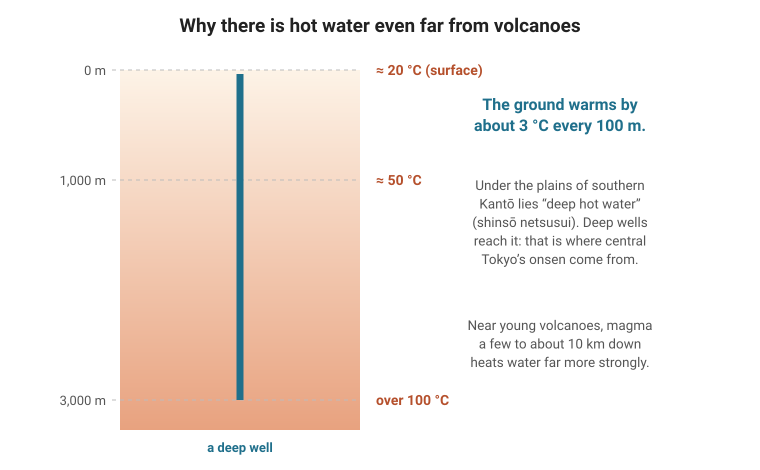
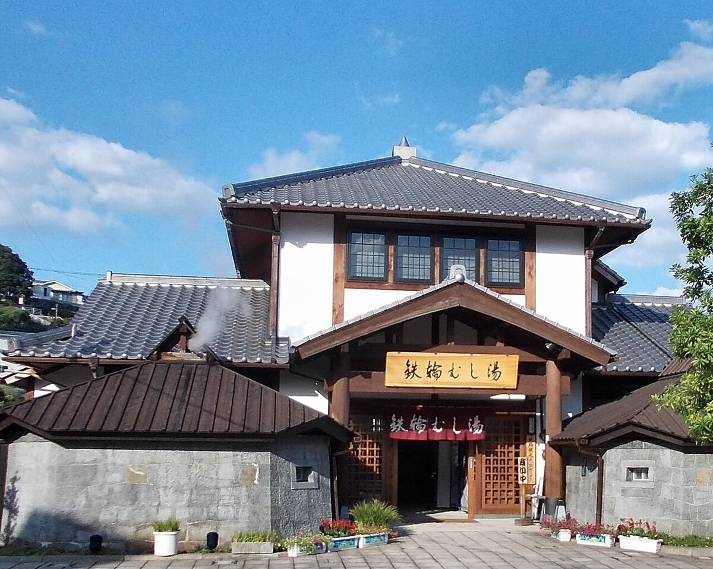

# 2. Where the Heat Comes From

Japan is a volcanic country, and many of its famous springs lie near volcanoes. But Tokyo, far from any active crater, also has onsen. This chapter explains both kinds of heat, and then gives the national numbers.

## 2.1 Volcanic springs

Geologists at the Geological Survey of Japan explain the two sources of heat (Sawaki et al. 2004):

- **Volcanic onsen** (火山性温泉, *kazansei onsen*). In volcanic regions, **magma chambers a few kilometres to about 10 km underground** heat the water that seeps down through cracks in the rock. Many onsen lie near young volcanoes, of the Quaternary period, and their water is often close to boiling.
- **Non-volcanic onsen.** Away from volcanoes, water is heated simply by the Earth's heat, which rises with depth.

The same authors note an old saying, "there are no onsen where you can see Mount Fuji". Springs used to emerge naturally along valleys, not on open plains. Once deep drilling became possible, onsen with views of Fuji appeared (Sawaki et al. 2004).

<figure>

<figcaption>Umi Jigoku ("Sea Hell"), one of the steaming ponds of Beppu, Ōita, 2022. <span class="credit">Image: Bpcon98, <a href="https://creativecommons.org/publicdomain/zero/1.0/">CC0</a>, via <a href="https://commons.wikimedia.org/wiki/File:Umi_Jigoku_%28Sea_Hell%29_in_Beppu.jpg">Wikimedia Commons</a>.</span></figcaption>
</figure>

## 2.2 Hot water under Tokyo

The Geological Survey explains why central Tokyo has onsen (GSJ n.d.):

- **The ground warms with depth by about 3 °C every 100 metres.** If the surface is 20 °C, the rock is about **50 °C at 1,000 m** and **over 100 °C at 3,000 m**.
- Under the southern Kantō Plain lies water that has been heated in this way, called **深層熱水** (*shinsō netsusui*, "deep hot water"). Central Tokyo's onsen tap it through deep wells.

Sawaki and colleagues add that such deep hot water in plains and basins is **mostly 60 °C or less**, and boiling water is very rare. Large onsen leisure facilities on the plains use it (Sawaki et al. 2004).

<figure class="diagram">

<figcaption>Temperature rising with depth, after the Geological Survey of Japan (GSJ n.d.; Sawaki et al. 2004). <span class="credit">Diagram drawn for this handbook from the sources cited in the chapter.</span></figcaption>
</figure>

## 2.3 The onsen map in numbers

The Ministry of the Environment publishes national onsen statistics every year. The figures below are as of the **end of March 2024** (MoE 2024a).

| Item | Number |
|---|---|
| Onsen areas with lodging | 2,857 |
| Sources, total | 27,920 |
| — in use, flowing naturally | 4,111 |
| — in use, pumped | 12,849 |
| Sources below 25 °C | 4,118 |
| Sources at 25–42 °C | 6,920 |
| Sources at 42 °C or more | 12,676 |
| Steam or gas sources | 998 |
| Total flow | 2,496,157 litres a minute |
| Lodgings using onsen | 13,179 |
| Overnight guests in the year | 120,705,968 |
| Public baths using onsen | 7,746 |

**Most water is pumped.** Pumped sources deliver 1,828,723 L/min, natural flow 667,434 L/min (MoE 2024a).

The prefectures stand out in different ways (MoE 2024a):

- **Ōita** has the most sources (5,086), the largest flow (291,121 L/min) and the most sources at 42 °C or more (3,870). Kagoshima (2,735 sources), Hokkaidō (2,239) and Shizuoka (2,192) follow.
- **Hokkaidō** has the most onsen areas (230), ahead of Nagano (193).
- **Shizuoka** has the most lodgings using onsen (2,263).
- **Nagano** has the most public baths using onsen (706).

<figure>

<figcaption>Kannawa Mushi-yu, a public steam bath in Kannawa Onsen, Beppu, 2011. <span class="credit">Image: STA3816, <a href="https://creativecommons.org/licenses/by-sa/3.0/">CC BY-SA 3.0</a>, via <a href="https://commons.wikimedia.org/wiki/File:Kannawa_Mushi-yu_Public_Bath.jpg">Wikimedia Commons</a>.</span></figcaption>
</figure>

## 2.4 Fewer inns, more day baths

A report to the Ministry's council in 2024 shows how use is changing (MoE 2024b):

- **Lodgings using onsen** peaked at **15,714** at the end of fiscal 1995 and fell to **12,999** by the end of fiscal 2022.
- **Overnight guests** peaked at **143.25 million** in fiscal 1992; in fiscal 2022 there were 109.86 million.
- **Public baths using onsen** have not declined in the same way: 7,981 at the end of fiscal 2019, 7,941 at the end of fiscal 2022.

## Self-check

```quiz
? Roughly how fast does the ground warm with depth, according to the Geological Survey of Japan?
- About 3 °C per 100 m *
- About 3 °C per kilometre
- About 30 °C per 100 m
> So about 50 °C at 1,000 m and over 100 °C at 3,000 m (GSJ n.d.).

? Where does the water of central Tokyo's onsen come from?
- Deep hot water under the southern Kantō Plain, reached by deep wells *
- Pipes from Hakone
- Mount Fuji
> It is non-volcanic water heated by the Earth's heat.

? Which prefecture has the most onsen sources?
- Ōita *
- Hokkaidō
- Shizuoka
> 5,086 sources at the end of March 2024 (MoE 2024a).

? How is most onsen water brought to the surface today?
- By pumping *
- By natural flow
- By steam pressure
> Pumped sources deliver about 1.83 million of the 2.50 million litres a minute.
```

## Sources for this chapter

1. **GSJ n.d.** Geological Survey of Japan, AIST 産業技術総合研究所 地質調査総合センター. 東京にどうして温泉があるの？関東平野南部の深層熱水資源 (Why does Tokyo have onsen? Deep hot-water resources of the southern Kantō Plain). [gsj.jp](https://www.gsj.jp/hazards/geologic-hazard/kanto-hotsprings.html).
2. **MoE 2024a.** See [Chapter 1](01-definition.md).
3. **MoE 2024b.** Ministry of the Environment 環境省. Central Environment Council, Hot Springs Subcommittee, document 4, 17 September 2024 (in Japanese). [env.go.jp](https://www.env.go.jp/council/content/12nature08/000257569.pdf).
4. **Sawaki et al. 2004.** Sawaki Takayuki, Tamanyu Shirō, Ōtani Tomoyuki 佐脇貴幸・玉生志郎・大谷具幸. 静岡の地熱資源・温泉と地中熱利用 (Geothermal resources, onsen and ground heat in Shizuoka). *Chishitsu News* 2004;594:27–30. [gsj.jp](https://www.gsj.jp/data/chishitsunews/04_02_06.pdf).

➡️ Next: [Chapter 3: Reading the label](03-label.md)
