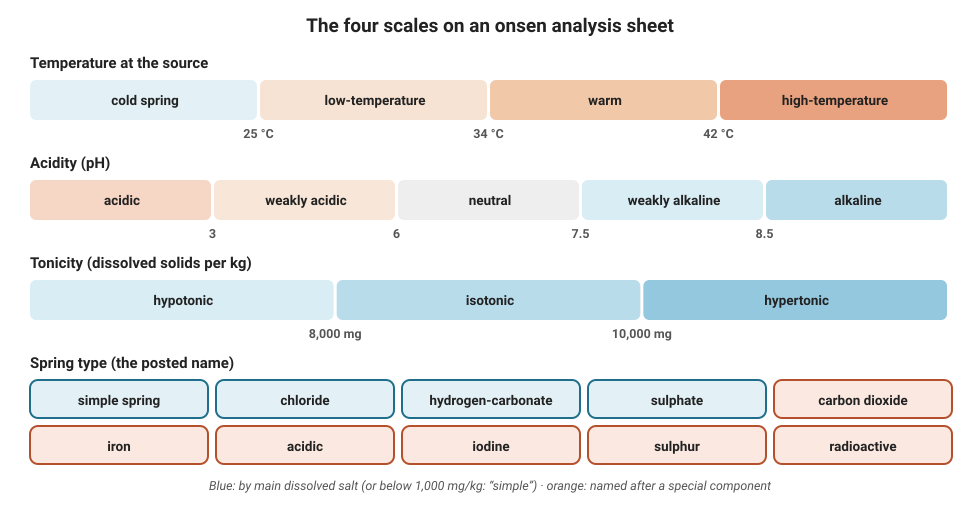

# 3. Reading the Label

Every onsen must post information about its water, usually as a framed sheet in the changing room. It looks technical, but it answers practical questions: how hot is the water at the source, will it sting, has it been diluted, is it the same water going round and round? This chapter explains how to read it.

## 3.1 Four scales

The Ministry of the Environment's guidelines for analysing springs, revised in 2014, sort water on several scales (MoE 2014a).

**Temperature at the source:**

| Class | Temperature |
|---|---|
| Cold mineral spring | below 25 °C |
| Low-temperature spring | 25 °C to below 34 °C |
| Warm spring | 34 °C to below 42 °C |
| High-temperature spring | 42 °C or more |

**Acidity (pH):** acidic below 3; weakly acidic 3 to below 6; neutral 6 to below 7.5; weakly alkaline 7.5 to below 8.5; alkaline 8.5 or more (MoE 2014a).

**Tonicity**, from the total dissolved substances per kilogram: **hypotonic** below 8,000 mg; **isotonic** 8,000 to below 10,000 mg; **hypertonic** 10,000 mg or more (MoE 2014a).

<figure class="diagram">

<figcaption>The scales and spring types of the Ministry of the Environment's analysis guidelines (MoE 2014a). <span class="credit">Diagram drawn for this handbook from the sources cited in the chapter.</span></figcaption>
</figure>

## 3.2 Spring types

A therapeutic spring (Chapter 1) is given a **泉質** (*sensitsu*, spring type). The guidelines name types in two ways (MoE 2014a):

- **By the main dissolved salt**, when the water carries at least 1,000 mg of dissolved substances per kilogram. The type is named after the main negative ion: **chloride spring** (塩化物泉), **hydrogen-carbonate spring** (炭酸水素塩泉) or **sulphate spring** (硫酸塩泉).
- **Simple spring** (単純温泉, *tanjun onsen*): less than 1,000 mg of dissolved substances, but at least 25 °C. If its pH is 8.5 or more, it is an **alkaline simple spring**.
- **By a special component**, when one of the stricter thresholds of Chapter 1 is reached: **carbon-dioxide spring** (二酸化炭素泉), **iron spring** (含鉄泉), **acidic spring** (酸性泉), **iodine spring** (含よう素泉), **sulphur spring** (硫黄泉) and **radioactive spring** (放射能泉).

The posted names also include aluminium and copper–iron springs. The iodine spring was added in the 2014 revision (MoE 2014a).

A full name on the sheet strings the scales together. A spring described as "sodium–chloride spring (hypotonic, weakly alkaline, high-temperature)" is a salt spring with less than 8,000 mg of solids per kilogram, a pH between 7.5 and 8.5, and a source temperature of at least 42 °C.

## 3.3 What has been done to the water

The definition of an onsen applies to the water at its source (Chapter 1). Since **24 May 2005**, a bath must also post whether, and why, it does any of the following (MoE 2005):

| Notice | Reading | Meaning |
|---|---|---|
| 加水 | *kasui* | water added (diluted) |
| 加温 | *kaon* | heated |
| 循環 | *junkan* | filtered and recirculated |
| 入浴剤 | *nyūyokuzai* | bath additives used |
| 消毒 | *shōdoku* | disinfected |

The rule was a response to cases in **2004**, when some facilities had used bath additives without saying so. The Central Environment Council reported on 10 February 2005, and the regulation was promulgated on 24 February 2005 (MoE 2005).

None of these is a fault. A spring at 94 °C has to be cooled before anyone can bathe in it, and a cold spring has to be heated (Chapter 7 gives an example). The notice simply tells you what you are getting.

## 3.4 Health information on the sheet

The posting also carries the Ministry's standard health information, revised in 2014: conditions in which bathing should be avoided, and precautions for bathing and for drinking the water (MoE 2014b). Chapter 11 summarises them.

## Self-check

```quiz
? A spring is described as "hypotonic". What does that tell you?
- It has less than 8,000 mg of dissolved substances per kilogram *
- It is below 25 °C
- It is acidic
> Tonicity is measured by dissolved substances (MoE 2014a).

? What is a "simple spring" (tanjun onsen)?
- At least 25 °C but with less than 1,000 mg of dissolved substances per kilogram *
- A spring with no added water
- Any spring below 25 °C
> "Simple" means weakly mineralised, not inferior.

? A sign at the bath says 循環. What does it mean?
- The water is filtered and recirculated *
- The water is heated
- The water is diluted
> 加水 means diluted and 加温 heated.

? Since when must baths post whether they add water, heat or recirculate?
- Since May 2005 *
- Since 1948
- Since 2017
> The rule followed undisclosed use of bath additives in 2004 (MoE 2005).
```

## Sources for this chapter

1. **MoE 2005.** See [Chapter 1](01-definition.md).
2. **MoE 2014a.** Ministry of the Environment 環境省. 鉱泉分析法指針（平成26年改訂） (Guidelines for the analysis of mineral springs, 2014 revision). [env.go.jp](https://www.env.go.jp/nature/onsen/pdf/2-5_p_14.pdf). Posting names from the table of old and new spring names: [env.go.jp](https://www.env.go.jp/content/900526900.pdf).
3. **MoE 2014b.** Ministry of the Environment 環境省. Notice 環自総発第1407012号 of 1 July 2014, on the posting of contraindications and precautions for bathing and drinking (in Japanese). [env.go.jp](https://www.env.go.jp/nature/onsen/pdf/2-5_p_11.pdf).

➡️ Next: [Chapter 4: Temple baths](04-temples.md)
