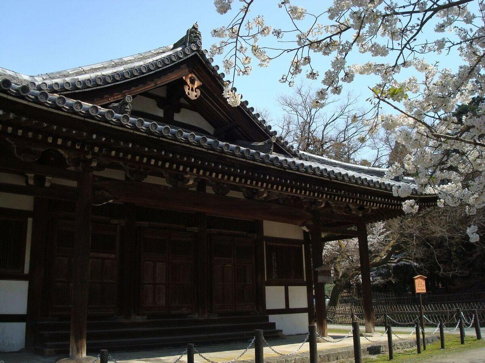
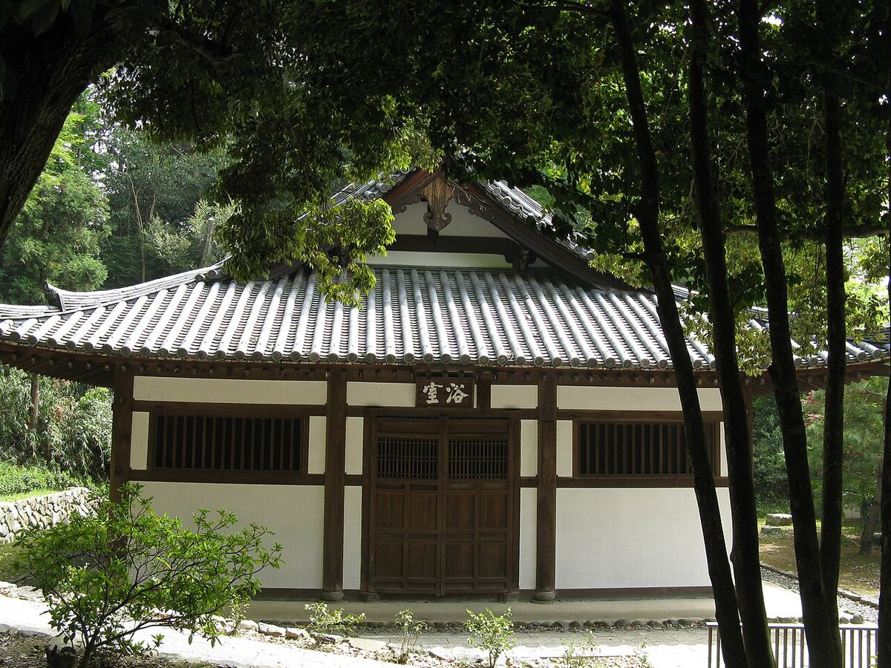

# 4. Temple Baths

Before bathing was a business, it was a religious act. Buddhist temples built bath halls, opened them to the poor, and told stories about the merit of washing others. This chapter follows that thread, from the eighth century to the bath halls still standing in Kyoto's Zen temples.

## 4.1 Bathing as merit

The historian of hygiene Nimiya Ken'ichi summarises the early history (Nimiya 1996):

- **Buddhism regards bathing as an act of merit.**
- From around the **Tenpyō era (eighth century)**, temples built **bath halls** (浴堂, *yokudō*) and offered **charity baths** (施浴, *seyoku*) to ordinary people.
- The practice continued through the **Kamakura and Muromachi periods**.

Kawabata Miki, in a study of bathing regulation, describes the same sequence for Japan as a whole: ablution and temple charity baths in early times, urban public bathhouses from the Edo period, and home baths today (Kawabata 2006).

<figure>

<figcaption>The Ōyuya ("great bath house") of Tōdai-ji, Nara, 2010. <span class="credit">Image: Tamachatora, <a href="https://creativecommons.org/licenses/by-sa/3.0/">CC BY-SA 3.0</a>, via <a href="https://commons.wikimedia.org/wiki/File:%E6%9D%B1%E5%A4%A7%E5%AF%BA%E5%A4%A7%E6%B9%AF%E5%B1%8B_-_panoramio.jpg">Wikimedia Commons</a>.</span></figcaption>
</figure>

## 4.2 The empress in the bathhouse

A legend about **[Empress Kōmyō](https://en.wikipedia.org/wiki/Empress_K%C5%8Dmy%C5%8D)** (eighth century) shows what charity bathing meant. In it, the empress scrubs a man with leprosy in a bathhouse, and he turns out to be a Buddha testing her (Matsuo 2022).

The historian of religion Matsuo Kenji traced how this story changed (Matsuo 2022):

- **First appearance.** The legend first appears in the *Kenkyū go-junreiki*, a record of a pilgrimage in the Kenkyū era (1190s).
- **It moved.** Between the Kamakura and Nanbokuchō periods, the scene of the story moved from Ashuku-ji, an earlier temple, to Hokke-ji. The Buddha in it changed from **Akshobhya** to **Mañjuśrī**.
- **Who spread it.** The followers of the monks **Eison** and **Ninshō**, who cared for people with leprosy and other outcasts, spread the legend between the thirteenth and fifteenth centuries. Their relief work included **scrubbing the bodies** of the sick (Matsuo 2022).

## 4.3 The bath halls of Zen temples

In **Zen** monasteries the bath was one of the **seven principal halls** (七堂伽藍, *shichidō garan*) of a complete temple. The architectural historian Hirai Toshiyuki lists the Zen baths that survive (Hirai 2007):

| Temple | Bath built |
|---|---|
| Tōfuku-ji, Kyoto | 1459; Important Cultural Property |
| Shōkoku-ji, Kyoto | 1596 |
| Daitoku-ji, Kyoto | 1622 |
| Kennin-ji, Kyoto | 1628 |
| Myōshin-ji, Kyoto | rebuilt 1656; Important Cultural Property |
| Shūon-an | Important Cultural Property |

Hirai studied the bath of **Myōshin-ji** in detail (Hirai 2007):

- **A legend** links it to the general **Akechi Mitsuhide**. A ridge plaque (*munafuda*) of **Tenshō 15 (1587)** survives.
- **The present building** was rebuilt in **1656**, according to the temple's construction ledger.
- **Monastic rules** governed bathing: a bell was struck **twelve times** to announce the bath, baths were held on set days, and duties were assigned by rank.

<figure>

<figcaption>The bath hall (浴室, <em>yokushitsu</em>) of Tōfuku-ji, Kyoto, built in 1459 (Hirai 2007). Photographed in 2011. <span class="credit">Image: KENPEI, <a href="https://creativecommons.org/licenses/by/3.0/">CC BY 3.0</a>, via <a href="https://commons.wikimedia.org/wiki/File:Tofukuji_yokushitu.jpg">Wikimedia Commons</a>.</span></figcaption>
</figure>

## 4.4 From temples to towns

Kawabata lists the reasons why bathing moved from temples to paid bathhouses in the crowded cities of the Edo period: the danger of fire in dense neighbourhoods, tenements without baths, and the cost of water and fuel (Kawabata 2006). Chapter 5 follows that story.

## Self-check

```quiz
? What were seyoku?
- Charity baths offered to ordinary people by temples *
- Steam baths in Edo bathhouses
- Private baths at inns
> Temples offered them from around the eighth century (Nimiya 1996).

? In the legend, whom does Empress Kōmyō scrub?
- A man with leprosy, who turns out to be a Buddha *
- The emperor
- A Zen monk
> Matsuo (2022) traces how the story changed over the centuries.

? Which group spread the Kōmyō legend and scrubbed the sick themselves?
- The followers of Eison and Ninshō *
- The Edo bathhouse guild
- The Meiji police
> Their relief work in the 13th–15th centuries included body scrubbing.

? Which Zen temple has the oldest surviving bath in Hirai's list?
- Tōfuku-ji (1459) *
- Myōshin-ji (1656)
- Kennin-ji (1628)
> It is an Important Cultural Property (Hirai 2007).
```

## Sources for this chapter

1. **Hirai 2007.** Hirai Toshiyuki 平井俊行. 妙心寺の浴室について (On the bath of Myōshin-ji). *Journal of the Society of Architectural Historians of Japan* 2007;49:21–39. doi:[10.24574/jsahj.49.0_21](https://doi.org/10.24574/jsahj.49.0_21).
2. **Kawabata 2006.** Kawabata Miki 川端美季. 「湯屋取締規則」及び「湯屋營業取締規則」に関する考察 (A study of the bathhouse regulations of the Meiji era). *Core Ethics* 2006;2:59–. [ritsumei.repo.nii.ac.jp](https://ritsumei.repo.nii.ac.jp/record/5324/files/ce2_59km02.pdf).
3. **Matsuo 2022.** Matsuo Kenji 松尾剛次. 湯屋の皇后伝説の変容：叡尊教団による非人垢すり (The transformation of the legend of the empress in the bathhouse). *Journal of Religious Studies* 2022;96(2):169–193. doi:[10.20716/rsjars.96.2_169](https://doi.org/10.20716/rsjars.96.2_169).
4. **Nimiya 1996.** Nimiya Ken'ichi 二宮健一. 洗浄と清潔の歴史概観 (A historical overview of washing and cleanliness). *Journal of the Japan Research Association for Textile End-Uses* 1996;37(6):292–299. doi:[10.11419/senshoshi1960.37.292](https://doi.org/10.11419/senshoshi1960.37.292).

➡️ Next: [Chapter 5: The bathhouses of Edo](05-edo.md)
