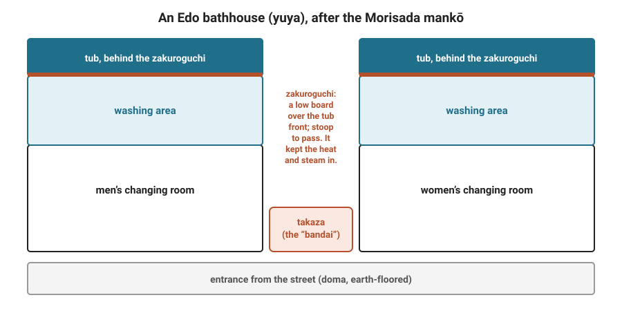

# 5. The Bathhouses of Edo

The paid public bathhouse became part of daily life in Edo, today's Tokyo. This chapter explains why, what a visit was like, what it cost, and how the authorities separated men and women.

## 5.1 The first bathhouse

The earliest record of a public bathhouse in Edo is from **Tenshō 19 (1591)**. According to the collection *Sozoro monogatari*, a man called **Ise Yoichi** opened a *sentō-buro* ("coin bath") near the Zenigame Bridge, in today's Ōtemachi. At first customers found it too hot and smoky (Kobayashi 2021; Kawabata 2006).

Ten years later, writes the sentō researcher Machida Shinobu, there was a bathhouse in every neighbourhood (Machida 2017). Kawabata Miki explains why the city needed them (Kawabata 2006):

- **Fire.** Edo was densely built, and private baths with their own fires were a hazard.
- **Housing.** Tenement houses (*nagaya*) had no baths.
- **Cost.** Water and fuel were expensive.

## 5.2 Steam or tub

Machida describes two kinds of bath in Edo (Machida 2017):

- the ***furoya***, a **steam bath**; and
- the ***yuya***, with a **tub of hot water**.

Customers preferred the tub, and steam baths disappeared, but the word *furo* survived: it is still the everyday Japanese word for a bath (Machida 2017).

The Edo-period encyclopaedia *Morisada mankō*, as summarised by the journalist Kobayashi Akira, notes a difference of vocabulary: in Kyoto and Osaka a bathhouse was a *furoya*, in Edo a *sentō* or *yuya*. In Kyoto and Osaka many houses had their own baths; in Edo, with its booming population of tenement dwellers, people used bathhouses (Kobayashi 2021).

## 5.3 Inside an Edo bathhouse

From the *Morisada mankō* (Kobayashi 2021):

- **Plan.** An earth-floored entrance; a raised seat (*takaza*) where the attendant took money; **men to the left, women to the right**; changing room, washing area, and the tub at the back.
- **The *zakuroguchi*.** A low board hung over the front of the tub. Bathers stooped to pass under it into a low, dark space.
- **The sign.** A **bow and arrow** hung outside, a pun: *ya-iru* ("shooting arrows") sounds like *yu-iru* ("entering the hot water"). After the Tenpō era (from 1830), a navy-blue cloth marked 男女 or ゆ was used.
- **The *sansuke*.** For an extra fee, an attendant washed your back.

Kawabata explains the *zakuroguchi*. It appeared in the **mid-Edo period**: the low lintel **kept the steam and heat in, saving fuel and water**, and so the bathing room was dark (Kawabata 2006). Machida describes the same dark tub room with its low entrance and few windows (Machida 2017).

<figure class="diagram">

<figcaption>Plan of an Edo bathhouse, drawn from the <em>Morisada mankō</em> as summarised by Kobayashi (2021), with the <em>zakuroguchi</em> as explained by Kawabata (2006). <span class="credit">Diagram drawn for this handbook from the sources cited in the chapter.</span></figcaption>
</figure>

The painting of Mount Fuji on the wall, so typical of the Tokyo sentō, is **not** from the Edo period. The general view, Kobayashi notes, is that it became popular in the Taishō era (Kobayashi 2021); Chapter 6 gives its origin.

## 5.4 How many, and at what price

| Year | Bathhouses in Edo | Source |
|---|---|---|
| 1796 | 510, about one for every three neighbourhoods | Tokyo Metropolitan Archives (TMA 2009) |
| 1810 | 523 | Machida 2017 |
| Tenpō–Kaei to the end of the shogunate | about 600 | *Morisada mankō* (Kobayashi 2021) |

The 1796 figure comes from a report of the town magistrates. It also counted about **110 unlicensed "medicinal baths"** (*yakutō*) competing with the licensed houses (TMA 2009).

**Fees** (Kobayashi 2021):

| When | Adult fee |
|---|---|
| Edo period, usually | about 10 *mon* |
| Tenpō reform, 1841 | 8 *mon* (children 6, infants 4) |
| 1862–63, firewood prices rising | 12 *mon* |
| 1865 | 16 *mon* |
| 1866 | 24 *mon* |

## 5.5 A bathhouse as an investment

The right to run a bathhouse was a tradable share, the **湯屋株** (*yuya-kabu*). Trade in these rights is attested at least from an edict of **1721** (TMA 2009).

The Tokyo Metropolitan Archives describe a deed of **1820** (Bunsei 3). A two-storey bathhouse in Asakusa, with men's and women's baths, a frontage of 5.5 *ken* and a depth of 13 *ken*, was sold with its equipment for **500 *ryō***. The seller went on running it and paid the buyer a monthly rent. The *Morisada mankō* gives share prices of **300 to 500 *ryō***, up to 1,000 (TMA 2009).

## 5.6 Separating men and women

Mixed bathing, called 入込湯 (*irikomiyu*), was normal in Edo's early and middle periods (Kobayashi 2021; Kawabata 2006). The authorities banned it in stages:

- **Kansei reforms (1787–1793).** **[Matsudaira Sadanobu](https://en.wikipedia.org/wiki/Matsudaira_Sadanobu)** banned mixed bathing in Edo (Kobayashi 2021).
- **Tenpō reforms.** **[Mizuno Tadakuni](https://en.wikipedia.org/wiki/Mizuno_Tadakuni)** banned it again, and baths were separated (Kobayashi 2021). In Kyoto and Osaka mixed bathing lasted until the Tenpō era; Kyoto banned it in **1843** (Kawabata 2006).
- **Some rural mixed bathing persisted** (Kobayashi 2021).

The shogunate also policed the ***yuna***, "bath women" who served customers. They appeared in the late Muromachi period, flourished in Edo, and were **banned in 1657** (Kawabata 2006).

## Self-check

```quiz
? Who opened the first recorded bathhouse in Edo, and when?
- Ise Yoichi, in 1591 *
- Matsudaira Sadanobu, in 1790
- Tsurusawa Monzaemon, in 1877
> Near the Zenigame Bridge, in today's Ōtemachi (Kobayashi 2021).

? What was the zakuroguchi for?
- A low entrance to the tub that kept heat and steam in *
- A window for the attendant to watch bathers
- The street door of the bathhouse
> It saved fuel and water, and made the room dark (Kawabata 2006).

? Why did a bathhouse hang a bow and arrow outside?
- As a pun: ya-iru sounds like yu-iru, "entering the hot water" *
- To show it belonged to a samurai
- As a protection against fire
> Later a navy-blue cloth marked ゆ was used.

? Which reforms first banned mixed bathing in Edo?
- The Kansei reforms (1787–1793) *
- The Meiji Restoration
- The Kyōhō reforms
> Under Matsudaira Sadanobu; the Tenpō reforms banned it again.

? About how many bathhouses did Edo have in 1796?
- 510 *
- 51
- 18,325
> About one for every three neighbourhoods (TMA 2009).
```

## Sources for this chapter

1. **Kawabata 2006.** See [Chapter 4](04-temples.md).
2. **Kobayashi 2021.** Kobayashi Akira 小林明. 寛政の改革で混浴禁止に？お江戸銭湯よもやま話：『守貞漫稿』（その10） (Mixed bathing banned in the Kansei reforms? Tales of the Edo sentō from the *Morisada mankō*, part 10). nippon.com, 22 May 2021. [nippon.com](https://www.nippon.com/ja/japan-topics/g01098/).
3. **Machida 2017.** Machida Shinobu 町田忍. Article on the history of the sentō (in Japanese). nippon.com, 25 April 2017. [nippon.com](https://www.nippon.com/ja/views/b07302/).
4. **TMA 2009.** Tokyo Metropolitan Archives 東京都公文書館. 『東京市史稿産業篇第五十』解読の手引き：江戸の湯屋と下野の豪農 (Reading guide to *Tōkyō shishikō, sangyō-hen* vol. 50: the bathhouses of Edo and a wealthy farmer of Shimotsuke), March 2009. [soumu.metro.tokyo.lg.jp](https://www.soumu.metro.tokyo.lg.jp/01soumu/archives/0601ooedo05.pdf).

➡️ Next: [Chapter 6: The sentō](06-sento.md)
