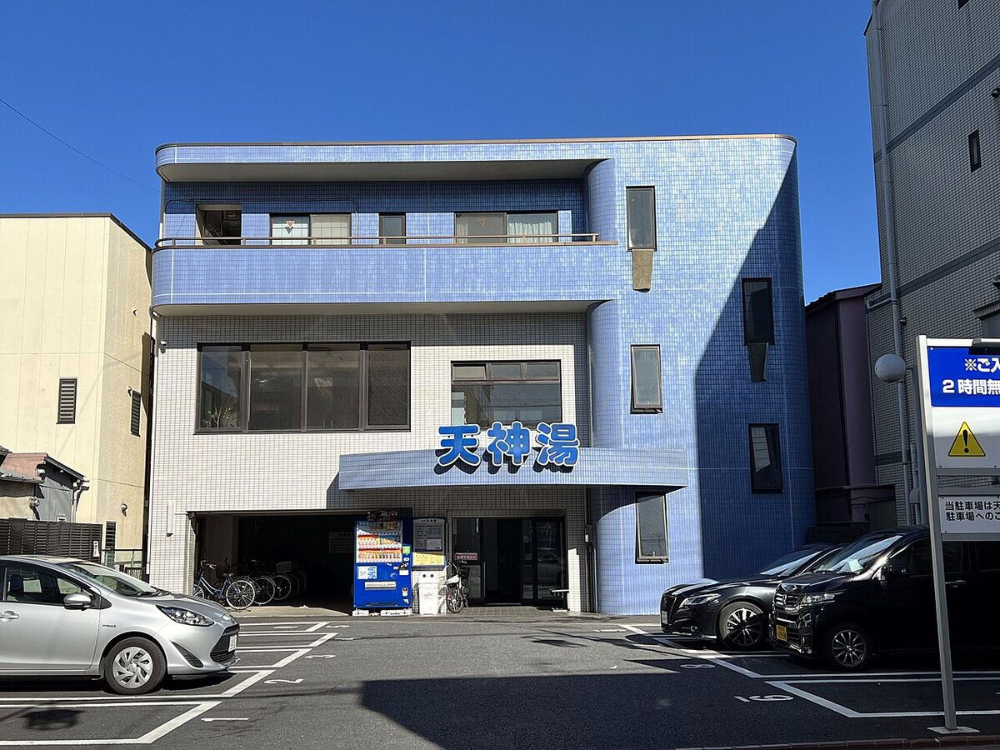
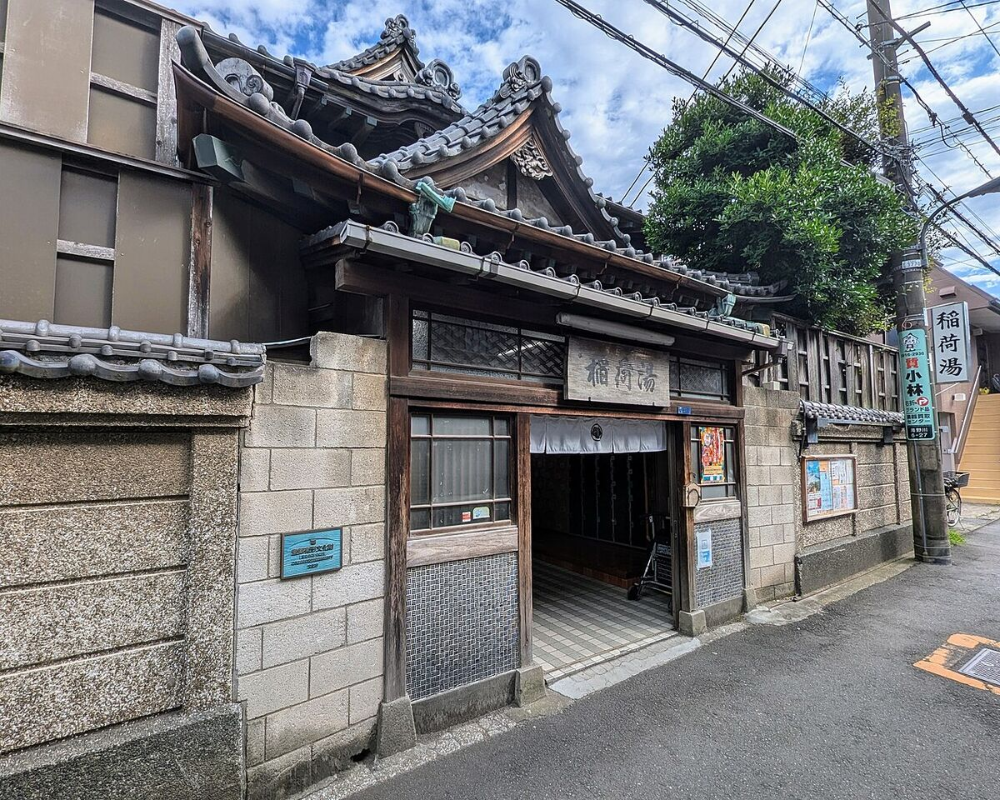
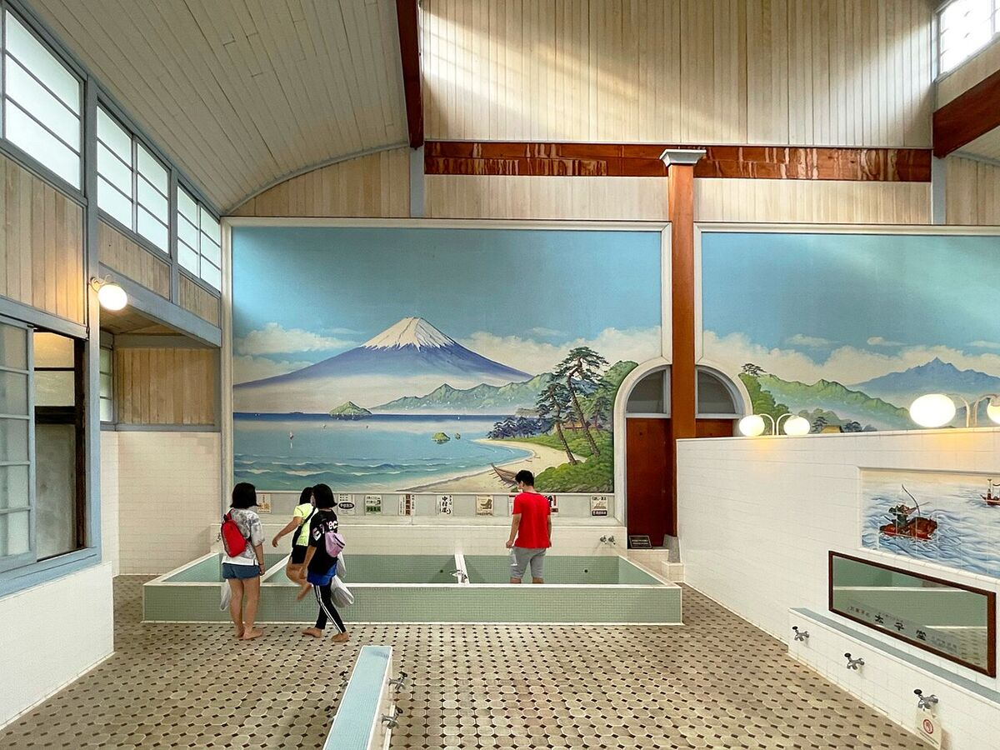
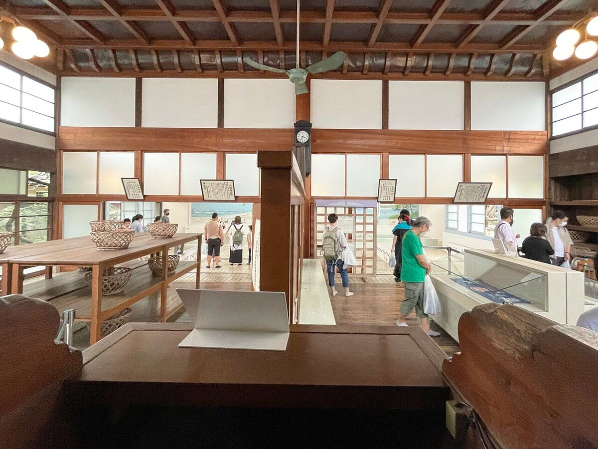
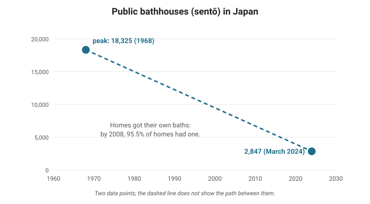
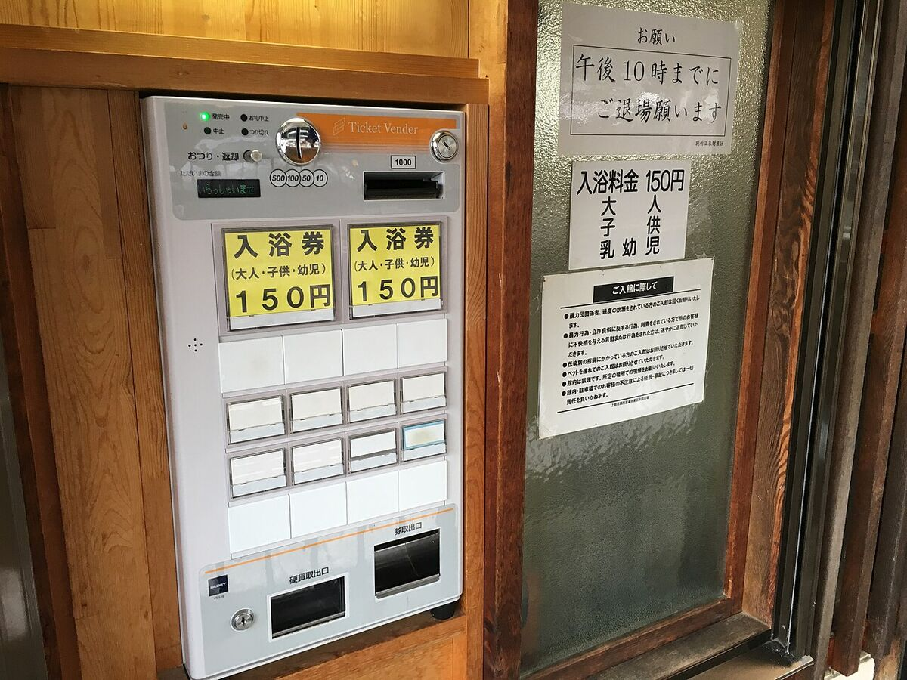
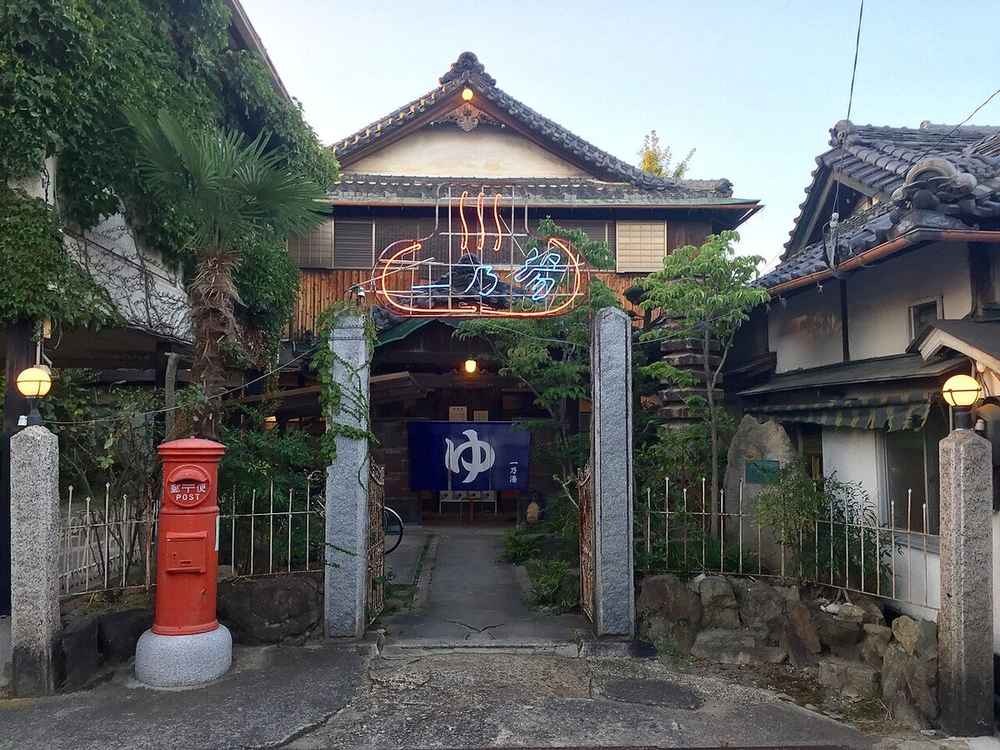

# 6. The Sentō

銭湯 (*sentō*) is the neighbourhood public bathhouse. For a century it was where most city people bathed. This chapter explains how the modern sentō took shape, what to look for in one, and why so few remain.

## 6.1 The Meiji "improved bath"

According to Machida Shinobu, the Meiji government banned mixed bathing after Western criticism, and ordered bathhouses to be opened up (Machida 2017).

- **1877, Kanda.** A bathhouse with a **high ceiling**, a **vent for the steam**, and the **bath and the changing room in one open space** was built. It was called the *kairyō-buro* ("improved bath"), and became the basic structure of the modern sentō. Tiles and **karan** (taps) followed (Machida 2017). Kawabata Miki names its builder as **Tsurusawa Monzaemon** (Kawabata 2006).
- **1879, Tokyo.** The first comprehensive regulation, the **Bathhouse Control Rules** (湯屋取締規則), issued through the Home Ministry's police. Its 14 articles covered licences, the guild, fire safety (a brick fire room and a chimney), closing at **11 p.m.** and in strong winds, crime prevention, **separate areas for men and women**, and **screens so that bathers could not be seen from outside**. They were revised in 1885 (23 articles); Kyoto followed in 1886 (Kawabata 2006).
- **1908.** Tokyo had **1,217** sentō (Machida 2017).

## 6.2 The Tokyo sentō

Machida describes the features of the classic Tokyo sentō (Machida 2017):

- **A temple-like building** (宮造り, *miya-zukuri*), often with a curved ***karahafu*** gable over the entrance. The style is found mostly around Tokyo. It arose in the rebuilding after the **Great Kantō Earthquake of 1923**, when carpenters skilled in building shrines and temples took on bathhouses.
- **A high, coffered ceiling** in the changing room.
- **A small courtyard garden** (*tsuboniwa*), often with carp.
- **A large painting** on the front wall of the bathing room.
- **The 番台 (*bandai*)**, the raised attendant's seat, about **1.3 m high** on average in the Tokyo area. The attendant collects fees, sells soap, and watches for anyone who feels unwell.

<figure>

<figcaption>Tenjin-yu, a sentō in Tokyo, 2023. The name on the sign ends in 湯 (<em>yu</em>, hot water). <span class="credit">Image: Asanagi, <a href="https://creativecommons.org/publicdomain/zero/1.0/">CC0</a>, via <a href="https://commons.wikimedia.org/wiki/File:Tenjin-yu_2023-12-17.jpg">Wikimedia Commons</a>.</span></figcaption>
</figure>

<figure>

<figcaption>Inari-yu, a sentō in Takinogawa, Kita Ward, Tokyo, 2025. <span class="credit">Image: Panam, <a href="https://creativecommons.org/publicdomain/zero/1.0/">CC0</a>, via <a href="https://commons.wikimedia.org/wiki/File:%E6%BB%9D%E9%87%8E%E5%B7%9D%E7%A8%B2%E8%8D%B7%E6%B9%AF_2025.jpg">Wikimedia Commons</a>.</span></figcaption>
</figure>

## 6.3 Mount Fuji on the wall

Machida gives the origin of the painting (Machida 2017):

- **1912 (Taishō 1).** The owner of **Kikai-yu**, in Kanda Sarugaku-chō, asked the Western-style painter **Kawagoe Kōshirō** to paint something for children. He painted **Mount Fuji**, as seen from his native Shizuoka.
- **It spread** to sentō across Tokyo.
- **Tile pictures**, mostly of **Kutani ware**, are also common, often showing carp.

<figure>

<figcaption>The men's bathing room of Kodakara-yu, a sentō built in the early Shōwa era and now part of the Edo-Tokyo Open Air Architectural Museum in Koganei, Tokyo. It is no longer used for bathing, so visitors walk through it dressed. <span class="credit">Image: ウィキ太郎(WikiTaro), Public domain, via <a href="https://commons.wikimedia.org/wiki/File:Japanese_communal_bathhouse_SENTO_Sent%C5%8D_%E9%8A%AD%E6%B9%AF%E3%81%AE%E6%B5%B4%E5%AE%A4.jpg">Wikimedia Commons</a>.</span></figcaption>
</figure>

<figure>

<figcaption>The changing room seen from the <em>bandai</em> of Kodakara-yu. <span class="credit">Image: ウィキ太郎(WikiTaro), Public domain, via <a href="https://commons.wikimedia.org/wiki/File:The_view_from_BANDAI_in_Japanese_SENTO_%E7%95%AA%E5%8F%B0%E3%81%8B%E3%82%89%E3%81%AE%E7%9C%BA%E3%82%81_01.jpg">Wikimedia Commons</a>.</span></figcaption>
</figure>

## 6.4 Rise and fall

The national association's data show a **peak of 18,325 sentō in 1968** (Machida 2017). At the end of March 2024, the Ministry of Health, Labour and Welfare counted **2,847** ordinary public baths, still falling (MHLW n.d.-a).

<figure class="diagram">

<figcaption>The number of sentō in 1968 and 2024 (Machida 2017; MHLW n.d.-a). <span class="credit">Diagram drawn for this handbook from the sources cited in the chapter.</span></figcaption>
</figure>

The Ministry lists the causes (MHLW n.d.-a):

- **Home baths.** By 2008, **95.5%** of homes had their own bath (Housing and Land Survey).
- **Fewer customers, poorer business.**
- **No successors.**
- **Land.** Good sites are converted to other uses.

The share of ordinary sentō in the whole bath business fell from **87% in 1970** to **12.0% in fiscal 2023**. The growth has been in "health centres", *kenkō rando* and ***super sentō*** (MHLW n.d.-a). Since April 1998, sentō used for welfare bathing schemes have had relief from fixed-asset tax (MHLW n.d.-a).

## 6.5 Visiting a sentō

- **The price is fixed by law.** The fee of an ordinary sentō is capped by each prefecture's ordinance; super sentō set their own prices (Machida 2017).
- **Paying.** Many sentō now have a front desk instead of a *bandai*, especially after renovation as "designer sentō" (Machida 2017). Some sell tickets from a machine at the door.
- **Soap** is sold by the *bandai* attendant (Machida 2017).

<figure>

<figcaption>A ticket machine at a bathhouse entrance, 2016. The buttons read 入浴券 150円 ("bath ticket, 150 yen") for adults, children and infants alike; the notice above the price list asks bathers to leave by 10 p.m. <span class="credit">Image: cage.okada, <a href="https://creativecommons.org/licenses/by/2.0/">CC BY 2.0</a>, via <a href="https://commons.wikimedia.org/wiki/File:%E5%85%A5%E6%B5%B4%E5%88%B8_%E3%81%94%E5%85%A5%E9%A4%A8%E3%81%AB%E9%9A%9B%E3%81%97%E3%81%A6_%2824106167993%29.jpg">Wikimedia Commons</a>.</span></figcaption>
</figure>

<figure>

<figcaption>Ichi-no-yu, a sentō in Iga, Mie. Its main building, with a <em>karahafu</em> roof, and its stone gate posts are registered tangible cultural properties. Photographed in 2017. <span class="credit">Image: Thirteen-fri, <a href="https://creativecommons.org/licenses/by-sa/4.0/">CC BY-SA 4.0</a>, via <a href="https://commons.wikimedia.org/wiki/File:Ichi-no-yu_%28Mie%29_2017-_01.jpg">Wikimedia Commons</a>.</span></figcaption>
</figure>

## Self-check

```quiz
? What was new about the Meiji "improved bath" of 1877?
- A high ceiling, a steam vent, and bath and changing room in one open space *
- A low zakuroguchi entrance
- Mixed bathing
> It became the basic structure of the modern sentō (Machida 2017).

? Why do many Tokyo sentō look like temples?
- They were rebuilt after the 1923 earthquake by carpenters skilled in temple building *
- They were once temple charity baths
- The 1879 rules required it
> The miya-zukuri style is found mostly around Tokyo.

? Where does the Fuji painting in sentō come from?
- A painting made for Kikai-yu in Kanda in 1912 *
- An Edo-period woodblock print
- A 1960s advertising campaign
> The painter Kawagoe Kōshirō painted Fuji as seen from Shizuoka.

? How many sentō were there at the peak in 1968?
- 18,325 *
- 2,847
- 1,217
> 2,847 is the March 2024 figure; 1,217 is Tokyo in 1908.

? Who sets the maximum price of an ordinary sentō?
- Each prefecture, by ordinance *
- The sentō owner
- The national government, in the Hot Springs Act
> Super sentō are free to set their own prices (Machida 2017).
```

## Sources for this chapter

1. **Kawabata 2006.** See [Chapter 4](04-temples.md).
2. **Machida 2017.** See [Chapter 5](05-edo.md).
3. **MHLW n.d.-a.** Ministry of Health, Labour and Welfare 厚生労働省. 公衆浴場業概要 (Outline of the public bath business). [mhlw.go.jp](https://www.mhlw.go.jp/stf/seisakunitsuite/bunya/kenkou_iryou/kenkou/seikatsu-eisei/seikatsu-eisei03/04.html).

➡️ Next: [Chapter 7: Onsen towns and tōji](07-towns.md)
