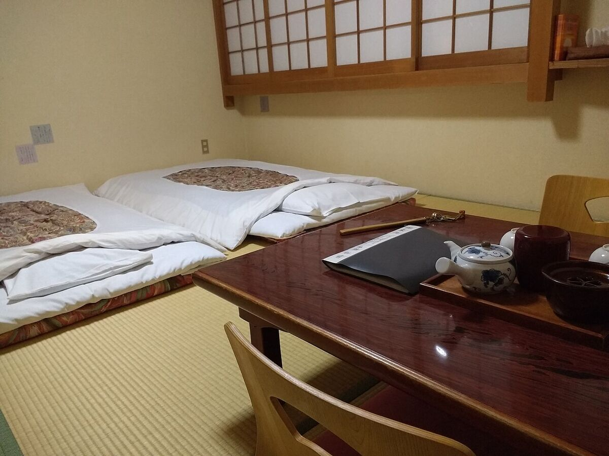
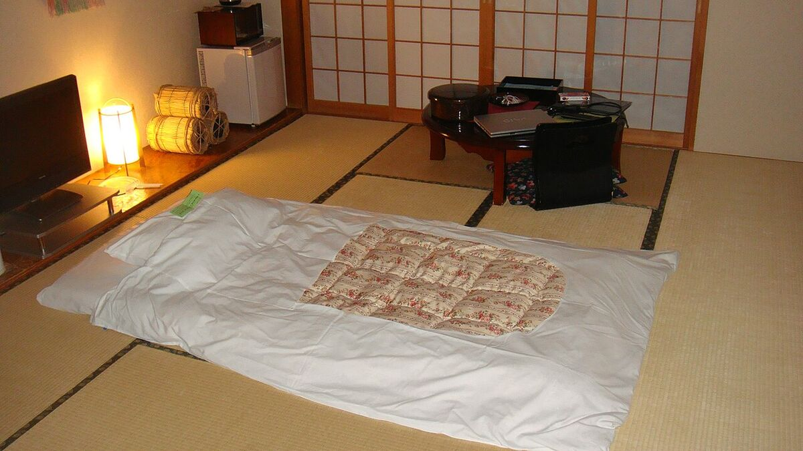

# 8. Staying at a Ryokan

A 旅館 (*ryokan*) is a Japanese-style inn: tatami rooms, futon, a large bath, and usually dinner and breakfast included. This chapter explains what the law means by an inn and how a ryokan stay works, following the Japan Tourism Agency's question-and-answer pages and JNTO's guide.

## 8.1 What the law calls an inn

Japan's **Inns and Hotels Act** (旅館業法, *Ryokangyō-hō*) defines the inn business as **letting people stay for a fee**, where "staying" means using the facility with bedding. It recognises three types (MHLW n.d.-b):

| Type | What it covers |
|---|---|
| 旅館・ホテル営業 (*ryokan-hoteru eigyō*) | ryokan and hotels |
| 簡易宿所営業 (*kan'i shukusho eigyō*) | lodging with shared space, such as guesthouses |
| 下宿営業 (*geshuku eigyō*) | boarding houses, let by the month |

**An inn may not simply refuse you.** It may refuse guests only in specified cases, for example if there is no room, if the guest is likely to act illegally, or in the case of specified infectious diseases. It must keep a **guest register** (MHLW n.d.-b).

## 8.2 What a ryokan offers

JNTO says ryokan **date back to the eighth century**. Most have the same elements (JNTO n.d.-a):

- **tatami** rooms and **futon**;
- **baths**, often an onsen, sometimes private or outdoor;
- **yukata**, a light cotton robe, to wear inside the inn and when walking in its gardens, with *geta* or *zōri*;
- an in-house **kaiseki** dinner and a **Japanese breakfast**, with local, seasonal food, served in a dining hall or in your room.

The staff explain the customs, such as taking off shoes, using the bath and wearing the *yukata* (JNTO n.d.-a).

<figure>

<figcaption>A room at Ryokan Matsumae in Nara, 2018, with the futon laid out. <span class="credit">Image: Mx. Granger, <a href="https://creativecommons.org/publicdomain/zero/1.0/">CC0</a>, via <a href="https://commons.wikimedia.org/wiki/File:Ryokan_Matsumae_in_Nara.jpg">Wikimedia Commons</a>.</span></figcaption>
</figure>

## 8.3 Booking and paying

From the Japan Tourism Agency (JTA n.d.):

- **Per person, not per room.** Rates are often per person, because the inn provides hospitality to each guest: local cooking, the baths. Some charge per room, with a supplement for extra people.
- **Meals included.** The standard plan is **一泊二食** (*ippaku nishoku*, "one night, two meals"): dinner and breakfast. Many ryokan also offer breakfast-only plans and room-only plans, called **素泊まり** (*sudomari*).
- **Children.** Under about three are often free, though meals or bedding may be charged. Some inns charge 50% or 70% of the adult rate for children; from about twelve, children usually pay the full price.
- **Diets and allergies.** Tell the inn **several days in advance** about allergies, or vegetarian, vegan or gluten-free needs. Meals are booked together with the stay.

## 8.4 Arriving

From the Japan Tourism Agency (JTA n.d.):

- **Check-in** is usually from about **15:00 to 16:00**. You can usually leave luggage earlier.
- **Dinner is served at set times.** If you arrive late you may miss it, so **call ahead**. At check-in you are asked when you want dinner and breakfast.
- **Pick-up** from the station is offered by some inns, often only with a reservation.
- **Curfew.** Many ryokan have a 門限 (*mongen*), a time when the doors are locked, for example **midnight**. Some have no curfew, or a front desk or key for late returns.

## 8.5 The room

- **Futon on tatami.** Traditionally, guests sleep on futon laid on the tatami. The Japan Tourism Agency suggests two reasons: rooms were small, and futon fold away; and the climate is humid, and futon are easy to air in the sun. Many ryokan now offer beds in Japanese rooms, combined Japanese-and-Western rooms (和洋室, *wayōshitsu*) or Western rooms (JTA n.d.).
- **Low table and floor chairs** (*zaisu*). Chairs are available on request (JTA n.d.).
- **A shower or unit bath** in most rooms; but the **large bath** (大浴場, *daiyokujō*) is the point (JTA n.d.).

<figure>

<figcaption>A ryokan room in Jōzankei, Hokkaidō, with futon and a low table, 2009. <span class="credit">Image: David McKelvey, <a href="https://creativecommons.org/licenses/by/2.0/">CC BY 2.0</a>, via <a href="https://commons.wikimedia.org/wiki/File:Futon_and_desk_in_a_Ryokan.jpg">Wikimedia Commons</a>.</span></figcaption>
</figure>

## 8.6 The baths

From the Japan Tourism Agency (JTA n.d.):

- **The large bath** needs no reservation. It is often open late at night and early in the morning, except during cleaning. Avoid bathing late at night or after drinking, to prevent accidents.
- **Private baths:** some rooms have their own bath. A ***kashikiri*** (貸切, "reserved") bath can be booked for a time slot.
- **Tattoos:** policies differ greatly from inn to inn (Chapter 10).

## Self-check

```quiz
? What does 一泊二食 mean on a ryokan plan?
- One night with dinner and breakfast *
- Two nights, one meal
- One night, room only
> Room-only is 素泊まり, sudomari (JTA n.d.).

? Why should you call a ryokan if you will arrive late?
- Dinner is served at set times and you may miss it *
- Late arrivals pay a surcharge by law
- The bath closes at 6 p.m.
> At check-in you choose your dinner and breakfast times.

? What is a kashikiri bath?
- A private bath booked for a time slot *
- The men's large bath
- A cold plunge pool
> Reserve it at the front desk (JTA n.d.).

? Under the Inns and Hotels Act, can an inn refuse a guest for any reason?
- No, only in specified cases, such as having no room *
- Yes, freely
- Only foreign guests
> It must also keep a guest register (MHLW n.d.-b).
```

## Sources for this chapter

1. **JNTO n.d.-a.** Japan National Tourism Organization. *Japanese Ryokan Guide*. [japan.travel](https://www.japan.travel/en/guide/japanese-ryokan/).
2. **JTA n.d.** Japan Tourism Agency 観光庁. 旅館Q&A (Ryokan questions and answers), pages 1–6. [mlit.go.jp](https://www.mlit.go.jp/kankocho/ryokan/list_ja-1.html).
3. **MHLW n.d.-b.** Ministry of Health, Labour and Welfare 厚生労働省. Page on the Inns and Hotels Act 旅館業法 (in Japanese). [mhlw.go.jp](https://www.mhlw.go.jp/stf/seisakunitsuite/bunya/0000130600.html).

➡️ Next: [Chapter 9: Bath etiquette](09-etiquette.md)
