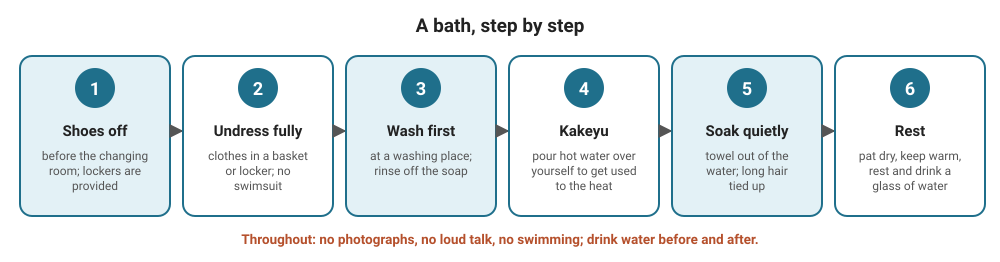
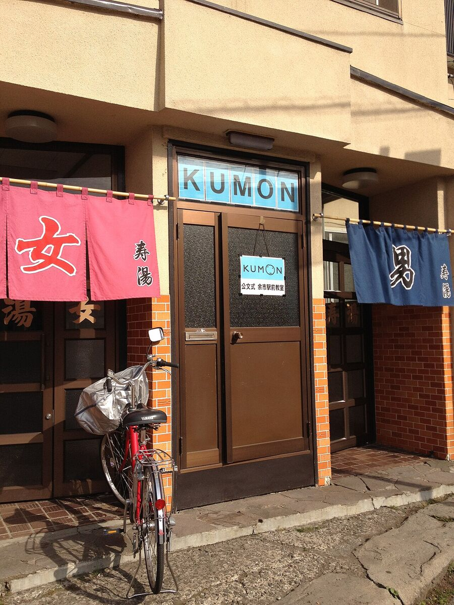

# 9. Bath Etiquette

This chapter goes through a visit in order, following JNTO's onsen guide, the Japan Tourism Agency and the Ministry of the Environment.

<figure class="diagram">

<figcaption>A bath in six steps (JNTO n.d.-b; JTA n.d.; MoE 2014b). <span class="credit">Diagram drawn for this handbook from the sources cited in the chapter.</span></figcaption>
</figure>

## 9.1 At the door

- **Choose the right side.** Changing rooms are **always separated by gender** (JNTO n.d.-b). Look for 男 (men) and 女 (women) on the curtain or sign; Chapter 12 has the full list.
- **Shoes and slippers off** before the changing room. There are lockers (JNTO n.d.-b).
- **Leave your phone outside** (JNTO n.d.-b).

<figure>

<figcaption>Two entrances, each with its curtain (<em>noren</em>): 女 (women) in red and 男 (men) in blue, 2012. <span class="credit">Image: M Murakami from Fukushima, Japan, <a href="https://creativecommons.org/licenses/by-sa/2.0/">CC BY-SA 2.0</a>, via <a href="https://commons.wikimedia.org/wiki/File:%E5%A5%B3%E6%B9%AF_KUMON_%E7%94%B7%E6%B9%AF_%287685078888%29.jpg">Wikimedia Commons</a>.</span></figcaption>
</figure>

## 9.2 In the changing room

- **Undress completely. No swimwear** (JNTO n.d.-b; JTA n.d.).
- **A small towel** may be carried for modesty (JNTO n.d.-b).

## 9.3 Wash first

- **Sit at a washing station**, with a bucket, a stool and a hand shower. Wash your whole body and remove make-up before you enter the bath (JNTO n.d.-b).
- The Japan Tourism Agency puts it simply: wash with the shower before getting in (JTA n.d.).

## 9.4 *Kakeyu*: pour before you soak

**掛け湯** (*kakeyu*) means pouring hot water from the bath over your body with a basin. It lets you get used to the temperature, and avoids a **sudden rise in blood pressure** (JTA n.d.; JNTO n.d.-b).

## 9.5 In the bath

- **The towel stays out of the water.** Fold it and put it on your head or on the edge of the bath (JNTO n.d.-b). The Ministry's official precautions say the same (MoE 2014b).
- **Tie up long hair** (JNTO n.d.-b; JTA n.d.).
- **Speak softly**; no loud talk (JNTO n.d.-b; JTA n.d.).
- **No swimming or splashing** (JNTO n.d.-b).
- **No photographs, ever.** JNTO calls this absolutely forbidden: it protects the privacy of other bathers, especially children (JNTO n.d.-b; JTA n.d.).

## 9.6 Afterwards

- **To rinse or not.** JNTO calls it a matter of preference (JNTO n.d.-b). The Ministry advises not rinsing the spring off, except for people with sensitive skin, after strong springs such as acidic or sulphur springs, and after chlorinated water (MoE 2014b).
- **Pat yourself dry, keep warm and rest** for about 30 minutes, and **drink a glass of water** (MoE 2014b). JNTO also suggests cool water (JNTO n.d.-b).
- **Avoid alcohol before bathing** (JNTO n.d.-b; MoE 2014b).

## 9.7 Day visits

You do not have to stay overnight. Many onsen towns, such as Kusatsu, have **day-use baths** (JNTO n.d.-b), and some communal baths are free (Chapter 7).

## Self-check

```quiz
? What must you do before getting into the bath?
- Wash your whole body at a washing station *
- Put on a swimsuit
- Soak your towel in the bath
> Remove make-up too (JNTO n.d.-b; JTA n.d.).

? Why pour hot water over yourself (kakeyu) first?
- To get used to the temperature and avoid a sudden rise in blood pressure *
- To pay the attendant
- To cool the bath down
> JTA n.d.; JNTO n.d.-b.

? Where should your small towel go while you soak?
- On your head or the edge of the bath, not in the water *
- In the water, around your body
- Over the hand shower
> Towels must not go into the water.

? May you take photographs in the bath if nobody else is there?
- No; photographs are forbidden *
- Yes, if it is empty
- Only with a phone
> Leave your phone outside the changing room.
```

## Sources for this chapter

1. **JNTO n.d.-b.** Japan National Tourism Organization. *How to Best Enjoy Japan's Onsen*. [japan.travel](https://www.japan.travel/en/guide/bathing-manners-and-tips-onsen-bathing-guide/).
2. **JTA n.d.** See [Chapter 8](08-ryokan.md).
3. **MoE 2014b.** See [Chapter 3](03-label.md).

➡️ Next: [Chapter 10: Tattoos](10-tattoos.md)
