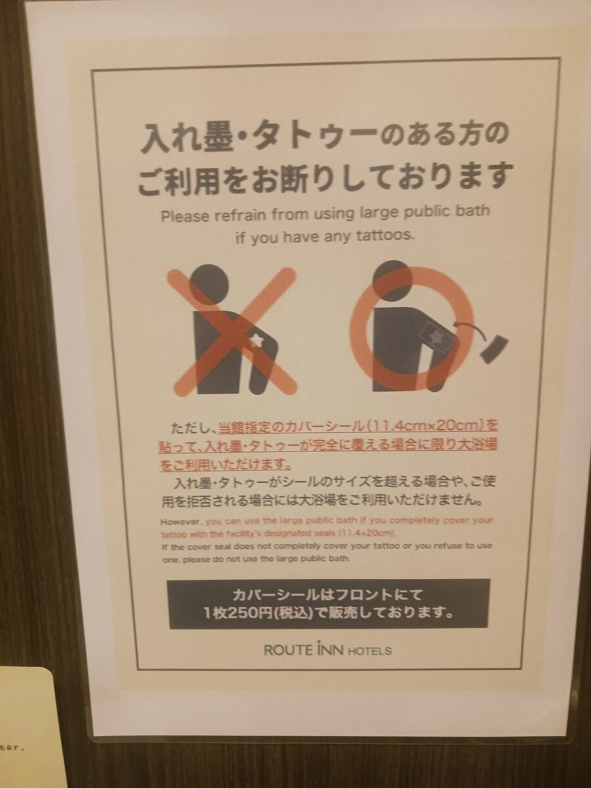

# 10. Tattoos

Many Japanese baths turn away people with tattoos. This chapter sets out what is known about the practice: what a government survey found, what the government has said in answer to Diet questions, and what options exist for tattooed bathers.

## 10.1 Why baths refuse tattoos

The Japan Tourism Agency's ryokan pages explain the background. Tattoos have historically been refused because they **evoke anti-social organisations**. Practice now **varies greatly**: some ryokan have no restriction, some decide case by case (a single small tattoo may be accepted), and some offer private or in-room baths instead (JTA n.d.).

## 10.2 What a national survey found

In 2015, the Japan Tourism Agency surveyed hotels and ryokan with onsen about tattooed bathers. The travel-industry news site *Travel Voice* reported the results (Travel Voice 2015):

- **The survey** went to **3,768** facilities, mainly hotels and ryokan; **581** replied. It was prompted by earlier cases involving tattooed foreign tourists.
- **Policies:** about **56%** refused tattooed bathers; about **31%** did not; about **13%** admitted them on conditions, such as covering the tattoo with stickers.
- **Reasons for refusing:** the facility's own judgement, on grounds of public morals or hygiene, about **59%**; an agreement within the industry or the area, about **13%**; a request from the police or local government, about **9%**.
- **Experience:** **78.3%** reported no trouble from tattooed bathers. Asked about complaints from other guests, **47.2%** had had some and **51.8%** had not.

## 10.3 What the government has said

Two Cabinet answers to written questions in the House of Representatives set out the official position:

- **It is up to each bath.** The Japan Tourism Agency published examples of how onsen facilities could avoid friction caused by cultural differences over tattoos. These are examples, not rules for every case: **handling is ultimately up to each facility's manager** (Cabinet 2016).
- **A tattoo is not a health matter.** The Public Bath Act lets an operator refuse a person with a contagious disease (Article 4), and forbids acts that make the bath unclean or harm public hygiene (Article 5). The Cabinet stated that **having a tattoo alone** cannot be construed as either (Cabinet 2017).

## 10.4 Your options

The Agency's examples, as listed in the 2016 Diet question, are three (Cabinet 2016):

1. **Cover it.** Use a sticker or cover sheet; bathing wear may also be considered. A small tattoo, for example the size of a palm, that does not intimidate others may need no special measure.
2. **Bathe at quiet times.** Go when families and children are unlikely to be bathing.
3. **Bathe privately.** Use a private bath nearby, a reserved (*kashikiri*) bath, or a room with its own bath.

JNTO also mentions cover sheets for very small tattoos, and private baths (JNTO n.d.-b). **Ask before you book**: policies differ from inn to inn (JTA n.d.).

<figure>

<figcaption>A hotel notice in Kōka, Shiga, 2025: 入れ墨・タトゥーのある方のご利用をお断りしております ("we decline use by people with tattoos"). The small print allows the large bath if the tattoo is completely covered by the hotel's own cover seal, 11.4 × 20 cm, sold at the front desk for 250 yen. <span class="credit">Image: Saimmx, <a href="https://creativecommons.org/publicdomain/zero/1.0/">CC0</a>, via <a href="https://commons.wikimedia.org/wiki/File:20251018_185138_%22no_tattoos%22_sign_in_onsen.jpg">Wikimedia Commons</a>.</span></figcaption>
</figure>

## Self-check

```quiz
? In the 2015 survey, about what share of facilities refused tattooed bathers?
- About 56% *
- About 13%
- All of them
> About 31% did not refuse and about 13% admitted them on conditions (Travel Voice 2015).

? Who decides whether a bath admits tattooed bathers?
- Each facility's manager *
- The national police
- The Hot Springs Act
> The government's examples are not binding rules (Cabinet 2016).

? Does the Public Bath Act allow refusing someone because of a tattoo as a hygiene risk?
- No; the government said a tattoo alone is not a contagious disease or an unhygienic act *
- Yes, tattoos are banned by the Act
- Only for foreign visitors
> Cabinet answer of February 2017.

? Which is one of the three options suggested in the government's examples?
- Using a reserved private bath *
- Bathing in a T-shirt
- Paying a surcharge
> The others are covering the tattoo and bathing at quiet times.
```

## Sources for this chapter

1. **Cabinet 2016.** Cabinet of Japan. Answer No. 298 to a written question, House of Representatives, 190th Diet, 2 June 2016 (in Japanese). [shugiin.go.jp](https://www.shugiin.go.jp/internet/itdb_shitsumon.nsf/html/shitsumon/b190298.htm).
2. **Cabinet 2017.** Cabinet of Japan. Answer No. 69 to a written question, House of Representatives, 193rd Diet, 21 February 2017 (in Japanese). [shugiin.go.jp](https://www.shugiin.go.jp/Internet/itdb_shitsumon.nsf/html/shitsumon/b193069.htm).
3. **JNTO n.d.-b.** See [Chapter 9](09-etiquette.md).
4. **JTA n.d.** See [Chapter 8](08-ryokan.md).
5. **Travel Voice 2015.** Report on the Japan Tourism Agency's survey of onsen facilities about tattooed bathers (in Japanese). *Travel Voice*, 22 October 2015. [travelvoice.jp](https://www.travelvoice.jp/20151022-53183).

➡️ Next: [Chapter 11: Bathing safely](11-health.md)
