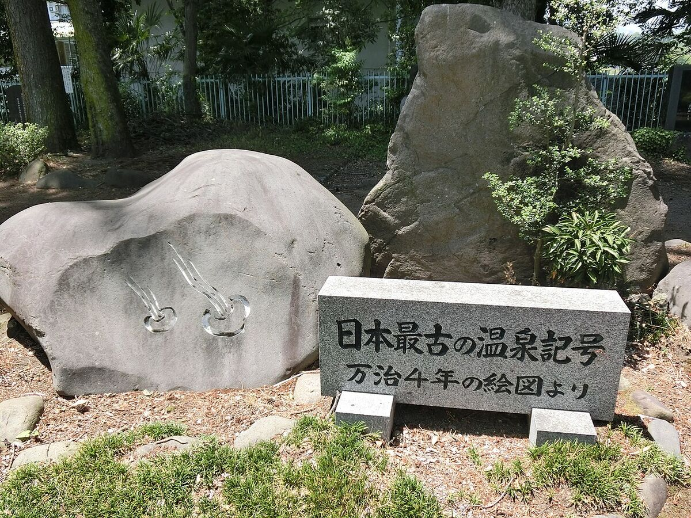

# 12. Bath Japanese

You can enjoy a Japanese bath without speaking a word. But reading a few characters keeps you out of the wrong changing room, and a few phrases answer the questions you will have at the front desk. Tap any Japanese word to hear it.

## 12.1 At the door

| Japanese | Reading | Meaning |
|---|---|---|
| 男湯 | *otokoyu* | men's bath |
| 女湯 | *onnayu* | women's bath |
| 男 | *otoko* | man, men |
| 女 | *onna* | woman, women |
| ゆ | *yu* | hot water; on a curtain, "bath here" |
| 湯 | *yu* | hot water, bath |
| 殿方 | *tonogata* | gentlemen |
| 婦人 | *fujin* | ladies |
| 入浴料 | *nyūyokuryō* | bathing fee |
| 入浴券 | *nyūyokuken* | bath ticket |
| 営業中 | *eigyōchū* | open |
| 準備中 | *junbichū* | closed (preparing) |
| 定休日 | *teikyūbi* | regular closing day |

**Learn 男 and 女 first.** Chapter 9 shows a pair of curtains marked with them.

<figure>

<figcaption>A monument marking the "birthplace of the onsen mark" ♨. Its tablet reads 日本最古の温泉記号 万治四年の絵図より: "Japan's oldest onsen symbol, from a map of Manji 4 (1661)". Photographed in 2015. <span class="credit">Image: Abasaa, Public domain, via <a href="https://commons.wikimedia.org/wiki/File:Birthplace_of_Onsen_Mark_monument.JPG">Wikimedia Commons</a>.</span></figcaption>
</figure>

## 12.2 Kinds of bath

| Japanese | Reading | Meaning |
|---|---|---|
| 温泉 | *onsen* | hot spring, hot-spring resort (Chapter 1) |
| 銭湯 | *sentō* | public bathhouse (Chapter 6) |
| 風呂 | *furo* | bath |
| お風呂 | *ofuro* | bath (polite) |
| 大浴場 | *daiyokujō* | large shared bath |
| 露天風呂 | *rotenburo* | open-air bath |
| 内湯 | *uchiyu* | indoor bath |
| 貸切風呂 | *kashikiriburo* | private bath, booked for a time |
| 足湯 | *ashiyu* | footbath |
| サウナ | *sauna* | sauna |
| 水風呂 | *mizuburo* | cold plunge bath |

## 12.3 On the analysis sheet

| Japanese | Reading | Meaning |
|---|---|---|
| 泉質 | *sensitsu* | spring type (Chapter 3) |
| 源泉 | *gensen* | source, spring |
| 単純温泉 | *tanjun onsen* | simple spring |
| 硫黄泉 | *iōsen* | sulphur spring |
| 酸性泉 | *sanseisen* | acidic spring |
| 加水 | *kasui* | water added |
| 加温 | *kaon* | heated |
| 循環 | *junkan* | recirculated |
| 消毒 | *shōdoku* | disinfected |
| 禁忌症 | *kinkishō* | contraindications (Chapter 11) |
| 湯あたり | *yuatari* | bath sickness (Chapter 11) |

## 12.4 Things you will need

| Japanese | Reading | Meaning |
|---|---|---|
| タオル | *taoru* | towel |
| バスタオル | *basutaoru* | bath towel |
| 石鹸 | *sekken* | soap |
| シャンプー | *shanpū* | shampoo |
| 脱衣所 | *datsuisho* | changing room |
| ロッカー | *rokkā* | locker |
| 浴衣 | *yukata* | cotton robe (Chapter 8) |
| かけ湯 | *kakeyu* | pouring water over yourself before the bath (Chapter 9) |

## 12.5 Signs about rules

| Japanese | Reading | Meaning |
|---|---|---|
| 撮影禁止 | *satsuei kinshi* | no photography |
| 入れ墨 | *irezumi* | tattoo |
| タトゥー | *tatū* | tattoo |
| お断り | *okotowari* | not allowed, we decline |
| タオルを湯船に入れないでください | *taoru o yubune ni irenaide kudasai* | please do not put towels in the bath |

The tattoo notice in Chapter 10 reads 入れ墨・タトゥーのある方のご利用をお断りしております: "we decline use by people with tattoos".

## 12.6 Phrases for the front desk

| Japanese | Reading | Meaning |
|---|---|---|
| 日帰り入浴はできますか | *higaeri nyūyoku wa dekimasu ka* | Can I bathe without staying overnight? |
| 一人いくらですか | *hitori ikura desu ka* | How much per person? |
| タオルはありますか | *taoru wa arimasu ka* | Do you have towels? |
| 何時まで入れますか | *nanji made hairemasu ka* | Until what time can I bathe? |
| 貸切風呂はありますか | *kashikiriburo wa arimasu ka* | Do you have a private bath? |
| タトゥーがありますが、入れますか | *tatū ga arimasu ga, hairemasu ka* | I have a tattoo. Can I go in? |
| カバーシールはありますか | *kabā shīru wa arimasu ka* | Do you have cover stickers? |
| 気分が悪いです | *kibun ga warui desu* | I feel unwell. |

## Self-check

```quiz
? Which character marks the women's side?
- 女 *
- 男
- 湯
> 女湯 (onnayu) is the women's bath; 男湯 (otokoyu) the men's.

? What is a 露天風呂?
- An open-air bath *
- A footbath
- A cold plunge bath
> 足湯 is a footbath and 水風呂 a cold bath.

? A sign reads 撮影禁止. What does it mean?
- No photography *
- No tattoos
- Closed today
> Photographs are never allowed in a bath (Chapter 9).

? How do you ask whether you can bathe without staying overnight?
- 日帰り入浴はできますか *
- 一人いくらですか
- 気分が悪いです
> 日帰り (higaeri) means a day trip.
```

## Sources for this chapter

This chapter is a vocabulary list. Facts about the places and rules it mentions are cited in the chapters it links to. The sign text quoted is from the photographs in this handbook.

1. **JNTO n.d.-b.** See [Chapter 9](09-etiquette.md).

➡️ Next: [Glossary](13-glossary.md)
