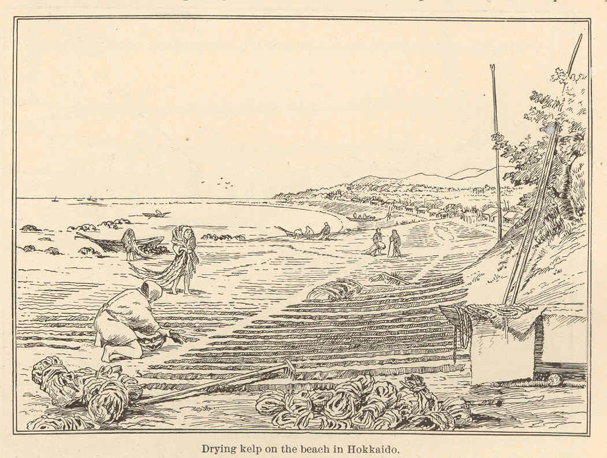
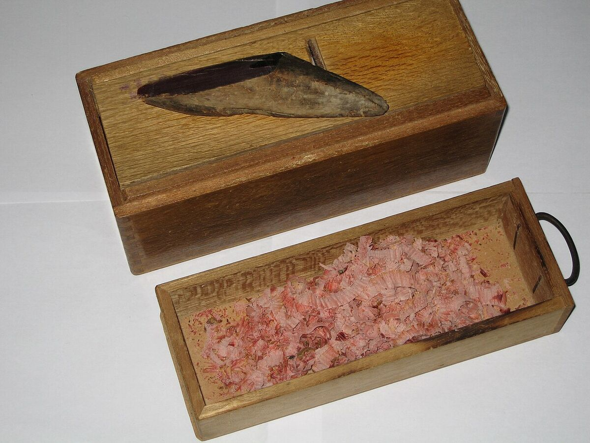
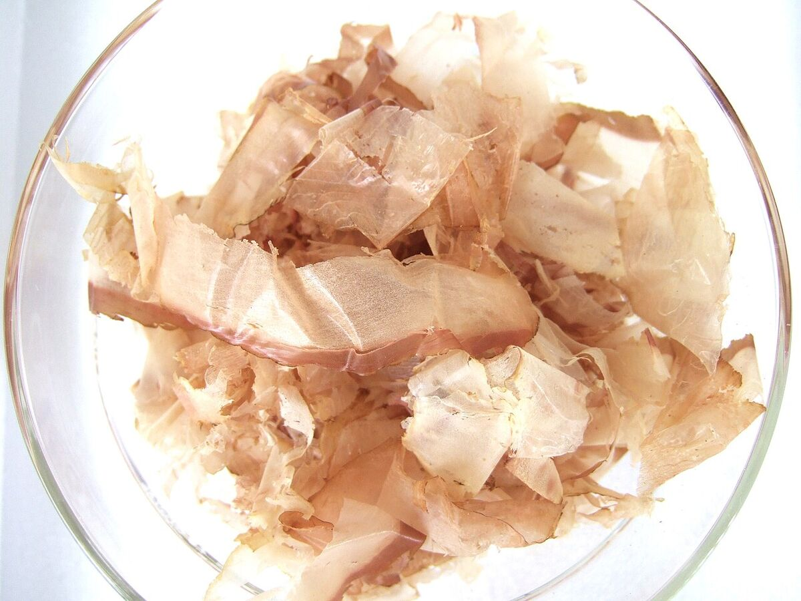

# 2. Dashi: Extraction as a Discipline

*Dashi* is the stock behind miso soup, simmered dishes, noodle broths and many sauces. It differs from a Western stock in the way it is made. The Umami Information Center contrasts the two: a European bouillon is made by boiling ingredients for a long time, whereas dashi uses ingredients that have already been carefully prepared and matured, and extracts them only by soaking or brief heating (Umami Information Center, *What is Dashi?*). The flavour is made in advance, by drying, smoking and moulding. The cook's job is to extract what is wanted and leave the rest behind.

This chapter covers the three classic dashi ingredients, how each is made, and what research says about extracting them.

<figure>

<figcaption>Drying kelp on the beach in Hokkaido, from a 1905 US Bureau of Fisheries report on Japan's seaweed industries. Kombu is still dried in the open after harvest (§2.2). <span class="credit">Illustration: Hugh M. Smith, <em>Seaweed Industries of Japan</em>, Bulletin of the Bureau of Fisheries vol. 24 (1905), Public domain, via <a href="https://commons.wikimedia.org/wiki/File:FMIB_41735_Drying_kelp_on_the_beach_in_Hokkaido.jpeg">Wikimedia Commons</a>.</span></figcaption>
</figure>

## 2.1 A short history

According to the Umami Information Center, boiling food in water goes back to the Jōmon period (about 13,000–300 BCE), with stocks of shellfish and fish bones. Dashi from kombu and katsuobushi existed in some form by the seventh century (Umami Information Center, *What is Dashi?*). Kombu reached Kyoto from Hokkaido in the Heian period, as Buddhist vegetarian temple cooking (*shōjin ryōri*) spread (Umami Information Center, *Kombu*). Katsuobushi in its present form is described as a tradition of about 400 years (Umami Information Center, *Katsuobushi*).

## 2.2 Kombu: the glutamate source

### What it is and how it is harvested

Kombu is a brown alga harvested mainly off Hokkaido and the Tōhoku coast. The Umami Information Center describes the traditional harvest as follows (Umami Information Center, *Kombu*):

- The plant grows for **two years** before harvest.
- Harvest runs from **July to September**, on dates fixed each year. The kelp grows at depths of about **5–8 m**. Harvesters work from boats and use long poles with hooks to detach it at the root.
- The fronds are dried on stony beaches, taking **4–5 hours** on a summer day, and are then shaped.
- Some kombu is matured in storage, a practice called ***kuragakoi*** ("cellar keeping"). This is said to improve the flavour and remove the seaweed odour.

### Varieties

The same source distinguishes the main dashi kombu (Umami Information Center, *Kombu*):

| Variety | Characteristics given by the source |
|---|---|
| **Ma-kombu** (also *yamadashi*) | Light brown, wedge-shaped fronds. Gives a delicate-coloured, relatively clear dashi with a premium sweetness. |
| **Rishiri-kombu** | Often considered the best for dashi. |
| **Rausu-kombu** | Wide, thin fronds. Its flavour is drawn out easily. |
| **Hidaka-kombu** | Dark and soft. Used mainly for simmering and eating rather than for stock. |

The professional *ichiban dashi* recipe in §2.5 uses ma-kombu for its clarity and sweetness (Umami Information Center, *What is Dashi?*).

### What kombu releases into water

Kombu has the highest glutamate content of the foods in Kurihara's table: 1,200–3,400 mg per 100 g (Kurihara 2015). The Umami Information Center describes it as having the highest natural level of glutamate of any foodstuff (*What is Dashi?*). Kurihara gives a reference method of soaking kombu in water at 60 °C for an hour. The resulting stock contains only glutamate and aspartate as its umami-tasting components, which makes it, in his words, a "pure umami solution" (Kurihara 2015).

Analysis of Rishiri-kombu stock by Koda and Matsumoto adds detail. The main free amino acids extracted were **glutamic acid, aspartic acid and alanine**, and the main nucleotides were **AMP and GMP**. They compared three temperature regimes: steady 10 °C, heating from 10 to 100 °C, and steady 100 °C. They also compared extraction times from 2.5 to 30 minutes. Taster preference depended on the dish. A dilute-umami stock was preferred for seasoning sushi rice. Strongly umami kombu was preferred for *shio-kombu* (salted simmered kombu) (Koda and Matsumoto).

### How long, how hot: the extraction trade-off

Sato and colleagues extracted kombu under several conditions:

- a cold soak at 10 °C for 120 minutes;
- a 20-minute soak at 10 °C followed by 4 minutes of heating;
- heating alone for 4, 9, 30, 60 and 120 minutes.

They then measured what reached the stock (Sato et al. 2008):

- About **90%** of the kombu's free amino acids passed into the stock. Their amount rose with longer soaking or heating, "particularly by soaking time".
- **40–70%** of the kombu's total **arsenic** also passed into the stock. Most of it was in organic forms (arsenosugars), which the authors describe as non-toxic or less toxic than inorganic arsenic.
- Both soaking and boiling increased arsenic extraction, but **boiling had a much larger effect**. Arsenic was released by a different mechanism from the amino acids.

> **Technique consequence.** Long, cool soaking extracts amino acids efficiently while limiting the extra release that boiling causes. This is consistent with the professional instruction in §2.5 to take the kombu out before the water boils. The arsenic data come from one study, and the authors stress that the arsenic is mostly in organic forms, so they are no reason for alarm. They do explain why kombu is not boiled for long.

The Rishiri-kombu sensory study tells the cook where to stop. At a ratio of **4 g kombu to 100 g water**, stocks with about **30 mg%** glutamate were rated tasty, below 10 mg% poor in savour, and above 50 mg% unpleasantly strong (Matsumoto et al. 1989). Extraction is a matter of hitting a target, not of getting the most out of the kelp.

For a first experiment, the Umami Information Center suggests leaving a piece of kombu in a cup of water for about **20 minutes** and tasting the result (*Kombu*).

## 2.3 Katsuobushi: the inosinate source

Katsuobushi is skipjack tuna (*katsuo*) that has been filleted, simmered, smoked and, in its highest grade, deliberately moulded, until it is one of the hardest foodstuffs known. The Umami Information Center calls it "the hardest food in the world". Its protein content rises from about **25%** in raw bonito to about **77%** in the finished product (Umami Information Center, *Katsuobushi*).

<figure>

<figcaption>A block of katsuobushi on a traditional shaving box (<em>kezuri-ki</em>). Shavings collect in the drawer below (§2.3). <span class="credit">Photo: サフィル, <a href="https://creativecommons.org/licenses/by-sa/4.0/">CC BY-SA 4.0</a>, via <a href="https://commons.wikimedia.org/wiki/File:JapaneseKatsuobushi.jpg">Wikimedia Commons</a>.</span></figcaption>
</figure>

### Step by step

The two sources below describe the same process from different angles. One is an industry educational page; the other is a research report on the moulding stage.

**1. Filleting.** The fish is cut into three pieces. Small fish yield ***kame-bushi*** (one fillet per side). From large fish, each side is split again into a belly piece (***mebushi***) and a back piece (***obushi***). Together these are called ***honbushi*** (Umami Information Center, *Katsuobushi*).

**2. Simmering (*shajuku*).** The fillets are arranged in woven trays and simmered. The Umami Information Center gives **60–90 minutes** and describes the step as "sealing in the inosinate". Afterwards, skin and bones are removed, and the result is called ***namaribushi*** (*Katsuobushi*). Takenaka's process chart gives boiling at **85 °C for 70–90 minutes** (Takenaka, IFO report, after Dimichi and Wada 1994).

**3. Smoke-drying (*baikan*).** After the first round of smoking, cracks are filled with a paste made from the fish's head and leftover flesh (*nakaochi*). The sources describe the number of rounds differently. The Umami Information Center says "over a dozen more rounds" (*Katsuobushi*). Takenaka's chart gives smoking at **80–90 °C for 5–6 hours, repeated 8–10 times over 10 days** (Takenaka). The product at this stage is ***arabushi***.

**4. Moulding (*kabitsuke*).** Arabushi is trimmed and scraped, then moulded:

- Takenaka's chart: the fish is incubated in a fermentation room, sun-dried, and the mould scraped off, usually **2–4 times**. Traditionally this is done **four times over six months**. In the first two stages the room is kept at **27 °C and 85–88% relative humidity**. In the third and fourth it is kept at **27 °C and 50–60%** (Takenaka).
- Umami Information Center: each mould growth lasts about **two weeks**. The fish is then sun-dried and dusted, and the cycle is repeated for about **four months** (*Katsuobushi*).
- Fully moulded katsuobushi is ***karebushi***, the highest grade ***honkarebushi***.

Both sources agree on the sequence. They differ on the number of rounds and the total duration, which plausibly vary by maker.

### What the mould does

The mould has long been described as *Aspergillus glaucus* and its relatives. Takenaka's study of the mould population identified **five xerophilic** (dryness-loving) species: *A. amstelodami*, *A. chevalieri*, *A. pseudoglaucus*, *A. ruber* and *A. sydowii* (Takenaka). Takenaka lists the results of moulding as fat breakdown, aroma, colour change, a mellow flavour and a refined colour. The Umami Information Center explains the mechanism: the mould draws moisture out from deep inside the fish and breaks down triglycerides (fats). This gives the stock its clarity, because less fat ends up in the dashi (*Katsuobushi*).

The Umami Information Center also states that smoke-drying and moulding raise the inosinate content above that of fresh bonito (*Katsuobushi*). Kurihara gives 470–800 mg IMP per 100 g for dried bonito (Kurihara 2015).

### Back, belly and dark meat

According to the Umami Information Center (*Katsuobushi*, *What is Dashi?*):

- **Obushi** (back) gives a refined, low-fat stock. **Mebushi** (belly) gives a richer one.
- For the finest ichiban dashi, the dark muscle (***chiai***) is removed before shaving.
- Some high-end restaurants use *magurobushi* (dried bluefin tuna) instead of katsuobushi. Stock made from arabushi is popular in the Kansai region.

### Why it is shaved so thin

Katsuobushi is shaved into paper-thin flakes. The Umami Information Center gives the reason. Thin shavings have a very large surface area, so the water-soluble inosinate dissolves in seconds. Because contact is so short, the less soluble amino acids, which would add a heavy taste and cloud the stock, stay behind (*Katsuobushi*). The shaving is itself an extraction technique: it selects what dissolves.

<figure>

<figcaption>Shaved katsuobushi. The paper-thin flakes give the large surface area that lets inosinate dissolve in seconds (§2.3). <span class="credit">Photo: Sakurai Midori, <a href="https://creativecommons.org/licenses/by-sa/3.0/">CC BY-SA 3.0</a>, via <a href="https://commons.wikimedia.org/wiki/File:Katsuobushi_02.jpg">Wikimedia Commons</a>.</span></figcaption>
</figure>

## 2.4 Dried shiitake and other stocks

- **Dried shiitake** is sun-dried to intensify its taste and supplies guanylate (Umami Information Center, *What is Dashi?*). Kurihara's enzyme rules from Chapter 1 apply: soak cold, then heat quickly to 60–70 °C (Kurihara 2015).
- **Niboshi** are small sardines or anchovies, cooked in water and then sun-dried. They give a strong, slightly bitter stock, well suited to miso soup and hotpots (*What is Dashi?*). Kurihara gives 350–800 mg IMP per 100 g for dried sardine (Kurihara 2015).
- **Shōjin dashi**, the stock of Buddhist temple cooking, uses no animal products. It is made from kombu, dried shiitake, soybeans, dried gourd strips (*kanpyō*) and vegetable skins. The Umami Information Center warns that shiitake's strong flavour can unbalance it (*What is Dashi?*). Chemically, this is the vegetable version of the synergy in Chapter 1: kombu's glutamate paired with shiitake's guanylate instead of fish inosinate.

## 2.5 Ichiban and niban dashi: the professional method

The Umami Information Center publishes a professional *ichiban dashi* ("first stock") method. It is reproduced here as a **worked example of the principles**, not as a recipe to memorise (*What is Dashi?*):

| Ingredient | Quantity |
|---|---|
| Soft water | 3 L, plus 100 mL kept aside |
| Ma-kombu | 20 g |
| Honkarebushi, dark meat (*chiai*) removed, freshly shaved | 80 g |

1. **Soak** the kombu in the water: about **1.5 hours in winter**, **20–30 minutes in summer**. Cold water extracts the amino acids gently. The time compensates for the water temperature.
2. **Heat** until just before boiling. **Remove the kombu** when small bubbles appear. The source warns that kombu left in too long will spoil and taint the dashi. Sato's arsenic and amino-acid results (§2.2) are consistent with this.
3. **Add the reserved 100 mL** of water to bring the temperature just below 100 °C.
4. **Turn off the heat** and add all the katsuobushi at once.
5. When the flakes **sink**, skim, and **strain immediately** through a cotton cloth. Short contact selects inosinate and aroma and leaves the less soluble components behind (§2.3).

Note the ratio: four times as much katsuobushi as kombu by weight. Kombu holds roughly 1,200–3,400 mg glutamate per 100 g and katsuobushi 470–800 mg IMP per 100 g (Kurihara 2015). This weighting is consistent with the Kyoto measurements, which found **roughly equal** glutamate and inosinate in ichiban dashi, the ratio at which synergy is strongest (*What is Dashi?*).

> **The sources disagree on the temperature for adding katsuobushi.** The Umami Information Center's dashi page has the flakes added *off the heat, just below 100 °C* (*What is Dashi?*). Its katsuobushi page says a large amount is added to kombu stock "when it comes to a boil", for only a few minutes (*Katsuobushi*). Takenaka's process chart concerns making katsuobushi, not dashi, so it does not settle the point. What all versions share is **brief contact at near-boiling temperature**. The one-minute difference between them matters less than not simmering the flakes.

***Niban dashi*** ("second stock") reuses the spent kombu and katsuobushi. About half the water of the first stock is added and simmered slowly. The result has a steady umami and is used for simmered dishes and miso soup rather than clear soups (*What is Dashi?*).

## 2.6 What to take from this chapter

- **The flavour is made before the pot.** Two years of growth, drying and cellaring for kombu; filleting, simmering, about ten rounds of smoking and months of moulding for katsuobushi. Extraction only has to draw that flavour out.
- **Temperature and time choose what you extract.** Cool soaking favours kombu's amino acids. Boiling extracts more of what you do not want. Thin shavings and short contact select inosinate.
- **The target is a concentration, not a maximum.** About 30 mg% glutamate was preferred in a kombu-only stock (Matsumoto et al. 1989). The weights in the professional recipe aim for roughly equal glutamate and inosinate.

## 2.7 Check yourself

```quiz
title: Chapter 2 self-check
? In the professional ichiban dashi method, when is the kombu removed?
- Just before the water boils, when small bubbles appear *
- After 10 minutes of boiling
- After the katsuobushi has sunk
> Kombu left too long spoils the stock (Umami Information Center). Boiling also sharply increases arsenic extraction (Sato et al. 2008).

? Sato and colleagues compared soaking and boiling kombu. What raised the arsenic in the stock far more?
- Boiling *
- Long cold soaking
- Neither: arsenic did not dissolve
> 40–70% of kombu's arsenic dissolved under their conditions, mostly in organic forms, and boiling had a much larger effect than soaking.

? Why is katsuobushi shaved paper-thin?
- To dissolve inosinate fast while the less soluble amino acids stay behind *
- To make it dissolve completely in the stock
- Because mould grows only on the surface
> The large surface area gives a quick, selective extraction that keeps the stock clear (Umami Information Center).

? What does moulding (kabitsuke) do to katsuobushi, according to the sources?
- It breaks down fat and draws out moisture, giving aroma and a clearer stock *
- It adds glutamate
- It makes the fish soft enough to shave
> Takenaka lists fat breakdown, aroma and colour change. The UIC adds moisture removal and stock clarity.

? In a Rishiri-kombu stock (4 g per 100 g water), which glutamate level did tasters prefer?
- About 30 mg% *
- Over 50 mg%
- Below 10 mg%
> Over 50 mg% was too strong and below 10 mg% poor in savour (Matsumoto et al. 1989).

? A vegetarian shōjin dashi pairs kombu with dried shiitake. Which umami pair does that create?
- Glutamate with guanylate *
- Glutamate with inosinate
- Inosinate with guanylate
> Inosinate is found only in animal foods, so shiitake's guanylate takes its place.
```

## Sources for this chapter

1. **Kurihara 2015.** Kurihara K. Umami the fifth basic taste: history of studies on receptor mechanisms and role as a food flavor. *BioMed Research International* 2015;2015:189402. doi:[10.1155/2015/189402](https://doi.org/10.1155/2015/189402). [PMC4515277](https://pmc.ncbi.nlm.nih.gov/articles/PMC4515277/).
2. **Sato et al. 2008.** Sato K, Makita H, Murakami K, Ebizuka H, Arita M, Hanaoka K, Nagao K. The dynamic state of arsenic and amino acids of kombu extract prepared under various extraction conditions. *Journal of Cookery Science of Japan* 2008;41(4):234–240. [J-STAGE PDF](https://www.jstage.jst.go.jp/article/cookeryscience1995/41/4/41_234/_pdf). Cited from the English abstract.
3. **Matsumoto et al. 1989.** Matsumoto N, Kato N, Koda M, Sugahara T. Relation of preference with contents of extraction of Rishiri-konbu. *Journal of Home Economics of Japan* 1989;40(10):883 ff. [J-STAGE PDF](https://www.jstage.jst.go.jp/article/jhej1987/40/10/40_10_883/_pdf). Cited from the English abstract and figure captions.
4. **Koda and Matsumoto.** Koda M, Matsumoto N. Relationship between cooking aptitude of Rishiri-konbu and its extractive conditions. *Journal of Cookery Science* 23(3):302 ff. [J-STAGE PDF](https://www.jstage.jst.go.jp/article/cookeryscience1968/23/3/23_302/_pdf). Cited from the English abstract and captions.
5. **Takenaka.** Takenaka S. Classification and mycobiota analysis of xerophilic fungi in the katsuobushi moulding process (in Japanese). Research report, Graduate School of Agricultural Science, Kobe University, for the Institute for Fermentation, Osaka. [ifo.or.jp PDF](https://www.ifo.or.jp/rc_pdf/14-takenaka.pdf). Its process chart is adapted from Dimichi and Wada 1994.
6. **Umami Information Center, *What is Dashi?*** [umamiinfo.com](https://www.umamiinfo.com/japaneseumami/whatisdashi/), accessed 17 November 2026.
7. **Umami Information Center, *Kombu*.** [umamiinfo.com](https://www.umamiinfo.com/richfood/foodstuff/kelp.html), accessed 17 November 2026.
8. **Umami Information Center, *Katsuobushi*.** [umamiinfo.com](https://www.umamiinfo.com/richfood/foodstuff/katsuobushi.html), accessed 17 November 2026.

➡️ Next: [Chapter 3: Kōji](03-koji.md)
