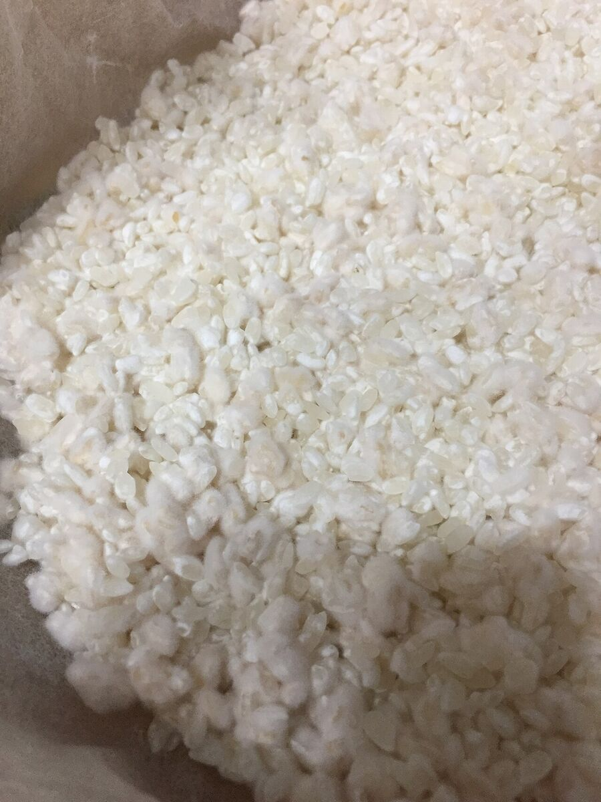

# 3. Kōji: The Mould Behind the Seasonings

Soy sauce, miso, mirin, sake, rice vinegar, *amazake* and *shio-kōji* all start the same way: a cooked grain or bean is covered in the mould *Aspergillus* and left to grow on it. The result, ***kōji***, is the shared engine of Japanese seasoning. Chapter 1 showed that umami needs *free* glutamate and that protein-bound glutamate is tasteless. Kōji is the tool that frees it, and that also turns starch into sugar. This chapter explains what kōji is, how it is grown, and how the grower's choices of temperature, moisture and time decide which enzymes it makes, and so how the finished seasoning tastes.

<figure>

<figcaption>Rice kōji: steamed rice grown over with <em>Aspergillus oryzae</em>. The white bloom is the mould's mycelium. <span class="credit">Photo: Zenyrgarden, <a href="https://creativecommons.org/licenses/by-sa/4.0/">CC BY-SA 4.0</a>, via <a href="https://commons.wikimedia.org/wiki/File:Koji_Mold_Rice.jpg">Wikimedia Commons</a>.</span></figcaption>
</figure>

## 3.1 One word, two meanings

Machida and colleagues point out that the word *kōji* means both the **material** (grain fermented by the mould in solid form) and the **microorganism** itself, the kōji mould *Aspergillus oryzae* (Machida et al. 2008). The double meaning goes back to a time when people made kōji without knowing it was the work of a microorganism.

Some historical markers from the same review (Machida et al. 2008):

- Growing mould on solid grain, called **solid-state cultivation**, is thought to have originated in China 3,000–2,000 years ago, and to have been brought to Japan during the **Yayoi period** (10th century BCE to 3rd century CE).
- Mould starters (spores) were sold commercially from the **13th–15th centuries**.
- Spores were kept alive and free of contamination by storing them in paper bags layered with **ash from burned hardwood leaves**. It is now known that the ash makes the conditions **alkaline**, which keeps other microorganisms out. Spore starter for sake brewers is called ***moyashi***.

## 3.2 Which moulds

Yamashita's review lists the main species and their jobs (Yamashita 2021):

| Species | Main use | Why |
|---|---|---|
| *Aspergillus oryzae* | The most widely used, in all fields | High saccharifying (starch-to-sugar) activity |
| *A. sojae* | Mainly soy sauce | Its **low** amylase activity is an advantage: it uses less starch while growing |
| *A. luchuensis* | Mainly *shōchū* (distilled spirit) | Makes a lot of citric acid, which suppresses bacteria during fermentation |

*A. oryzae* is closely related to *A. flavus*, which produces aflatoxin, one of the most potent natural carcinogens. Machida and colleagues report that *A. oryzae* has no record of producing aflatoxin or any other carcinogenic metabolite. Fermented foods made with *A. oryzae* and *A. sojae* have been shown to be aflatoxin-free. The aflatoxin-related genes that *A. oryzae* carries were not expressed even under conditions that favour aflatoxin production in *A. flavus*. Industrial uses of *A. oryzae* are listed as **Generally Recognized as Safe (GRAS)** by the US Food and Drug Administration (Machida et al. 2008).

## 3.3 What kōji makes: an enzyme toolbox

The mould grows on the surface of the grain. Its hyphae (thread-like filaments) push into the grain and secrete enzymes from their tips. Yamashita calls kōji "a treasure trove of enzymes" because it makes a whole complex of them at once: **amylases** (starch to sugar), **proteases** (protein to peptides and amino acids), **cellulase** and **lipase** (Yamashita 2021). Yamashita stresses an important difference from industrial fermentation. An amino-acid or organic-acid factory aims to make one substance efficiently. A kōji food is judged on **all** its breakdown products together (Yamashita 2021):

- glucose and amino acids directly shape taste;
- the **aminocarbonyl (Maillard) reaction** during storage, and oxidation, shape colour;
- the same sugars and amino acids feed the **yeasts and lactic-acid bacteria** that take over later;
- even the mould's network of hyphae affects the **texture** of miso.

## 3.4 Growing kōji: the hour-by-hour technique

Kusumoto and colleagues describe how rice kōji is made for miso, including the traditional tray method (Kusumoto et al. 2021). Each step controls three things: **heat**, **oxygen** and **moisture**.

### Preparing the grain

Rice is selected, soaked, then **steamed with near-saturated steam for 40–60 minutes**. This fully converts its raw starch (β-starch) into gelatinised starch (α-starch) (Kusumoto et al. 2021). Gelatinisation is not optional. In thoroughly cooked rice, the hyphae dig into the grain by breaking down its starch. In **undercooked** rice, where gelatinisation is incomplete, the hyphal tips cannot advance and the mould grows only on the surface. Too few enzymes are then made, and the miso does not mature properly (Kusumoto et al. 2021). The Japanese term for hyphae penetrating the grain is ***hazekomi***.

### The tray method, step by step

The traditional method uses wooden trays (***futa***) and an insulated wooden bed (***toko***) in a culture room (Kusumoto et al. 2021):

1. **Loading (*hikikomi*).** The steamed rice is cooled and inoculated with spores (***tanetsuke***), then laid on the bed and covered with cloth to hold warmth and moisture. Rice temperature is held at **27–30 °C**.
2. **Kneading (*kirikaeshi*).** The spores germinate **3–5 hours** after contact with the rice. From about **10 hours** the mould starts to generate heat, and from about **16 hours** the heat rises quickly. The kōji is mixed and kneaded by hand to stop it overheating and to keep the grains from sticking together as the hyphae grow.
3. **Piling (*morikomi*).** The batch is moved into the futa trays. A thin wooden plate, raised slightly at its centre, sits in each tray to help heat escape.
4. **Mixing (*teire*).** The kōji is mixed by hand before it overheats, usually **twice**. This controls temperature, supplies oxygen and lets carbon dioxide out. In the paper's general description of rice kōji, the first *teire* comes about **18 hours** after inoculation and the second about **26 hours**.
5. **Rearranging (*tsumikae*).** The room is not evenly warm, so the trays are moved around to even out each tray's temperature history.
6. **Finishing (*de-kōji*).** The kōji is taken out after about **40 hours**. The best moment depends on the mould strain. Kusumoto and colleagues give a total of **42–48 hours** for rice kōji, with the temperature held at or below **40 °C** while the mould grows.

Yamashita gives a general cultivation time for kōji of **40–45 hours**. Left unchecked, the mould's own heat would push the product above **50 °C**, at which point growth stops (Yamashita 2021).

### Why the grower fights the heat

As the hyphae spread, heat production, oxygen use and carbon-dioxide output all rise sharply. Healthy growth needs more ventilation, a lower temperature and removal of CO₂. Keeping the temperature low early on also suppresses unwanted bacteria such as *Bacillus subtilis* (Kusumoto et al. 2021). The kneading, mixing and tray-shifting steps are all ways of managing this heat by hand. Modern mechanical kōji rooms do the same job automatically (Kusumoto et al. 2021).

## 3.5 Steering the enzymes with temperature

Kōji is not one fixed product. The grower chooses the temperature to favour the enzymes the final seasoning needs. Kusumoto and colleagues give the rule for miso (Kusumoto et al. 2021):

| Target | Enzymes wanted | Kōji culture temperature |
|---|---|---|
| **Sweet miso** | Amylases, which turn starch into glucose and oligosaccharides | Relatively high, **35–38 °C** |
| **Salty miso** | Proteases, which turn protein into the amino acids and peptides behind umami | **30 °C or below** |

Sweet miso also uses **more kōji** relative to soybeans (Kusumoto et al. 2021). Chapter 4 follows these choices into the finished pastes.

Soy sauce is steered differently. Wheat is roasted and crushed, and the roasted wheat flour coats the cooked soybeans, lowering the moisture on their surface. This guards against contamination by *Bacillus* while the mould grows. To produce sauces rich in amino acids, especially glutamic acid, brewers choose strains of *A. oryzae* and *A. sojae* with **high protease and glutaminase** activity (Yamashita 2021).

## 3.6 Spore starter: kōji grown for spores

The starter (***tane-kōji***) is itself grown on grain, but for the opposite goal: as many long-lived spores as possible, with few bacteria (Yamashita 2021).

- The grains are only slightly polished, **2–3% for rice and 10–20% for barley**. The aim is to leave the minerals and protein in the outer layer that help the mould grow, and to stop the grains sticking together during steaming.
- Cultivation lasts **4–6 days** depending on the strain, against **40–45 hours** for ordinary kōji.
- Powdered materials give a higher spore yield because of their large surface area, but they are easily contaminated by bacteria.

## 3.7 Kōji products at a glance

Yamashita's review shows how one technique branches into many foods (Yamashita 2021):

- **Sake and shōchū** use ***parallel double fermentation***: kōji turns starch into sugar while yeast turns sugar into alcohol, both at once in the same vessel. Beer and whisky do these steps separately, using malt. Sake kōji has to be balanced: rice broken down too far adds off-flavours.
- **Soy sauce:** see Chapter 4. Tamari is made mostly from soybeans, *shiro* (white) soy sauce mainly from wheat.
- **Miso:** see Chapter 4.
- **Mirin** contains about **40–50% glucose**. Its kōji needs high saccharifying and protease activity. Strains with high **tyrosinase** activity are unsuitable, because a bright colour is wanted. See Chapter 5.
- **Amazake** is a sweet drink made by adding water to rice kōji and holding it at about **55 °C** for several hours up to 20 hours. It needs kōji with high saccharifying activity.
- **Shio-kōji** ("salt kōji") is kōji mixed with salt and water and fermented at room temperature for **7–10 days**. It contains fewer sugars than other seasonings. Its notable feature is a high level of **active kōji enzymes**: meat soaked in it becomes more tender and gains umami.

> **Technique consequence.** Shio-kōji is a seasoning that is still working when you use it. A marinade of shio-kōji does not just add flavour from outside: its enzymes continue to break down protein and starch in the food. Amazake (about 55 °C) and the enzymatically matured sweet misos of Chapter 4 (about 50 °C) use the same idea. They are held near or above the 50 °C at which, according to Yamashita, the mould stops growing, yet saccharification still takes place within hours. The kōji's enzymes keep working after the mould itself has stopped.

## 3.8 Check yourself

```quiz
title: Chapter 3 self-check
? Why must rice for kōji be fully steamed (gelatinised)?
- So the hyphae can digest their way into the grain and make enough enzymes *
- To kill the mould spores already on the rice
- To make the rice sweet before inoculation
> In undercooked rice the hyphae only cover the surface, too few enzymes are made, and miso fails to mature (Kusumoto et al. 2021).

? A miso maker wants a sweet miso rich in sugars. How should the kōji be grown?
- At a relatively high 35–38 °C, to favour amylases *
- At 30 °C or below, to favour proteases
- Above 50 °C for speed
> High temperature favours amylase. Salty, umami-rich miso calls for 30 °C or below (Kusumoto et al. 2021).

? What is the main purpose of kirikaeshi and teire (kneading and mixing) in the culture room?
- To control the mould's own heat and supply oxygen *
- To add more spores
- To mix in salt
> Mould growth generates heat from about 10 h and rapidly from about 16 h. Mixing cools the kōji, lets in oxygen and releases CO₂.

? Why is A. sojae favoured for soy sauce?
- Its low amylase activity means it uses less starch while it grows *
- It makes the most citric acid
- It is the only mould without aflatoxin genes
> Yamashita 2021. A. luchuensis is the citric-acid producer, used for shōchū.

? What makes sake's fermentation "parallel double"?
- Saccharification by kōji and alcohol fermentation by yeast happen at the same time *
- Two kinds of rice are fermented together
- The mash is fermented twice in sequence
> Unlike beer, where malting and fermentation happen one after the other (Yamashita 2021).

? Traditional spore storage used hardwood-leaf ash. Why did it work?
- The ash made conditions alkaline, which kept other microbes out *
- The ash fed the spores
- The ash absorbed the mould's toxins
> Machida et al. 2008.
```

## Sources for this chapter

1. **Machida et al. 2008.** Machida M, Yamada O, Gomi K. Genomics of *Aspergillus oryzae*: learning from the history of koji mold and exploration of its future. *DNA Research* 2008;15(4):173–183. doi:[10.1093/dnares/dsn020](https://doi.org/10.1093/dnares/dsn020). [PMC2575883](https://pmc.ncbi.nlm.nih.gov/articles/PMC2575883/).
2. **Yamashita 2021.** Yamashita H. Koji starter and koji world in Japan. *Journal of Fungi* 2021;7(7):569. doi:[10.3390/jof7070569](https://doi.org/10.3390/jof7070569). [PMC8304044](https://pmc.ncbi.nlm.nih.gov/articles/PMC8304044/).
3. **Kusumoto et al. 2021.** Kusumoto K-I, Yamagata Y, Tazawa R, Kitagawa M, Kato T, Isobe K, Kashiwagi Y. Japanese traditional miso and koji making. *Journal of Fungi* 2021;7(7):579. doi:[10.3390/jof7070579](https://doi.org/10.3390/jof7070579). [PMC8307815](https://pmc.ncbi.nlm.nih.gov/articles/PMC8307815/).

➡️ Next: [Chapter 4: Soy sauce and miso](04-shoyu-miso.md)
