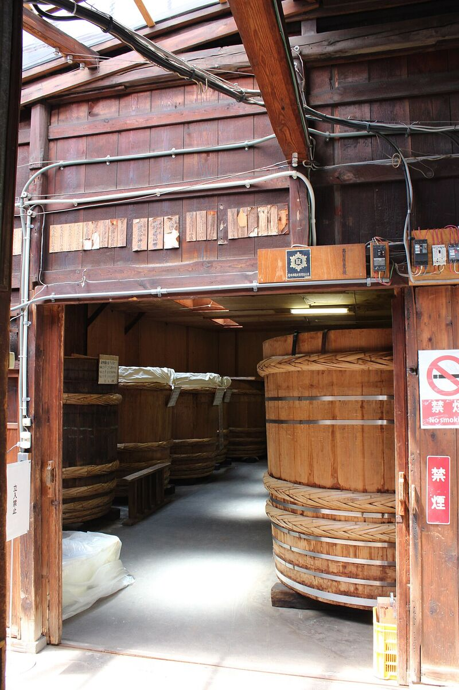
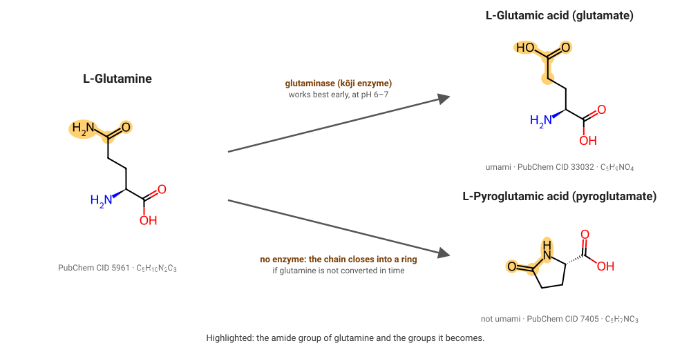

# 4. Soy Sauce and Miso: Fermentation in Salt

[Soy sauce](https://en.wikipedia.org/wiki/Soy_sauce) (*shōyu*) and [miso](https://en.wikipedia.org/wiki/Miso) are the two great salted ferments of Japanese cooking. Both begin with the [kōji](https://en.wikipedia.org/wiki/K%C5%8Dji_%28food%29) of Chapter 3 and both mature in salt for months. They differ in what the maker steers towards. Soy sauce is pressed into a clear liquid of aroma, colour and dissolved [umami](https://en.wikipedia.org/wiki/Umami). Miso stays a paste, and its colour, sweetness and saltiness are set by the ratio of kōji to [soybeans](https://en.wikipedia.org/wiki/Soybean), the salt level and the length of ageing. This chapter follows both processes stage by stage and ends with the classification tables that tell a cook which miso or soy sauce they have in hand.

<figure>

<figcaption>Inside a miso storehouse in Matsumoto, Nagano Prefecture, with a large wooden fermentation vat. <span class="credit">Photo: KCyamazaki, <a href="https://creativecommons.org/licenses/by-sa/4.0/">CC BY-SA 4.0</a>, via <a href="https://commons.wikimedia.org/wiki/File:%E7%9F%B3%E4%BA%95%E5%91%B3%E5%99%8C%EF%BC%88%E6%9D%BE%E6%9C%AC%E5%B8%82%EF%BC%89%E5%86%85%E9%83%A8.jpg">Wikimedia Commons</a>.</span></figcaption>
</figure>

## 4.1 A short history

The [Ministry of Agriculture, Forestry and Fisheries](https://en.wikipedia.org/wiki/Ministry_of_Agriculture,_Forestry_and_Fisheries_%28Japan%29) (MAFF) gives this outline (MAFF, *Soy sauce, miso, other seasonings*):

- Around the **7th century**, a method of harvesting large amounts of salt from salt fields on sandy beaches was established. Salt's use as a preservative made fermented foods such as miso and soy sauce possible.
- One theory holds that **miso** came to Japan in **666 CE** from Goguryeo, a kingdom on the Korean peninsula. Early forms appear in the 8th-century *Shōsō-in* documents and in the 10th-century dictionary *Wamyō ruijushō*. In medieval Japan, as soybean production grew, miso-making spread from temples to villages and homes.
- **Soy sauce** grew out of ***hishio***, foods fermented with salt introduced from China. The Taihō Code of 701 CE records *hishio* made from soybeans. In the Kamakura period, the Zen priest Kakushin brought back *kinzanji* miso from China, which became the origin of **tamari** soy sauce. This developed into modern soy sauce by the end of the Muromachi period. The word *shōyu* first appears in writing in 1597, in the dictionary *Ekirinbon setsuyōshū*.

## 4.2 Soy sauce: the *honjōzō* method

The standard Japanese brewing method is called ***honjōzō*** ("genuine brewing"). Ito and Matsuyama, writing from Kikkoman's research division, describe five stages: treating the raw materials, making kōji, fermenting and ageing the *moromi* mash, pressing, and refining (Ito and Matsuyama 2021).

### Stage 1: treating the raw materials

- **Soybeans** are moistened and **cooked under steam pressure** to denature their proteins, which makes them easier for enzymes to digest (Ito and Matsuyama 2021).
- **Wheat** is **roasted at 160–180 °C** and crushed (Ito and Matsuyama 2021). Yamashita adds the reason: the roasted [wheat flour](https://en.wikipedia.org/wiki/Wheat_flour) lowers the moisture on the soybeans' surface, which protects against *Bacillus* contamination during kōji growth (Yamashita 2021).
- Soybeans and wheat are mixed in **roughly equal amounts** (Ito and Matsuyama 2021).

### Stage 2: kōji

The mixture is inoculated with a pure culture of kōji mould and incubated **for two to three days at 30 °C** under high humidity. The mould grows through the mass and produces protein- and starch-digesting enzymes. The authors call kōji-making, including the raw-material treatment, **"the most crucial step"** in soy sauce brewing (Ito and Matsuyama 2021).

The traits a brewer wants in a soy-sauce mould are (Ito and Matsuyama 2021):

1. high production of enzymes, especially **[proteases](https://en.wikipedia.org/wiki/Protease), [glutaminase](https://en.wikipedia.org/wiki/Glutaminase) and macerating enzymes**;
2. short stalks and good spore production;
3. fast growth and plenty of mycelium;
4. **low [starch](https://en.wikipedia.org/wiki/Starch) consumption** during growth;
5. genetic stability;
6. no aflatoxin, and little or no other mycotoxin.

No single strain has all of these. Strains are therefore improved by mutagenesis. For example, an X-ray mutant of *A. sojae* produced twice the protease of its parent, and a UV-mutated strain with more glutaminase gave moromi with more [glutamate](https://en.wikipedia.org/wiki/Glutamic_acid) (Ito and Matsuyama 2021).

### Stage 3: *moromi* fermentation, a relay of three organisms

The kōji is mixed into a concentrated **22–23% salt solution**, forming the mash called ***moromi***. It is traditionally fermented for **6–8 months**. The final salt content of soy sauce is about **17–18%**, which stops non-salt-tolerant microorganisms from growing. The kōji mould itself dies soon after brining. Its enzymes carry on breaking down the raw materials into [amino acids](https://en.wikipedia.org/wiki/Amino_acid) and sugars (Ito and Matsuyama 2021).

Three groups of organisms then work **in sequence**, in what the authors call *multiple parallel fermentation* (Ito and Matsuyama 2021):

| Order | Organism | What it does |
|---|---|---|
| 1 | **Halophilic [lactic-acid bacteria](https://en.wikipedia.org/wiki/Lactic_acid_bacteria)**, *[Tetragenococcus halophilus](https://en.wikipedia.org/wiki/Tetragenococcus_halophilus)* | Grow best at 5–10% salt. Turn [glucose](https://en.wikipedia.org/wiki/Glucose) from wheat starch into **[lactic acid](https://en.wikipedia.org/wiki/Lactic_acid)**, and citric acid from soybeans into **[acetic acid](https://en.wikipedia.org/wiki/Acetic_acid)**. The moromi becomes slightly acidic, giving soy sauce a faint sourness. |
| 2 | **Main fermenting [yeast](https://en.wikipedia.org/wiki/Yeast)**, *[Zygosaccharomyces rouxii](https://en.wikipedia.org/wiki/Zygosaccharomyces_rouxii)* | Produces **2–4% [ethanol](https://en.wikipedia.org/wiki/Ethanol)**, a little glycerol, and key aroma compounds including **HEMF** and **[methionol](https://en.wikipedia.org/wiki/Methionol)**. At 18% salt it can grow only between pH 4.0 and 5.0, so it needs the acid made by the bacteria first. |
| 3 | **Late-maturation yeasts**, *Candida versatilis* and *C. etchellsii* | Remain active late in ripening. *C. versatilis* forms aroma compounds such as **4-ethylguaiacol** from phenolic compounds that come from wheat lignin. |

The bacterium was first isolated from soy-sauce moromi in **1907**, as *Pediococcus soyae*, and reclassified as *Tetragenococcus halophilus* in **1990**. These microbes traditionally entered the mash from the kōji, the vessels and the brewery itself. Today, selected strains with good fermentation performance are widely added deliberately (Ito and Matsuyama 2021).

> **Why the order matters.** The yeast that makes soy sauce's main aroma can grow in 18% brine only within a narrow acid range (pH 4.0–5.0). The lactic-acid bacteria create that range. The relay is a chain of dependencies, not a coincidence (Ito and Matsuyama 2021).

### How glutamate is made in the moromi

Ito and Matsuyama describe three pathways by which kōji enzymes produce glutamate from soybean and wheat protein (Ito and Matsuyama 2021):

- **A. Direct release.** Proteases cut proteins into peptides, and peptidases cut those into amino acids, glutamate among them.
- **B. Glutaminase.** Free **[glutamine](https://en.wikipedia.org/wiki/Glutamine)** released from the proteins is converted into glutamate by the mould's glutaminases.
- **C. Peptidoglutaminase.** Glutamine at the end of a peptide chain is converted into glutamate *before* release, then freed by peptidases.

Timing decides the yield. Early moromi is near neutral (**pH 6–7**), and that is when the glutaminases, which prefer a high pH and tolerate salt poorly, work best. Free glutamine that is not converted in time turns, without any enzyme, into **[pyroglutamate](https://en.wikipedia.org/wiki/Pyroglutamic_acid)**, which is not umami. Glutamine does this much more readily than glutamate. As lactic and acetic acids accumulate and the pH falls, acid-loving [carboxypeptidases](https://en.wikipedia.org/wiki/Carboxypeptidase) take over and continue releasing glutamate from peptides whose ends were already converted (Ito and Matsuyama 2021). This is why brewers choose strains with high glutaminase activity (Yamashita 2021).

<figure class="diagram">

<figcaption>The race in early moromi. Glutaminase turns the amide group of glutamine into the carboxyl group of glutamic acid. Left unconverted, glutamine closes into a ring and becomes pyroglutamic acid, which is not umami (Ito and Matsuyama 2021). <span class="credit">Diagram drawn for this handbook with <a href="https://www.rdkit.org/">RDKit</a> from PubChem structure records: <a href="https://pubchem.ncbi.nlm.nih.gov/compound/5961">L-glutamine</a>, <a href="https://pubchem.ncbi.nlm.nih.gov/compound/33032">L-glutamic acid</a>, <a href="https://pubchem.ncbi.nlm.nih.gov/compound/7405">L-pyroglutamic acid</a>.</span></figcaption>
</figure>

### Colour and aroma

During ageing, sugars such as glucose react with the amino acids, through **[Maillard](https://en.wikipedia.org/wiki/Maillard_reaction) reactions**, to form Amadori compounds. These are responsible for soy sauce's **colour, mildness and umami**. Nearly **300 aroma compounds** have been identified in soy sauce, most of them formed during fermentation and ageing (Ito and Matsuyama 2021).

### Stages 4 and 5: pressing and refining

The aged moromi is wrapped in square cloths, stacked and pressed. The liquid that comes out is **raw soy sauce**. It is then **heated**, for pasteurisation and to inactivate enzymes. Heating makes the [denatured](https://en.wikipedia.org/wiki/Denaturation_%28biochemistry%29) enzymes and other particles coagulate and settle, and it speeds up the chemical reactions that complete the flavour. Only the clear upper part is taken as the final product (Ito and Matsuyama 2021). The authors give a total brewing time of about **six months**. Their moromi stage is 6–8 months, and MAFF gives about eight months for *koikuchi* soy sauce (MAFF), so the total varies by maker and type.

## 4.3 The five types of soy sauce

MAFF classifies commercial soy sauce into five types (MAFF, *Soy sauce, miso, other seasonings*):

| Type | How it is made | Character and use | Region |
|---|---|---|---|
| ***Koikuchi*** (dark) | Equal soybeans and wheat. Kōji in brine. About **8 months** of fermentation and ageing. | At least **80%** of production. Rich aroma. Effective at masking fishy or gamey smells. | All of Japan, especially the east |
| ***Usukuchi*** (light-coloured) | Soybeans and wheat. **[Amazake](https://en.wikipedia.org/wiki/Amazake)** is added for mildness. Wheat is **roasted lightly**, and **more salt** is used to slow fermentation and ageing, both to keep the colour pale. | Developed in [Kansai](https://en.wikipedia.org/wiki/Kansai_region) for *Kamigata* cooking, which aims to keep ingredients' own colour and flavour | Kansai |
| ***Tamari*** | Mostly soybeans with a little wheat. Crushed soybeans are formed into **miso-kōji balls** and fermented in a **small amount of brine**. Ages longer than koikuchi. | Rich and distinctive. Used for [sashimi](https://en.wikipedia.org/wiki/Sashimi), *kabayaki* (glazed grilled eel), rice crackers, *tsukudani*, noodle soups. | Tōkai (Aichi, Gifu, Mie) |
| ***Saishikomi*** ("re-brewed") | Equal soybeans and wheat, but **raw soy sauce (*kiage*) is used instead of brine**. Ages **1.5–2 years or longer**. | Slightly lower salt, but rich in taste and colour, and viscous. For [sushi](https://en.wikipedia.org/wiki/Sushi), eel sauce, sashimi. | Yamaguchi, San'in to Kyūshū |
| ***Shiro*** (white) | **Mostly wheat.** (The English MAFF page prints the wheat-to-soybean ratio as "09時01分", a spreadsheet time-format error for 9:1. Yamashita 2021 independently describes shiro soy sauce as made "mainly with wheat".) About **3 months**. Colouring steps skipped or kept brief. | Paler than usukuchi. Less umami, light-bodied, with kōji aroma and sweetness standing out. | Mainly Aichi |

Yamashita confirms the two extremes: tamari is a dark soy sauce made from soybeans only, and *shiro* soy sauce is made mainly from wheat (Yamashita 2021).

> **Reading the table as technique.** Every lever in Stage 1–5 appears here. *Usukuchi* keeps its colour pale by roasting the wheat lightly and raising the salt to slow the Maillard reactions. *Saishikomi* replaces the brine with soy sauce, doubling the dissolved solids. *Shiro* swaps soybean protein for wheat starch, giving more sweetness and less umami. *Tamari* reduces the wheat and the brine, making a dense, soybean-dominated sauce.

## 4.4 Miso: making the paste

Miso is soybeans mixed with kōji and salt and matured. MAFF classifies it by the grain the kōji is grown on (MAFF):

- **rice miso** (*kome-miso*), with rice kōji;
- **barley miso** (*mugi-miso*), with barley kōji;
- **soybean miso** (*mame-miso*), in which all the soybeans are made into kōji;
- **blended miso**, a mix of these.

Rice miso accounts for about **80%** of production. Barley miso is made mainly in Kyūshū, Shikoku and Chūgoku, and soybean miso mainly in the Chūbu region of central Japan (Kusumoto et al. 2021). Since early times, kōji-making has been seen as the most critical step, followed by soybean processing and mixing (Kusumoto et al. 2021).

### Rice miso, step by step

Kusumoto and colleagues describe the process as follows (Kusumoto et al. 2021):

1. **Soybeans** are washed and soaked, typically for **15–17 hours**, then steamed or boiled, usually under pressure, and cooled.
2. **Rice kōji** is made in parallel (Chapter 3): rice steamed 40–60 minutes, inoculated, and grown for 42–48 hours.
3. **Mixing (*shikomi*).** The cooked soybeans are crushed, typically through a chopper with **5–6 mm** holes. They are immediately mixed with rice kōji, salt water and other ingredients. Salt-tolerant yeast (*Zygosaccharomyces rouxii*) and salt-tolerant lactic-acid bacteria (*Tetragenococcus halophilus*) are generally added, the same pair that works in soy sauce.
4. **Fermentation and maturation** in a tank, usually at **25–30 °C**. Depending on the type of miso wanted, this lasts from **one month to several years**. MAFF gives a range from **several days to two years** (MAFF). The shortest times apply to the enzymatic sweet misos below.
5. **Turning (*tenchi-gaeshi*).** The miso is transferred upside down into another tank, in order to:
   - even out fermentation and maturation across the tank;
   - let in air, because the yeast needs oxygen to grow (it does not grow without air, although the alcohol it makes affects flavour);
   - release the heat of fermentation.

MAFF summarises the biochemistry. Salt suppresses unwanted bacteria. The kōji's [amylases](https://en.wikipedia.org/wiki/Amylase) turn rice starch into sugar, and its proteases turn soybean protein into amino acids, giving miso its rich umami. Lactic-acid bacteria then make lactic acid from the sugar, and yeast grows and makes ethanol (MAFF).

### Enzymatic miso: sweet and quick

Two styles mature through **kōji enzymes alone**, without a long microbial fermentation: white sweet miso, such as **Kyoto white miso** (*saikyō*-style), and red sweet miso, such as **[Edo](https://en.wikipedia.org/wiki/Edo_period) sweet miso**. They use a high proportion of kōji, contain only **5–7% salt**, and are matured in **a few days at about 50 °C** (Kusumoto et al. 2021). Yamashita gives the parallel description: kōji at **twice the amount of soybeans**, saccharified at **50–55 °C for several hours**, about **5% salt**, and a light colour (Yamashita 2021). The principle is the one from Chapter 3: hold the kōji's enzymes at a temperature where they work and the microbes do not.

### Barley and soybean miso

- **Barley** absorbs water very quickly, so the soaking time is set for each water temperature. The grains swell into hard clumps that must be broken up before and after steaming, or the mould grows unevenly. Barley's higher protein also makes its kōji more prone to bacterial contamination, overheating and clumping. Light barley miso has a high proportion of kōji, a shorter maturation, a kōji aroma and **9–11% salt**. Red barley miso matures longer, with **10–12% salt** (Kusumoto et al. 2021).
- **Soybean miso** uses only soybeans and salt. Soaking is the critical step. With a *restricted water absorption* technique, soaked and drained soybeans should weigh **1.5–1.6 times** their dry weight. The soybeans are pressure-steamed and formed into ***miso balls*** **15–40 mm** across, which are inoculated with kōji starter. Ball size affects quality: smaller balls tend to give higher enzyme activity (Kusumoto et al. 2021). MAFF describes soybean miso as dark reddish-brown, with a robust umami and a slightly astringent taste. It is made only in Aichi, Gifu and Mie, and called *Hatchō*, *Nagoya*, *Sanshū* or *tamari* miso (MAFF).

### Colour, aroma and texture

- The **Maillard reaction** between amino compounds and sugars produces brown polymers called **[melanoidins](https://en.wikipedia.org/wiki/Melanoidin)**. It colours miso and creates aroma compounds. Over **200 aroma compounds** have been found in rice miso (Kusumoto et al. 2021).
- **HEMF** gives a sweet, caramel-like aroma. In rice miso it is absent right after mixing, rises during maturation and falls again late in maturation. **4-Ethylguaiacol** distinguishes misos made with different kōji. HEMF and **methionol** are made by the yeast. Together, the levels of these three compounds seem to determine miso's aroma (Kusumoto et al. 2021).
- MAFF notes that **colour depends on the length of ageing** (MAFF).
- Miso is a paste, so it does not need as much protein broken down as soy sauce does. Yamashita gives figures of about **60%** of miso protein dissolved and about **25%** broken down. Too much breakdown makes miso **too soft**, causes colour changes in storage and lowers its quality (Yamashita 2021).

## 4.5 The miso classification table

MAFF reproduces this classification from the *Encyclopedia of Traditional Japanese Food* (MAFF, after *Nihon no Dentō Shokuhin Jiten*, p. 249). "Kōji ratio" is MAFF's "koji-to-soybean ratio". The page gives the numbers without stating their unit.

| Type | Taste and colour | Kōji ratio | Salt (%) | Main area |
|---|---|---|---|---|
| Rice miso, ***ama*** (sweet) | White | 15–30 | 5–7 | Kinki, Chūgoku, Setouchi |
| | Red | 12–20 | 5–7 | Tokyo |
| Rice miso, ***amakuchi*** (mildly salty) | Light | 8–15 | 7–12 | Shizuoka, Kyūshū |
| | Red | 10–15 | 11–13 | Tokushima and others |
| Rice miso, ***karakuchi*** (salty) | Light | 5–10 | 11–13 | [Kantō](https://en.wikipedia.org/wiki/Kant%C5%8D_region), Kōshin'etsu, Hokuriku and across Japan |
| | Red | 5–10 | 11–13 | Kantō, Kōshin'etsu, Tōhoku and across Japan |
| Barley miso | *Amakuchi* | 15–25 | 9–11 | Kyūshū, Chūgoku (Sea of Japan side) |
| | *Karakuchi* | 8–15 | 11–13 | Kyūshū, Shikoku, northern Kantō |
| Soybean miso | (all soybeans made into kōji) | — | 10–12 | Chūkyō (Aichi, Mie, Gifu) |

> **Caution on the "ratio" column.** Because the unit is not stated, this handbook does not convert the numbers into proportions. Use the column as a **relative** measure: within the table, more kōji goes with less salt and a sweeter miso.

MAFF adds regional notes. Well-known **white sweet misos** include *Saikyō* miso (Kyoto), *Sanuki* miso (Kagawa) and *Fuchū* miso (Hiroshima). The best-known **red sweet miso** is Edo-style *ama-miso*. *Aijiro* miso (Shizuoka) and *Gozen* miso (Tokushima) are well-known *amakuchi* misos. **Salty rice miso** is the most produced kind, represented by *Shinshū* and *Sendai* miso. Barley miso is also called *inaka* ("country") miso (MAFF).

> **What the table tells the cook.** Read across any row: **more kōji goes with less salt and a sweeter, paler miso**. White *ama-miso* has the highest kōji figure in the table (15–30, against 5–10 for salty *karakuchi* miso) and about half the salt. This follows from Chapter 3. More kōji means more amylase and more sugar. Less salt lets the enzymes work faster, so maturation is short and the colour has no time to darken.

## 4.6 Miso and health: what the sources actually say

Kusumoto and colleagues are cautious. Miso is high in salt, and restricting miso is sometimes recommended in Japan to reduce salt intake. Most studies of miso as a functional food are in cell cultures or animals, and few involve humans. Two published human studies found that long-term, normal consumption of miso soup **did not affect blood pressure**. The authors call for more research to establish the mechanisms (Kusumoto et al. 2021). This handbook makes no stronger claim.

## 4.7 Check yourself

```quiz
title: Chapter 4 self-check
? In soy sauce moromi, why do the lactic-acid bacteria have to work before the main yeast?
- The yeast can grow in 18% salt only at pH 4.0–5.0, which the bacteria's acid creates *
- The bacteria make the sugar the yeast needs
- The yeast would kill the bacteria if added first
> Z. rouxii's pH range narrows in strong brine. T. halophilus lowers the pH first (Ito and Matsuyama 2021).

? What happens to free glutamine that the glutaminases don't convert in time?
- It turns into pyroglutamate, which is not umami *
- It turns into glutamate on its own
- It stays as glutamine, which tastes like glutamate
> Glutamine cyclises to pyroglutamate much more readily than glutamate does (Ito and Matsuyama 2021).

? Which soy sauce is brewed with raw soy sauce instead of brine?
- Saishikomi *
- Tamari
- Usukuchi
> Saishikomi ("re-brewed") ages 1.5–2 years or longer (MAFF).

? How does usukuchi soy sauce stay light in colour?
- Lightly roasted wheat and more salt to slow fermentation and ageing *
- It is diluted with water
- It uses white rice instead of wheat
> MAFF. Amazake is also added to make the flavour milder.

? Looking at the MAFF miso table, what goes with a high kōji-to-soybean ratio?
- Lower salt and a sweeter miso *
- Higher salt and a darker miso
- Longer ageing
> White ama-miso: ratio 15–30, salt 5–7%. Salty karakuchi miso: ratio 5–10, salt 11–13%.

? Why is miso turned (tenchi-gaeshi) during maturation?
- To even out fermentation, give the yeast air, and release heat *
- To mix in fresh salt
- To press out liquid tamari
> All three purposes are listed by Kusumoto et al. 2021.

? Kyoto-style white sweet miso matures in a few days. How?
- Kōji enzymes at about 50 °C and low salt do the work without a long microbial fermentation *
- It is made with extra yeast
- It is not fermented at all; sugar is added
> Kusumoto et al. 2021: 5–7% salt, high kōji, several days at about 50 °C.
```

## Sources for this chapter

1. **Ito and Matsuyama 2021.** Ito K, Matsuyama A. Koji molds for Japanese soy sauce brewing: characteristics and key enzymes. *Journal of Fungi* 2021;7(8):658. doi:[10.3390/jof7080658](https://doi.org/10.3390/jof7080658). [PMC8399179](https://pmc.ncbi.nlm.nih.gov/articles/PMC8399179/). (Authors from Kikkoman Corporation's R&D division.)
2. **Kusumoto et al. 2021.** Kusumoto K-I, Yamagata Y, Tazawa R, Kitagawa M, Kato T, Isobe K, Kashiwagi Y. Japanese traditional miso and koji making. *Journal of Fungi* 2021;7(7):579. doi:[10.3390/jof7070579](https://doi.org/10.3390/jof7070579). [PMC8307815](https://pmc.ncbi.nlm.nih.gov/articles/PMC8307815/).
3. **Yamashita 2021.** Yamashita H. Koji starter and koji world in Japan. *Journal of Fungi* 2021;7(7):569. doi:[10.3390/jof7070569](https://doi.org/10.3390/jof7070569). [PMC8304044](https://pmc.ncbi.nlm.nih.gov/articles/PMC8304044/).
4. **MAFF.** Ministry of Agriculture, Forestry and Fisheries of Japan. *Soy sauce, miso, other seasonings — Traditional Foods in Japan.* [maff.go.jp](https://www.maff.go.jp/e/policies/market/dento_syoku/bunrui/syouyu-miso.html), accessed 17 November 2026. Its tables cite *Nihon no Dentō Shokuhin Jiten* (Encyclopedia of Traditional Japanese Food), Asakura Publishing.

➡️ Next: [Chapter 5: Mirin, vinegar and sake](05-mirin-vinegar.md)
