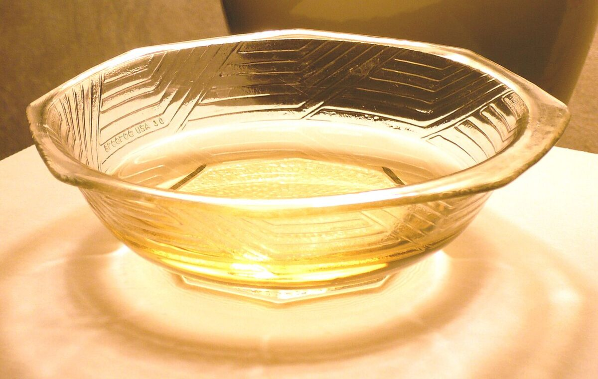
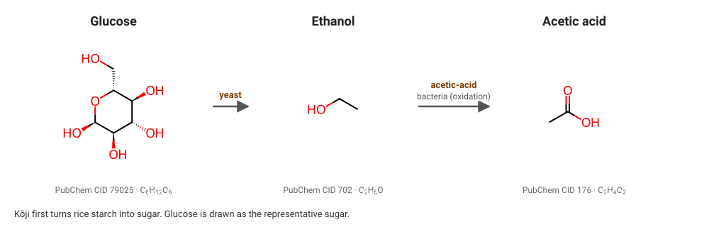

# 5. Mirin, Vinegar and Sake: Sweetness, Sourness and Alcohol

Chapters 3 and 4 showed [kōji](https://en.wikipedia.org/wiki/K%C5%8Dji_%28food%29) making salt-based seasonings. This chapter covers the other three brewed liquids in the Japanese kitchen. **[Mirin](https://en.wikipedia.org/wiki/Mirin)** is a sweet seasoning made by kōji enzymes working in alcohol, with no [yeast](https://en.wikipedia.org/wiki/Yeast). **[Rice vinegar](https://en.wikipedia.org/wiki/Rice_vinegar)** is made by a two-stage fermentation that turns rice into [sake](https://en.wikipedia.org/wiki/Sake) and the sake into [acetic acid](https://en.wikipedia.org/wiki/Acetic_acid). **Sake** is the alcoholic drink at the start of both. Each one does more than add a taste: mirin changes how food holds together, and vinegar changes the texture of rice.

## 5.1 Mirin

<figure>

<figcaption>Mirin: a clear, golden, sweet seasoning made from glutinous rice, rice kōji and shōchū (§5.1). <span class="credit">Photo: Badagnani, <a href="https://creativecommons.org/licenses/by/3.0/">CC BY 3.0</a>, via <a href="https://commons.wikimedia.org/wiki/File:Mirinbowl.jpg">Wikimedia Commons</a>.</span></figcaption>
</figure>

### What mirin is, legally and chemically

Ito's review of mirin brewing begins with the legal definition. Under Japan's **Liquor Tax Law**, mirin must have an **extract content of 40% or more** and an **alcohol content below 15%**. The main component of that extract is **sugar** (Ito 2021). Yamashita gives the sugar more precisely: mirin contains about **40–50% [glucose](https://en.wikipedia.org/wiki/Glucose)** (Yamashita 2021).

### History

Ito writes that mirin originated in China and reached Japan during the **Muromachi and Warring States periods**. It was first a drink and came into use for cooking in the **[Edo](https://en.wikipedia.org/wiki/Edo_period) period** (Ito 2021). [MAFF](https://en.wikipedia.org/wiki/Ministry_of_Agriculture,_Forestry_and_Fisheries_%28Japan%29) gives two competing theories of its origin. One traces it to *nerizake*, a sweet sake drunk in the early Muromachi period. The other traces it to a Ming-dynasty Chinese mead written 蜜淋. MAFF adds that mirin's use as a seasoning grew once a method for making high-sugar mirin from *[shōchū](https://en.wikipedia.org/wiki/Sh%C5%8Dch%C5%AB)* was established in the Edo period (MAFF, *[Soy sauce](https://en.wikipedia.org/wiki/Soy_sauce), [miso](https://en.wikipedia.org/wiki/Miso), other seasonings*).

### How it is made

The raw materials are **[glutinous rice](https://en.wikipedia.org/wiki/Glutinous_rice)**, **rice kōji** and ***shōchū*** (distilled spirit) (Ito 2021; MAFF). Ito gives the proportions:

- **Kōji ratio** (kōji rice weight ÷ total rice weight): **10–15%** w/w.
- **Alcohol ratio** (alcohol volume ÷ total rice weight): **60–70%** v/w.

The key point is what does **not** happen. Unlike other alcoholic beverages, the mirin mash is **not fermented by yeast** (Ito 2021). The alcohol is added as shōchū from the start. In the mash, the kōji's starch- and protein-digesting enzymes break the [gelatinised](https://en.wikipedia.org/wiki/Starch_gelatinization) [starch](https://en.wikipedia.org/wiki/Starch) and the protein of the steamed glutinous rice down into smaller molecules **in the presence of alcohol**. This happens through saccharification and ageing (Ito 2021). MAFF gives the conditions: **saccharification and ageing at 20–30 °C for 40–60 days**, then pressing, sedimentation (***orisage***) and filtration, followed by **several months** of storage to complete the brewing (MAFF).

The kōji has to suit this task. It needs high saccharifying and [protease](https://en.wikipedia.org/wiki/Protease) activity, because [amino acids](https://en.wikipedia.org/wiki/Amino_acid) also contribute to mirin's taste. Strains with high **[tyrosinase](https://en.wikipedia.org/wiki/Tyrosinase)** activity are avoided, because a bright colour is wanted (Yamashita 2021).

> **Why this matters to the cook.** Because the mould's enzymes work in alcohol without yeast, the sugar they release is not fermented away. It accumulates to the 40% or more required by law. The alcohol keeps the mash from spoiling over its weeks of saccharification. This is why mirin is both very sweet and alcoholic.

### What mirin does in cooking

Ito lists the effects of mirin's **sugar and alcohol** (Ito 2021):

- it **prevents simmered food from falling apart** (*nikuzure*, the break-up of ingredients during simmering);
- it **improves texture**;
- it has a **deodorising** effect, masking unwanted odours.

MAFF gives a similar list (MAFF):

- it helps seasoning **penetrate** foodstuffs;
- it gives dishes a **glossy or shiny** look;
- it **keeps cooked food from falling apart**;
- it **removes fishy smells**.

Ito also notes reports of antioxidant activity and of an inhibitory effect on blood-pressure increase, both derived from the **aminocarbonyl ([Maillard](https://en.wikipedia.org/wiki/Maillard_reaction)) reaction** (Ito 2021). These reports concern products of the reaction in mirin, not proven health effects of eating mirin, and this handbook makes no further claim.

> **What the sources do not say.** Neither source explains the mechanism behind "preventing break-up" or "improving penetration". Popular explanations exist, but this handbook does not repeat them without a source. What can be said is that the effects are attributed to mirin's **sugar and alcohol** together (Ito 2021).

## 5.2 Rice vinegar

### Modern production: two fermentations

In modern Japan, rice vinegar is made by a **two-stage fermentation** from steamed rice, rice kōji and water, using yeast and then [acetic-acid bacteria](https://en.wikipedia.org/wiki/Acetic_acid_bacteria) (Yanagihara et al. 2024):

1. **Alcohol fermentation.** Kōji turns the rice starch into sugar, and yeast turns the sugar into alcohol, making sake.
2. **Acetic fermentation.** Acetic-acid bacteria oxidise the alcohol to acetic acid.

<figure class="diagram">

<figcaption>The two fermentations of rice vinegar, as small molecules: sugar to alcohol (yeast), alcohol to acetic acid (acetic-acid bacteria) (Yanagihara et al. 2024). <span class="credit">Diagram drawn for this handbook with <a href="https://www.rdkit.org/">RDKit</a> from PubChem structure records: <a href="https://pubchem.ncbi.nlm.nih.gov/compound/79025">α-D-glucose</a>, <a href="https://pubchem.ncbi.nlm.nih.gov/compound/702">ethanol</a>, <a href="https://pubchem.ncbi.nlm.nih.gov/compound/176">acetic acid</a>.</span></figcaption>
</figure>

There are two production methods (Yanagihara et al. 2024):

- **Static surface fermentation**, the traditional method. A crêpe-like film (***pellicle***) of acetic-acid bacteria floats on the surface of the sake. [Ethanol](https://en.wikipedia.org/wiki/Ethanol) is converted into acetic acid over about **one month**.
- **Submerged fermentation**, the modern industrial method.

MAFF describes the same principle: sake is made from rice, then the "mother of vinegar" (the film of acetic-acid bacteria) is allowed to form on it so that acetic fermentation takes place (MAFF).

### Kasu vinegar and sushi

**Kasu vinegar** (粕酢) is made from **[sake lees](https://en.wikipedia.org/wiki/Sake_kasu)** (*sake-kasu*), the by-product of sake brewing. The lees are aged for a set period, water is added, and the mother of vinegar is inoculated for **static fermentation** (MAFF). MAFF links its rise to the late Edo period. It was cheaper than rice vinegar, and its flavour suited the newly popular **Edo-style [sushi](https://en.wikipedia.org/wiki/Sushi)** (MAFF).

### Kurozu: the amber vinegar

In a few areas, rice vinegar is still made by **spontaneous fermentation in pottery jars**, close to the old method. The water charged is about **four times the total rice**, and fermentation lasts about **half a year**, starting in spring or autumn. The result is an amber rice vinegar called ***kurozu*** (Yanagihara et al. 2024).

### A history of a different sourness

Yanagihara and colleagues report a historical finding. Vinegar-making is believed to have reached southern Osaka from China in the **4th century**. The earliest Japanese description of vinegar-making is in the ***Engishiki*** (927). Based on 15 books published between 927 and 1866, the method barely changed for more than 800 years, probably until vinegar-making companies were founded in the middle of the Edo period. Those old methods used **much less water** relative to rice than today, and fermentation lasted only **one week to one month**, mostly in summer (Yanagihara et al. 2024).

The authors reproduced the methods from Edo-period books, including ***Honchō shokkan*** (1697). They found that the low-water recipes produce a **lactic-acid ferment** without acetic fermentation. Their reproduction of the *Honchō shokkan* method, which they call "Honcho", gave these results (Yanagihara et al. 2024):

- about **2% [lactic acid](https://en.wikipedia.org/wiki/Lactic_acid)**, the source of its sourness, and very little acetic acid (0.188 g per 100 mL);
- **more than twice the free amino acids** of kurozu, with more [glutamic acid](https://en.wikipedia.org/wiki/Glutamic_acid);
- in taste-sensor analysis, **weaker acidity but stronger [umami](https://en.wikipedia.org/wiki/Umami)** than commercial rice vinegar.

The authors conclude that vinegar before the Edo period may have been a seasoning that added **umami and a gentle sourness**, closer to soy sauce in function than to modern vinegar (Yanagihara et al. 2024).

### Vinegar and heat: a counter-intuitive measurement

Acetic acid is volatile, and cooks often assume that boiling vinegar drives its sourness off. Yanagihara and colleagues measured what actually happens when **100 mL** of vinegar is boiled for **10 minutes** (Yanagihara et al. 2024):

- **Kurozu's acidity rose gradually** during boiling. Acetic acid boils at **118 °C**, so it evaporates less readily than water, and the acid concentrates as the water leaves.
- **Honcho's acidity rose much more**, almost **doubling after 8 minutes**. Its ethanol (about 10%) evaporated quickly, and its acids, mainly non-volatile lactic acid, became concentrated.

> **Technique consequence.** Reducing a vinegar-based liquid makes it **more** sour, not less, because the water leaves faster than the acetic acid. This measurement, from one experiment with two vinegars, contradicts the common idea that heat "cooks off" vinegar's sourness.

### Vinegar and the texture of sushi rice

Odahara and colleagues measured how the parts of sushi vinegar (*sushi-zu*) affect the texture of cooked rice. The vinegar was added immediately after cooking, and the rice was tested before and after overnight storage at **4 °C**. Their test solutions were 3% (w/v) acetic acid, 10% salt and 50% sugars. They found (Odahara et al. 2004):

- **acetic acid increased stickiness**, both before and after cold storage, compared with adding water;
- **sugars increased surface hardness** after cold storage. **[Fructose](https://en.wikipedia.org/wiki/Fructose)** did so most among [sucrose](https://en.wikipedia.org/wiki/Sucrose), glucose, fructose and [maltose](https://en.wikipedia.org/wiki/Maltose);
- in mixtures, **high concentrations of sucrose or fructose reduced the stickiness** caused by acetic acid.

They also found that measuring single grains was more reproducible than measuring 10 g of rice in bulk (Odahara et al. 2004). Chapter 9, on rice, returns to stickiness and what causes it.

## 5.3 Sake

Sake is made from steamed rice, rice kōji and water, then filtered. Like shōchū, it is produced by **parallel double fermentation**: kōji saccharifies the rice while yeast makes alcohol, at the same time and in the same vessel. Beer and whisky, by contrast, use malt and carry out these processes separately (Yamashita 2021). Most sake kōji uses *A. oryzae*, which has high saccharifying activity. If the rice is broken down too far, off-flavours increase, so kōji is made with a balance between alcohol yield and taste in mind. Some sakes use the fruity acidity of citric acid made by *A. luchuensis* (Yamashita 2021).

Sake is the starting point for rice vinegar and the "cousin" of mirin. MAFF describes mirin as produced "by applying the brewing method of sake", and rice vinegar as made by fermenting sake (MAFF). The sources used in this handbook do not give a technical account of sake's role as a cooking ingredient. That is left out here rather than assumed.

## 5.4 Check yourself

```quiz
title: Chapter 5 self-check
? What makes mirin's brewing unusual among Japanese alcoholic products?
- The mash is not fermented by yeast. Kōji enzymes work in added alcohol *
- It is distilled twice
- It uses wheat kōji
> The alcohol comes from shōchū, so the sugar released by the kōji is not fermented away (Ito 2021).

? What does Japan's Liquor Tax Law require of mirin?
- Extract of 40% or more and alcohol below 15% *
- Alcohol of at least 20%
- At least 10% glutamic acid
> Ito 2021. Yamashita gives about 40–50% glucose.

? Which cooking effect is attributed to mirin by both Ito and MAFF?
- It keeps simmered food from falling apart *
- It thickens sauces through gelatin
- It tenderises meat through protease activity
> Ito: "prevention of nikuzure", from sugar and alcohol. MAFF: "preventing cooked foodstuffs from falling apart".

? You boil 100 mL of rice vinegar for 10 minutes. What happens to its acidity, according to Yanagihara et al.?
- It rises, because water evaporates faster than acetic acid *
- It falls, because acetic acid boils off first
- It stays the same
> Acetic acid boils at 118 °C. Kurozu's acidity rose gradually as the vinegar concentrated.

? In the sushi-rice study, which component of sushi vinegar increased the stickiness of rice?
- Acetic acid *
- Salt
- Fructose
> Sugars increased surface hardness after cold storage, and high sucrose or fructose reduced the stickiness caused by acetic acid (Odahara et al. 2004).

? Why did kasu vinegar spread in the late Edo period?
- It was cheaper than rice vinegar and its flavour suited Edo-style sushi *
- It was the only vinegar allowed by law
- It needed no fermentation
> MAFF.
```

## Sources for this chapter

1. **Ito 2021.** Ito A. Mirin brewing (in Japanese, English abstract). *Journal for the Integrated Study of Dietary Habits* 2021;31(4):207–215. doi:[10.2740/jisdh.31.4_207](https://doi.org/10.2740/jisdh.31.4_207). Cited from the English abstract.
2. **Yamashita 2021.** Yamashita H. Koji starter and koji world in Japan. *Journal of Fungi* 2021;7(7):569. doi:[10.3390/jof7070569](https://doi.org/10.3390/jof7070569). [PMC8304044](https://pmc.ncbi.nlm.nih.gov/articles/PMC8304044/).
3. **Yanagihara et al. 2024.** Yanagihara N, Maeda M, Yoshikawa J, Akuzawa S, Fujii A, Nagano M, Koizumi Y, Maehashi K. Flavor assessment of a lactic fermented vinegar described in Japanese books from the Edo period (1603–1867). *Heliyon* 2024;10(11):e32344. doi:[10.1016/j.heliyon.2024.e32344](https://doi.org/10.1016/j.heliyon.2024.e32344). [PMC11219324](https://pmc.ncbi.nlm.nih.gov/articles/PMC11219324/).
4. **Odahara et al. 2004.** Odahara M, Sokooshi H, Takahashi T, Okadome H, Ohtsubo K. The effect of sushi vinegar on texture of sushi rice before and after storage under low temperature (in Japanese, English abstract). *Nippon Shokuhin Kagaku Kogaku Kaishi* 2004;51(11):620–625. [J-STAGE](https://www.jstage.jst.go.jp/article/nskkk1995/51/11/51_11_620/_article/-char/en) (authors from Kewpie Jyozo Co. and the National Food Research Institute). Cited from the English abstract.
5. **MAFF.** Ministry of Agriculture, Forestry and Fisheries of Japan. *Soy sauce, miso, other seasonings — Traditional Foods in Japan.* [maff.go.jp](https://www.maff.go.jp/e/policies/market/dento_syoku/bunrui/syouyu-miso.html), accessed 17 November 2026.

➡️ Next: [Chapter 6: Raw fish](06-raw-fish.md)
