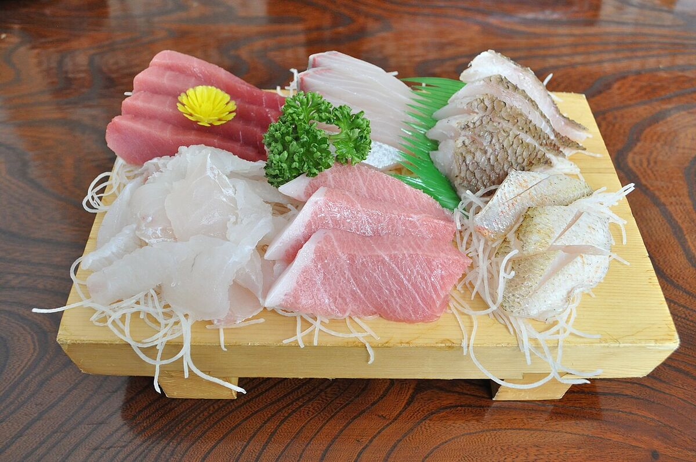
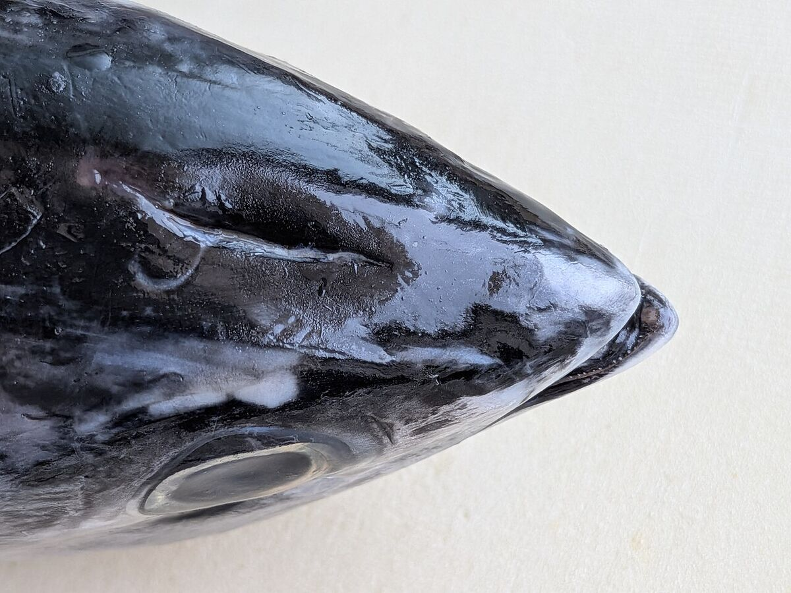
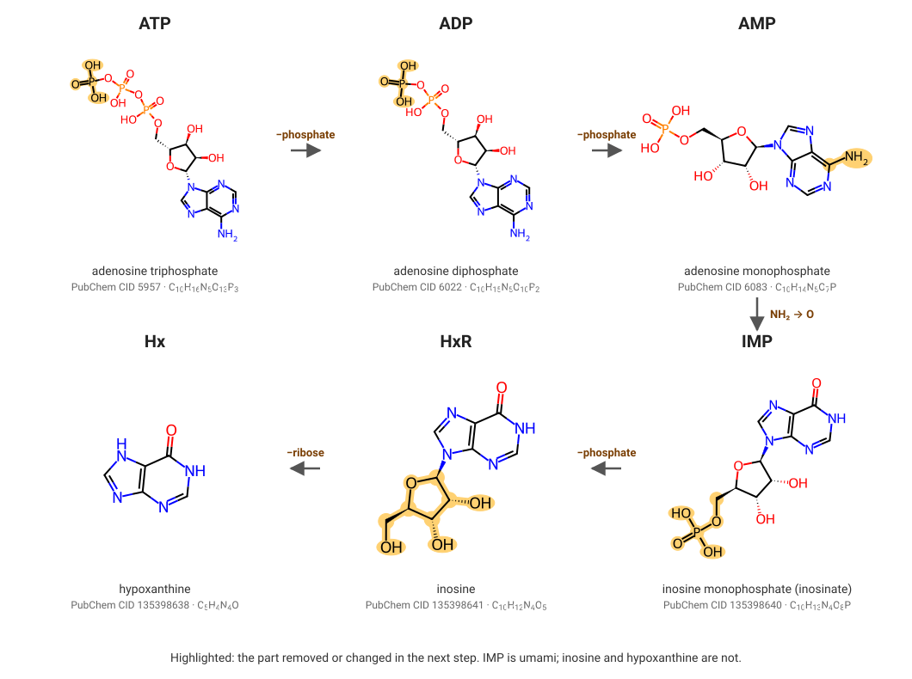

# 6. Raw Fish: Death, Rigor and Freshness

[Sashimi](https://en.wikipedia.org/wiki/Sashimi) is the barest test of technique in Japanese cooking. There is no heat, no sauce to hide behind, and almost no time between fish and plate. The flavour and texture of raw fish are decided mostly **before** the knife touches it: by how the fish died, at what temperature it was kept, and how many hours have passed. This chapter follows the biochemistry of fish muscle after death, as described in the research literature, and turns it into the questions a cook should ask. It ends with the parasite risk, which no kitchen technique can ignore.

<figure>

<figcaption>A sashimi set from Chōshi, Chiba Prefecture. With no cooking to rely on, texture and flavour are set by how the fish died and how it was kept. <span class="credit">Photo: Ocdp, <a href="https://creativecommons.org/publicdomain/zero/1.0/">CC0</a>, via <a href="https://commons.wikimedia.org/wiki/File:Sashimi_002.jpg">Wikimedia Commons</a>.</span></figcaption>
</figure>

## 6.1 What happens in muscle after death

Duarte and colleagues' review of fish quality divides the changes after death into three stages: **[rigor mortis](https://en.wikipedia.org/wiki/Rigor_mortis)**, **autolysis** (self-digestion by the fish's own enzymes) and **bacterial spoilage** (Duarte et al. 2020).

### Pre-rigor: the flexible hours

At the moment of death, fish muscle still holds **[glycogen](https://en.wikipedia.org/wiki/Glycogen)**, **[phosphocreatine](https://en.wikipedia.org/wiki/Phosphocreatine)** and **[ATP](https://en.wikipedia.org/wiki/Adenosine_triphosphate)**. These keep it flexible and elastic for a few hours. Blood circulation stops, and with it the oxygen supply. The muscle switches to **anaerobic glycolysis**: it breaks down glycogen, uses up its ATP, and produces **[lactic acid](https://en.wikipedia.org/wiki/Lactic_acid)**, so the pH falls (Duarte et al. 2020).

How much glycogen there is depends on the fish. Duarte and colleagues note that reserves are higher in **well-fed fish** and in fish that had **a calm death**, and that this extends shelf life (Duarte et al. 2020).

The falling pH has two effects: it **slows bacterial growth**, which is good, and it **reduces the water-holding capacity** of the proteins, which is not (Duarte et al. 2020).

### Rigor: the stiff phase

When ATP runs low, the contractile proteins **[actin](https://en.wikipedia.org/wiki/Actin) and [myosin](https://en.wikipedia.org/wiki/Myosin)** bind together. The muscle contracts and becomes rigid and inextensible. This is rigor mortis. Rigor resolves after **hours or more than a day**, depending on species, handling, size, physical condition and, above all, **temperature and stress before death**. The lower the stress and temperature, the later rigor starts and the longer it lasts. Duarte and colleagues treat fish **before or during rigor** as synonymous with high quality (Duarte et al. 2020).

### Post-rigor: softening and spoilage

After rigor resolves, autolysis begins. **Cathepsins** (especially B and L) and the **calpain** system break down the myosin heavy chain, and **collagenase** breaks down collagen types I and V, which give the muscle its structure. The flesh softens. Peptides and free [amino acids](https://en.wikipedia.org/wiki/Amino_acid) are released, which feed bacteria (Duarte et al. 2020). During the first five to six days on ice, bacteria are still in their **lag phase**, adapting to the new environment of the dead fish. After that they grow exponentially, and bacterial action becomes the main cause of deterioration from about the **sixth day on ice** (Duarte et al. 2020). Autolysis starts in the digestive tract, so **gutting under hygienic conditions** keeps digestive enzymes and gut bacteria out of the flesh (Duarte et al. 2020).

> **Two different clocks.** Chapter 1 showed that the same ATP breakdown that drives rigor also **makes [inosinate](https://en.wikipedia.org/wiki/Inosinic_acid) (IMP)**, the [umami](https://en.wikipedia.org/wiki/Umami) of fish, which in [yellowtail](https://en.wikipedia.org/wiki/Japanese_amberjack) peaks about 10 hours after killing (Kurihara 2015). So a fish can be texturally at its best (pre-rigor, elastic) before it is at its most savoury (IMP peak). Neither source tells the cook which to prefer. That is a matter of the dish and the fish.

## 6.2 How the killing method changes the timing

### Stress speeds everything up

Nakayama and colleagues at Mie University compared three treatments of **[red sea bream](https://en.wikipedia.org/wiki/Pagrus_major)** (*madai*, 33–36 cm, 1.2–1.4 kg), stored at **3 °C** after death (Nakayama et al. 1996):

1. **Stressed:** held out of water for 30 minutes, then killed by a spike into the medulla oblongata (the base of the brain).
2. **Unstressed:** removed gently from the tank and killed immediately with the same spike.
3. **Unstressed + spinal cord destroyed:** killed the same way, then **a wire passed through the neural canal** to destroy the spinal cord. This is the principle of the Japanese technique known as ***[ikejime](https://en.wikipedia.org/wiki/Ikejime)***.

The authors explain the reasoning. After a spike to the brain, the **spinal reflex arc still works**, and nerve impulses keep reaching the muscles. Destroying the spinal cord stops those impulses, which could delay rigor (Nakayama et al. 1996).

### What they measured

<figure>

<figcaption>A frigate tuna (<em>hira-sōda</em>), recorded on Wikimedia Commons as 神経〆 (<em>shinkei-jime</em>, killed by destroying the nerve cord). <span class="credit">Photo: Syced, <a href="https://creativecommons.org/publicdomain/zero/1.0/">CC0</a>, via <a href="https://commons.wikimedia.org/wiki/File:%E7%A5%9E%E7%B5%8C%E3%80%86_%E3%83%92%E3%83%A9%E3%82%BD%E3%82%A6%E3%83%80.jpg">Wikimedia Commons</a>.</span></figcaption>
</figure>

| Measure | Stressed | Unstressed | Spinal cord destroyed |
|---|---|---|---|
| Rigor index reaches 100% | **3 h** | **10 h** | **22 h** |
| Peak rigor tension in a fillet | 12.5 g at 2.5 h | 5.5 g at 10 h | **4 g at 25 h** |
| Muscle pH just after death | 6.47 (falls sharply to about 6.20 within 3 h) | 6.83 | — |

*Source: Nakayama et al. 1996, from the text and figures. The pH of the spinal-cord-destroyed fish is described in the abstract as "high at the initial stage" and declining slowly.*

In the spinal-cord-destroyed fish, the rise in rigor index **paused** at 32–42% between 7 and 19 hours before resuming. Overall, the index reached 100% **12–19 hours later** than in the controls. ATP, pH and breaking strength (the force needed to push a plunger into a slice) all started high and fell slowly (Nakayama et al. 1996).

### Why the texture holds

The authors give two reasons for the fish's higher breaking strength throughout storage (Nakayama et al. 1996):

1. Less tension was generated during rigor, so the muscle structure was **weakened less**.
2. The pH stayed relatively **high**, so there was **less protein breakdown** of the connective tissue around the muscle cells.

They state the commercial motive plainly: "the elastic texture in pre-rigor fish muscle is valuable for the preparation of sliced raw fish" (Nakayama et al. 1996).

### It does not always work

A follow-up study on **plaice** by the same group found **two patterns** in spinal-cord-destroyed fish (Nakayama et al. 1997):

- a **delay type**, with a higher starting ATP/IMP ratio that fell slowly, so rigor was delayed;
- an **acceleration type**, in which strong rigor began while ATP was still high, together with tetanus (rapid ATP breakdown from **calcium leaking** inside the muscle cells). The authors attribute this to a strong impulse from the spinal-cord destruction reaching the muscle's calcium store (the sarcoplasmic reticulum) some time after death. This type resembled stressed fish, although rigor started about two hours later.

> **What the cook can take from this.** Stress before death brings rigor forward and makes it stronger. A calm kill followed by spinal-cord destruction **can** delay rigor by many hours and preserve an elastic, firm texture. But in plaice, the same procedure sometimes **accelerated** rigor. The technique depends on how it is done, and the studies cover only two species.

## 6.3 Measuring freshness: the K value

The ATP breakdown chain continues past IMP. Hwang and colleagues describe the sequence: ATP → [ADP](https://en.wikipedia.org/wiki/Adenosine_diphosphate) → [AMP](https://en.wikipedia.org/wiki/Adenosine_monophosphate) → **IMP** → **[inosine](https://en.wikipedia.org/wiki/Inosine) (HxR)** → **[hypoxanthine](https://en.wikipedia.org/wiki/Hypoxanthine) (Hx)**, each step at its own rate. ATP falls rapidly within **24 hours** of death (Hwang et al. 2019).

<figure class="diagram">

<figcaption>The ATP breakdown chain in fish muscle, in the order given by Hwang and colleagues (Hwang et al. 2019). Each step removes or changes one part of the molecule: two phosphates come off, the amino group of AMP is replaced by oxygen to give IMP, then the last phosphate and finally the ribose sugar are lost. <span class="credit">Diagram drawn for this handbook with <a href="https://www.rdkit.org/">RDKit</a> from PubChem structure records: <a href="https://pubchem.ncbi.nlm.nih.gov/compound/5957">ATP</a>, <a href="https://pubchem.ncbi.nlm.nih.gov/compound/6022">ADP</a>, <a href="https://pubchem.ncbi.nlm.nih.gov/compound/6083">AMP</a>, <a href="https://pubchem.ncbi.nlm.nih.gov/compound/135398640">IMP</a>, <a href="https://pubchem.ncbi.nlm.nih.gov/compound/135398641">inosine</a>, <a href="https://pubchem.ncbi.nlm.nih.gov/compound/135398638">hypoxanthine</a>.</span></figcaption>
</figure>

The **K value** expresses how far along this chain the fish has gone. It is calculated from the concentrations of ATP and its breakdown products. In Hwang and colleagues' study it was calculated as the percentage of hypoxanthine among all the ATP breakdown products (Hwang et al. 2019). The thresholds they cite (Hwang et al. 2019, citing Ehira 1976 and Kuda et al. 2007):

| K value | Meaning |
|---|---|
| **below 20%** | Fresh |
| **about 60%** | Start of decomposition |
| **above 65%** | Reject |

Their flatfish data show how fast temperature moves fish along this chain (Hwang et al. 2019):

- The starting K value was **3.3%**.
- At **4 °C**, the authors judged the fish **no longer sashimi-grade at 2 days**. It reached 56.9% at 14 days.
- At **10 °C**, the value was 67.4% at 3 days and 99.4% at 4 days.
- At **25 °C**, it reached 63.1% at **6 hours** and 96.6% at 10 hours.
- Hypoxanthine rose in step with bacterial counts, with correlation coefficients (R²) of 0.77–0.91.

> **The umami connection.** IMP is the useful middle of this chain: it is the inosinate of Chapter 1. Inosine and hypoxanthine, further down, are not umami. A rising K value means the fish's IMP is being lost. Freshness and savouriness, for fish, are measured on the same chemical chain.

## 6.4 Parasites: the limit of technique

### The risk

*[Anisakis](https://en.wikipedia.org/wiki/Anisakis)* larvae are parasitic nematodes in marine fish, and they cause **anisakiasis**, a gastrointestinal disease. Suzuki and colleagues, from the Tokyo Metropolitan Institute of Public Health, report (Suzuki et al. 2021):

- *Anisakis* has been listed as a **distinct food-poisoning agent** in Japan's Food Poisoning Statistics since **2013**, and reported cases are gradually **increasing**.
- Of larvae taken from patients in Tokyo between 2011 and 2018, **94.0%** were *Anisakis simplex* sensu stricto and **4.4%** *A. pegreffii*.
- **Mackerel** has been the most common source. "Marinated mackerel" accounted for **32.8%** of cases in Tokyo between 2011 and 2017. In May 2018, **[skipjack tuna](https://en.wikipedia.org/wiki/Skipjack_tuna)** was the leading source.
- In skipjack tuna, some larvae had already migrated from the guts to the **belly muscle** of the **live fish before capture**. A good cold chain after capture therefore **cannot** prevent infection.

> **Technique consequence: marinating is not a kill step.** The single largest category of cases in Tokyo was *marinated* mackerel. Salting and vinegaring a fish, as in *shime-saba*, changes its flavour and texture, but the case data give no reason to treat it as protection against *Anisakis*.

### What does kill the larvae

According to Suzuki and colleagues, Japan's **Ministry of Health, Labour and Welfare** recommends **freezing at below −20 °C for 24 hours** or **heating above 60 °C for 1 minute**. For high-risk species, they say the fish must be frozen or **at least have the belly muscle removed** (Suzuki et al. 2021).

A later study by the same institute adds an important precision (Kodo et al. 2025):

- Larvae embedded in mackerel and frozen conventionally at −20 °C were **not all dead after 24 hours** of freezing.
- **All** larvae died after **24 hours counted from the moment the fish's core reached −20 °C**, with both rapid and conventional freezing.
- With **rapid (air-blast) freezing**, all larvae died once the core reached **−35 °C**.
- In conventional freezing, the time for the core to reach −20 °C varied by **several hours** depending on fish size (standard deviation **171 minutes**, against under 15 minutes for rapid freezing).
- The authors also note that larvae have been found in the **back (dorsal) muscle** of mackerel, so for some species removing the belly muscle alone may not be enough.

> **The practical rule.** The "−20 °C for 24 hours" rule only works if the 24 hours start **when the centre of the fish reaches −20 °C**, not when it goes into the freezer (Kodo et al. 2025). A domestic freezer's temperature and the size of the piece both matter.

## 6.5 Check yourself

```quiz
title: Chapter 6 self-check
? Why does a stressed fish go into rigor sooner?
- It used up its energy reserves (ATP, glycogen) before death *
- Its blood clots faster
- Bacteria grow faster in stressed fish
> In Nakayama et al. 1996, stressed sea bream reached full rigor at 3 h, unstressed at 10 h.

? In the sea bream study, what did destroying the spinal cord after a brain spike do?
- Delayed full rigor by about 12–19 hours and kept the flesh firmer *
- Prevented rigor completely
- Made the fish enter rigor immediately
> The rigor index reached 100% at 22 h, against 10 h for the unstressed control.

? Why did the spinal-cord-destroyed fish keep a higher breaking strength?
- Weaker rigor tension and a higher pH meant less damage to muscle and connective tissue *
- The wire hardened the muscle
- It had more fat
> Both reasons are given by Nakayama et al. 1996.

? What does a K value of 15% indicate?
- Fresh fish *
- Fish at the start of decomposition
- Fish that should be rejected
> Below 20% is fresh, about 60% is the start of decomposition, and above 65% means reject (Hwang et al. 2019, citing Ehira and Kuda).

? A recipe says: freeze the fish at −20 °C for 24 hours to kill Anisakis. What does Kodo et al. 2025 add?
- The 24 hours should start when the fish's core reaches −20 °C *
- −20 °C is never enough, only −80 °C works
- Freezing works only for mackerel
> With conventional freezing, a few larvae survived 24 h in the freezer. All died after 24 h at a −20 °C core.

? Why can't a perfect cold chain after capture prevent anisakiasis from skipjack tuna?
- Larvae can move into the belly muscle while the fish is still alive *
- Cold activates the larvae
- Skipjack is always eaten unfrozen
> Suzuki et al. 2021.
```

## Sources for this chapter

1. **Duarte et al. 2020.** Duarte AM, Silva F, Pinto FR, Barroso S, Gil MM. Quality assessment of chilled and frozen fish — mini review. *Foods* 2020;9(12):1739. doi:[10.3390/foods9121739](https://doi.org/10.3390/foods9121739). [PMC7760111](https://pmc.ncbi.nlm.nih.gov/articles/PMC7760111/).
2. **Nakayama et al. 1996.** Nakayama T, Toyoda T, Ooi A. Delay in rigor mortis of red sea-bream by spinal cord destruction. *Fisheries Science* 1996;62(3):478–482. [J-STAGE PDF](https://www.jstage.jst.go.jp/article/fishsci1994/62/3/62_3_478/_pdf).
3. **Nakayama et al. 1997.** Nakayama T, Matsuhisa M, Yamaura M, Sumiyoshiyama T, Ooi A. Delayed example in rigor mortis of spinal cord destroyed plaice detected by measurements of isotonic contraction and isometric tension. *Fisheries Science* 1997;63(5):830–834. [J-STAGE](https://www.jstage.jst.go.jp/article/fishsci1994/63/5/63_5_830/_article). Cited from the abstract.
4. **Hwang et al. 2019.** Hwang J-H, Kim Y, Choi H, Lee K-G. ATP degradation products as freshness indicator of flatfish during storage. *Food Science and Biotechnology* 2019;28(6):1891 ff. doi:[10.1007/s10068-019-00615-7](https://doi.org/10.1007/s10068-019-00615-7). [PMC6859147](https://pmc.ncbi.nlm.nih.gov/articles/PMC6859147/).
5. **Suzuki et al. 2021.** Suzuki J, Murata R, Kodo Y. Current status of anisakiasis and *Anisakis* larvae in Tokyo, Japan. *Food Safety* 2021;9(4):89 ff. doi:[10.14252/foodsafetyfscj.D-21-00004](https://doi.org/10.14252/foodsafetyfscj.D-21-00004). [PMC8691968](https://pmc.ncbi.nlm.nih.gov/articles/PMC8691968/).
6. **Kodo et al. 2025.** Kodo Y, Murata R, Mori K, Suzuki J, Sadamasu K. Rapid and conventional freezing conditions of fish for the prevention of human anisakiasis. *Food Safety* 2025;13(1):1 ff. doi:[10.14252/foodsafetyfscj.D-24-00015](https://doi.org/10.14252/foodsafetyfscj.D-24-00015). [PMC11937842](https://pmc.ncbi.nlm.nih.gov/articles/PMC11937842/).
7. **Kurihara 2015.** See [Chapter 1](01-umami.md).

➡️ Next: [Chapter 7: Frying](07-frying.md)
