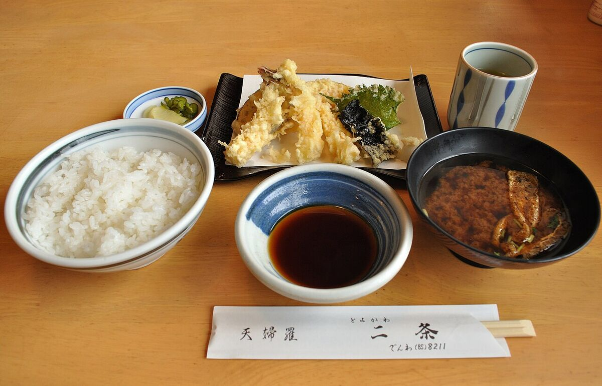
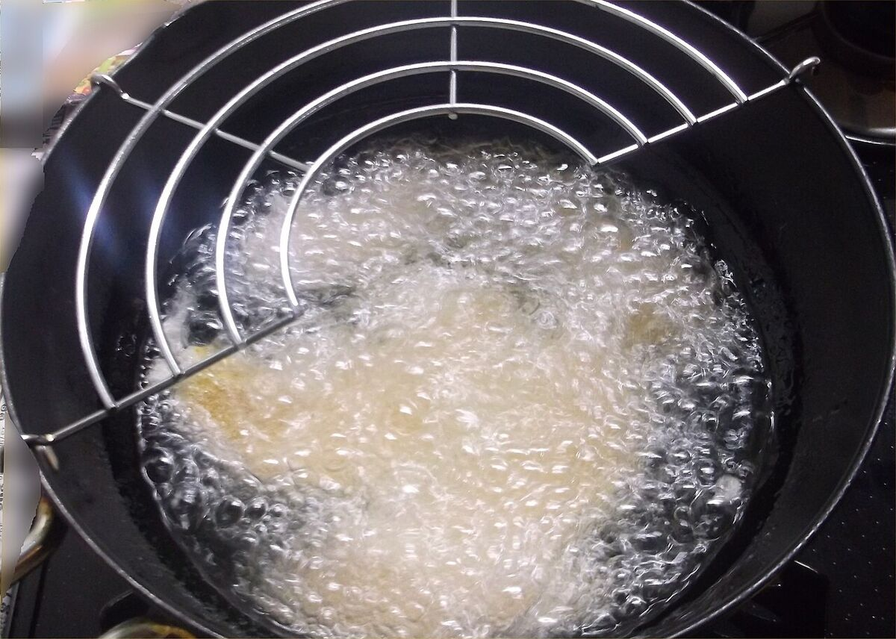

# 7. Frying: Batter, Crust and Oil

*Tempura* is the Japanese dish best known abroad for its texture: a thin, dry, crisp coating around food that stays moist inside. This chapter explains how such a crust forms, why it goes soggy, and where the oil in fried food comes from. It relies on food-science studies of tempura-style batters and on an imaging study of oil uptake. These studies were carried out in Europe on squid, courgette and plain dough, not in Japanese kitchens, so their findings are mechanisms rather than rules of tempura practice. Where traditional Japanese practice makes claims the sources do not test, the chapter says so.

<figure>

<figcaption>A tempura set meal: tempura served with rice, miso soup and a dipping sauce. <span class="credit">Photo: Ocdp, <a href="https://creativecommons.org/publicdomain/zero/1.0/">CC0</a>, via <a href="https://commons.wikimedia.org/wiki/File:Tempura_003.jpg">Wikimedia Commons</a>.</span></figcaption>
</figure>

## 7.1 What deep-frying does

Martínez-Pineda and colleagues define deep-frying as cooking by **immersion in oil or fat above the boiling point of water**. Heat and mass move at the same time: water and dissolved substances leave the food while oil enters it. The result is the texture people want from fried food, **a dry, crisp crust around a tender interior**. **Maillard reactions** in the crust give its typical flavour and colour (Martínez-Pineda et al. 2020).

A **batter** is a liquid dough into which food is dipped before frying. It acts as a **barrier against moisture loss**. A tempura batter is "basically" **flour and water**, but other ingredients are often added: starches, egg, proteins such as gluten, seasonings, gums and raising agents (Martínez-Pineda et al. 2020).

## 7.2 Gluten: from bread crust to tempura

Carvalho and Ruiz-Carrascal explain the role of wheat protein (Carvalho and Ruiz-Carrascal 2018). Gluten is "a tough, elastic substance that acts as a net, trapping and holding air bubbles". It holds the batter together and makes it stick to the food. The structure gluten forms depends on **how much gluten there is, its quality, and how far it is hydrated**. The resulting structure can be:

- **crisp and brittle**, as in a bread crust;
- **elastic**, as in the crumb of a loaf;
- **flowing**, as in a tempura batter.

Tempura-coated foods are crisp **right after frying** because a **mostly dehydrated gluten network** forms. As the coating takes up moisture, the water **plasticises** the network, and it turns **elastic and soggy** instead of crisp. The moisture can come from the surrounding air while the food is held after frying, or from the food itself when it is reheated (Carvalho and Ruiz-Carrascal 2018).

> **Technique consequence.** Crispness is a matter of **dryness**. A tempura crust is crisp because its protein network has lost its water, and it softens as soon as it gets water back. This is the scientific basis for serving tempura immediately. The sources do not test the traditional Japanese instruction to use ice-cold water and to stir the batter as little as possible. Their framework (gluten's structure depends on how far it is hydrated) is consistent with the aim behind that instruction, which is to keep the batter flowing rather than elastic, but the handbook does not claim more than that.

## 7.3 Experiments with the batter

### Replacing water with alcohol

Carvalho and Ruiz-Carrascal fried squid rings in four batters: water only, or water partly replaced by **ethanol**, each with or without **CO₂ infusion**. They tested them right after frying and after **48 hours** in the refrigerator followed by oven reheating (Carvalho and Ruiz-Carrascal 2018):

- Ethanol gave **less moisture and more fat** in the fried coating, whether or not CO₂ was used.
- Ethanol batters measured as **crisper** in instrumental tests, with a lower maximum breaking force.
- Tasters rated them **crisper and crunchier**, **even after two days of storage and reheating**.
- There was no difference in colour among the four batters.

### Courgette: thickness, time and three batters

Martínez-Pineda and colleagues fried battered courgette (zucchini) at **170 °C**. Their standard batter was 80 g wheat flour, 125 mL mineral water at **15 °C**, 1 g salt and 1 g sugar, mixed for 45 seconds. Slices were dipped for 10 seconds and drained for 8 seconds before frying (Martínez-Pineda et al. 2020). They compared:

| Batter | Change from standard | Result |
|---|---|---|
| **Standard** (SB) | — | 17.8% oil |
| **Maltodextrin** (MB) | 20 g of the flour replaced by maltodextrin | More intense **golden-brown** colour, **lower viscosity** and less batter picked up, slightly less oil (**15.8%**) |
| **Ethanol** (EB) | Part of the flour replaced by **cornflour**, part of the water by **ethanol** (50 g), plus **baking powder** | The **crispiest** coating, rougher and more stable over time, but less moisture and **more than double the oil (36.9%)** |

They also found (Martínez-Pineda et al. 2020):

- **Thinner slices** absorbed **more oil**.
- **Longer frying** gave more oil and less moisture. After 360 seconds, oil content was **54% higher** and moisture **43% lower** than after 180 seconds.
- A **higher proportion of wheat flour** gives more moisture and a strong film that acts as a **barrier against evaporation**, and so **less oil uptake** (citing earlier work).

### The trade-off

Both studies point to the same tension. **The drier and more porous the crust, the crisper it is, and the more oil it can hold.** In the courgette study, the ethanol–cornflour–baking-powder batter was the crispiest and the oiliest. The authors explain this through the **porosity** and larger surface gaps that the ethanol, raising agent and corn starch create (Martínez-Pineda et al. 2020).

## 7.4 Where the oil goes in: during frying or after?

<figure>

<figcaption>Frying kabocha tempura. While water evaporates from the food, the pressure inside keeps oil out. Most oil enters after the food leaves the pot (§7.4). <span class="credit">Photo: Kentin, <a href="https://creativecommons.org/licenses/by-sa/4.0/">CC BY-SA 4.0</a>, via <a href="https://commons.wikimedia.org/wiki/File:Frying_tempura_2014.jpg">Wikimedia Commons</a>.</span></figcaption>
</figure>

Verma and colleagues used fast synchrotron X-ray tomography to film the inside of a **wheat-flour dough** in 3D while it fried and then cooled (Verma et al. 2025). Their introduction summarises the established view:

- Oil uptake is generally driven by **pressure**. While water evaporates and the food expands, the **positive internal pressure** keeps oil out.
- When the food **cools**, the vapour inside condenses. This creates a pressure gradient that **draws surface oil into the food**. Several studies have shown that oil enters **mainly after the food leaves the oil**.
- Oil also enters fine pores in the crust by **capillary action**, so the structure of the pore network matters.

Their own measurements of final oil content at three oil temperatures were (Verma et al. 2025):

| Oil temperature | Final oil content |
|---|---|
| 180 °C | 14.4% |
| 150 °C | 12.2% |
| 120 °C | 1.3% |

Higher temperatures formed a **distinct crust with openings at the surface**. Small crust pores then filled with oil by capillary action, and pores connected to the surface reached deeper below the crust. Note that 120 °C lies below the 150–180 °C range the authors give for ordinary deep-frying (Verma et al. 2025).

> **Technique consequence.** Two practical points follow from the mechanism, as far as the sources go. First, the moment of **removal from the oil** is critical: oil clinging to the surface is drawn in as the food cools, so how quickly it is drained matters. Second, the crust that gives crispness is the same structure that takes up oil. A crisp, low-oil fry is a balance, not something one setting maximises. Verma and colleagues used a model dough, not a Japanese tempura, so the figures are not tempura figures.

## 7.5 What the sources do not cover

The following points of Japanese frying practice appear widely in cookbooks but are **not** tested in the sources used here, so this handbook does not state them as facts:

- the specific frying temperatures that Japanese cooks associate with particular ingredients;
- the choice of oil (for example, sesame-oil blends);
- the use of egg in the batter, and its effect;
- the instruction to use ice-cold water and to under-mix.

The tested mechanisms are: a **dry gluten network** gives crispness and **moisture** destroys it (§7.2); **porosity** gives crispness and also takes up oil (§7.3); oil enters mostly **during cooling** (§7.4).

## 7.6 Check yourself

```quiz
title: Chapter 7 self-check
? Why is tempura crisp right after frying but soggy later?
- A dehydrated gluten network forms, and moisture later plasticises it *
- The oil solidifies as it cools
- The starch turns back into sugar
> Carvalho and Ruiz-Carrascal 2018: moisture from the air or the food softens the network.

? In the courgette study, what did the batter with ethanol, cornflour and baking powder produce?
- The crispiest coating, with more than twice the oil *
- The palest coating with the least oil
- A soggy coating
> 36.9% oil, against 17.8% for the standard batter (Martínez-Pineda et al. 2020).

? According to the literature summarised by Verma et al., when does most oil enter fried food?
- After it is removed from the oil, as vapour condenses during cooling *
- In the first second of frying
- Only if the oil is above 200 °C
> While water evaporates, internal pressure keeps oil out. Cooling reverses the pressure.

? What did adding maltodextrin to the batter mainly change?
- A deeper golden-brown colour and less batter pick-up *
- A much crisper crust
- Twice as much oil
> Martínez-Pineda et al. 2020. Oil fell slightly, from 17.8% to 15.8%.

? Which of these is NOT established by the sources in this chapter?
- That tempura batter must be made with ice-cold water *
- That moisture makes a fried crust lose its crispness
- That thinner slices took up more oil
> The cold-water rule is traditional practice. The sources here don't test it.
```

## Sources for this chapter

1. **Carvalho and Ruiz-Carrascal 2018.** Carvalho MJ, Ruiz-Carrascal J. Improving crunchiness and crispness of fried squid rings through innovative tempura coatings: addition of alcohol and CO₂ incubation. *Journal of Food Science and Technology* 2018;55(6):2068 ff. doi:[10.1007/s13197-018-3121-2](https://doi.org/10.1007/s13197-018-3121-2). [PMC5976590](https://pmc.ncbi.nlm.nih.gov/articles/PMC5976590/).
2. **Martínez-Pineda et al. 2020.** Martínez-Pineda M, Yagüe-Ruiz C, Vercet A. How batter formulation can modify fried tempura-battered zucchini chemical and sensory characteristics? *Foods* 2020;9(5):626. doi:[10.3390/foods9050626](https://doi.org/10.3390/foods9050626). [PMC7278784](https://pmc.ncbi.nlm.nih.gov/articles/PMC7278784/).
3. **Verma et al. 2025.** Verma U, Riley IM, Lukić B, Broche L, Verboven P, Delcour JA, Nicolaï BM. High-speed computed tomography to visualise the 3D microstructural dynamics of oil uptake in deep-fried foods. *Nature Communications* 2025;16:2600. doi:[10.1038/s41467-025-57934-z](https://doi.org/10.1038/s41467-025-57934-z). [PMC11911452](https://pmc.ncbi.nlm.nih.gov/articles/PMC11911452/).

➡️ Next: [Chapter 8: Marinating with kōji](08-koji-marinades.md)
