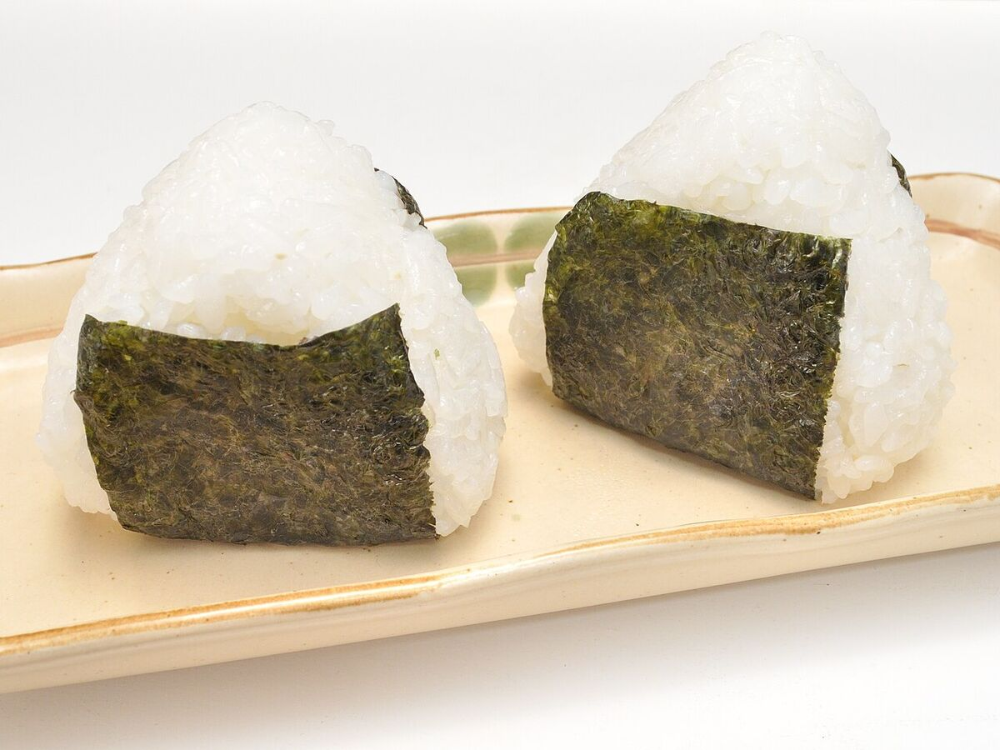

# 9. Rice: Starch, Water and Stickiness

Rice is eaten in Japan as whole cooked grains, and its quality is judged by texture: how soft, how sticky, how glossy, and how well it keeps when it cools. All of these come down to **starch**: what kind of starch the grain holds, how it takes up water, and what leaks out of the grain into the cooking water. This chapter explains that chemistry, then follows it into three Japanese uses: table rice, kōji rice (Chapter 3) and sushi rice.

<figure>

<figcaption>Onigiri (rice balls) made from Japanese table rice. <span class="credit">Photo: Ocdp, <a href="https://creativecommons.org/publicdomain/zero/1.0/">CC0</a>, via <a href="https://commons.wikimedia.org/wiki/File:Onigiri_002.jpg">Wikimedia Commons</a>.</span></figcaption>
</figure>

## 9.1 Rice in Japan

MAFF states that rice-eating culture in Japan dates back to the **Jōmon or Yayoi** era, and that rice is eaten both as steamed rice and processed into rice cakes and dumplings (MAFF, *Grain products*). Li and colleagues point out that rice is the only major cereal usually eaten as whole grains after cooking, and that cooking methods differ by region. South and East Asians typically cook rice in a rice cooker with a measured amount of water (the **absorption method**). Elsewhere, rice is often boiled in excess water, which is then drained (Li et al. 2017).

## 9.2 Two starches: amylose and amylopectin

Rice starch is made of two kinds of glucose polymer (Li et al. 2017; Nakamura et al. 2021):

| | **Amylose** | **Amylopectin** |
|---|---|---|
| Structure | Mostly linear (α-1,4 links), with a few long branches | Highly branched (α-1,4 and α-1,6 links), with a vast number of short branches |
| Molecular weight | about 10⁵–10⁶ | about 10⁷–10⁸ |

The proportion of amylose is the most widely used predictor of how cooked rice behaves. Nakamura and colleagues give the standard classes of **apparent amylose content (AAC)**, measured by the iodine method (Nakamura et al. 2021):

| Class | Apparent amylose content |
|---|---|
| **Waxy** (glutinous, *mochi-gome*) | below 2% |
| Very low | 5–12% |
| Low | 12–20% |
| Intermediate | 20–25% |
| High | 25–33% |

They summarise the rule: **high-amylose rice becomes hard and non-sticky** when cooked (Nakamura et al. 2021). Li and colleagues add that stickiness is consistently **negatively correlated** with amylose content and hardness. High-amylose rice is usually harder and less sticky, and low-amylose rice softer and stickier. But rice varieties with **similar** amylose contents can still differ in stickiness (Li et al. 2017). Something else is at work.

## 9.3 Where stickiness comes from: what leaks out

During cooking, some starch **leaches** out of the grains into the water and onto their surfaces. Two studies examined this leachate.

### Koshihikari against a less sticky rice

Hanashiro and colleagues compared **Koshihikari**, known for its sticky grains, with **Hoshiyutaka**, known for less sticky ones, and with the waxy rice **Hiyokumochi** (Hanashiro et al. 2004):

- The amount of material leached **increased with the temperature** at which it was collected. At 85 °C, it was **0.9%** (Hiyokumochi), **0.8%** (Koshihikari) and **1.3%** (Hoshiyutaka) of the rice weight.
- More than **93%** of the leached material was carbohydrate, mostly starch-derived.
- The **amylose** share of the leachate was **1%** (Hiyokumochi), **9%** (Koshihikari) and **21%** (Hoshiyutaka).
- In a swap experiment, they replaced Koshihikari's leached liquid with Hoshiyutaka's. Koshihikari's adhesiveness **fell from 334 to 173 erg**.

They concluded that **the more small amylose molecules there are in the leachate, the less sticky the cooked grains** (Hanashiro et al. 2004). Note that the less sticky rice actually leached **more** material. The difference lies in what the leachate is made of, not how much there is.

### The molecular picture

Li and colleagues analysed the leachate of several cultivars molecularly. Rice was cooked at a rice-to-water ratio of 1:1.6 for 30 minutes (Li et al. 2017). They found:

- **Mainly amylopectin, not amylose**, leaches out of the starch granules and the grain during cooking.
- Leached amylopectin molecules are about **30 times smaller** than native amylopectin. Leached amylose molecules are about **5 times smaller** than native amylose.
- **Stickiness increases** with:
  - **lower amylose** content in the whole grain;
  - **more amylopectin** in the leachate;
  - a **larger share of short amylopectin chains** in the leachate;
  - a **larger molecular size** of the leached amylopectin.

Their explanation is drawn from polymer physics. Highly branched molecules crowd and interpenetrate, which restricts their movement and gives them a higher viscous resistance than linear molecules. More branching and larger leached amylopectin molecules therefore mean a "stickier" surface film between grains. Amylose, by contrast, acts more like a **diluent** in terms of viscosity (Li et al. 2017). The authors suggest that the small amylopectin molecules sit loosely at the edges of the starch's internal structures, and are released once heating destroys its crystalline order (Li et al. 2017).

> **Technique consequence.** The stickiness that sushi and Japanese table rice need is a **surface property**. It comes from branched starch released onto the grain surface during cooking. Li and colleagues note that stickiness between grains is "the key requirement for sushi" (Li et al. 2017). The swap experiment shows that the cooking water carries much of the effect: replacing the leachate halved Koshihikari's adhesiveness (Hanashiro et al. 2004).

## 9.4 Water: soaking and the cooking ratio

Laboratory studies of Japanese rice use controlled cooking, which shows the variables that matter. Nakamura and colleagues' standard method (Nakamura et al. 2021):

- **10 g** of milled rice with **14 g** of water, **1.4 times the rice weight**. (The rice is taken at a standard 13.5% moisture, and the water ratio is corrected for each sample.)
- **Soak for 1 hour**, then cook in an electric rice cooker.
- Hold at **25 °C for 2 hours** before measuring.

This is not a household recipe. It shows that **water ratio** and **soaking** are fixed, measured quantities in research on rice quality, because they change the result.

### Why full cooking matters: the kōji lesson

Chapter 3 gave a sharp example of what incomplete cooking does. For kōji, rice is steamed with near-saturated steam for **40–60 minutes** to convert its raw (β) starch completely into gelatinised (α) starch. In **undercooked** rice, the mould's hyphae cannot penetrate the grain, and kōji fails (Kusumoto et al. 2021). Thorough steaming is what lets the hyphae digest their way into the grain (Kusumoto et al. 2021).

## 9.5 Cooling: retrogradation

Cooked rice hardens as it cools and is stored. This is **retrogradation**: the gelatinised starch partly re-orders itself. Nakamura and colleagues measure it with a staling test. Cooked rice is stored at **6 °C for 24 hours**, and its hardness is compared with that of the same rice held at 25 °C for 2 hours. They call the ratio the **degree of retrogradation** (Nakamura et al. 2021).

Their review of earlier work notes (Nakamura et al. 2021):

- Rice quality depends **not only on amylose but also on amylopectin**.
- Retrogradation rates of rice starches correlate positively with the proportion of **longer amylopectin chains** (degree of polymerisation, DP, above 10).
- A **"super-hard" rice** developed in Japan by mutation has an apparent amylose content above **35%**, because its amylopectin has many **super-long chains**.

Their own contribution is a fast instrument test. A viscosity profile measured at **120 °C** correlated strongly with the hardness of cooked rice after cold storage (r = 0.92 for surface hardness) (Nakamura et al. 2021). For the cook, the point is that how hard a rice becomes in the refrigerator can be **predicted from its starch** before it is cooked.

## 9.6 Sushi rice: vinegar changes texture

Sushi rice (*sushi-meshi*) is cooked rice seasoned with sushi vinegar. Chapter 5 described Odahara and colleagues' study of how each part of sushi vinegar affects the rice. Added right after cooking and tested before and after a night at 4 °C (Odahara et al. 2004):

- **Acetic acid made the rice stickier** than plain water did, both fresh and after cold storage.
- **Sugars made the grain surface harder** after cold storage, **fructose** most of all.
- **High levels of sucrose or fructose reduced** the stickiness caused by the acetic acid.

So sushi vinegar is not just a flavour. Its acid and its sugar pull the texture in **opposite directions**, and their balance sets how the rice behaves. Koda and Matsumoto's kombu study (Chapter 2) adds a related detail: tasters preferred a **dilute-umami** kombu stock for seasoning sushi rice (Koda and Matsumoto).

## 9.7 Check yourself

```quiz
title: Chapter 9 self-check
? A rice has an apparent amylose content of 1.5%. What is it?
- Waxy (glutinous) rice *
- A typical high-amylose rice
- A very low-amylose table rice
> Waxy rice is below 2% (Nakamura et al. 2021).

? Li et al. found that mainly one starch leaches out of rice grains during cooking. Which?
- Amylopectin *
- Amylose
- Neither: only protein leaches
> Leached amylopectin molecules were about 30 times smaller than native ones.

? Hoshiyutaka leached more material than Koshihikari at 85 °C, yet was less sticky. Why?
- Its leachate had much more amylose (21% against 9%) *
- It leached no starch at all
- Its grains were longer
> More small amylose in the leachate means less adhesiveness (Hanashiro et al. 2004).

? Which leachate feature increased stickiness in Li et al.'s study?
- More short amylopectin chains and larger leached amylopectin molecules *
- More amylose
- Smaller amylopectin molecules
> Branched, large molecules give higher viscous resistance (Li et al. 2017).

? How do Nakamura et al. measure the "degree of retrogradation"?
- Hardness after 24 h at 6 °C divided by hardness after 2 h at 25 °C *
- The weight of water lost in storage
- The colour change of the grains
> A staling test for cooked rice.

? In sushi vinegar, what pulls against acetic acid's effect on stickiness?
- High concentrations of sucrose or fructose *
- Salt
- Water
> Odahara et al. 2004.
```

## Sources for this chapter

1. **Li et al. 2017.** Li H, Fitzgerald MA, Prakash S, Nicholson TM, Gilbert RG. The molecular structural features controlling stickiness in cooked rice, a major palatability determinant. *Scientific Reports* 2017;7:43713. doi:[10.1038/srep43713](https://doi.org/10.1038/srep43713). [PMC5338010](https://pmc.ncbi.nlm.nih.gov/articles/PMC5338010/).
2. **Hanashiro et al. 2004.** Hanashiro I, Ohta K, Takeda C, Mizukami H, Takeda Y. Leaching of amylose and amylopectin during cooking of rice grains and their effect on adhesiveness of cooked rice. *Journal of Applied Glycoscience* 2004;51(4):349–354. doi:[10.5458/jag.51.349](https://doi.org/10.5458/jag.51.349). Cited from the English abstract.
3. **Nakamura et al. 2021.** Nakamura S, Katsura J, Maruyama Y, Ohtsubo K. Evaluation of hardness and retrogradation of cooked rice based on its pasting properties using a novel RVA testing. *Foods* 2021;10(5):987. doi:[10.3390/foods10050987](https://doi.org/10.3390/foods10050987). [PMC8147165](https://pmc.ncbi.nlm.nih.gov/articles/PMC8147165/).
4. **Odahara et al. 2004.** See [Chapter 5](05-mirin-vinegar.md).
5. **Kusumoto et al. 2021.** See [Chapter 3](03-koji.md).
6. **Koda and Matsumoto.** See [Chapter 2](02-dashi.md).
7. **MAFF.** Ministry of Agriculture, Forestry and Fisheries of Japan. *Grain products — Traditional Foods in Japan.* [maff.go.jp](https://www.maff.go.jp/e/policies/market/dento_syoku/bunrui/kokurui.html), accessed 17 November 2026.

➡️ Next: [Chapter 10: Noodles](10-noodles.md)
