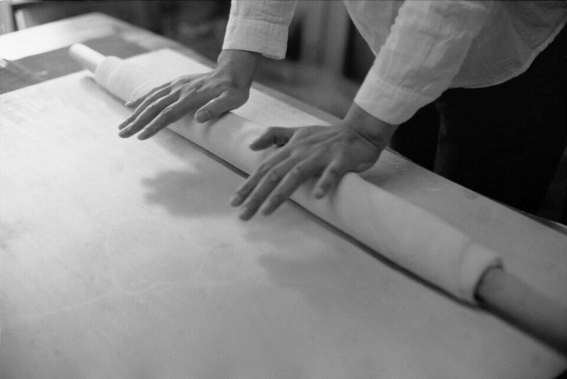

# 10. Noodles: Udon and Soba

Japan's two traditional noodles sit at opposite ends of a technical problem. **Udon** is made from wheat, and its texture depends on how gluten and starch work together. **Soba** is made from buckwheat, which has **no gluten at all**, so the noodle has to hold together some other way. This chapter explains both, and ends with what happens to a noodle in the pot and in the minutes after it leaves the pot.

<figure>

<figcaption>Rolling out udon dough with a long rolling pin, in Ube, Yamaguchi Prefecture. <span class="credit">Photo: Ken FUNAKOSHI from Okinawa, Japan, <a href="https://creativecommons.org/licenses/by-sa/2.0/">CC BY-SA 2.0</a>, via <a href="https://commons.wikimedia.org/wiki/File:Udon_making.jpg">Wikimedia Commons</a>.</span></figcaption>
</figure>

## 10.1 History and definitions

MAFF says the origin of udon and soba is unknown, but that the culture of eating them is said to have arisen in the **Edo era**. A method for making buckwheat noodles called *sobakiri* is described in the Edo-period cookbook *Ryōri monogatari*, which suggests soba noodles existed before that (MAFF, *Grain products*). MAFF's regional-cuisine page adds that buckwheat had long been eaten as flour or grain, in kneaded form. At the beginning of the Edo period, soba noodles were served in **temples**, and they were later sold alongside udon in Edo (MAFF, *Soba*).

MAFF's definitions (MAFF, *Grain products*):

- **Udon**: noodles made by adding **salt water to wheat flour** and kneading. Variants include *hiyamugi* (thin), *hiramen* or *kishimen* (flat) and *sōmen* (very fine).
- **Soba**: noodles made by kneading **buckwheat flour, water and binding agents such as wheat flour and eggs**. The kneaded mass before shaping is called *sobagaki*. The colour of soba comes from the buckwheat used. MAFF divides it into **sarashina** soba (light-coloured, light flavour) and **yabu** soba (dark-coloured, strong flavour).

## 10.2 Udon: gluten, starch and salt

### The official sizes

Japan Agricultural Standards (JAS) distinguish the dried wheat noodles by **diameter** (MAFF, *Grain products*):

| Dried noodle | JAS size |
|---|---|
| Udon | diameter **1.7 mm or more** |
| Hiyamugi | diameter **1.3 mm to under 1.7 mm** |
| Sōmen | diameter **under 1.3 mm** |
| Hiramen | width **4.5 mm or more**, thickness **under 2.0 mm**, tape-shaped |
| Hand-stretched udon (*tenobe*) | Dough is coated with oil, then stretched and twisted into strands and dried; diameter 1.7 mm or more |

### What udon needs from its flour

Pokharel and colleagues summarise the requirements for udon, a Japanese-type **white salted noodle** (Pokharel et al. 2023):

- The key ingredients are **wheat flour, salt and water**. White salted noodles are defined by the **absence** of the alkaline salts used in yellow alkaline noodles such as ramen.
- Udon is made from white wheat varieties with **8–10% protein** and **low amylose**, about **22%** of total starch.
- Good udon has a strand diameter of **2.0–3.9 mm**, a **bright, creamy white** colour when cooked, high water absorption, resistance to boiling, and a **soft, elastic, smooth** texture described as ***mochi-mochi***.
- Suitable wheat is reported to grow only in **Japan and Australia**. Japan buys much of its udon wheat from Western Australia, whose varieties resemble the Japanese cultivar **Norin 61**. Their **partially waxy starch** gives a high viscosity peak and high swelling volume when gelatinised, which good udon requires.
- In the dough, **gliadins** give viscosity and **glutenins** give elasticity. **Starch acts as a filler** in the gluten network. A low gelatinisation temperature shortens cooking time.

> **Technique consequence.** Udon's prized *mochi-mochi* softness comes largely from its **starch**: a low-amylose, partially waxy starch that swells strongly. Chapter 9 showed the same link in rice, where lower amylose went with softer, stickier grains. The gluten network gives the elastic "spring". Neither alone makes udon.

### Salt

MAFF's definition makes salt water essential to udon (MAFF, *Grain products*). The sources read for this chapter do not quantify salt's mechanical role in udon dough, so this handbook does not state one.

## 10.3 Soba: holding together without gluten

### The binding problem

Suzuki and colleagues explain the central difficulty (Suzuki et al. 2020):

- **Unlike wheat flour, buckwheat flour contains no gluten.** The strength and handling of buckwheat dough and noodles, including their resistance to cracking, are therefore not as good as wheat's.
- Japanese noodle makers **sometimes mix wheat flour into buckwheat flour** to strengthen the dough. The proportion of wheat ranges from **very low** to **moderate** in soba shops, and is **sometimes over 70%** in dried noodles.
- Buckwheat flour has about **12–13% protein**, more than rice (6.1%) or barley (7%). Its main proteins are **salt-soluble globulins**, not gluten-forming proteins. Earlier work suggests protein may be an important factor in the mechanical properties of buckwheat noodles.
- Buckwheat starch makes up to **75%** of the dry weight of the groats, with typically **20–30% amylose**.

### Flour from different parts of the seed

Maeda and colleagues describe how buckwheat is milled (Maeda et al. 2009):

- De-hulled grains can be ground whole into ***marunuki*** flour.
- Alternatively, milling separates flours from different parts of the grain. The **first flour**, ***sarashina***, comes from the inner part (mainly endosperm) and contains about **77.6% carbohydrate**. The second and third flours come from the intermediate and outer layers. They contain **more protein, fat and ash** and less carbohydrate.
- Buckwheat flour contains about **10% protein**, and **double or more the ash** of wheat flour.

The name of the inner flour, *sarashina*, is also the name MAFF gives to pale, light-flavoured soba. MAFF attributes soba's colour to the colour of the buckwheat used (MAFF, *Grain products*). The sources do not spell out which flours go into the darker *yabu* style, so this handbook does not either. MAFF's soba page adds that of Tokyo's three famous soba houses, *Sarashina* has translucent noodles and *Yabu* greenish ones (MAFF, *Soba*).

### Freshness of the flour

Suzuki and colleagues stress that, in Japan, **the freshness of buckwheat flour is very important to noodle makers, because it deteriorates quickly** (Suzuki et al. 2020):

- Deterioration is caused mainly by **lipid breakdown and oxidation**, driven by the enzymes of the **lipoxygenase pathway**. Free fatty acids accumulate, and peroxides and carbonyl compounds increase.
- Deterioration was **faster at 20 °C than at 5 °C**.
- **Bitterness** in buckwheat flour increases with storage temperature.
- Japanese millers, distributors, noodle makers and some consumers **value a green colour** in the seed. Getting it requires early harvest, which lowers yield.

> **Technique consequence.** Soba flour behaves like a perishable ingredient, not a dry staple. Cool storage slows the enzymatic and oxidative changes that make it stale and bitter.

## 10.4 In the pot: water moves in, then keeps moving

Maeda and colleagues used **magnetic resonance imaging (MRI)** to watch water move inside **two soba** (*marunuki* and *sarashina*) and **one udon-type wheat noodle** during boiling and during holding after boiling (Maeda et al. 2009).

Their framing of good texture:

- During boiling, water enters from the surface. A **moisture gradient** forms, from the soft, swollen starch at the surface, with high water content, to a harder, drier **core**. This gradient gives the desirable **resistance to the teeth**.
- Cooking beyond the optimal time makes the noodle **too soft and breakable**, because the moisture becomes evenly distributed.
- Each noodle therefore has its own **optimal cooking time**.

Their measurements:

| Phase | Apparent water diffusion coefficient | Comparison |
|---|---|---|
| During boiling | 4–7 × 10⁻⁶ cm²/s | **Higher** in soba than in wheat noodles |
| Holding after boiling (30–120 min) | 2–3 × 10⁻⁷ cm²/s, constant | Lower in soba than in wheat noodles |

The authors conclude that, compared with wheat noodles, **buckwheat noodles cook more quickly** and **lose their favourable texture** during holding (Maeda et al. 2009).

> **Technique consequence.** The texture of a noodle is a **snapshot of a moving gradient**. Water keeps moving inward after the noodle leaves the pot, slowly flattening the soft-outside, firm-inside structure. Soba's faster uptake while boiling means a shorter window for cooking it right.

## 10.5 Check yourself

```quiz
title: Chapter 10 self-check
? Why do soba makers often add wheat flour?
- Buckwheat has no gluten, so the dough is weak and cracks *
- To make the noodles darker
- Because buckwheat flour has too much protein
> Suzuki et al. 2020: the wheat share ranges from very low in soba shops to over 70% in some dried noodles.

? What defines dried udon, hiyamugi and sōmen under the JAS standard?
- Their diameter *
- Their salt content
- The type of wheat
> Udon 1.7 mm or more, hiyamugi 1.3–1.7 mm, sōmen under 1.3 mm (MAFF).

? Which starch property do Japanese udon wheats share?
- Low amylose and partially waxy starch that swells strongly *
- Very high amylose
- No starch, only gluten
> About 22% amylose. High peak viscosity and swelling volume give the mochi-mochi texture (Pokharel et al. 2023).

? Where does pale sarashina buckwheat flour come from?
- The inner part of the seed, mainly endosperm *
- The husk
- The whole seed ground together
> Whole-seed flour is marunuki. The outer flours have more protein, fat and ash (Maeda et al. 2009).

? What gives a well-cooked noodle its "resistance to the teeth"?
- A moisture gradient from a soft wet surface to a firmer, drier core *
- An even moisture content throughout
- Salt crystals in the core
> Overcooking evens out the moisture and makes the noodle soft and breakable (Maeda et al. 2009).

? Why should soba flour be stored cool?
- Lipid breakdown and oxidation, which make it stale and bitter, are faster when warm *
- It absorbs water from the air
- Cold activates its gluten
> Deterioration was faster at 20 °C than at 5 °C (Suzuki et al. 2020).
```

## Sources for this chapter

1. **Pokharel et al. 2023.** Pokharel A, Jaidka RK, Sruthi NU, Bhattarai RR. Effects of incorporation of porous tapioca starch on the quality of white salted (udon) noodles. *Foods* 2023;12(8):1662. doi:[10.3390/foods12081662](https://doi.org/10.3390/foods12081662). [PMC10137948](https://pmc.ncbi.nlm.nih.gov/articles/PMC10137948/). Used for its introduction's summary of udon requirements.
2. **Suzuki et al. 2020.** Suzuki T, Noda T, Morishita T, Ishiguro K, Otsuka S, Brunori A. Present status and future perspectives of breeding for buckwheat quality. *Breeding Science* 2020;70(1):48 ff. [PMC7180147](https://pmc.ncbi.nlm.nih.gov/articles/PMC7180147/).
3. **Maeda et al. 2009.** Maeda I, Horigane AK, Yoshida M, Aikawa Y. Water diffusion in buckwheat noodles and wheat noodles during boiling and holding as determined from MRI and rectangular cylinder diffusion model. *Food Science and Technology Research* 2009;15(2):107–116. [J-STAGE PDF](https://www.jstage.jst.go.jp/article/fstr/15/2/15_2_107/_pdf).
4. **MAFF, *Grain products*.** Ministry of Agriculture, Forestry and Fisheries of Japan. *Grain products — Traditional Foods in Japan.* [maff.go.jp](https://www.maff.go.jp/e/policies/market/dento_syoku/bunrui/kokurui.html), accessed 17 November 2026.
5. **MAFF, *Soba*.** Ministry of Agriculture, Forestry and Fisheries of Japan. *Soba — Our Regional Cuisines.* [maff.go.jp](https://www.maff.go.jp/e/policies/market/k_ryouri/search_menu/6156/index.html), accessed 17 November 2026.

➡️ Next: [Chapter 11: Tofu](11-tofu.md)
