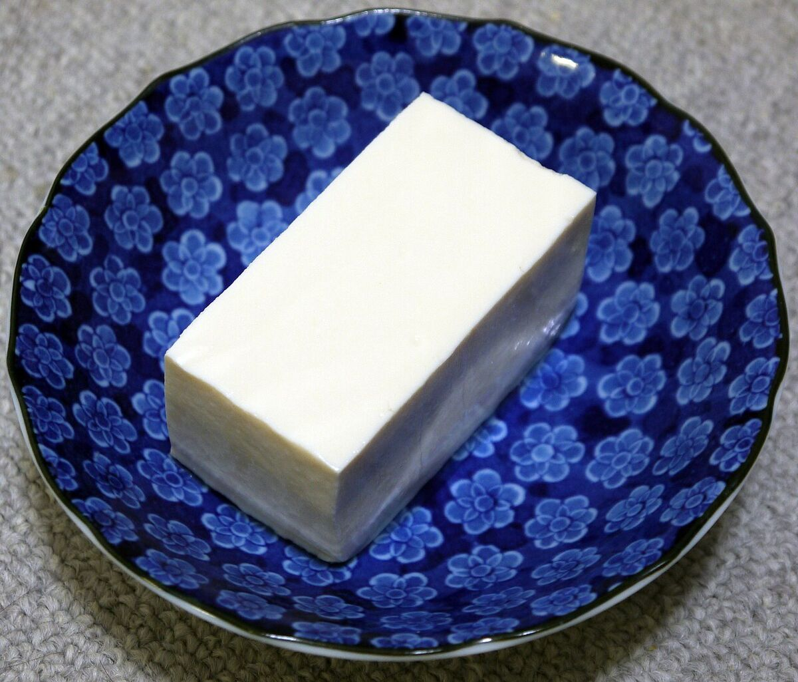
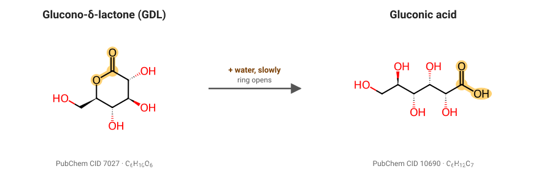

# 11. Tofu: Turning Soy Milk into a Gel

[Tofu](https://en.wikipedia.org/wiki/Tofu) is the clearest example in this handbook of texture made by chemistry. It is [soy milk](https://en.wikipedia.org/wiki/Soy_milk) turned solid by adding a coagulant, and its character depends almost entirely on three choices: **which coagulant**, **how much**, and at **what temperature**. Then comes one mechanical choice: whether to press the water out. This chapter goes through these choices using a 2024 review of the research on coagulants and the Ministry of Agriculture's description of Japanese tofu types.

<figure>

<figcaption>Kinugoshi (silken) tofu: fine-grained and soft, set without pressing (§11.1). <span class="credit">Photo: DryPot, <a href="https://creativecommons.org/licenses/by-sa/3.0/">CC BY-SA 3.0</a>, via <a href="https://commons.wikimedia.org/wiki/File:Japanese_SilkyTofu_%28Kinugoshi_Tofu%29.JPG">Wikimedia Commons</a>.</span></figcaption>
</figure>

## 11.1 Origins and the Japanese types

Geng and colleagues describe tofu as a Chinese food that originated in the Western Han dynasty more than 2,000 years ago (Geng et al. 2024). [MAFF](https://en.wikipedia.org/wiki/Ministry_of_Agriculture,_Forestry_and_Fisheries_%28Japan%29) gives its Japanese history: tofu came from China together with Buddhism, probably in the **[Nara](https://en.wikipedia.org/wiki/Nara_period) period**. It was at first a food of nobles and priests, and became common among ordinary people in the **[Edo](https://en.wikipedia.org/wiki/Edo_period) period**. MAFF also notes that [soybeans](https://en.wikipedia.org/wiki/Soybean) are believed to have reached Japan almost 2,000 years ago (MAFF, *Processed bean products*).

MAFF divides today's tofu into two main types (MAFF, *Processed bean products*):

| | ***Momen-dōfu*** ("cotton" tofu) | ***Kinugoshi-dōfu*** ("silk-strained" tofu) |
|---|---|---|
| Grain | Coarse | Fine |
| How it is made | Soy milk is set with a coagulant. The curd is **broken**, put in a moulding box, **pressed** to squeeze out water, and set again. | **Thicker** soy milk is set with a coagulant, **without** pressing. |
| Texture | Moderately firm | Soft |
| Nutrients | More protein, fat, calcium, iron and fibre, because the soybean solids are concentrated | More potassium and B vitamins, because the water is kept |

MAFF adds a historical note. Tofu as introduced from China is believed to have been **hard**, like the *shima-dōfu* of Okinawa (firmer still than momen) or the *kata-dōfu* still made in parts of Ishikawa, Toyama and Tokushima. Smooth, tongue-pleasing tofu was developed gradually, ending in today's kinugoshi (MAFF).

## 11.2 From bean to soy milk

Geng and colleagues list the operations of tofu-making: **selecting, soaking, grinding, filtering, boiling, pulping, setting and pressing** (Geng et al. 2024). MAFF summarises the core: soybeans are ground and heated with water, the fibre and other solids are removed as ***[okara](https://en.wikipedia.org/wiki/Okara_%28food%29)***, and the soy milk is set with a coagulant (MAFF).

### Why the milk must be heated first

Heating is not just sterilisation. The review explains that the **thermal [denaturation](https://en.wikipedia.org/wiki/Denaturation_%28biochemistry%29) of the proteins is necessary** to form an aggregated network. Heating disrupts the compact protein structure, whereas acid precipitation and calcium alone do not. The network formed by heat-denatured soybean protein has high water retention, low hardness and high springiness (Geng et al. 2024).

Soybean protein is not one protein. Its two main storage proteins denature at different temperatures (Geng et al. 2024):

| Protein | Denaturation temperature |
|---|---|
| β-conglycinin (7S) | about **71 °C** |
| Glycinin (11S) | about **92 °C** |

One study exploited this difference. A **two-step heating, 75 °C for 5 minutes then 95 °C for 5 minutes**, gave a springier curd than a single heating at 95 °C for 5 minutes (Geng et al. 2024).

## 11.3 The coagulants

The review groups coagulants into **salts**, **acids**, **enzymes** and newer composite types (Geng et al. 2024). In ancient times, **brine** (bittern, Japanese *[nigari](https://en.wikipedia.org/wiki/Bittern_%28salt%29)*) or **gypsum** ([calcium sulfate](https://en.wikipedia.org/wiki/Calcium_sulfate)) were the main coagulants. **[Glucono-δ-lactone](https://en.wikipedia.org/wiki/Glucono-%CE%B4-lactone)** ("lactone tofu") has been used in large-scale production since the **1980s** because of its softness, smooth texture, high water retention and springiness (Geng et al. 2024).

### Salt coagulants: bridges of calcium and magnesium

Salt coagulants are the oldest and most widely used. They include **[magnesium chloride](https://en.wikipedia.org/wiki/Magnesium_chloride)**, **[magnesium sulfate](https://en.wikipedia.org/wiki/Magnesium_sulfate)**, **calcium chloride**, **calcium sulfate** and **calcium acetate** (Geng et al. 2024).

How they work: the most-cited explanation is the **"ion bridge" theory**. The divalent cations **Ca²⁺** and **Mg²⁺** bind to the **carboxyl groups** of protein side chains, especially those of aspartic acid and [glutamic acid](https://en.wikipedia.org/wiki/Glutamic_acid), and link protein molecules together (Geng et al. 2024). The review concludes from comparisons of calcium salts that the **cations start** curd formation, while the **anions** have a greater effect on how fast the protein gels and how much water the tofu keeps (Geng et al. 2024).

Comparisons reported in the review (Geng et al. 2024):

- **Calcium sulfate** gave a **more uniform network** with a **finer, smoother surface** than magnesium chloride. In another study, calcium sulfate was judged the most suitable coagulant overall, with high yield, good [isoflavone](https://en.wikipedia.org/wiki/Isoflavone) retention and superior texture.
- **Calcium chloride** gave a significantly **higher yield** than other calcium salts. **Calcium sulfate** and **calcium gluconate** gave significantly **harder** tofu.
- **More coagulant** increased gel strength but **reduced water retention**.

### Magnesium chloride: concentration decides everything

The review gives detailed findings on magnesium chloride, the salt studied in its section on brine coagulation (Geng et al. 2024):

- Low concentrations (**below 10 mmol/L**) gave **smooth** precipitates. Higher concentrations (**10–20 mmol/L**) gave **rough** ones. Commercial tofu averaged about **10 mmol/L** (range 0–20).
- Over the full range up to saturation, coagulation passes through **five stages**:

| MgCl₂ (mmol/L) | Stage |
|---|---|
| 0–3 | No curd |
| 3–8 | Curd forming |
| 8–50 | Stable coagulation |
| 50–210 | Curd **dissociating** again |
| 210 and above | No curd |

The review points out why this matters in practice. Real production uses **concentrated or saturated brine**. Right after it is added, the brine is very unevenly distributed in the milk, so parts of the milk briefly see far higher concentrations than the average (Geng et al. 2024).

> **Technique consequence.** Magnesium chloride is concentration-sensitive: too little does nothing, a moderate amount sets the milk, and a local excess can make a rough curd or even break it up again. This explains why magnesium chloride is harder to handle than gypsum, which gives a smoother, more uniform network.

### Acid coagulants: glucono-δ-lactone

**Glucono-δ-lactone (GDL)** slowly turns into **[gluconic acid](https://en.wikipedia.org/wiki/Gluconic_acid)** in water. Acid coagulants work mainly through **hydrogen ions**. The process has **two steps**: heat denatures the protein, then the acid promotes **[hydrophobic](https://en.wikipedia.org/wiki/Hydrophobic_effect) coagulation**. Compared with GDL, **calcium ions** set the milk **more rapidly** (Geng et al. 2024).

<figure class="diagram">

<figcaption>GDL is the closed-ring form of gluconic acid. In water the ring opens slowly, releasing the acid that sets the curd (Geng et al. 2024). <span class="credit">Diagram drawn for this handbook with <a href="https://www.rdkit.org/">RDKit</a> from PubChem structure records: <a href="https://pubchem.ncbi.nlm.nih.gov/compound/7027">glucono-δ-lactone</a>, <a href="https://pubchem.ncbi.nlm.nih.gov/compound/10690">gluconic acid</a>.</span></figcaption>
</figure>

Findings on GDL tofu (Geng et al. 2024):

- Below **70 °C**, gelation is **slow** and forms a relatively **soft** curd. Above **70 °C**, reactive groups are exposed, gelation **speeds up**, and the curd is **rough**.
- One study found the best water-holding capacity with **12% soy milk heated at 95 °C for 20 minutes** and set at **85 °C for 60 minutes**.
- The hydrophobic interaction behind GDL coagulation was strongest when the milk had been heated to **90 °C**. At that point coagulation was fastest and the gel strongest.
- Other organic acids (lactic, acetic, succinic, tartaric, citric) can also set tofu.

### The general two-step model

For both salts and acids, the review summarises the traditional model as (Geng et al. 2024):

1. **thermal denaturation** of the proteins;
2. **hydrophobic coagulation**, promoted by metal ions or acid protons.

A finer three-step description divides it into **denaturation**, **aggregation of protein chains** (driven mainly by electrostatic and hydrophobic interactions) and **connection of the chains** (mainly through [hydrogen bonds](https://en.wikipedia.org/wiki/Hydrogen_bond) and disulfide bonds) (Geng et al. 2024). The two main proteins play different roles: the **11S** protein dominates at low coagulant concentrations, and the **7S** protein matters more at high ones (Geng et al. 2024).

## 11.4 The hidden variable: phytic acid

Two batches of soybeans can make different tofu with the same coagulant. One reason is **[phytic acid](https://en.wikipedia.org/wiki/Phytic_acid)**, a phosphate compound in seeds that is highest in legume seeds, bran and germ (Geng et al. 2024):

- Phytic acid **binds calcium preferentially** and reversibly. When calcium is added, it reduces the direct reaction between calcium and protein, creating a "**buffer period**" in coagulation.
- Overall, **the more phytic acid, the softer the tofu**. Removing it with the enzyme phytase gave tofu with higher fracture stress.
- The phytic acid content of soybeans is **more influenced by growing conditions** than their protein content, which makes tofu quality hard to control.
- One study recommends a soybean phytic acid content of **17–20 mg/g** for good tofu.

> **Technique consequence.** The "right" amount of coagulant is not a constant. It depends on the beans. A tofu maker adjusts the dose to each batch of soybeans because part of the calcium or magnesium is taken up by phytic acid before it reaches the protein.

## 11.5 Tofu transformed

Tofu is mostly water, fragile and quick to spoil. MAFF describes the traditional ways of changing it (MAFF, *Processed bean products*):

- ***[Aburaage](https://en.wikipedia.org/wiki/Abura-age)***: thin slices of tofu fried in oil, with the surface dried.
- ***Atsuage***: thick slices fried briefly in hot oil, so the inside is still tofu.
- ***Ganmodoki***: tofu broken up, mixed with vegetables and other ingredients, shaped, and fried.
- ***Kōri-dōfu*** (*[kōya-dōfu](https://en.wikipedia.org/wiki/Koya-dofu)* in [Kansai](https://en.wikipedia.org/wiki/Kansai_region), *shimi-dōfu* in Tōhoku): **[freeze-dried](https://en.wikipedia.org/wiki/Freeze_drying)** tofu. Freezing and drying change the tissue, giving a texture unlike the original.
- ***[Yuba](https://en.wikipedia.org/wiki/Tofu_skin)***: the **film** that forms on the surface of soy milk when it is heated continuously. It is made only from soybeans and concentrates all their components. It is eaten fresh, dried or moulded.

## 11.6 Check yourself

```quiz
title: Chapter 11 self-check
? What is the main difference in how momen and kinugoshi tofu are made?
- Momen curd is broken and pressed. Kinugoshi sets whole from thicker milk without pressing *
- Momen uses nigari, kinugoshi always uses GDL
- Kinugoshi is strained through silk after setting
> MAFF: momen is broken, moulded, pressed and set again. Kinugoshi is set from thicker soy milk.

? According to the "ion bridge" theory, how do calcium and magnesium set soy milk?
- The divalent ions link protein molecules through their carboxyl groups *
- They make the milk acidic
- They break proteins into smaller pieces
> Geng et al. 2024. Acid coagulants like GDL work mainly through hydrogen ions.

? Why must soy milk be heated before it is coagulated?
- Thermal denaturation of the proteins is needed to build the gel network *
- Coagulants only dissolve in hot milk
- Heating removes the okara
> Geng et al. 2024.

? With magnesium chloride, what happens if the local concentration goes far too high (50–210 mmol/L)?
- The curd starts to dissociate again *
- The tofu becomes extra smooth
- Nothing changes beyond the stable stage
> Lu et al., cited in Geng et al. 2024, identified five stages ending in no curd at 210 mmol/L and above.

? Two batches of beans give different tofu with the same coagulant dose. Which compound does the review single out?
- Phytic acid, which binds calcium and softens the tofu *
- Lactic acid
- Starch
> Its level varies with growing conditions more than protein does.

? A GDL tofu is set at 60 °C instead of 85 °C. What does the research predict?
- Slower gelation and a softer curd *
- Faster gelation and a rougher curd
- No curd at all
> Below 70 °C gelation is slow and soft. Above 70 °C it is faster and rough (Geng et al. 2024).
```

## Sources for this chapter

1. **Geng et al. 2024.** Geng Y, Du X, Jia R, Zhu Y, Lu Y, Guan X, Hu Y, Zhu X, Zhang M. Research progress on tofu coagulants and their coagulation mechanisms. *Foods* 2024;13(21):3475. doi:[10.3390/foods13213475](https://doi.org/10.3390/foods13213475). [PMC11545762](https://pmc.ncbi.nlm.nih.gov/articles/PMC11545762/). A review: individual findings come from the primary studies it cites.
2. **MAFF.** Ministry of Agriculture, Forestry and Fisheries of Japan. *Processed bean products — Traditional Foods in Japan.* [maff.go.jp](https://www.maff.go.jp/e/policies/market/dento_syoku/bunrui/mamerui-kakou.html), accessed 17 November 2026. Based on *Nihon no Dentō Shokuhin Jiten* (Encyclopedia of Traditional Japanese Food), Asakura Publishing.

➡️ Next: [Chapter 12: Bean paste and wagashi](12-an-wagashi.md)
