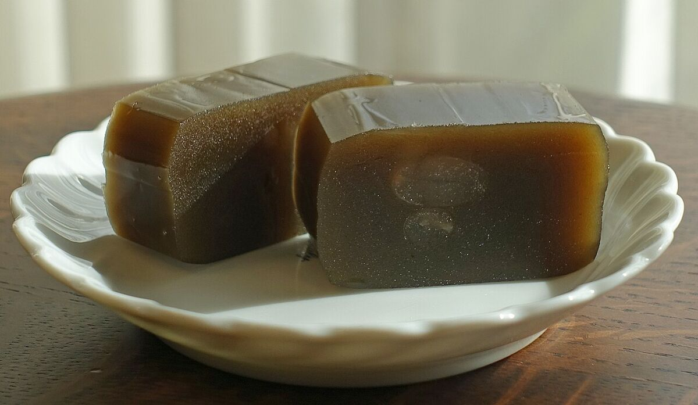
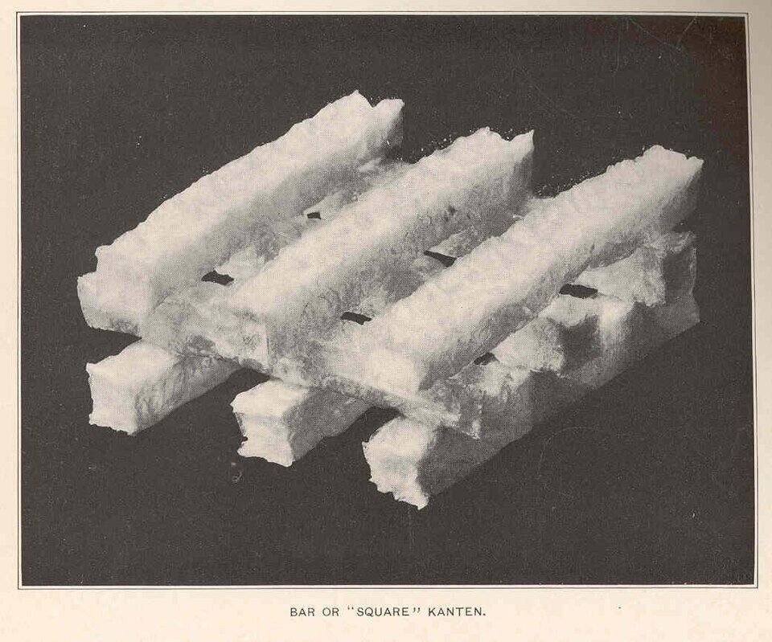
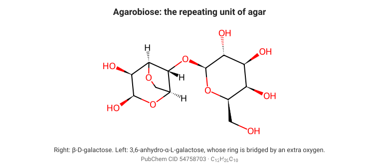

# 12. Bean Paste, Agar and Yōkan

A main ingredient of traditional Japanese confectionery (*[wagashi](https://en.wikipedia.org/wiki/Wagashi)*) is ***[an](https://en.wikipedia.org/wiki/Red_bean_paste)***, a sweet paste of cooked beans. The major industrial use of red [adzuki](https://en.wikipedia.org/wiki/Adzuki_bean) beans in Japan is making this reddish-purple paste (Yoshida et al. 2025). This chapter explains what an actually is at the cellular level, how its colour is controlled, and how it combines with **[agar](https://en.wikipedia.org/wiki/Agar)** (*kanten*), a seaweed gel, to make ***[yōkan](https://en.wikipedia.org/wiki/Y%C5%8Dkan)***, the firm bean jelly. Each step is a texture technique: keeping bean cells intact, removing what browns, and setting a gel with sugar and heat.

<figure>

<figcaption>Sliced <em>usuzumi</em> yōkan, a firm jelly of bean paste, sugar and agar (§12.4). <span class="credit">Photo: PekePON, <a href="https://creativecommons.org/licenses/by-sa/4.0/">CC BY-SA 4.0</a>, via <a href="https://commons.wikimedia.org/wiki/File:Usuzumi-yokan.jpg">Wikimedia Commons</a>.</span></figcaption>
</figure>

## 12.1 What an is: a paste of intact cells

Yoshida and colleagues give a precise description. An-paste is made of ***an-particles*** (*an-ryūshi*). These are the **colourless seed cells** of the bean (cotyledon cells), each **wrapped in its heat-denatured cell wall and cell membrane** and **filled with [gelatinised](https://en.wikipedia.org/wiki/Starch_gelatinization) ("heat-alpha") [starch](https://en.wikipedia.org/wiki/Starch)** (Yoshida et al. 2025).

So an is not a purée of dissolved starch. It is a mass of whole cells, each a little sealed package of cooked starch. In their review of yōkan, Huang and colleagues note related findings by others. The gelatinisation of starch **inside the bean-paste particles** was associated with the texture of bean paste. When bean paste is **kneaded**, the cell walls are **damaged** and starch is released, and **stronger and faster stirring** increases this breakdown (Huang et al. 2022, citing Hsieh et al.).

> **Technique consequence.** The fineness and smoothness of an depend on keeping the bean cells **separate but intact**. Breaking cells releases free starch and changes the texture. Working the paste is therefore itself a variable.

### From beans to paste

Yoshida and colleagues describe the standard sequence (Yoshida et al. 2025):

1. Boil the beans.
2. Remove the red **seed coats**.
3. **Wash** the an-particles in water several times. The result is ***sarashi-an*** (also ***nama-an***), an unsweetened paste.
4. Add **sugar** and **heat** to make sweetened ***koshi-an***, the smooth paste.

Their laboratory "general procedure" makes the steps concrete. 200 g of dried adzuki beans were boiled in 800 g of water for **15 minutes**. Then 200 g of cold water was added and the beans stood for 20 minutes. The cooking water was then **discarded** (a step called ***shibukiri***). The beans were simmered again in 1,600 g of water for **60 minutes** on low heat, topping up the water. They were then mashed. The seed coats were removed through a **1.5 mm** strainer, and the cells were passed through a **250 µm** sieve, washed several times and pressed (Yoshida et al. 2025).

## 12.2 Colour: purple pigments against brown

In wagashi, an-paste is judged on **colour**, flavour and taste. Colour is among the most important, and a **purple** an is highly valued in fine handmade confectionery. Yoshida and colleagues explain the chemistry (Yoshida et al. 2025):

- The bean cells themselves are **colourless**. The colour comes from the red **seed coat**.
- In 2019 they identified two purple pigments in the seed coat, **catechinopyranocyanidins A and B**. Unlike the more familiar [anthocyanins](https://en.wikipedia.org/wiki/Anthocyanin), these are **almost insoluble in water**, purple from strongly acidic to neutral conditions, and **break down quickly in light**.
- During boiling, these pigments move from the seed coat to the an-particles. The **more purple** the an, the **more** of the two pigments it contains.
- The seed coat also contains large amounts of **[proanthocyanidins](https://en.wikipedia.org/wiki/Proanthocyanidin)**, colourless [polyphenols](https://en.wikipedia.org/wiki/Polyphenol) that oxidise to **yellow-brown** compounds. Unlike the purple pigments, these **dissolve readily in water**.

This explains ***shibukiri***. Discarding the cooking water once or twice removes the water-soluble polyphenols that would turn the paste brown, while the insoluble purple pigments stay with the beans (Yoshida et al. 2025). The colour of an is also affected by the quality of the beans, the chemistry of the water and the material of the pot. The traditional method for getting purple an has relied heavily on the intuition and experience of craftspeople (Yoshida et al. 2025).

The authors tested a modified method. Beans were **soaked for 18 hours** and washed to remove polyphenols, then placed in water in a cooker whose pressure was **lowered to 10–30 kPa** and returned to normal five times before heating. This "pre-vacuum" step was intended to suppress oxidation. They were then heated at 100 °C for 1 hour (Yoshida et al. 2025). Colour readings, where higher *a** means redder and lower *b** means bluer:

| Method | *a** | *b** | Appearance |
|---|---|---|---|
| General procedure | 5.9 | 6.4 | Brownish red |
| General procedure with pre-soaking | 7.6 | 2.9 | Brownish red |
| **Pre-soaking + pre-vacuum** | **9.7** | **−0.3** | **Most intensely purple** |

*Source: Yoshida et al. 2025.*

> **Technique consequence.** Two cook-controllable mechanisms decide an's colour. **Removing water-soluble polyphenols** (soaking, washing, discarding the first water) prevents browning, and **limiting oxidation** protects the colour further. Because the purple pigments degrade in light, the authors handled all their samples in the dark or under red light (Yoshida et al. 2025).

## 12.3 Agar (kanten): a gel made by cooling

<figure>

<figcaption>Bar or "square" kanten (dried agar), from a 1905 US Bureau of Fisheries report on Japan's seaweed industries. <span class="credit">Photo: Hugh M. Smith, <em>Seaweed Industries of Japan</em>, Bulletin of the Bureau of Fisheries vol. 24 (1905), Public domain, via <a href="https://commons.wikimedia.org/wiki/File:FMIB_41724_Kanten%2C_or_Seaweed_Isinglass_-_Bar_or_%27Square%27_Kanten.jpeg">Wikimedia Commons</a>.</span></figcaption>
</figure>

**Agar** is a polysaccharide from red seaweeds. The [European Food Safety Authority](https://en.wikipedia.org/wiki/European_Food_Safety_Authority)'s re-evaluation of agar as a food additive summarises its properties (EFSA 2016):

- Commercial agar comes mainly from red algae of the genera ***[Gelidium](https://en.wikipedia.org/wiki/Gelidium)*** and ***[Gracilaria](https://en.wikipedia.org/wiki/Gracilaria)***. Several *Gelidium* species listed as primary commercial sources are harvested in **Japan**, among them *G. amansii*, *G. pacificum* and *G. liatulum*.
- Structurally, agar is a **linear** polysaccharide of alternating 3-linked β-D-galactose and 4-linked α-L-galactose residues. A substantial part of the α-L-galactose residues may exist as a **3,6-anhydro** derivative. The basic repeating unit is the disaccharide ***agarobiose***.
- Agar contains a neutral, **gelling** fraction, **[agarose](https://en.wikipedia.org/wiki/Agarose)**, and a sulfated, **non-gelling** fraction, **[agaropectin](https://en.wikipedia.org/wiki/Agaropectin)**; both are agarobiose polymers. More recent work treats agar as a complex mixture of polysaccharides that depends on the seaweed and the manufacturing method.
- Agar is **insoluble in cold water**. It dissolves at temperatures **at or above about 85 °C**, the melting point of its gels.
- Agar gels form at very low concentrations. The threshold is around **0.2%**.
- Agarose forms "**physical gels**", held together only by **[hydrogen bonds](https://en.wikipedia.org/wiki/Hydrogen_bond)** between the polymer chains. These gels hold a great deal of water in their network.
- The gels are **reversible**. They melt on heating and set again on cooling.
- **Gelation [hysteresis](https://en.wikipedia.org/wiki/Hysteresis):** the gelling temperature is around **38 °C**, but the melting temperature is around **85 °C**. A sol can be cooled far below its melting point before it sets. Once set, it must be reheated to a much higher temperature to melt again.
- **Sugar** increases agar's gelling power, which is why it is used in jams and jellies. **Salts** raise the melting point. **[Tannic acid](https://en.wikipedia.org/wiki/Tannic_acid)**, found in some fruits, **blocks gelling**.
- Agar mixed with [locust bean gum](https://en.wikipedia.org/wiki/Locust_bean_gum) loses less liquid (**[syneresis](https://en.wikipedia.org/wiki/Syneresis_%28chemistry%29)**) during handling and storage.

<figure class="diagram">

<figcaption>Agarobiose, the repeating unit of agar (EFSA 2016). Agarose is a long chain of these units. <span class="credit">Diagram drawn for this handbook with <a href="https://www.rdkit.org/">RDKit</a> from PubChem structure records: <a href="https://pubchem.ncbi.nlm.nih.gov/compound/54758703">agarobiose</a>.</span></figcaption>
</figure>

Huang and colleagues describe the gelling mechanism in their yōkan study (Huang et al. 2022). Above the gelling temperature, agar chains exist as **random coils**. On cooling, they form **regular double helices**, which **aggregate** into junction zones and build a network. They also explain syneresis: as double helices continue to aggregate, the network **contracts** and squeezes out water (Huang et al. 2022).

> **Technique consequence.** The 38 °C / 85 °C hysteresis is what makes agar useful in confectionery. A dissolved agar mixture stays liquid long enough to be mixed with bean paste and poured. Once set, it does not melt at room or mouth temperature. Agar must also be fully dissolved at near-boiling temperatures. Below about 85 °C it does not dissolve (EFSA 2016).

## 12.4 Yōkan: bean paste, sugar and agar

Huang and colleagues describe yōkan as made mainly from **adzuki-bean paste, sugar and agar, cooked together**. They report that it reached Japan from China with monks during the Tang dynasty. It was originally a jelly from lamb broth and became, in Japan, a bean-and-agar confection used at **tea ceremonies** (Huang et al. 2022).

They optimised three variables: **agar concentration** (1.0, 1.5 and 2.0%), **sugar content** (28, 34 and 40%) and **"concentration time"**, the time the mixture is boiled down (15, 30 and 45 minutes) (Huang et al. 2022).

### What each variable did

| Property | Order of influence | Notes |
|---|---|---|
| **Syneresis** (weeping) | time > agar > sugar | Longer boiling-down **significantly reduced** syneresis |
| **Gel strength** | time > agar > sugar | All three significant |
| **Hardness** | time > agar > sugar | Time and agar significant |
| **[Elasticity](https://en.wikipedia.org/wiki/Elasticity_%28physics%29)** | time > agar > sugar | Time and agar significant |
| **Colour** (lightness) | sugar > agar > time | Long boiling darkened the yōkan, attributed to **caramelisation** |

*Source: Huang et al. 2022.* Gel strength, hardness and elasticity rose with boiling time and agar concentration. These properties were strongly linked to the loss of water.

### What the microscope showed

With **34% sugar**, electron micrographs showed a **continuous adhesive layer** over the surface of the bean-paste particles. **Without sugar**, there were only **flaky** deposits. Sugar, damaged starch and agar dissolve during heating into the **continuous phase**, which surrounds the bean-paste particles. The authors conclude that the evenness of this phase gives yōkan its stickiness, elasticity and chewiness. Without sugar, the yōkan lacked those qualities (Huang et al. 2022).

### Optimum

The conditions preferred by tasters were **1.2–1.5% agar**, **34–40% sugar** and **30–40 minutes** of boiling down (Huang et al. 2022).

> **Reading yōkan as a structure.** Yōkan is a **two-phase** material. Intact bean cells (the an-particles of §12.1) are suspended in a continuous gel of agar and dissolved sugar. Boiling down removes water, strengthening the gel and reducing weeping. Sugar both builds the continuous phase and, with long heating, caramelises and darkens it.

## 12.5 Check yourself

```quiz
title: Chapter 12 self-check
? What is an an-particle?
- A whole bean cell, wrapped in its heat-denatured wall and filled with gelatinised starch *
- A crystal of sugar coated with bean protein
- A fragment of seed coat
> Yoshida et al. 2025. The cells themselves are colourless.

? Why is the first cooking water discarded (shibukiri) when making an?
- It removes water-soluble polyphenols that would turn the paste brown *
- It removes the purple pigments
- It softens the seed coats
> The purple catechinopyranocyanidins are almost insoluble and stay with the beans.

? Agar sets at about 38 °C but melts only at about 85 °C. What is this called?
- Gelation hysteresis *
- Retrogradation
- Syneresis
> EFSA 2016. It lets a dissolved agar mixture be poured, while the set gel survives room temperature.

? In the yōkan study, what most reduced syneresis (weeping)?
- A longer boiling-down (concentration) time *
- More sugar
- Less agar
> The order of influence was time > agar > sugar (Huang et al. 2022).

? What did yōkan made without sugar look like under the microscope?
- Only flaky deposits on the bean particles, with no continuous adhesive layer *
- Exactly like normal yōkan
- Completely dissolved bean cells
> Sugar helps build the continuous phase that gives stickiness, elasticity and chewiness.

? Why might long boiling make yōkan darker?
- Caramelisation of the sugar *
- Oxidation of agar
- Loss of the purple pigments to the water
> Huang et al. 2022.
```

## Sources for this chapter

1. **Yoshida et al. 2025.** Yoshida K, Kawahara M, Takayama Y, Asano T. Purple pigments, catechinopyranocyanidins A and B, in the seed coats of red adzuki beans elute during processing to yield purple-colored an-paste. *Proceedings of the Japan Academy, Series B* 2025;101(10):648 ff. doi:[10.2183/pjab.101.037](https://doi.org/10.2183/pjab.101.037). [PMC12932078](https://pmc.ncbi.nlm.nih.gov/articles/PMC12932078/).
2. **Huang et al. 2022.** Huang P-H, Cheng Y-T, Lu W-C, Li P-H. Optimization of concentration-time, agar, and sugar concentration for sweet gelatinized adzuki-bean jelly cake (yokan) by response surface methodology. *Gels* 2022;8(9):540. doi:[10.3390/gels8090540](https://doi.org/10.3390/gels8090540). [PMC9498569](https://pmc.ncbi.nlm.nih.gov/articles/PMC9498569/).
3. **EFSA 2016.** EFSA Panel on Food Additives and Nutrient Sources added to Food (ANS), Mortensen A, et al. Re-evaluation of agar (E 406) as a food additive. *EFSA Journal* 2016;14(12):e04645. doi:[10.2903/j.efsa.2016.4645](https://doi.org/10.2903/j.efsa.2016.4645). [PMC13088875](https://pmc.ncbi.nlm.nih.gov/articles/PMC13088875/).

➡️ Next: [Chapter 13: Mochi and starch gels](13-mochi-starches.md)
