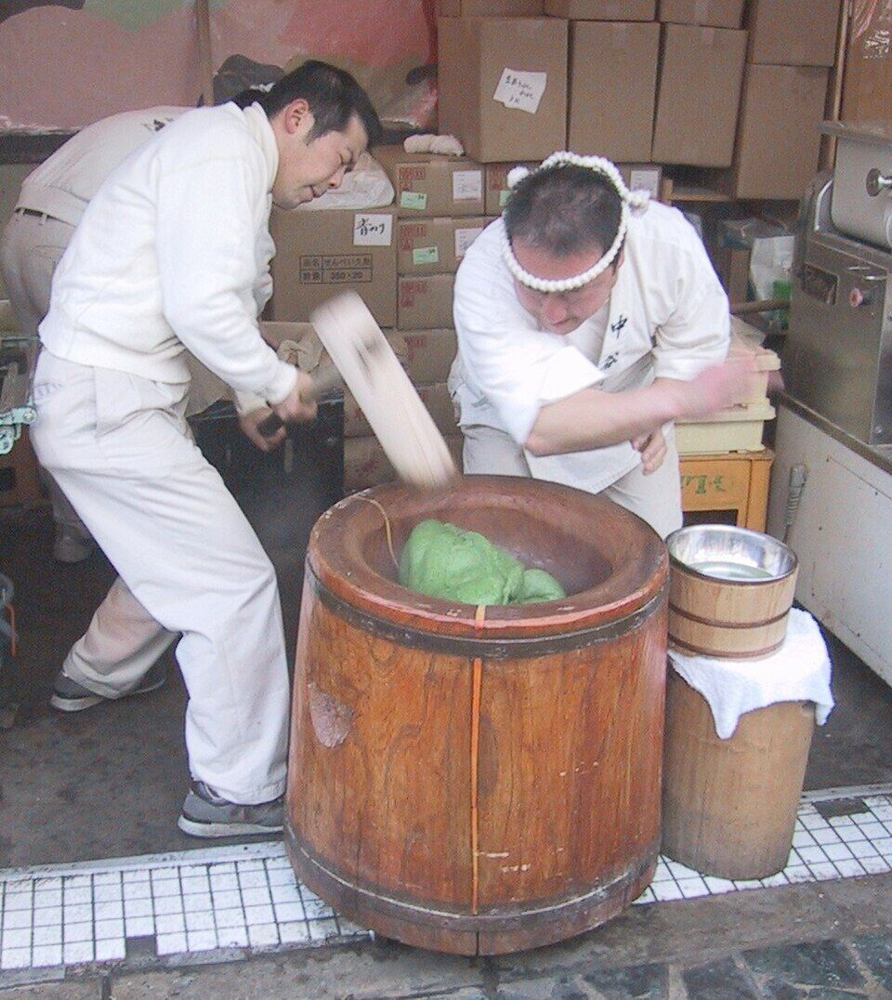

# 13. Mochi and Starch Gels

***Mochi***, the stretchy cake of glutinous rice, takes the starch chemistry of Chapter 9 to its extreme. Its rice has almost no amylose, so its behaviour, both the stretch and the slow hardening, is governed almost entirely by **amylopectin**. This chapter covers mochi and its relatives, and then a very different traditional thickener, **kuzu** (kudzu) starch, which owes its usefulness to the opposite: a relatively **high** amylose content.

<figure>

<figcaption>Pounding mochi with a wooden mortar (<em>usu</em>) and mallet (<em>kine</em>). <span class="credit">Photo: Chris 73, <a href="https://creativecommons.org/licenses/by-sa/3.0/">CC BY-SA 3.0</a>, via <a href="https://commons.wikimedia.org/wiki/File:Making_mochi_with_an_Usu_and_Kine.jpg">Wikimedia Commons</a>.</span></figcaption>
</figure>

## 13.1 Mochi in Japan

MAFF gives a short history (MAFF, *Grain products*):

- Rice cake is said to have existed since the **Jōmon** era. Originally it was made by kneading, steaming and pounding a mixture of **flour of minor cereals** and water.
- In the **late Nara** era, the original form of today's mochi appeared: rice cake made by **mashing rice grains**.
- Mochi became a major offering in rituals, at auspicious occasions and in Buddhist services.

MAFF also records a clear regional split: **round** mochi is popular around **Kansai**, **square** mochi in **Kantō** and further north. Forms include *kiri-mochi* (cut pieces), *noshi-mochi* (flattened), *namako-mochi* (flat half-cylinders), *hishi-mochi* (diamonds), *kōri-mochi* (freeze-dried), *arare* (small cubes for rice crackers), *kiritanpo* (mashed rice pressed onto skewers and roasted) and *kibi-dango* (millet dumplings) (MAFF, *Grain products*).

## 13.2 Glutinous rice: nearly all amylopectin

Chapter 9 gave the amylose classes of rice. **Waxy** (glutinous) rice has an apparent amylose content **below 2%** (Nakamura et al. 2021). Qiu and colleagues put it another way: glutinous rice starch consists **mainly of amylopectin (>98%)** (Qiu et al. 2022).

Two consequences follow, according to the same source (Qiu et al. 2022):

- Glutinous rice gives products an **adhesive texture**.
- It has a **longer shelf life against retrogradation** (staling) than ordinary, amylose-containing rice.

Hanashiro and colleagues' leaching experiment from Chapter 9 fits this picture. The waxy rice Hiyokumochi released a leachate that was only **1% amylose** (Hanashiro et al. 2004). Its starch surface is almost pure branched amylopectin, the component that Li and colleagues link to stickiness (Li et al. 2017).

## 13.3 Mochi still hardens: retrogradation in amylopectin

"Resistant to staling" does not mean immune. Qiu and colleagues stored **glutinous rice gels** and **sweetened glutinous rice cakes** at **4 °C for 14 days** (Qiu et al. 2022):

| Sample | Hardness, fresh | Hardness, after 14 days at 4 °C |
|---|---|---|
| Glutinous rice gel | 690 g | **1,423 g** |
| Sweetened glutinous rice cake | 720 g | **1,096 g** |

Over the same period, the samples became **less adhesive**. The authors' earlier work, summarised in this paper, found that (Qiu et al. 2022):

- **moisture content** was the most significant factor in preventing retrogradation of cooked glutinous rice. Negligible retrogradation occurred over 14 days at 4 °C when moisture was **above 80%**;
- adding **sugar, salt, lipid and surfactant** significantly reduced retrogradation after 14 days at 4 °C.

The sweetened cake hardened less than the plain gel in the table above. That is consistent with the protective effect of sugar, although the two samples also differed in other ways.

### The rice matters, and so does the weather it ripened in

Matsue and Ogata compared mochi made from native red- and black-grained glutinous rice with mochi from ordinary white glutinous rice (Matsue and Ogata 1998):

- The **hardening speed** of mochi from red- and black-grained cultivars tended to be **lower** than that of mochi from white ones.
- The **hardening speed of mochi correlated significantly and positively with the air temperature during the ripening period** of the rice. Rice that ripened in warmer weather made mochi that hardened faster.
- Mochi from the red and black cultivars tended to be judged **less palatable**.

> **Technique consequence.** Mochi's tendency to harden is partly set **before cooking**, by the rice variety and even the weather in its last weeks in the field (Matsue and Ogata 1998). After cooking, the cook's levers are **moisture**, **sugar** and **storage temperature**: refrigeration at 4 °C hardened glutinous rice products markedly within two weeks (Qiu et al. 2022).

## 13.4 Daifuku: amylopectin chain length

***Daifuku*** is mochi made from glutinous rice flour, shaped into a round, soft, moist shell around a filling (Tian et al. 2025). Tian and colleagues name its common faults: **flattened** shape, **dry, tough skin** and a **high cracking rate**. They trace these to the weak water absorption and retention of glutinous rice flour and its **poor gel network** (Tian et al. 2025).

They compared ten glutinous rice flours, from *indica* and *japonica* varieties (Tian et al. 2025):

- *Indica* flours had **higher** viscosity, amylopectin content, proportion of **long-branched chains**, gelatinisation enthalpy and setback.
- Their longer B₂ and B₃ amylopectin chains formed **more double helices** after pasting. This gave **higher hardness** and a **compact gel network** with better water retention. Daifuku made from them kept an excellent appearance.
- *Japonica* flours, with **more short chains**, **retrograded slowly** but formed an **unstable gel network**.
- The authors concluded that *indica* flour was more suitable for daifuku.

> **A trade-off in the starch.** The two mochi studies show amylopectin's double role. **Short-chained** amylopectin keeps mochi **soft for longer**, because it retrogrades slowly, but gives a weaker network. **Long-chained** amylopectin builds a **firmer structure** that holds its shape. Tian and colleagues chose structure for daifuku, a shaped product that must not flatten or crack.

## 13.5 Kuzu: a high-amylose starch from a vine

***Kuzu*** (kudzu, *Pueraria* species) is a perennial vine of the bean family (Fabaceae) that is rich in starch. He and colleagues give its properties (He et al. 2025):

- Kudzu is cultivated widely in **East Asia** for food and medicine. The main species are *Pueraria thomsonii* and *P. lobata*.
- Starch makes up about **52%** of its dry weight, with a relatively **high amylose content**, averaging about **24.8%**.
- Its starch is valued for **high paste transparency**, **strong viscosity** and **stability**, and is used in jellies, sweets and instant foods.
- Its drawback is **poor solubility in cold water**.
- The two species differ in granule shape, amylose content and gelatinisation temperature. In their experiment, which heated the starches at 45–95 °C, ***P. lobata*** starch underwent its physicochemical changes at lower degrees of gelatinisation than ***P. thomsonii***.

Shi and colleagues compared *Pueraria* starches with commercial starches. The *Pueraria* starches had **significantly higher amylose** and **smaller particles** (Shi et al. 2025).

> **Kuzu and mochi as opposites.** Mochi is nearly pure amylopectin and makes a sticky, stretchy mass. Kuzu starch, at around a quarter amylose, makes a **clear, viscous paste** valued for transparency and stability (He et al. 2025). Together with agar (Chapter 12), these are three different routes to a Japanese confection's texture: a branched-starch mass, a high-amylose starch paste, and a seaweed polysaccharide gel.

> **What the sources do not cover.** Popular sources make many claims about how to cook kuzu (how to dissolve it, how long to stir, which kuzu is "genuine"). The research papers used here are on Chinese-grown cultivars and laboratory pastes, and they do not test Japanese kitchen practice. This handbook reports only their measured properties.

## 13.6 Check yourself

```quiz
title: Chapter 13 self-check
? What makes up more than 98% of glutinous rice starch?
- Amylopectin *
- Amylose
- Protein
> Qiu et al. 2022. Waxy rice is below 2% apparent amylose (Nakamura et al. 2021).

? Glutinous rice gel was stored at 4 °C for 14 days. What happened to its hardness?
- It roughly doubled, from 690 g to 1,423 g *
- It halved
- It stayed the same, because amylopectin cannot retrograde
> Glutinous rice resists staling better than ordinary rice, but it is not immune (Qiu et al. 2022).

? What did Matsue and Ogata find about mochi hardening speed?
- It correlated with the air temperature while the rice was ripening *
- It depended only on how long the mochi was pounded
- Red-grained mochi hardened fastest
> Red- and black-grained cultivars actually tended to harden more slowly.

? Why did indica glutinous rice flour make better-shaped daifuku in Tian et al.'s study?
- More long amylopectin chains formed more double helices and a compact gel network *
- It contained more amylose
- It had more protein
> Short-chained japonica flours retrograded slowly but formed an unstable network.

? Which property is kuzu starch valued for?
- High paste transparency, viscosity and stability *
- Extreme stickiness like mochi
- Solubility in cold water
> Its limitation is poor cold-water solubility (He et al. 2025).

? Which factor did earlier work single out as most important in preventing retrogradation of cooked glutinous rice?
- Moisture content *
- Colour of the rice
- Cooking pot material
> Negligible retrogradation occurred over 14 days at 4 °C above 80% moisture (cited in Qiu et al. 2022).
```

## Sources for this chapter

1. **MAFF.** Ministry of Agriculture, Forestry and Fisheries of Japan. *Grain products — Traditional Foods in Japan.* [maff.go.jp](https://www.maff.go.jp/e/policies/market/dento_syoku/bunrui/kokurui.html), accessed 17 November 2026.
2. **Qiu et al. 2022.** Qiu S, Abbaspourrad A, Padilla-Zakour OI. Prevention of the retrogradation of glutinous rice gel and sweetened glutinous rice cake utilizing pulsed electric field during refrigerated storage. *Foods* 2022;11(9):1306. doi:[10.3390/foods11091306](https://doi.org/10.3390/foods11091306). [PMC9103319](https://pmc.ncbi.nlm.nih.gov/articles/PMC9103319/).
3. **Matsue and Ogata 1998.** Matsue Y, Ogata T. Physicochemical and mochi-making properties of the native red and black-kerneled glutinous rice cultivars. *Plant Production Science* 1998;1(2):126 ff. [J-STAGE](https://www.jstage.jst.go.jp/article/pps1998/1/2/1_2_126/_article/-char/en). Cited from the abstract.
4. **Tian et al. 2025.** Tian Y, Li J, Nie M, Wang L, Liu L, Wang F, Tong L-T. The impact of gelatinization property differences based on amylopectin structure variations on the glutinous rice flour properties and quality of Daifuku. *Food Chemistry: X* 2025;27:102423. doi:[10.1016/j.fochx.2025.102423](https://doi.org/10.1016/j.fochx.2025.102423). [PMC12005919](https://pmc.ncbi.nlm.nih.gov/articles/PMC12005919/).
5. **He et al. 2025.** He Z, Zhu F, Li M, Kong X. Effects of different degrees of gelatinization on structural, physicochemical and digestive properties of kudzu starch. *Foods* 2025;14(21):3614. doi:[10.3390/foods14213614](https://doi.org/10.3390/foods14213614). [PMC12607623](https://pmc.ncbi.nlm.nih.gov/articles/PMC12607623/).
6. **Shi et al. 2025.** Shi J, Zou H, Sui Y, Xiong T, Chen X, Fan C, Mei X. Characterization of starches from *Pueraria lobata* and *Pueraria thomsonii*: structural and physicochemical properties and comparison with commercial starches. *International Journal of Food Science* 2025;2025:1032983. doi:[10.1155/ijfo/1032983](https://doi.org/10.1155/ijfo/1032983). [PMC12706119](https://pmc.ncbi.nlm.nih.gov/articles/PMC12706119/).
7. **Nakamura et al. 2021; Hanashiro et al. 2004; Li et al. 2017.** See [Chapter 9](09-rice.md).

➡️ Next: [Chapter 14: The language of texture](14-texture.md)
