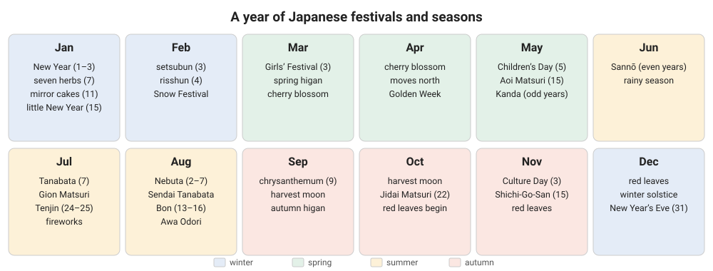

# Festivals and Seasons Handbook: The Japanese Year

Japan keeps two calendars at once. Offices run on the Gregorian calendar adopted in 1873, but the year is still marked by the old seasons, the five *sekku* and the festivals of the local shrine. This handbook explains how the Japanese year works, in three parts:

- **The calendar:** the old lunisolar calendar and the switch of 1873, era names, the 24 solar terms and lucky days, the national holidays and Golden Week, and the five *sekku*.
- **The year:** New Year; *setsubun* and the cherry blossom; summer, Bon, the dances and the fireworks; the harvest moon, the red leaves, Shichi-Go-San and New Year's Eve.
- **Matsuri:** what a shrine festival is, the *mikoshi* and the floats that UNESCO lists, the great festivals from Kyoto to Sapporo, and how to watch, join in and stay safe.

It is written for a reader who wants to understand as well as to watch. Dates and numbers are given where the sources give them.

<figure class="diagram">

<figcaption>The year in this handbook, month by month. Diagram drawn for this handbook from the sources cited in the chapters.</figcaption>
</figure>

> ⚠️ **About the dates.** Festival dates, programmes and holiday lists change, and festivals are sometimes cancelled or moved. Every date in this handbook carries its source, and the handbook was last checked in **November 2026**. Cherry-blossom and autumn-leaf dates vary from year to year by a week or more. **Always check the organiser's or the Japan Meteorological Agency's website before you travel.** This handbook is not connected with any festival, shrine or organiser.

## How this handbook treats facts

- **Every factual statement comes from a named source**, cited in brackets, such as (NDL 2016a), and listed at the end of each chapter.
- **Five kinds of source are used:**
  - **Government:** the Cabinet Office (national holidays), the National Diet Library's exhibition on the Japanese calendar, the National Astronomical Observatory of Japan (solar terms), the Japan Meteorological Agency (cherry blossom and autumn leaves), the Agency for Cultural Affairs, and the Ministry of Agriculture, Forestry and Fisheries (festival food).
  - **UNESCO's** records of Japan's intangible cultural heritage.
  - **Cities and organisers:** Kyoto, Akashi and Tokushima cities, and the Aomori Nebuta and Sapporo Snow Festival committees.
  - **The Japan National Tourism Organization**, for practical details of festivals.
  - **Peer-reviewed scholarship** on J-STAGE. Quotations from Japanese are translated.
- **Encyclopaedias, fan sites and travel blogs are not used as sources.** Terms are linked to Wikipedia (marked ↗) only as further reading.
- **Where the sources disagree or are uncertain, the handbook says so**: for example, on the origin of cherry-blossom viewing (Chapter 6) and of the Awa Odori (Chapter 10).

## Pictures

The pictures are public-domain prints and freely licensed photographs. Every picture is credited in its caption and again on the [sources page](14-sources.md). The diagrams were drawn for this handbook from the cited sources.

## The three parts

### Part I: The calendar

| Chapter | What it explains |
|---|---|
| [1. The old calendar and the switch of 1873](01-calendars.md) | Lunisolar months, Edo-period reforms, the switch to the Gregorian calendar, the sixty-year cycle, era names |
| [2. Solar terms, lucky days and old month names](02-solar-terms.md) | The 24 solar terms, *setsubun* and *higan*, the six-day cycle of lucky days, the old names of the months |
| [3. National holidays and Golden Week](03-holidays.md) | The 1948 law, the 16 holidays, substitute and sandwich holidays, Golden Week, 2026 and 2027 dates |
| [4. The five seasonal festivals](04-sekku.md) | Seven-herb porridge, the Girls' Festival, Children's Day, Tanabata, the chrysanthemum festival |

### Part II: The year

| Chapter | What it explains |
|---|---|
| [5. New Year](05-new-year.md) | Gate pines, *zōni* and *osechi*, the first shrine visit and the railways, New Year cards, the little New Year |
| [6. Setsubun and spring](06-spring.md) | Bean-throwing, *higan*, how the cherry blossom is measured, its dates by city, how *hanami* began |
| [7. Summer: Bon, dances and fireworks](07-summer.md) | Bon in brief, the *furyū-odori* on the UNESCO list, Kyoto's great bonfires, fireworks |
| [8. Autumn and the end of the year](08-autumn-winter.md) | The harvest moon, the red-leaf front, Shichi-Go-San, the winter solstice, New Year's Eve |

### Part III: Matsuri

| Chapter | What it explains |
|---|---|
| [9. What a matsuri is](09-matsuri.md) | The procession of the *kami*, *mikoshi*, *yama*, *hoko* and *yatai*, the 37 float festivals on the UNESCO list |
| [10. The great festivals](10-great-festivals.md) | Gion, Aoi and Jidai in Kyoto, Tenjin, Kanda and Sannō, Nebuta, Awa Odori, the Snow Festival, with dates |
| [11. Going to a festival](11-visiting.md) | Watching, joining in as a *haneto* or in the *niwaka-ren*, food stalls, crowds and the Akashi accident |
| [12. Festival and season Japanese](12-language.md) | The words on calendars, posters and programmes |

Then the [glossary](13-glossary.md) and the [sources and image credits](14-sources.md).

## Related pages

- [Folklore, Chapter 6: Ancestors, Bon and the afterlife](../folklore/06-ancestors.md), for the beliefs behind Bon and *higan*.
- [Railways, Chapter 5: Railways that built cities](../railways/05-private.md), for the railways that made New Year shrine visits popular.
- [Lesson 8: Pitfalls](../lessons/08-pitfalls.md), for heat and crowds in summer.

➡️ Start: [Chapter 1: The old calendar and the switch of 1873](01-calendars.md)
