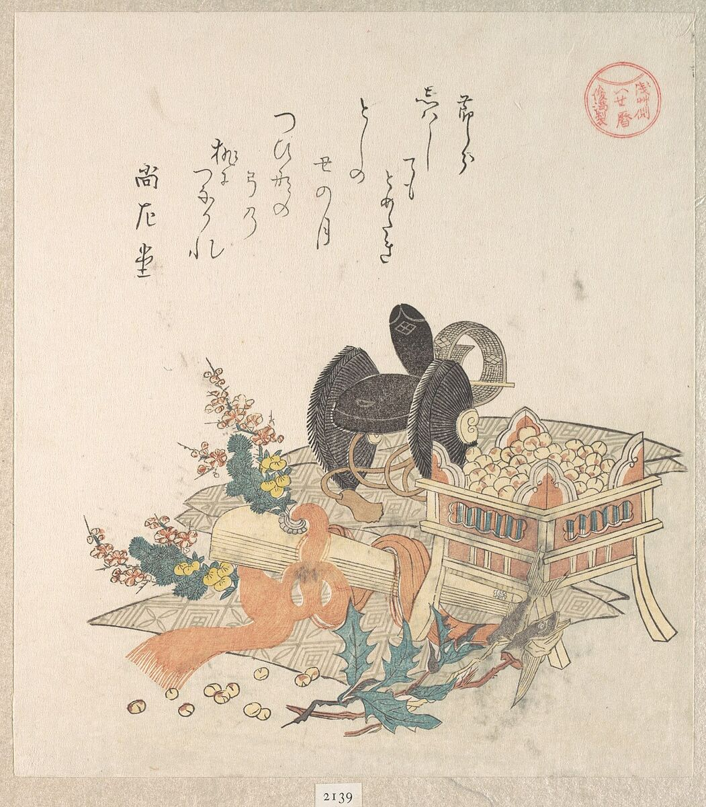
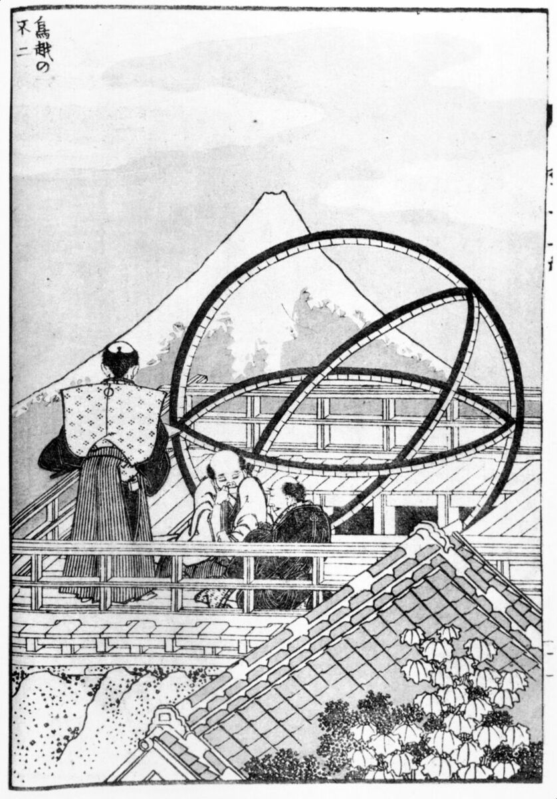
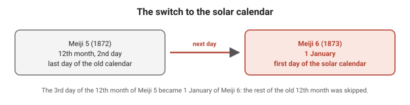

# 1. The Old Calendar and the Switch of 1873

Japan has kept time by the Gregorian calendar since 1873. Before that it used a **lunisolar calendar** (太陰太陽暦, *taiin taiyō reki*), and many festivals still carry its dates. This chapter explains how the old calendar worked, why it was replaced, and the era names that Japan still uses alongside Western years.

## 1.1 Japan's first calendars

The National Diet Library's exhibition *The Japanese Calendar* tells the story (NDL 2016a):

- **From China, through Korea.** The *Nihon shoki*, Japan's oldest chronicle, has an entry for the sixth month of **553** in which the court plans to invite a calendar expert from Paekche (*Kudara*), in what is now Korea. It is the first mention of a calendar in Japanese records. Japan is said to have drawn up its first calendar in **604**.
- **A state monopoly.** Under the *ritsuryō* legal codes, the calendar was made by the *Onmyōryō* (陰陽寮), a government office in charge of calendars, astronomy and divination. "It was a time when calendars and divination were inseparable." From the end of the 10th century the Kamo family handed down calendar-making, and the Abe family, whose patriarch was the diviner **Abe no Seimei** (921–1005), handed down astronomy.

## 1.2 How a lunisolar year works

The months of the old calendar followed the Moon, and the year had to be kept in step with the Sun (NDL 2016a):

- **Long and short months.** The Moon goes round the Earth in about **29.5 days**, so months had either 30 days (大の月, *dai no tsuki*, a long month) or 29 days (小の月, *shō no tsuki*, a short month).
- **The intercalary month.** Twelve such months fall short of the Earth's year of 365.25 days, so the calendar drifted against the seasons. To correct it, an extra month, the **intercalary month** (閏月, *urū-zuki*), was added every few years, making a year of **13 months**.
- **A new pattern every year.** The order of long and short months changed from year to year, so nobody could know it without a printed calendar.

The rule for placing the extra month came from the 24 solar terms described in Chapter 2: a month that contained no "middle" solar term became the intercalary month (NDL 2016b).

## 1.3 Calendars for everyone

Printed calendars spread from the 14th century, and by the Edo period (1603–1868) farmers and merchants depended on them (NDL 2016a):

- **Kana calendars.** The court's calendar, the *guchū-reki* (具注暦), was written in Chinese characters with detailed notes on seasons, events and lucky days. A simplified version in *kana*, the *kana-goyomi* (仮名暦), appeared, and calendars began to be printed in the middle of the **14th century**.
- **Regional calendars.** The *Ise-goyomi* (伊勢暦), printed in what is now Ise city, became the most widely spread, carried round the country by the priests (*oshi*) of the Ise shrines.
- **Picture calendars.** For people who could not read, picture calendars (絵暦, *e-goyomi*) such as the *Tayama-reki* of present-day Iwate showed everything in pictures.
- **Riddles of long and short months.** Merchants settled accounts at the end of each month, so they had to know which months were long. *Daishō-reki* (大小暦) hid the long and short months in pictures and verses, and their makers "vied in novelty and humor".
- **Pocket and pillar calendars.** Abridged calendars (略暦, *ryaku-reki*) were folded small or pinned to a post (柱暦, *hashira-goyomi*). As today, merchants gave them to customers at the end of the year.

<figure>

<figcaption>"Beans for tossing during the <em>setsubun</em> exorcism ceremony", from Kubo Shunman's print series <em>Ise Calendars for the Asakusa Group</em>, 1810s. Chapter 6 describes <em>setsubun</em>. <span class="credit">Image: Kubo Shunman, <a href="https://creativecommons.org/publicdomain/zero/1.0/">CC0</a>, via <a href="https://commons.wikimedia.org/wiki/File:%E2%80%9CBeans_for_Tossing_During_Setsubun_Exorcism_Ceremony%2C%E2%80%9D_from_the_series_Ise_Calendars_for_the_Asakusa_Group_%28Asakusa-gawa_Ise_goyomi%29_MET_DP138337.jpg">Wikimedia Commons</a>.</span></figcaption>
</figure>

## 1.4 Reforms of the Edo period

For more than eight centuries Japan used one Chinese method, the **Senmyō calendar** (宣明暦), adopted in **862**: 823 years in all. By the 17th century it no longer matched eclipses and other events in the sky (NDL 2016b):

| Calendar | First used | Years in use |
|---|---|---|
| 宣明暦 *Senmyō* | 862 | 823 |
| 貞享暦 *Jōkyō* | 1685 | 70 |
| 宝暦暦 *Hōreki* | 1755 | 43 |
| 寛政暦 *Kansei* | 1798 | 46 |
| 天保暦 *Tenpō* | 1844 | 29 |

- **The first Japanese calendar.** The **Jōkyō calendar** of 1685 was the first made by a Japanese, the astronomer **Shibukawa Harumi** (1639–1715). He corrected a Chinese method for the difference in longitude between China and Japan. With this reform the shogunate took control of calendar-making, and Shibukawa became its first official astronomer (天文方, *tenmonkata*) (NDL 2016b).
- **Western astronomy.** The later reforms brought in Western astronomy and made the lunisolar calendar more precise. The shogunate's astronomers calculated it, and publishers round the country printed it (NDL 2016a).

<figure>

<figcaption>The shogunate's astronomical observatory at Asakusa, with its armillary sphere, in Hokusai's <em>One Hundred Views of Mount Fuji</em> (1834–1835). The observatory was built in 1782 (NDL 2016a). <span class="credit">Image: Katsushika Hokusai, Public domain, via <a href="https://commons.wikimedia.org/wiki/File:Hokusai%2C_Fuji_at_Torigoe.jpg">Wikimedia Commons</a>.</span></figcaption>
</figure>

## 1.5 The switch of 1872–1873

The Meiji government, which wanted Western institutions, announced in the 11th month of **1872** (Meiji 5) that Japan would adopt the solar **Gregorian calendar** (太陽暦, *taiyō-reki*) (NDL 2016a; NDL 2016b):

- **Almost no warning.** The change came so fast that **the 3rd day of the 12th month of Meiji 5 became 1 January of Meiji 6 (1873)**. The rest of the old 12th month was skipped, and "a great amount of confusion prevailed".
- **Support from scholars.** Writers such as **Fukuzawa Yukichi** backed the more logical calendar and published books to explain it.
- **The first solar calendar.** The official calendar for 1873 explained the principle of the solar calendar and of fixed clock hours, and gave the year as **2533** in the imperial era counted from the legendary first emperor, Jinmu. Because of the sudden switch, it had not reached the whole country by the end of 1872.
- **What survived.** The calendar is now Gregorian, but it still carries words for the seasons from the old lunisolar calendar, such as *daikan* ("great cold") and *shōkan* ("lesser cold") (NDL 2016b).

<figure class="diagram">

<figcaption>The calendar switch (NDL 2016b). <span class="credit">Diagram drawn for this handbook from the sources cited in the chapter.</span></figcaption>
</figure>

### Old dates and new dates

The switch is why some festivals are held a month "late". Tanabata is the 7th day of the 7th month. Most places hold it on 7 July, but Sendai holds its famous Tanabata on 6–8 August, "one month later than most of the rest of Japan" (JNTO n.d.-e). In the same way, Bon fell on the 15th day of the 7th month in the old calendar, and is now centred on **15 August** (Tanaka n.d.). Chapters 4 and 7 say more.

## 1.6 The sixty-year cycle

Many notes in the old calendars came from the Chinese theory of *yin* and *yang* and the five phases (wood, fire, earth, metal and water). Its backbone is the **sexagenary cycle** (干支, *eto*) (NDL 2016b):

- **Ten stems and twelve branches.** The ten "heavenly stems" (十干, *jikkan*) began as names for counting days in tens. The twelve "earthly branches" (十二支, *jūnishi*) began as names for the order of the twelve months, and were later given twelve animals: rat, ox, tiger, hare, dragon, snake, horse, sheep, monkey, rooster, dog and boar.
- **Sixty combinations.** Paired in turn, stems and branches make **60 combinations** (六十干支). When a person has lived through all sixty, they have reached their *kanreki* (還暦), the 60th birthday.
- **Elder and younger.** In Japan the *yang* and *yin* halves were read as "elder brother" (兄, *e*) and "younger brother" (弟, *to*), so the cycle came to be called *eto* (兄弟).

The twelve animals are still on New Year's cards (Chapter 5): the first page of the picture calendar of 1802 showed a dog, because it was the year of the dog (NDL 2016a).

## 1.7 Era names

Japan counts years both in the Western way and by **era name** (元号, *gengō*). 2026 is **Reiwa 8** (令和8年); official documents and many forms use it, as does the Cabinet Office's list of holidays (Cabinet Office 2026a).

- **The law.** The **Era Name Act** of 1979 has two articles: era names are set by cabinet order, and an era name is changed **only when a new emperor succeeds** (Era Name Act 1979).
- **Reiwa.** The cabinet order of 2019 changed the era name to **Reiwa**, from the day after the abdication law took effect on 30 April 2019: **1 May 2019** became Reiwa 1 (Cabinet Order 2019).

To turn a Reiwa year into a Western one, add 2018: Reiwa 8 + 2018 = 2026.

## Self-check

```quiz
? What happened to the last weeks of Meiji 5 (1872)?
- The 3rd day of the 12th month became 1 January 1873 *
- They were added to 1873 as a 13th month
- Nothing; the change came in 1900
> The switch was announced in the 11th month of 1872 (NDL 2016b).

? Why did the old calendar sometimes have 13 months?
- An intercalary month kept the lunar months in step with the seasons *
- An extra month was added for each new emperor
- Every fourth year had a festival month
> Twelve lunar months are shorter than the solar year (NDL 2016a).

? Who made the first calendar devised by a Japanese, in 1685?
- Shibukawa Harumi *
- Abe no Seimei
- Fukuzawa Yukichi
> The Jōkyō calendar (NDL 2016b).

? When does Japan's era name change?
- Only when a new emperor succeeds *
- Every 60 years
- At every general election
> Era Name Act 1979.
```

## Sources for this chapter

1. **Cabinet Office 2026a.** Cabinet Office 内閣府. 「国民の祝日」について (On the national holidays), checked November 2026. [cao.go.jp](https://www8.cao.go.jp/chosei/shukujitsu/gaiyou.html).
2. **Cabinet Order 2019.** 元号を改める政令 (Cabinet Order changing the era name), Cabinet Order No. 143 of 2019. [e-Gov laws](https://laws.e-gov.go.jp/law/431CO0000000143).
3. **Era Name Act 1979.** 元号法 (Era Name Act), Act No. 43 of 1979. [e-Gov laws](https://laws.e-gov.go.jp/law/354AC0000000043).
4. **JNTO n.d.-e.** Japan National Tourism Organization. *Sendai Tanabata Festival*. [japan.travel](https://www.japan.travel/en/spot/423/).
5. **NDL 2016a.** National Diet Library 国立国会図書館. *The Japanese Calendar* (online gallery), "Calendar History 1" and "Calendar History 2". [ndl.go.jp](https://www.ndl.go.jp/koyomi/e/history/index.html).
6. **NDL 2016b.** National Diet Library. 日本の暦 (The Japanese calendar), Japanese edition: 江戸から明治の改暦; 干支①六十干支; 二十四節気. [ndl.go.jp](https://www.ndl.go.jp/koyomi/chapter1/s2.html).
7. **Tanaka n.d.** Tanaka Naomi 田中直美. 行事と食文化 (Annual events and food culture). Ministry of Agriculture, Forestry and Fisheries 農林水産省. [maff.go.jp](https://www.maff.go.jp/j/keikaku/syokubunka/culture/pdf/08_gyoji.pdf).

➡️ Next: [Chapter 2: Solar terms, lucky days and old month names](02-solar-terms.md)
