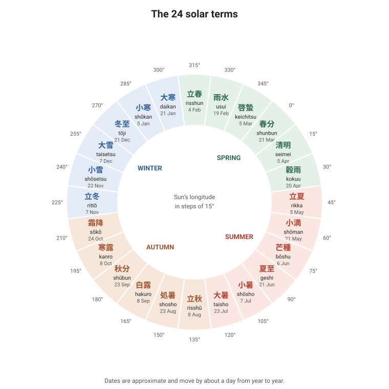
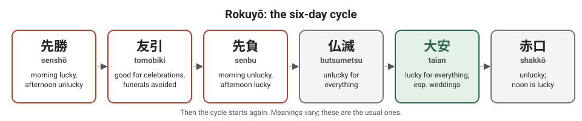

# 2. Solar Terms, Lucky Days and Old Month Names

Japanese calendars and diaries still print words from the old calendar: the **24 solar terms**, seasonal days such as *setsubun* and *higan*, the **six-day cycle** of lucky and unlucky days, and poetic names for the months. This chapter explains what they mean and who sets their dates today.

## 2.1 The 24 solar terms

The 24 solar terms (二十四節気, *nijūshi sekki*) divide the year by the Sun, not the Moon. The year is split into four seasons, and each season into six (NDL 2016b):

- **Defined by the Sun.** Each term begins at the moment the Sun reaches a set position on the ecliptic (its *solar longitude*), in steps of **15 degrees**. The spring equinox (*shunbun*) is the moment the Sun's longitude is 0°, and the autumn equinox (*shūbun*) the moment it is 180° (NAOJ n.d.-b).
- **Two kinds.** "Section" terms (節気, *sekki*) and "middle" terms (中気, *chūki*) alternate. In the old calendar, a month with no middle term became the intercalary month (NDL 2016b).
- **Dates move a little.** Because the dates follow the Sun, they can shift by about a day from year to year (NDL 2016b).

<figure class="diagram">

<figcaption>The 24 solar terms, with their approximate dates (NDL 2016b) and solar longitudes (NAOJ n.d.-b). <span class="credit">Diagram drawn for this handbook from the sources cited in the chapter.</span></figcaption>
</figure>

The terms you are most likely to meet, with their usual dates (NDL 2016b):

| Term | Reading | Meaning | Around |
|---|---|---|---|
| 立春 | *risshun* | beginning of spring | 4 February |
| 春分 | *shunbun* | spring equinox | 21 March |
| 立夏 | *rikka* | beginning of summer | 5 May |
| 夏至 | *geshi* | summer solstice | 21 June |
| 大暑 | *taisho* | great heat | 23 July |
| 立秋 | *risshū* | beginning of autumn | 8 August |
| 秋分 | *shūbun* | autumn equinox | 23 September |
| 立冬 | *rittō* | beginning of winter | 7 November |
| 冬至 | *tōji* | winter solstice | 21 December |
| 小寒 | *shōkan* | lesser cold | 5 January |
| 大寒 | *daikan* | great cold | 21 January |

The "beginning of autumn" falls in the hottest weeks of the year. The names come from China and keep the old calendar's idea of the seasons. Weather forecasts and letters still use them, and Japanese cooking uses them as the standard for seasonal feeling (Tanaka n.d.).

### Who sets the dates

The **National Astronomical Observatory of Japan** (NAOJ) calculates the solar terms. Every February it publishes the next year's calendar, the *rekiyō* (暦要項), in the government gazette. That includes the dates of the spring and autumn equinoxes, which are public holidays (Chapter 3) (Cabinet Office 2026a; NAOJ n.d.-a).

For 2026 the observatory gave, in Japan Standard Time (NAOJ 2025):

| Term | 2026 |
|---|---|
| *Risshun* (beginning of spring) | 4 February, 05:02 |
| *Shunbun* (spring equinox) | 20 March, 23:46 |
| *Geshi* (summer solstice) | 21 June, 17:25 |
| *Shūbun* (autumn equinox) | 23 September, 09:05 |
| *Tōji* (winter solstice) | 22 December, 05:50 |

## 2.2 Seasonal days: *zassetsu*

Alongside the solar terms there are other markers of the season, called *zassetsu* (雑節), and "events are still held on them today" (NDL 2016b):

| Day | Reading | Meaning | 2026 (NAOJ 2025) |
|---|---|---|---|
| 節分 | *setsubun* | The day before *risshun*. Originally the day before each of the four season-starts; only the spring one remains. Rites to drive out evil are held | 3 February |
| 彼岸 | *higan* | Seven days: the equinox and three days either side | from 17 March and from 20 September |
| 八十八夜 | *hachijū-hachiya* | The 88th day from *risshun*, a marker for sowing | 2 May |
| 入梅 | *nyūbai* | Calendar start of the rainy season | 11 June |
| 土用 | *doyō* | The 18 days before each season-start. Digging the earth was avoided | from 17 January, 17 April, 20 July, 20 October |
| 二百十日 | *nihyaku-tōka* | The 210th day from *risshun*, said to bring storms | 1 September |

Chapters 6 to 8 describe what people do on these days.

### Why *setsubun* moved

Most people would say *setsubun* is on 3 February. In 2021 it fell on **2 February**, for the first time since 1897 (NAOJ 2021):

- *Setsubun* is the day before *risshun*, and *risshun* is a solar term.
- A solar year is about **365.2422 days**, so each ordinary year the moment of *risshun* comes about **6 hours later**, and each leap year it jumps back a little.
- Over the decades *risshun* has crept earlier, onto 3 February in some years, which pulls *setsubun* onto 2 February.

The observatory notes that the spring *setsubun* survived because *risshun* was close to the New Year of the old calendar and marked the turn of the year (NAOJ 2021).

## 2.3 Lucky and unlucky days: *rokuyō*

Many Japanese calendars mark each day with one of six words, the *rokuyō* (六曜). The National Diet Library explains (NDL 2016c):

- They came from China around the **14th century**, but only became widespread **from the end of the Edo period**. Their names and order have changed over time.
- On the old calendar, the first day of months 1 and 7 is always *senshō*, of months 2 and 8 *tomobiki*, and so on; the six then follow in order.
- "There are many interpretations of their meaning, and no standard of which is correct."

The usual readings, as the library gives them (NDL 2016c):

| Day | Reading | Meaning (as usually given) |
|---|---|---|
| 先勝 | *senshō* | Good for hurrying. Morning lucky, afternoon unlucky |
| 友引 | *tomobiki* | "Pulls a friend": good for celebrations, but funerals are avoided |
| 先負 | *senbu* | Keep calm and hold back. Morning unlucky, afternoon lucky |
| 仏滅 | *butsumetsu* | Unlucky for everything, but funerals and memorial rites are fine |
| 大安 | *taian* | Lucky for everything, especially weddings |
| 赤口 | *shakkō* | Unlucky, worst for celebrations. Noon is lucky |

<figure class="diagram">

<figcaption>The six-day cycle of <em>rokuyō</em> and its usual meanings (NDL 2016c). <span class="credit">Diagram drawn for this handbook from the sources cited in the chapter.</span></figcaption>
</figure>

## 2.4 Old names of the months

In the old calendar the months had Japanese names, *wafū getsumei* (和風月名). They are still used in letters and poetry, but because of the calendar change they now feel **one to two months out of season**. Their origins are debated; the National Diet Library gives the usual explanations (NDL 2016d):

| Month | Name | Meaning (usual explanation) |
|---|---|---|
| 1 | 睦月 *mutsuki* | The month when relatives gather and are friendly (*mutsubi*) |
| 2 | 如月 *kisaragi* | Still cold: you put on another layer |
| 3 | 弥生 *yayoi* | Plants grow thick |
| 4 | 卯月 *uzuki* | The month of the *u* (deutzia) flower |
| 5 | 皐月 *satsuki* | Rice seedlings are planted |
| 6 | 水無月 *minazuki* | "Month of water": water is led into the paddies (*na* here means "of") |
| 7 | 文月 *fumizuki* | The rice ears fill |
| 8 | 葉月 *hazuki* | The month of falling leaves |
| 9 | 長月 *nagatsuki* | Long nights |
| 10 | 神無月 *kannazuki* | "Month of the gods"; another story says the gods leave for Izumo |
| 11 | 霜月 *shimotsuki* | The month of frost |
| 12 | 師走 *shiwasu* | Even teachers run about |

*Satsuki* also names the azaleas that bloom in that season, and *shiwasu* is still said of the busy end of the year.

## Self-check

```quiz
? What defines the moment of a solar term?
- The Sun reaching a set solar longitude, in steps of 15° *
- The new moon
- A decree of the Emperor each year
> The spring equinox is 0°, the autumn equinox 180° (NAOJ n.d.-b).

? Why did setsubun fall on 2 February in 2021?
- It is the day before risshun, a solar term that had moved to 3 February *
- The government moved it for a long weekend
- The old calendar had an intercalary month
> NAOJ 2021.

? On which rokuyō day are weddings traditionally favoured?
- Taian *
- Butsumetsu
- Tomobiki
> Taian is "lucky for everything, especially weddings" (NDL 2016c).

? Who announces the dates of the equinox holidays?
- The National Astronomical Observatory, the February before *
- Each prefecture
- The Imperial Household Agency
> In the government gazette (Cabinet Office 2026a).
```

## Sources for this chapter

1. **Cabinet Office 2026a.** See [Chapter 1](01-calendars.md).
2. **NAOJ 2021.** National Astronomical Observatory of Japan 国立天文台, Ephemeris Computation Office. 節分の日が動き出す (The date of setsubun starts to move), 2021. [nao.ac.jp](https://eco.mtk.nao.ac.jp/koyomi/topics/html/topics2021_2.html).
3. **NAOJ 2025.** National Astronomical Observatory of Japan. 令和8年(2026)暦要項：二十四節気および雑節 (Calendar for 2026: solar terms and seasonal days), published 3 February 2025. [nao.ac.jp](https://eco.mtk.nao.ac.jp/koyomi/yoko/2026/rekiyou262.html).
4. **NAOJ n.d.-a.** National Astronomical Observatory of Japan. こよみ用語解説：国民の祝日 (Calendar terms: national holidays). [nao.ac.jp](https://eco.mtk.nao.ac.jp/koyomi/faq/holiday.html).
5. **NAOJ n.d.-b.** National Astronomical Observatory of Japan. こよみ用語解説：二十四節気 (Calendar terms: the 24 solar terms). [nao.ac.jp](https://eco.mtk.nao.ac.jp/koyomi/faq/24sekki.html).
6. **NDL 2016b.** See [Chapter 1](01-calendars.md). Here: 二十四節気 (with *zassetsu*). [ndl.go.jp](https://www.ndl.go.jp/koyomi/chapter3/s7.html).
7. **NDL 2016c.** National Diet Library. 日本の暦: 吉凶を表す言葉①六曜 (Words for good and bad luck 1: *rokuyō*). [ndl.go.jp](https://www.ndl.go.jp/koyomi/chapter3/s3.html).
8. **NDL 2016d.** National Diet Library. 日本の暦: 和風月名 (Japanese month names). [ndl.go.jp](https://www.ndl.go.jp/koyomi/chapter3/s8.html).
9. **Tanaka n.d.** See [Chapter 1](01-calendars.md).

➡️ Next: [Chapter 3: National holidays and Golden Week](03-holidays.md)
