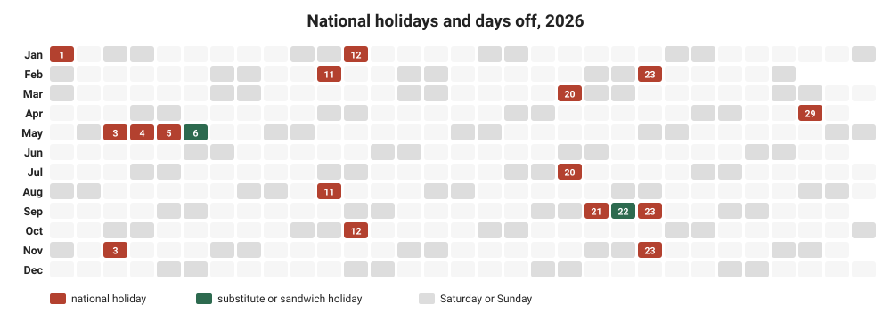

# 3. National Holidays and Golden Week

Japan has **16 national holidays** a year, set by law. This chapter explains where they came from, how the "substitute" and "sandwich" holidays work, and why the weeks around them matter to anyone travelling in Japan.

## 3.1 Before 1948: holidays of the imperial court

The Cabinet Office explains the history (Cabinet Office 2026b):

- **Eleven days off.** Before the present law, an imperial edict of **1927** made **11 festival days** public holidays. Seven were *saijitsu* (祭日), days of imperial rites: among them the rites for the imperial ancestors at the spring and autumn equinoxes (春季皇霊祭, 秋季皇霊祭) and the harvest rite *Niiname-sai* (新嘗祭) on 23 November. Four were *shukujitsu* (祝日), days of celebration: among them *Kigensetsu* (紀元節), the legendary founding of the empire, on 11 February, the reigning emperor's birthday on 29 April, and *Meijisetsu* (明治節), the Meiji emperor's birthday, on 3 November.
- **A new constitution.** After the Constitution of Japan took effect in May 1947, the government proposed to rewrite the holidays by cabinet order. The Diet objected that holidays were "closely connected with the lives and feelings of the people" and should be decided by the Diet. So the Diet wrote the law itself.
- **Asking the public.** The government asked for opinions through newspapers and radio and held an opinion poll. Committees of both houses met dozens of times.

The **Act on National Holidays** (国民の祝日に関する法律, *Kokumin no shukujitsu ni kansuru hōritsu*) passed on 5 July 1948 and came into force on **20 July 1948** (Cabinet Office 2026b).

## 3.2 What the law says

Article 1 sets out the purpose: "days on which the whole people celebrate, give thanks or commemorate", to foster beautiful customs and build a better society and a richer life. Article 2 lists the days and the meaning of each (Cabinet Office 2026a):

| Holiday | Japanese | Date | Purpose in the law |
|---|---|---|---|
| New Year's Day | 元日 *Ganjitsu* | 1 January | to celebrate the beginning of the year |
| Coming of Age Day | 成人の日 *Seijin no hi* | 2nd Monday of January | to celebrate and encourage young people who have become adults |
| National Foundation Day | 建国記念の日 *Kenkoku kinen no hi* | 11 February (set by cabinet order) | to recall the founding of the nation and foster love of country |
| Emperor's Birthday | 天皇誕生日 *Tennō tanjōbi* | 23 February | to celebrate the Emperor's birthday |
| Spring Equinox Day | 春分の日 *Shunbun no hi* | the spring equinox | to praise nature and love living things |
| Shōwa Day | 昭和の日 *Shōwa no hi* | 29 April | to look back on the Shōwa era, which recovered after turbulent days |
| Constitution Memorial Day | 憲法記念日 *Kenpō kinenbi* | 3 May | to commemorate the constitution taking effect |
| Greenery Day | みどりの日 *Midori no hi* | 4 May | to commune with nature and be grateful for its blessings |
| Children's Day | こどもの日 *Kodomo no hi* | 5 May | to respect children's personalities, seek their happiness, and thank mothers |
| Marine Day | 海の日 *Umi no hi* | 3rd Monday of July | to give thanks for the blessings of the sea |
| Mountain Day | 山の日 *Yama no hi* | 11 August | to get close to the mountains and give thanks for their blessings |
| Respect for the Aged Day | 敬老の日 *Keirō no hi* | 3rd Monday of September | to honour the elderly and celebrate long life |
| Autumn Equinox Day | 秋分の日 *Shūbun no hi* | the autumn equinox | to honour ancestors and remember the dead |
| Sports Day | スポーツの日 *Supōtsu no hi* | 2nd Monday of October | to enjoy sports and respect others |
| Culture Day | 文化の日 *Bunka no hi* | 3 November | to love freedom and peace and promote culture |
| Labour Thanksgiving Day | 勤労感謝の日 *Kinrō kansha no hi* | 23 November | to honour work, celebrate production and thank one another |

Several of the dates are the old court days with a new meaning: 11 February was *Kigensetsu*, 3 November was *Meijisetsu*, and 23 November was the harvest rite (Cabinet Office 2026b).

The equinox days have no fixed date in the law. They are the days of the astronomical equinoxes, which the National Astronomical Observatory announces the February before (Chapter 2) (Cabinet Office 2026a).

## 3.3 From 9 holidays to 16

The law of 1948 had **nine** holidays. The chair of the lower house committee said they were chosen to suit "the spirit of the new constitution" and so that "the whole people can readily accept and take part" (Cabinet Office 2026b). Seven more were added later, mostly by laws proposed by members of the Diet.

The Cabinet Office's list of every holiday since 1955 shows when each change took effect (Cabinet Office 2026c):

| Year | Change |
|---|---|
| 1966 | Respect for the Aged Day (15 September) and Health and Sports Day (10 October) |
| 1967 | National Foundation Day (11 February) |
| 1973 | The first substitute holiday, 30 April |
| 1988 | 4 May becomes a holiday, sandwiched between two others |
| 1989 | 29 April, the late Shōwa emperor's birthday, becomes Greenery Day; the Emperor's Birthday moves to 23 December |
| 1996 | Marine Day (20 July) |
| 2000 | Coming of Age Day and Health and Sports Day move to Mondays |
| 2003 | Marine Day and Respect for the Aged Day move to Mondays |
| 2007 | 29 April becomes Shōwa Day; Greenery Day moves to 4 May |
| 2016 | Mountain Day (11 August) |
| 2020 | The Emperor's Birthday moves to 23 February; Health and Sports Day is renamed Sports Day |

The Monday holidays give many three-day weekends. In 2020 and 2021 only, Marine Day, Sports Day and Mountain Day were moved to fit the Tokyo Olympic and Paralympic Games (Cabinet Office 2026a).

## 3.4 Substitute and sandwich holidays

Article 3 of the law adds two kinds of extra day off (Cabinet Office 2026a; NAOJ n.d.-a):

- **Substitute holiday** (振替休日, *furikae kyūjitsu*). When a holiday falls on a Sunday, the next day that is not a holiday becomes a holiday. In 2014, 4 May was a Sunday and 5 May was Children's Day, so **6 May** became the day off.
- **Sandwich holiday** (国民の休日, *kokumin no kyūjitsu*). An ordinary day with a holiday on both sides becomes a holiday. Respect for the Aged Day moves between 15 and 21 September, and the autumn equinox falls between 22 and 24 September, so every few years a **sandwiched day** appears. In 2026, Tuesday **22 September** is one.

<figure class="diagram">

<figcaption>The national holidays and extra days off of 2026, from the Cabinet Office list. Golden Week and the September cluster stand out (Cabinet Office 2026a). <span class="credit">Diagram drawn for this handbook from the sources cited in the chapter.</span></figcaption>
</figure>

## 3.5 Golden Week and the other busy weeks

Four holidays fall within a week at the turn of April and May: Shōwa Day (29 April), Constitution Memorial Day (3 May), Greenery Day (4 May) and Children's Day (5 May). Since 4 May became a holiday, 3–5 May has been a run of three days off every year, and a weekend or a substitute holiday often makes it longer (Cabinet Office 2026c). This cluster is known as **Golden Week** (ゴールデンウィーク, *gōruden wīku*). The Japan National Tourism Organization calls it "one of Japan's busiest travel periods", with "packed trains and hotels", and advises anyone who must travel in the first week of May to book early (JNTO n.d.-i).

In **2019** the accession of the new emperor on 1 May was treated as a holiday, which turned the days from **27 April to 6 May** into **ten days off in a row** (Cabinet Office 2026c).

The other peaks are the **New Year** (Chapter 5) and **Bon** in mid-August (Chapter 7), which are not national holidays in the law, apart from 1 January. Around New Year, "expect prices to be higher and options more limited" for hotels, planes and trains (JNTO n.d.-h). Around Bon, typically 13 to 16 August, seats on planes, trains and highway buses "sell out in advance" (JNTO n.d.-g). Book early, or travel at other times.

### The holidays of 2026 and 2027

From the Cabinet Office (Cabinet Office 2026a), as checked in November 2026:

| Holiday | 2026 | 2027 |
|---|---|---|
| New Year's Day | Thu 1 Jan | Fri 1 Jan |
| Coming of Age Day | Mon 12 Jan | Mon 11 Jan |
| National Foundation Day | Wed 11 Feb | Thu 11 Feb |
| Emperor's Birthday | Mon 23 Feb | Tue 23 Feb |
| Spring Equinox Day | Fri 20 Mar | Sun 21 Mar (substitute holiday Mon 22 Mar) |
| Shōwa Day | Wed 29 Apr | Thu 29 Apr |
| Constitution Memorial Day | Sun 3 May | Mon 3 May |
| Greenery Day | Mon 4 May | Tue 4 May |
| Children's Day | Tue 5 May (substitute holiday Wed 6 May) | Wed 5 May |
| Marine Day | Mon 20 Jul | Mon 19 Jul |
| Mountain Day | Tue 11 Aug | Wed 11 Aug |
| Respect for the Aged Day | Mon 21 Sep (sandwich holiday Tue 22 Sep) | Mon 20 Sep |
| Autumn Equinox Day | Wed 23 Sep | Thu 23 Sep |
| Sports Day | Mon 12 Oct | Mon 11 Oct |
| Culture Day | Tue 3 Nov | Wed 3 Nov |
| Labour Thanksgiving Day | Mon 23 Nov | Tue 23 Nov |

The Cabinet Office publishes the following year's list each February (Cabinet Office 2026a).

## Self-check

```quiz
? Who decided Japan's postwar national holidays?
- The Diet, which wrote the 1948 law itself *
- The occupation authorities alone
- The Imperial Household
> The government withdrew its plan to set them by cabinet order (Cabinet Office 2026b).

? What happens when a national holiday falls on a Sunday?
- The next day that is not a holiday becomes a substitute holiday *
- Nothing; the holiday is lost
- The Saturday before becomes a holiday
> Article 3(2) of the law (Cabinet Office 2026a).

? Why was Golden Week 2019 ten days long?
- The new emperor's accession on 1 May was treated as a holiday *
- The Olympics were held in May
- The law was changed to add a week
> 27 April to 6 May 2019 were all days off (Cabinet Office 2026c).

? Which holiday has no fixed date in the law?
- Spring Equinox Day *
- Culture Day
- Mountain Day
> The equinox days follow astronomy (Cabinet Office 2026a).
```

## Sources for this chapter

1. **Cabinet Office 2026a.** See [Chapter 1](01-calendars.md).
2. **Cabinet Office 2026b.** Cabinet Office. （参考情報）祝日法制定の経緯 (Background: how the holiday law was made), checked November 2026. [cao.go.jp](https://www8.cao.go.jp/chosei/shukujitsu/gaiyou/kaku/keii.html).
3. **Cabinet Office 2026c.** Cabinet Office. 昭和30年（1955年）から令和9年（2027年）国民の祝日 (National holidays from 1955 to 2027), CSV file, checked November 2026. [cao.go.jp](https://www8.cao.go.jp/chosei/shukujitsu/syukujitsu.csv).
4. **JNTO n.d.-g.** Japan National Tourism Organization. *Japan in August*. [japan.travel](https://www.japan.travel/en/guide/august/).
5. **JNTO n.d.-h.** Japan National Tourism Organization. *Japan in January*. [japan.travel](https://www.japan.travel/en/guide/january/).
6. **JNTO n.d.-i.** Japan National Tourism Organization. *Japan in May*. [japan.travel](https://www.japan.travel/en/guide/may/).
7. **NAOJ n.d.-a.** See [Chapter 2](02-solar-terms.md).

➡️ Next: [Chapter 4: The five seasonal festivals](04-sekku.md)
