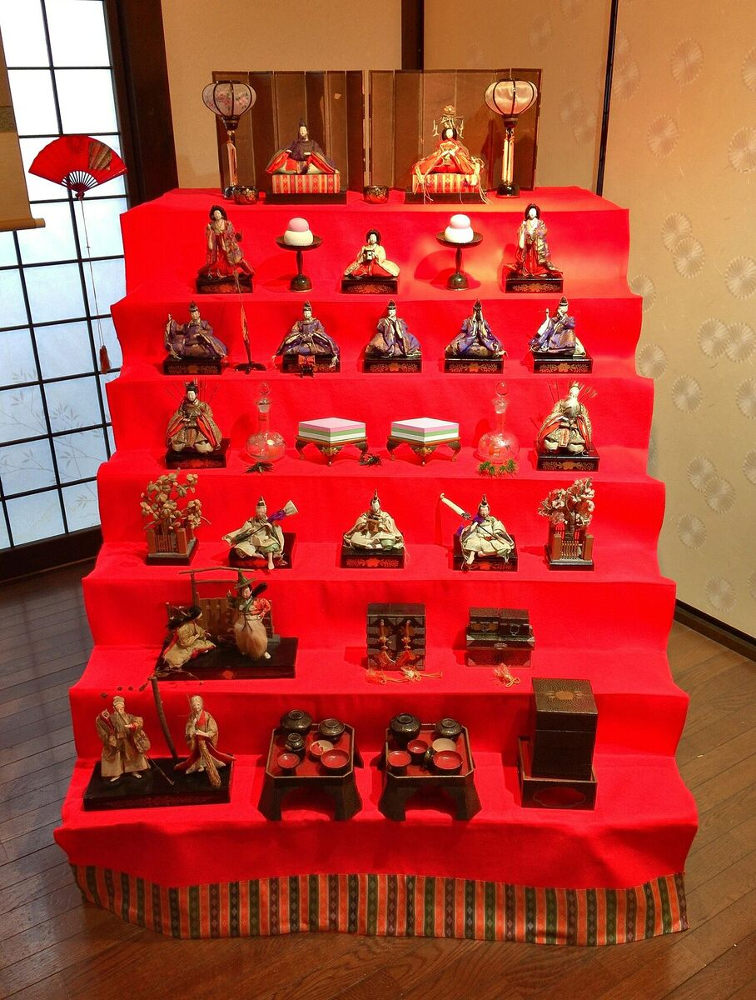
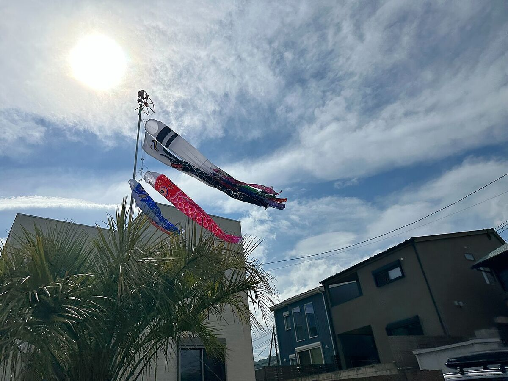
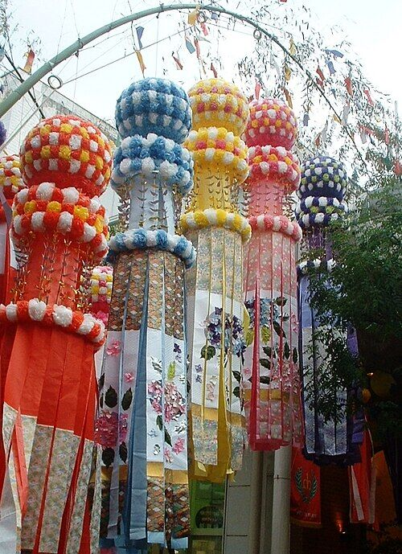

# 4. The Five Seasonal Festivals

Five days of the year have been special in Japan for more than a thousand years: 1/7, 3/3, 5/5, 7/7 and 9/9. They are the **five *sekku*** (五節句, *go-sekku*). Two of them became the Girls' Festival and Children's Day, and a third became Tanabata, the star festival. This chapter explains each one and the food that goes with it.

## 4.1 What a *sekku* is

The main source is a chapter on annual events and food by the food-culture scholar Tanaka Naomi, published by the Ministry of Agriculture, Forestry and Fisheries (Tanaka n.d.):

- **Special days, *hare*.** Japanese life distinguishes ordinary days from special days, *hare* (ハレ). Some come round every year (annual events, 年中行事 *nenjū gyōji*), and some come once in a lifetime (rites of passage such as coming of age, marriage or the 60th birthday).
- **From China.** The five *sekku* were brought from China between the Nara and Heian periods (8th–12th centuries) and merged with Japanese customs. They are built on the Chinese idea of "doubled days", when an odd month and day are the same number.
- **Purification.** All five were rites to drive off misfortune. People prepared a feast and offered it to the gods, then ate together with them. That is why the word is also written 節供, "seasonal offering".
- **From court to people.** The rites began at court, passed to the samurai, and spread to ordinary people.

Each *sekku* also has a popular name, after a plant (Tanaka n.d.):

| Date | Name | Popular name |
|---|---|---|
| 1/7 | 人日 *jinjitsu* | the festival of the seven herbs |
| 3/3 | 上巳 *jōshi* | the peach festival |
| 5/5 | 端午 *tango* | the iris festival |
| 7/7 | 七夕 *tanabata* | the star festival |
| 9/9 | 重陽 *chōyō* | the chrysanthemum festival |

## 4.2 7 January: seven-herb rice porridge

*Jinjitsu* means "the day of people" (Tanaka n.d.):

- **From China.** A Chinese record of annual events, the *Jingchu suishiji* (荊楚歳時記), calls it the day for divining people's fortunes, when a soup of seven herbs was eaten against illness.
- **In Japan.** It merged with the Japanese custom of picking young greens at New Year to become *nanakusa-gayu* (七草粥), rice porridge with seven herbs. In the Heian period it was a hot soup; it became a porridge in the Muromachi period, and took its present form between the Muromachi and Edo periods.
- **The seven herbs** are *seri* (water dropwort), *nazuna* (shepherd's purse), *gogyō* (cudweed), *hakobera* (chickweed), *hotoke no za* (nipplewort), *suzuna* (turnip) and *suzushiro* (daikon radish). Eating plants with strong life early in the year was thought to give long life.
- **The end of New Year.** The day closes the New Year rites, and "the porridge rests a stomach tired of rice cakes".

## 4.3 3 March: the Girls' Festival

*Hinamatsuri* (雛祭り), the doll festival, is "a day to celebrate and wish for the happiness and healthy growth of girls" (MAFF 2023). Tanaka and the ministry trace its history (Tanaka n.d.; MAFF 2023):

- **Dolls as scapegoats.** In the Heian period, people transferred their impurity to a paper doll (人形, *hitogata*) and floated it away on a river. The "floating dolls" (流し雛, *nagashi-bina*) are the origin of the festival.
- **Dolls as toys.** The rite merged with *hiina asobi*, girls' play with dolls at the Heian court.
- **A fixed date and a girls' festival.** The date was fixed on 3 March in the Muromachi period. In the Edo period it became a festival for girls, held at the imperial palace and in the shogun's inner palace, and it spread to townspeople and the provinces.
- **Tiered displays.** Dolls were made in pairs, as husband and wife, and from the Genroku era (1688–1704) displays on tiers (段飾り, *dankazari*) were made.

The food of the day (MAFF 2023; Tanaka n.d.):

- ***Hishi-mochi*** (菱餅), diamond-shaped rice cakes in three layers. In the ministry's explanation, the green layer at the bottom stands for new shoots, the white for snow and the pink for life: shoots under the snow, then peach blossom.
- ***Hina-arare*** (雛あられ), puffed rice crackers. In Kansai they are round and salty; in Kantō they are rice-grain shaped and sweet.
- **White sake** (白酒, *shirozake*), descended from peach-blossom sake. The peach was believed to drive off evil.
- **Clam soup.** Clams were part of the display because the festival absorbed an old custom of picnics on the shore in spring.

<figure>

<figcaption>A seven-tiered <em>hina</em> doll display. <span class="credit">Image: Asanagi, <a href="https://creativecommons.org/publicdomain/zero/1.0/">CC0</a>, via <a href="https://commons.wikimedia.org/wiki/File:Ornamental_dolls_of_Hinamatsuri_2020-01-12.jpg">Wikimedia Commons</a>.</span></figcaption>
</figure>

## 4.4 5 May: Children's Day

*Tango* means "the first horse day" of the month. In law, 5 May is **Children's Day**, "to respect children's personalities, seek their happiness, and thank mothers" (Cabinet Office 2026a). Tanaka explains its history (Tanaka n.d.):

- **A dangerous month.** In ancient China the 5th month was an "evil month". People hung up irises (*shōbu*) and mugwort, whose strong smell was believed to drive off disease, and tied five-coloured threads to their arms.
- **In Japan.** It came in the Nara period and joined local rites of the rice-planting season. Mounted archery at court became today's *yabusame*.
- **A boys' festival.** The word *shōbu* (菖蒲, iris) sounds like *shōbu* (尚武, "valuing the martial spirit"), so the day became a boys' festival. In the Edo period, samurai and townsmen alike put up banners and **carp streamers** (鯉幟, *koinobori*) and displayed warrior dolls, wishing their sons to grow strong.
- **Food.** *Chimaki* (粽), rice dumplings wrapped in leaves, came from a Chinese story and were believed to drive off evil. *Kashiwa-mochi* (柏餅) is wrapped in an oak leaf. The oak does not drop its old leaves until new ones bud, so it promised that the family line would continue.

<figure>

<figcaption>Carp streamers (<em>koinobori</em>). <span class="credit">Image: Nesnad, <a href="https://creativecommons.org/licenses/by/4.0/">CC BY 4.0</a>, via <a href="https://commons.wikimedia.org/wiki/File:Carp_streamers_-_koinobori_-_2023_May_6_various.jpeg">Wikimedia Commons</a>.</span></figcaption>
</figure>

## 4.5 7 July: Tanabata, the star festival

Tanabata grew from a Chinese legend about two stars (Tanaka n.d.; JNTO n.d.-e):

- **The legend.** The weaver princess **Orihime** (the star Vega) and the cowherd **Hikoboshi** (Altair) are separated by the Milky Way and can meet only one night a year.
- **In Japan.** The Chinese legend and the Chinese rite of praying for skill in weaving and the arts (乞巧奠, *kikōden*) merged with a Japanese belief in the *tanabata-tsume*, a maiden who wove cloth by the water while waiting for a god to descend.
- **Bamboo and wishes.** In the Heian period, bamboo, used in folk custom as a place for the gods to alight, was set up at court and hung with poem slips. Today people still write wishes on paper strips (短冊, *tanzaku*) and hang them on bamboo.
- **Food.** *Sakubei* (索餅), twisted wheat dough fried in oil, was eaten to escape epidemics. It is said to be the ancestor of *sōmen* noodles.

Tanabata falls "on the 7th day of the 7th month. Depending on the calendar used, that could mean July or August" (JNTO n.d.-e). Japan's biggest Tanabata, in **Sendai**, is held on **6–8 August**, with fireworks on 5 August. Its shopping arcades are hung with large paper decorations and streamers that people can walk through (JNTO n.d.-e).

<figure>

<figcaption>Tanabata decorations in a shopping arcade in Sendai. <span class="credit">Image: Atsi Otani, <a href="https://creativecommons.org/licenses/by-sa/3.0/">CC BY-SA 3.0</a>, via <a href="https://commons.wikimedia.org/wiki/File:Sendai_Tanabata_2005.jpg">Wikimedia Commons</a>.</span></figcaption>
</figure>

## 4.6 9 September: the chrysanthemum festival

*Chōyō* (重陽) means "doubled *yang*": nine is the highest odd number, the most *yang* of all (Tanaka n.d.):

- **In China** the day was feared. People climbed hills, carried bags of dogwood (*shuyu*) and drank chrysanthemum wine, believed to give long life.
- **In Japan** it became a court banquet in the Heian period. Chrysanthemums were covered overnight with floss silk; in the morning people wiped themselves with the dew-soaked silk to stay young.
- **Today.** Ordinary people ate rice with chestnuts, so it was also called the chestnut festival. It was dropped from the list of official festival days in the Meiji period and largely forgotten, but survives in many places as the autumn festival of the local shrine, *okunchi* ("the ninth").

## Self-check

```quiz
? What do the five sekku dates have in common?
- An odd month and day of the same number *
- A full moon
- The start of a season by the solar terms
> The Chinese idea of "doubled days" (Tanaka n.d.).

? What is the origin of the Girls' Festival?
- Paper dolls that took on impurity and were floated down rivers *
- A Meiji-era school festival
- The birthday of an empress
> Nagashi-bina, the "floating dolls" (Tanaka n.d.; MAFF 2023).

? Why is kashiwa-mochi eaten on 5 May?
- The oak keeps its old leaves until new ones bud, a sign that the family line continues *
- Oak leaves cure colds
- Oak trees flower on that day
> Tanaka n.d.

? Why is Sendai's Tanabata held in August?
- It follows the old calendar's 7th month, about a month later *
- July is the rainy season in Sendai
- It was moved for tourists in 2000
> "One month later than most of the rest of Japan" (JNTO n.d.-e).
```

## Sources for this chapter

1. **Cabinet Office 2026a.** See [Chapter 1](01-calendars.md).
2. **JNTO n.d.-e.** See [Chapter 1](01-calendars.md).
3. **MAFF 2023.** Ministry of Agriculture, Forestry and Fisheries. お家で祝うひなまつり！ (Celebrating Hinamatsuri at home), *Let's! Washoku project*, February 2023. [maff.go.jp](https://www.maff.go.jp/j/keikaku/syokubunka/culture/wagohan/articles/2302/spe14_03.html).
4. **Tanaka n.d.** See [Chapter 1](01-calendars.md).

➡️ Next: [Chapter 5: New Year](05-new-year.md)
