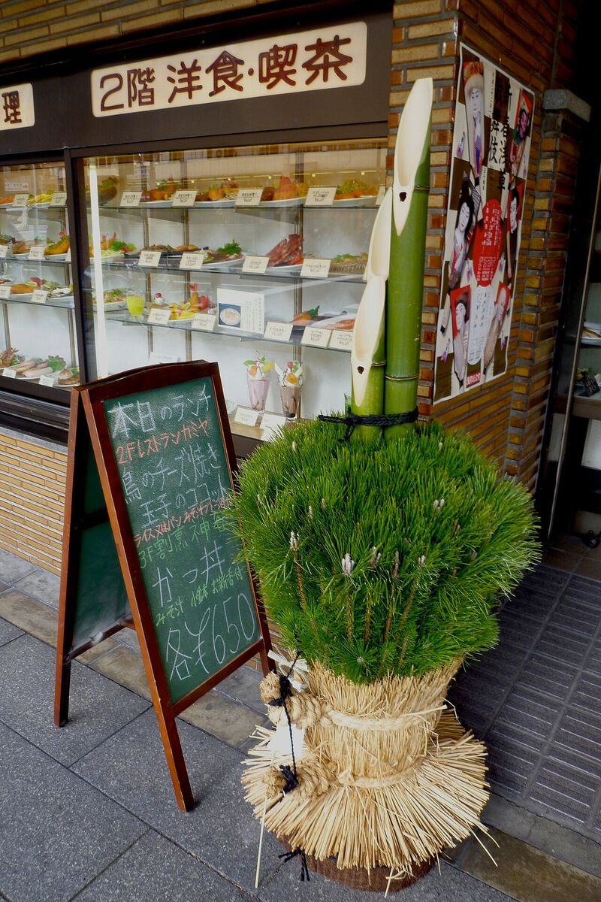
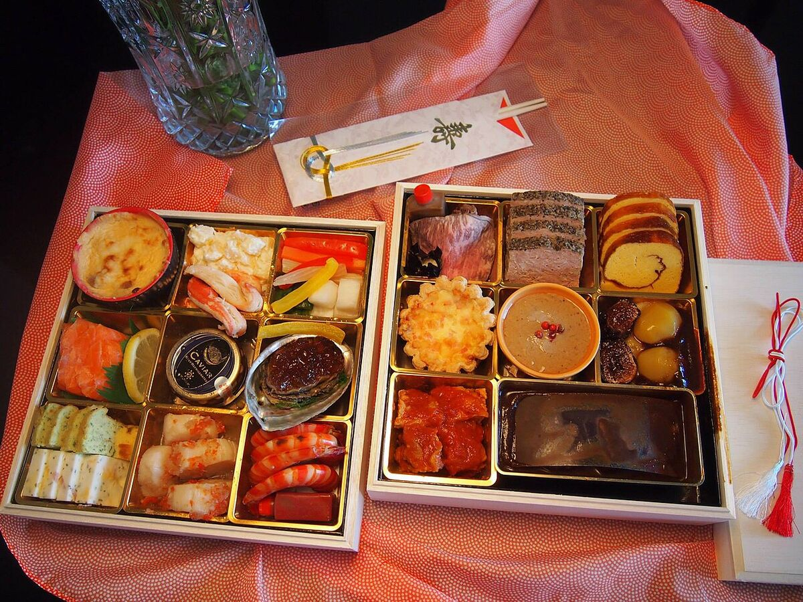
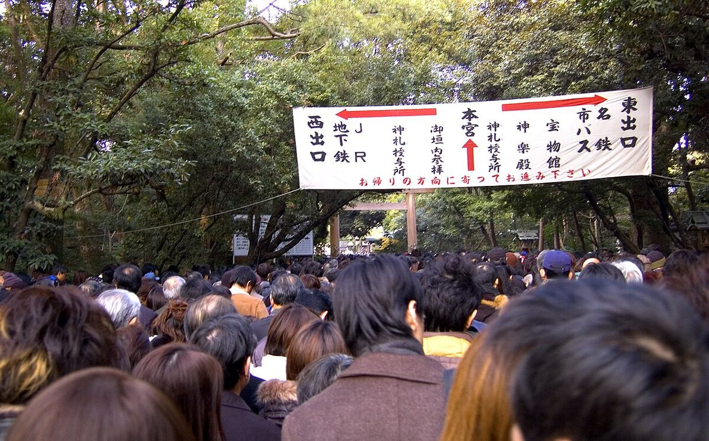

# 5. New Year

*Shōgatsu* (正月), the New Year, is the most important festival of the Japanese year. Tanaka Naomi calls it "the most important seasonal day, breaking the monotony of everyday life" (Tanaka n.d.). This chapter follows it from the last days of December to the "little New Year" of 15 January.

## 5.1 Welcoming the god of the year

The decorations and foods of New Year are for a god: the **god of the year** (歳神, *toshigami*), who visits each home and brings the new year's strength (Tanaka n.d.; MAFF Hokkaidō n.d.-b):

- ***Kadomatsu*** (門松), "gate pines", stand on either side of the entrance. The pine is a *yorishiro* (依代), a mark for the god to come down to.
- **Two kinds of wish.** The decorations carry two wishes: to invite good fortune (招福, *shōfuku*) and to ward off disaster (攘災, *jōsai*).
- **The *hōrai* display** (蓬莱飾り) shapes Mount Hōrai, a mountain of the gods, in the alcove of the house, to draw the god in.
- ***Kagami-mochi*** (鏡餅), "mirror rice cakes", are offered to the god of the year. In the past, the household made rice cakes all day, together, to welcome the god (MAFF Hokkaidō n.d.-b).

<figure>

<figcaption>A <em>kadomatsu</em> at a shop entrance in Asakusa, Tokyo, December 2009. <span class="credit">Image: Nesnad, <a href="https://creativecommons.org/licenses/by/3.0/">CC BY 3.0</a>, via <a href="https://commons.wikimedia.org/wiki/File:Kadomatsu-asakusa-dec28-2009.jpg">Wikimedia Commons</a>.</span></figcaption>
</figure>

## 5.2 New Year food

A ministry survey of 2,000 people in 2020 found that New Year and New Year's Eve foods were the most widely kept of all festival foods: **more than 80%** said they ate them "almost every time" or "more often than not" (MAFF 2020).

- ***Zōni*** (雑煮), a soup with rice cakes, is "a remnant of samurai custom". At samurai banquets, lord and retainers exchanged cups of sake in a ceremony called *shikisankon*, and *zōni* was the food served with the first cup. It became the New Year food, eaten together with spiced sake, *otoso* (屠蘇) (Tanaka n.d.).
- **Round rice cakes and New Year money.** The round rice cake in *zōni* "symbolises the soul (*tama*)". Eating it means taking in the soul of the new year, the strength of the god of the year. The New Year money given to children, ***otoshidama*** (お年玉), has the same meaning (Tanaka n.d.).
- ***Osechi*** (お節料理), the New Year dishes, are packed in stacked boxes. The ministry's children's page explains that dishes such as black beans and herring roe carry wishes for the family's health and for many descendants (MAFF n.d.).
- **New Year's Eve in Hokkaidō.** Many families in Hokkaidō eat their *osechi* on the evening of **31 December**, at a feast called *toshitori-zen*. In the old calendar, the day began at sunset, so the feast at the start of the year was eaten on what is now New Year's Eve (MAFF Hokkaidō n.d.-b).

<figure>

<figcaption><em>Osechi</em> in stacked lacquer boxes. <span class="credit">Image: Akihito Kurono (Bokensdorf), <a href="https://creativecommons.org/publicdomain/zero/1.0/">CC0</a>, via <a href="https://commons.wikimedia.org/wiki/File:Osechi.jpg">Wikimedia Commons</a>.</span></figcaption>
</figure>

## 5.3 The first shrine visit

***Hatsumōde*** (初詣), the first visit of the year to a shrine or temple, is today the best-known New Year custom. Its modern form is younger than it looks. The historian Hirayama Noboru, in a book reviewed in the journal *Rekishi to keizai*, shows how it grew with the **railways** (Nakanishi 2017):

- **Kawasaki Daishi.** New Year visits to Kawasaki Daishi, a temple in the suburbs of Tokyo, took root after a railway reached it.
- **Freedom from old rules.** Railways and suburbs together loosened the rules of the Edo period, under which people visited a shrine in a lucky direction that changed every year (恵方, *ehō*). A new, leisure-like kind of visit was born that did not worry about such details.
- **Kansai.** In the Kansai region, private railways and the national railway built routes to sacred places such as the Ise shrines, and sold the trips with a mix of leisure and national feeling.

The railways handbook tells how those private railways grew: see [Railways, Chapter 5](../railways/05-private.md).

<figure>

<figcaption>New Year's Day crowds at Atsuta Shrine, Nagoya, 2006. <span class="credit">Image: Paul Davidson, <a href="https://creativecommons.org/licenses/by/2.0/">CC BY 2.0</a>, via <a href="https://commons.wikimedia.org/wiki/File:Crowds_at_Atsuta_Shrine%2C_New_Year%E2%80%99s_Day_%2880254988%29.jpg">Wikimedia Commons</a>.</span></figcaption>
</figure>

## 5.4 New Year cards

New Year cards, *nengajō* (年賀状), are delivered on New Year's Day. Japan Post asked senders to post them by **25 December** for delivery on 1 January 2026. Its special New Year postcards carry lottery prizes (Japan Post 2025). Their numbers are falling fast. Japan Post's first printing of New Year postcards for **2026** was **750 million**, about **69.9%** of the first printing for 2025, which was about 1.07 billion (Japan Post 2025).

## 5.5 The end of New Year

New Year ends in stages:

- **7 January: seven-herb porridge.** The day of *jinjitsu*, with *nanakusa-gayu* (Chapter 4), ends the New Year rites (Tanaka n.d.).
- **11 January: opening the mirror cakes.** On 11 January the *kagami-mochi* are eaten. They are also called "teeth-hardening cakes" (歯固め餅, *hagatame-mochi*): the word for teeth (*ha*) is linked to age, so eating them was a wish for long life (Tanaka n.d.).
- **15 January: the little New Year.** In the old calendar, the 15th of the first month was the full moon, and was once itself the New Year. It is called *koshōgatsu* (小正月, "little New Year") or *onna shōgatsu* ("women's New Year"). People decorate branches with rice-cake "cocoons" (*mayudama*) and eat **rice porridge with azuki beans** (小豆粥, *azuki-gayu*) to pray in advance for a good harvest (MAFF Hokkaidō n.d.-a).

### Coming of Age Day

The second Monday of January is **Coming of Age Day**, a national holiday "to celebrate and encourage young people who have become adults and are determined to live on their own" (Cabinet Office 2026a). Until 1999 it was always 15 January, the old little New Year. Since 2000 it has fallen on a Monday (Cabinet Office 2026c).

## Self-check

```quiz
? What is the kadomatsu at the gate for?
- A mark for the god of the year to come down to *
- Keeping snow away from the door
- Showing that the house has paid its taxes
> The pine is a yorishiro (Tanaka n.d.).

? Where did the custom of zōni come from?
- The food served with the first cup at samurai banquets *
- Portuguese stew brought in the 16th century
- A Meiji government recipe
> Shikisankon (Tanaka n.d.).

? What helped hatsumōde at Kawasaki Daishi take root?
- The opening of a railway to the temple *
- A law making it compulsory
- Television broadcasts
> Hirayama's study, reviewed in Nakanishi 2017.

? When do many families in Hokkaidō eat their osechi?
- On the evening of 31 December *
- On 7 January
- On 15 January
> When the day began at sunset (MAFF Hokkaidō n.d.-b).
```

## Sources for this chapter

1. **Cabinet Office 2026a.** See [Chapter 1](01-calendars.md).
2. **Cabinet Office 2026c.** See [Chapter 3](03-holidays.md).
3. **Japan Post 2025.** Japan Post Co. 日本郵便. 2026（令和8）年用年賀はがきなどの発行および販売 (Issue and sale of New Year postcards for 2026), press release, 29 August 2025. [post.japanpost.jp](https://www.post.japanpost.jp/notification/pressrelease/2025/00_honsha/0829_02_01.pdf).
4. **MAFF 2020.** Ministry of Agriculture, Forestry and Fisheries. 和食文化に関する意識調査の結果を公表しました (Results of a survey on washoku culture), press release, 23 December 2020. [maff.go.jp](https://www.maff.go.jp/j/keikaku/syokubunka/culture/pdf/03_press.pdf).
5. **MAFF n.d.** Ministry of Agriculture, Forestry and Fisheries. 行事食について (On festival foods), children's page. [maff.go.jp](https://www.maff.go.jp/j/syokuiku/kodomo_navi/learn/event.html).
6. **MAFF Hokkaidō n.d.-a.** Hokkaidō Regional Agricultural Administration Office 北海道農政事務所. お正月の行事と料理 (New Year events and dishes). [maff.go.jp](https://www.maff.go.jp/hokkaido/suishin/shokuiku/osyogatu_gyoji.html).
7. **MAFF Hokkaidō n.d.-b.** Hokkaidō Regional Agricultural Administration Office. 年の瀬の行事と料理 (Year-end events and dishes). [maff.go.jp](https://www.maff.go.jp/hokkaido/suishin/shokuiku/toshinose_gyoji.html).
8. **Nakanishi 2017.** Nakanishi Satoshi 中西聡. Review of Hirayama Noboru 平山昇, 初詣の社会史：鉄道が生んだ娯楽とナショナリズム (A social history of hatsumōde: the leisure and nationalism born of railways; Ochanomizu Shobō, 2015). *Rekishi to keizai* (Journal of Political Economy and Economic History) 2017;59(4):63–65. [J-STAGE](https://www.jstage.jst.go.jp/article/rekishitokeizai/59/4/59_63/_article/-char/en).
9. **Tanaka n.d.** See [Chapter 1](01-calendars.md).

➡️ Next: [Chapter 6: Setsubun and spring](06-spring.md)
