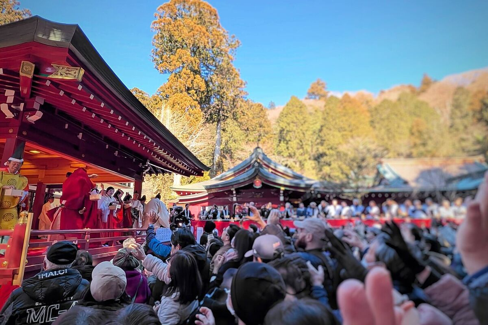
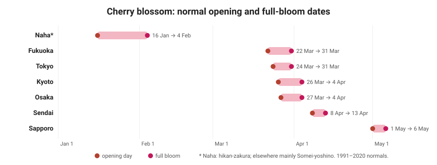
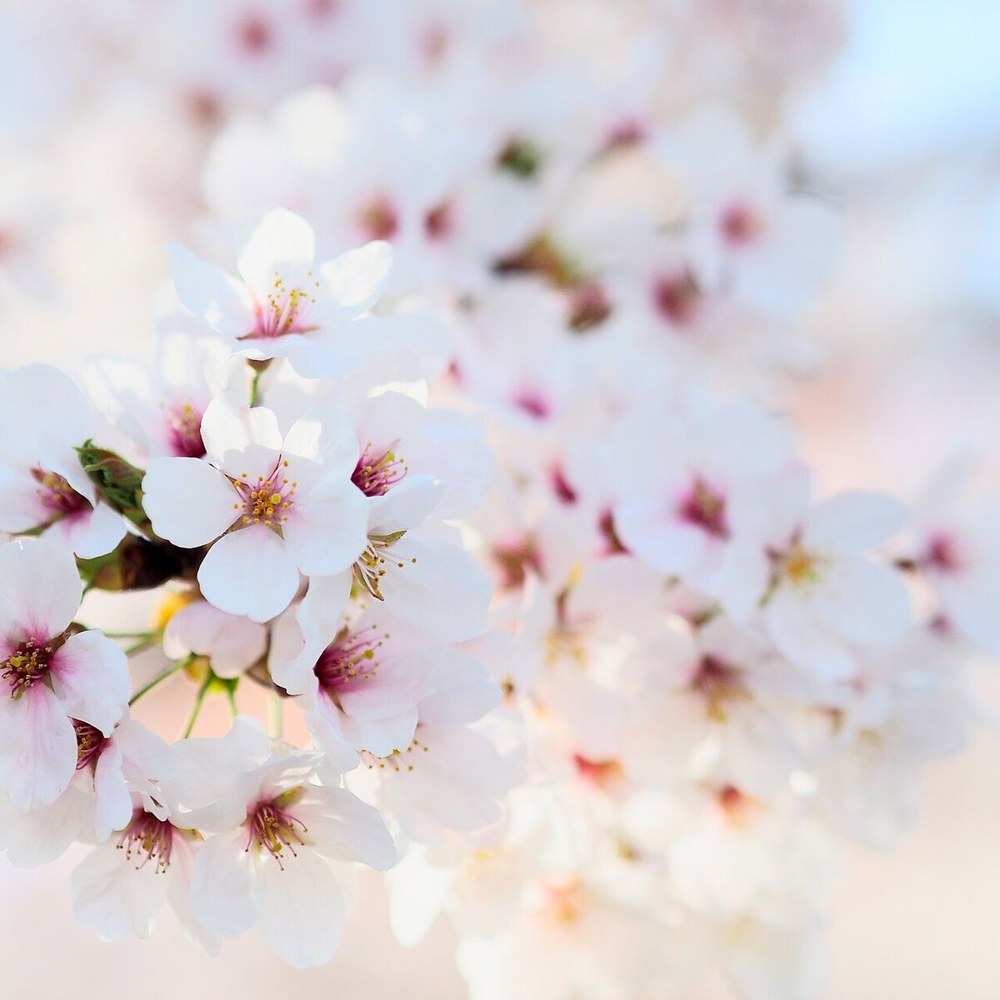
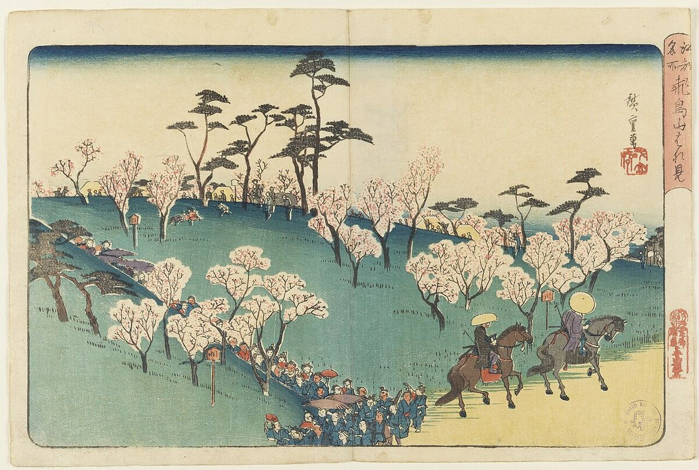

# 6. Setsubun and Spring

Spring in the Japanese calendar starts in early February, with *setsubun* and *risshun*, and ends with the cherry blossom moving north to Hokkaidō in May. This chapter covers the bean-throwing of *setsubun*, the spring equinox week, and the cherry blossom: how its dates are measured and how cherry-blossom viewing began.

## 6.1 *Setsubun*: driving out the demons

*Setsubun* is the day before *risshun*, the beginning of spring: usually 3 February, sometimes 2 February (Chapter 2) (NAOJ 2021). Tanaka Naomi describes the customs (Tanaka n.d.):

- **Throwing beans.** People scatter roasted soybeans, *mamemaki* (豆まき), and then eat **one bean more than their age** to pray for a year without illness.
- **At the door.** A sprig of holly and the head of a sardine are hung at the entrance to keep evil away.
- ***Ehōmaki.*** In some regions people eat a thick rolled sushi, *ehōmaki* (恵方巻き). *Ehō* is the lucky direction of the year.

The National Diet Library defines *setsubun* as the day "on which rites to drive out evil are held" (NDL 2016b). The ministry's children's page lists "the lucky beans of *setsubun*" (節分の福豆, *setsubun no fukumame*) among Japan's festival foods (MAFF n.d.).

<figure>

<figcaption>Bean-throwing at <em>setsubun</em>. <span class="credit">Image: KQuhen, <a href="https://creativecommons.org/licenses/by-sa/4.0/">CC BY-SA 4.0</a>, via <a href="https://commons.wikimedia.org/wiki/File:Hakone_Shrine_Setsubun_mamemaki_01.jpg">Wikimedia Commons</a>.</span></figcaption>
</figure>

## 6.2 The spring equinox and *higan*

The spring equinox is a national holiday, "to praise nature and love living things" (Cabinet Office 2026a). It falls in the middle of *higan* (彼岸), the seven days around each equinox (NDL 2016b). In Tanaka's words, *higan* is when people honour their ancestors "in a pleasant season": they visit the family grave, clean the household Buddhist altar, and offer *botamochi* (rice balls in sweet bean paste, also called *ohagi*) and *higan* dumplings (Tanaka n.d.). The folklore handbook explains the beliefs about ancestors: [Folklore, Chapter 6](../folklore/06-ancestors.md).

## 6.3 How the Japan Meteorological Agency watches the cherry trees

Each spring the news follows the "cherry blossom front" (桜前線, *sakura zensen*) north. The figures come from the **Japan Meteorological Agency** (JMA), which has watched the same trees at its weather stations for decades (JMA 2020a):

- **Sample trees.** At each station the agency chooses a **sample tree** (標本木, *hyōhonboku*) and observes only that tree.
- **Opening day** (開花日, *kaika-bi*): the first day on which **five or six flowers** or more are open on the sample tree.
- **Full bloom** (満開日, *mankai-bi*): the first day on which **about 80%** or more of the buds are open.
- **Which cherry.** Mainly the ***Somei-yoshino*** (染井吉野) variety, which began at the end of the Edo period and is a hybrid of two wild cherries, *Edo-higan* and *Ōshima-zakura*. It is planted from Kyūshū to the Ishikari plain in Hokkaidō. Where it does not grow, the agency watches other species: *hikan-zakura* in Okinawa and Amami, *ezo-yamazakura* in parts of Hokkaidō.

### The front, on average

Using the normal dates for 1991–2020, the agency describes the front (JMA 2020a):

- ***Hikan-zakura*** in Okinawa and Amami start to open around **mid-January**.
- ***Somei-yoshino*** open in **late March** in Kyūshū, Chūgoku, Shikoku, Kinki, Tōkai and Kantō; they reach Hokuriku and southern Tōhoku around **10 April**, and the north of Hokkaidō in **mid-May**.
- Full bloom follows some days later: see the table below.

<figure class="diagram">

<figcaption>Normal opening and full-bloom dates of the cherry blossom in selected cities, 1991–2020 averages (JMA 2026a; JMA 2026b). <span class="credit">Diagram drawn for this handbook from the sources cited in the chapter.</span></figcaption>
</figure>

### Dates by city

The normal dates and the dates of 2026, from the agency's tables (JMA 2026a; JMA 2026b):

| City | Normal opening | Normal full bloom | Opening 2026 | Full bloom 2026 |
|---|---|---|---|---|
| Naha (*hikan-zakura*) | 16 Jan | 4 Feb | 18 Jan | 3 Feb |
| Fukuoka | 22 Mar | 31 Mar | 24 Mar | 3 Apr |
| Tokyo | 24 Mar | 31 Mar | 19 Mar | 28 Mar |
| Kyoto | 26 Mar | 4 Apr | 23 Mar | 30 Mar |
| Osaka | 27 Mar | 4 Apr | 26 Mar | 3 Apr |
| Sendai | 8 Apr | 13 Apr | 31 Mar | 4 Apr |
| Sapporo | 1 May | 6 May | 18 Apr | 24 Apr |

In 2026 Sapporo's tree opened **13 days** before its normal date. Over the six years 2021–2026, Tokyo's opening day ranged from 14 March (2021 and 2023) to 29 March (2024) (JMA 2026a). A trip planned around the normal date can easily miss the bloom by a week or more.

<figure>

<figcaption><em>Somei-yoshino</em> cherry blossom. <span class="credit">Image: T.Kiya, <a href="https://creativecommons.org/licenses/by-sa/2.0/">CC BY-SA 2.0</a>, via <a href="https://commons.wikimedia.org/wiki/File:Sakura%2C_Cherry_blossoms._%E6%A1%9C_-_Flickr_-_T.Kiya.jpg">Wikimedia Commons</a>.</span></figcaption>
</figure>

## 6.4 How cherry-blossom viewing began

*Hanami* (花見), "flower viewing", means picnicking under the cherry trees. Two scholars and the ministry's food-culture chapter explain its history:

- **Court and poetry.** The *Man'yōshū*, the oldest anthology of Japanese poems, already has many poems on wild cherries and some on planted ones. In the Heian period the cherry became the main flower for viewing: the evidence usually cited is that in the *Kokinshū* anthology the cherry overtakes the plum and becomes the flower most often sung. Cherry viewing in mansion gardens and in the wild became popular (Ikeya 2014).
- **The Edo period: hanami for everyone.** With peace and a growing economy, a culture of hanami that included ordinary people took shape in the Edo period. It began with cherries planted in samurai gardens and in the grounds of temples and shrines (Ikeya 2014).
- **A shogun plants cherries.** The eighth shogun, **Tokugawa Yoshimune**, laid out **Asukayama**, a hill in Ōji north of Edo, as a place for blossom viewing in the first half of the **18th century**. In the same Kyōhō and Genbun eras (1716–1741) the Sumida river embankment, Gotenyama, Nakano and Koganei were also laid out, quite systematically, as pleasure grounds on the outskirts of Edo for the townspeople (Ono 1987).
- **Offering to the mountain god?** In Tanaka's account, hanami from late March into May was a rite: sake and food were offered under the cherry trees to the **god of the mountain**, to pray for a good harvest (Tanaka n.d.). Ikeya notes that this link with farming rites is a theory strongly held in folklore studies, but that there is **no evidence** for it: when people first began to view flowers in Japan is not clear from the records (Ikeya 2014).

<figure>

<figcaption>Cherry-blossom viewing at Asukayama, by Utagawa Hiroshige. <span class="credit">Image: Utagawa Hiroshige (publisher Sanoya Kihei), Public domain, via <a href="https://commons.wikimedia.org/wiki/File:Cherry-Blossom_Viewing_at_Asuka_Hill_%28Asukayama_hanami%29.jpg">Wikimedia Commons</a>.</span></figcaption>
</figure>

## 6.5 The 88th night

*Hachijū-hachiya* (八十八夜), the 88th day counted from *risshun*, is "a marker for sowing seeds" (NDL 2016b). In 2026 it fell on **2 May** (NAOJ 2025).

## Self-check

```quiz
? How many beans do you eat at setsubun, in Tanaka's account?
- One more than your age *
- Exactly eight
- As many as you caught
> To pray for a year without illness (Tanaka n.d.).

? When does the JMA declare a cherry tree "open"?
- When five or six or more flowers are open on its sample tree *
- When half the trees in a park are in flower
- On the spring equinox
> JMA 2020a.

? In which city does the cherry blossom first in the JMA tables above?
- Naha, in January *
- Tokyo, in March
- Sapporo, in May
> Naha's hikan-zakura open in mid-January (JMA 2020a).

? Who laid out Asukayama for cherry-blossom viewing?
- The shogun Tokugawa Yoshimune *
- The Meiji emperor
- The Tokyo city government in 1950
> In the first half of the 18th century (Ono 1987).
```

## Sources for this chapter

1. **Cabinet Office 2026a.** See [Chapter 1](01-calendars.md).
2. **Ikeya 2014.** Ikeya Hiroyuki 池谷祐幸. 桜の観賞と栽培の歴史：野生種から栽培品種への道 (The history of cherry viewing and cultivation: from wild species to cultivars). *Shinrin kagaku* 2014;70:3–7. [J-STAGE](https://www.jstage.jst.go.jp/article/jjsk/70/0/70_KJ00009380024/_article/-char/en).
3. **JMA 2020a.** Japan Meteorological Agency 気象庁. さくらの開花日と満開日 (Cherry opening and full-bloom days: method and normal-date maps, 1991–2020). [jma.go.jp](https://www.data.jma.go.jp/sakura/data/sakura2020.pdf).
4. **JMA 2026a.** Japan Meteorological Agency. さくらの開花日 (2021–2026年) (Cherry opening days, 2021–2026, with normals), checked November 2026. [jma.go.jp](https://www.data.jma.go.jp/sakura/data/sakura003_07.html).
5. **JMA 2026b.** Japan Meteorological Agency. さくらの満開日 (2021–2026年) (Cherry full-bloom days, 2021–2026, with normals), checked November 2026. [jma.go.jp](https://www.data.jma.go.jp/sakura/data/sakura004_07.html).
6. **MAFF n.d.** See [Chapter 5](05-new-year.md).
7. **NAOJ 2021.** See [Chapter 2](02-solar-terms.md).
8. **NAOJ 2025.** See [Chapter 2](02-solar-terms.md).
9. **NDL 2016b.** See [Chapter 2](02-solar-terms.md).
10. **Ono 1987.** Ono Ryōhei 小野良平. 飛鳥山にみる名所づくりの思想 (The planning concept of a noted place: the case of Asukayama). *Journal of the Japanese Institute of Landscape Architects* (造園雑誌) 1987;51(5):13–18. [J-STAGE](https://www.jstage.jst.go.jp/article/jila1934/51/5/51_5_13/_article/-char/en).
11. **Tanaka n.d.** See [Chapter 1](01-calendars.md).

➡️ Next: [Chapter 7: Summer: Bon, dances and fireworks](07-summer.md)
