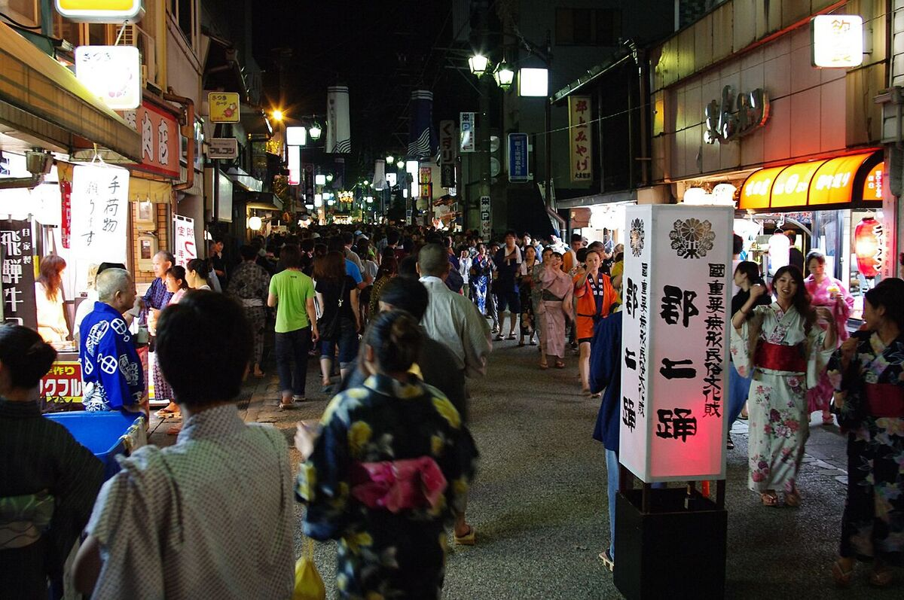
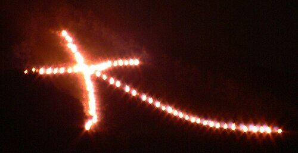
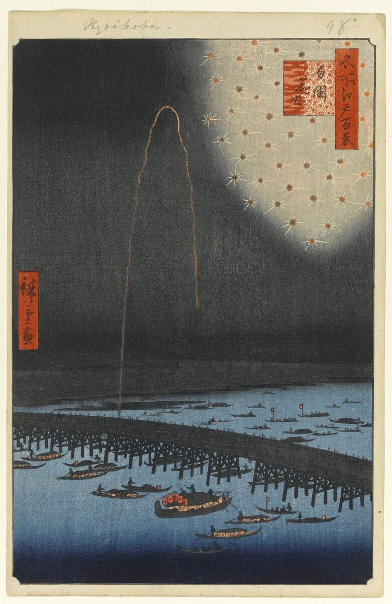

# 7. Summer: Bon, Dances and Fireworks

Many of the festivals in this handbook fall in summer. In mid-August, Bon brings families home to honour their ancestors, and towns across the country dance through the night. Summer evenings also bring the fireworks displays. This chapter covers Bon briefly, the dances that UNESCO now lists, Kyoto's great bonfires, and the fireworks.

## 7.1 Bon in brief

*Bon* (盆), or *urabon* (盂蘭盆), is the festival of the ancestors (Tanaka n.d.):

- **The date.** In the old calendar it fell on the 15th day of the 7th month. Today it is centred on **15 August** (Chapter 1).
- **Offerings.** Vegetarian dishes, vegetables, fruit and sweets are set on trays before the household Buddhist altar.

For what people believe happens at Bon (the dead coming home, the welcome and farewell fires, the first Bon after a death) see the folklore handbook: [Folklore, Chapter 6](../folklore/06-ancestors.md).

**For the traveller**, Bon matters in another way. The Bon holiday period, "typically between August 13 and 16", is "a time for relatives to gather at their family homes", and seats on planes, trains and highway buses "sell out in advance" (JNTO n.d.-g). Bon is not a national holiday in the law; Mountain Day, 11 August, is (Cabinet Office 2026a).

## 7.2 Dancing: *bon-odori* and *furyū-odori*

In the Bon season, towns and villages dance in the streets and squares: *bon-odori* (盆踊り). In **2022**, UNESCO inscribed **41 of Japan's folk dances**, including several Bon dances, on its Representative List of the Intangible Cultural Heritage of Humanity as ***Furyū-odori*** (風流踊), "ritual dances imbued with people's hopes and prayers". It was decided on **30 November 2022** at UNESCO's committee in Morocco, and extended an earlier listing of 2009, *Chakkirako* (Bunka-chō 2022a).

UNESCO's decision describes them, in the Agency for Cultural Affairs' translation (Bunka-chō 2022a):

- **What they are.** Diverse folk dances, marked by eye-catching costumes and lively dance and music, danced for centuries mainly in rural areas. In lives often struck by severe natural disasters, communities created them to express their hope for a peaceful life.
- **What they are for.** Ending epidemics, honouring the spirits of ancestors, good harvests and safety from disaster. From costume to music, each dance is believed to drive away evil spirits and misfortune and to strengthen the good powers, local gods and ancestral spirits, that protect the community.
- **Coming home to dance.** The dances give people who live in the cities a reason to return home. People from Uonuma in Niigata who live in Tokyo, for example, go home to take part.

The agency's leaflet lists all 41 (Bunka-chō 2022b). Two examples:

- **Gujō Odori** (郡上踊, Gujō, Gifu prefecture). Said to have begun in the Kan'ei era (1624–1644), when the lord of Gujō, Endō Yoshitaka, held dances to bring his people together. Today it is danced on more than **30 nights** from mid-July to early September, with **all-night dancing from 13 to 16 August**.
- **Nishimonai Bon Odori** (西馬音内の盆踊, Ugo, Akita prefecture). Held on three days, **16 to 18 August**. A dance to pray for good harvests, begun more than 700 years ago, is said to have merged later with a dance for the dead.

The Awa Odori of Tokushima, the most famous dance festival of all, is described in Chapter 10.

<figure>

<figcaption>The streets of Gujō during the all-night dancing, 16 August 2009. <span class="credit">Image: tsuda, <a href="https://creativecommons.org/licenses/by-sa/2.0/">CC BY-SA 2.0</a>, via <a href="https://commons.wikimedia.org/wiki/File:Gujo_odori_2009-08-16.jpg">Wikimedia Commons</a>.</span></figcaption>
</figure>

## 7.3 Kyoto's great bonfires

On the night of **16 August**, from 8 p.m., five great fires are lit on the mountains around Kyoto: the ***Gozan no okuribi*** (五山送り火), "the sending-off fires on the five mountains". Kyoto City explains (Kyoto City 2019):

- **What they are.** "The most magnificent of Kyoto's Bon events in August." They grew from the custom of lighting fires to send the ancestors' spirits, who came home at Bon, back to the other world.
- **The shapes.** The character 大 (*dai*, "great"), the words 妙法 (*myōhō*, "the wonderful law"), a ship, a second, "left" 大, and a *torii* gate.
- **How old.** A guidebook of 1662 already records the 大, 妙法 and the ship; a book of 1665 records the left 大. There is no record of the *torii* shape, which is said to have begun in the mid-Edo period.
- **How big.** The 大 is more than about 90 m wide, each character of 妙法 about 100 m, and the ship about 200 m.

<figure>

<figcaption>The 大 (<em>daimonji</em>) fire on 16 August. <span class="credit">Image: Cookie4869, <a href="https://creativecommons.org/licenses/by-sa/3.0/">CC BY-SA 3.0</a>, via <a href="https://commons.wikimedia.org/wiki/File:Gozan-okuribi_Daimonji.jpg">Wikimedia Commons</a>.</span></figcaption>
</figure>

## 7.4 Fireworks

Summer brings fireworks displays, *hanabi taikai* (花火大会), and huge crowds to watch them.

- **Sumida River, Tokyo.** The Sumidagawa Fireworks Festival is held on the **last Saturday of July**, and "nearly a million people visit each year". It "is said to have originated" from fireworks launched at Ryōgoku by the eighth shogun, Tokugawa Yoshimune, in **1733**, to pray for the end of a famine and ward off evil spirits. There are no grandstand seats; the Japan National Tourism Organization recommends clothes that are easy to walk in (JNTO n.d.-f).
- **With other festivals.** Many festivals end with fireworks. Tenjin Matsuri in Osaka ends with fireworks over the river (Chapter 10), and Aomori's Nebuta festival closes with fireworks and floats carried by boat across the harbour on 7 August (Aomori Nebuta 2026).

<figure>

<figcaption><em>Fireworks at Ryōgoku</em>, from Hiroshige's <em>One Hundred Famous Views of Edo</em> (1858). <span class="credit">Image: Utagawa Hiroshige, Public domain, via <a href="https://commons.wikimedia.org/wiki/File:Fireworks_at_Ryogoku_%28Ryogoku_Hanabi%29%2C_No._98_from_One_Hundred_Famous_Views_of_Edo.jpg">Wikimedia Commons</a>.</span></figcaption>
</figure>

Large crowds can be dangerous. The accident at the Akashi fireworks in 2001, in which eleven people died, is described in Chapter 11, with advice for crowds and heat.

## 7.5 Other summer days

- **Tanabata** (7 July, or August in Sendai) is described in Chapter 4.
- ***Doyō*** (土用), the 18 days before the beginning of autumn, run from **20 July** in 2026 (NAOJ 2025). Digging the earth was traditionally avoided in *doyō* (NDL 2016b).
- **The 210th day** (*nihyaku-tōka*), counted from *risshun*, falls around 1 September and was said always to bring storms (NDL 2016b). It is the typhoon season.

## Self-check

```quiz
? What did UNESCO inscribe in 2022 as Furyū-odori?
- 41 folk dances from across Japan *
- The Gion Matsuri floats
- Kyoto's five bonfires
> On 30 November 2022 (Bunka-chō 2022a).

? What are Kyoto's Gozan no okuribi for?
- Sending the ancestors' spirits back after Bon *
- Celebrating the rice harvest
- Marking the start of the New Year
> Kyoto City 2019.

? When is Gujō Odori danced all night?
- 13 to 16 August *
- 31 December
- Every Saturday in May
> It is danced on more than 30 nights in all (Bunka-chō 2022b).

? What is the Sumidagawa Fireworks Festival said to have begun as?
- Fireworks in 1733 to pray for the end of a famine *
- A celebration of the 1964 Olympics
- A wedding gift to an emperor
> "Is said to have originated" (JNTO n.d.-f).
```

## Sources for this chapter

1. **Aomori Nebuta 2026.** Aomori Nebuta Festival Executive Committee 青森ねぶた祭実行委員会. *Aomori Nebuta Festival* (English page) and スケジュール・運行コース (Schedule and route), checked November 2026. [nebuta.jp](https://www.nebuta.jp/foreign/english.html).
2. **Bunka-chō 2022a.** Agency for Cultural Affairs 文化庁. 「風流踊」のユネスコ無形文化遺産登録（代表一覧表記載） (Inscription of Furyū-odori on the UNESCO list), press release with the decision in provisional translation, 30 November 2022. [bunka.go.jp](https://www.bunka.go.jp/koho_hodo_oshirase/hodohappyo/pdf/93797801_01.pdf).
3. **Bunka-chō 2022b.** Agency for Cultural Affairs. ユネスコ無形文化遺産 風流踊 (UNESCO intangible heritage: Furyū-odori), leaflet. [bunka.go.jp](https://www.bunka.go.jp/seisaku/bunkazai/shokai/mukei_bunka_isan/pdf/93950301_01.pdf).
4. **Cabinet Office 2026a.** See [Chapter 1](01-calendars.md).
5. **JNTO n.d.-g.** See [Chapter 3](03-holidays.md).
6. **JNTO n.d.-f.** Japan National Tourism Organization. *Sumidagawa Fireworks Festival*. [japan.travel](https://www.japan.travel/en/spot/385/).
7. **Kyoto City 2019.** Kyoto City 京都市. 京都市のあらまし（京の三大祭と五山送り火） (Outline of Kyoto: the three great festivals and the Gozan okuribi), 27 August 2019. [city.kyoto.lg.jp](https://www.city.kyoto.lg.jp/sogo/page/0000015635.html).
8. **NAOJ 2025.** See [Chapter 2](02-solar-terms.md).
9. **NDL 2016b.** See [Chapter 2](02-solar-terms.md).
10. **Tanaka n.d.** See [Chapter 1](01-calendars.md).

➡️ Next: [Chapter 8: Autumn and the end of the year](08-autumn-winter.md)
