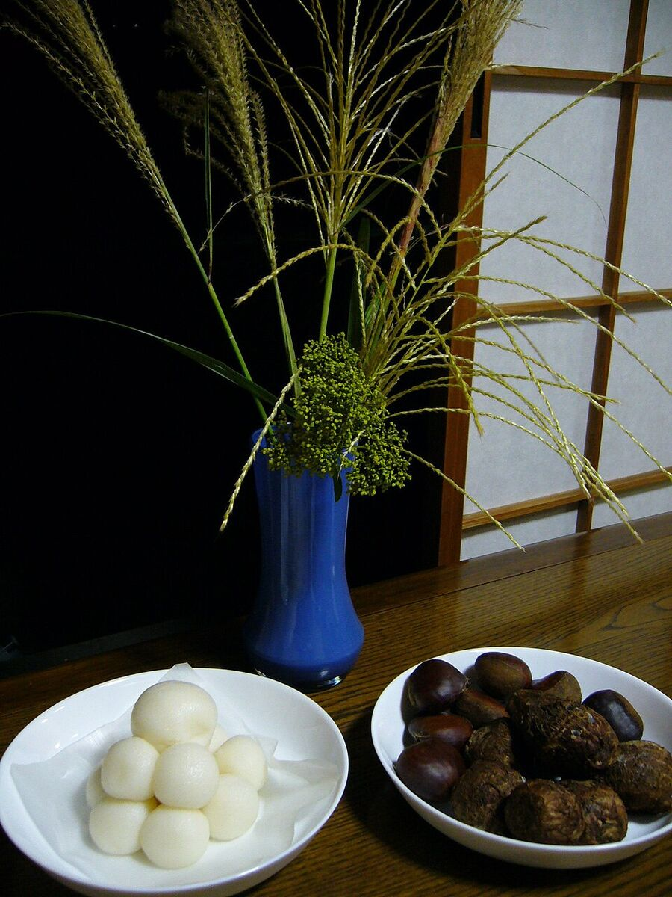
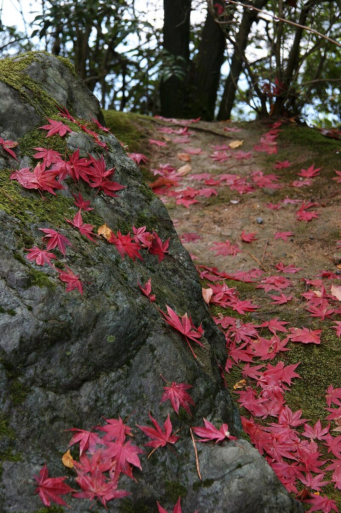
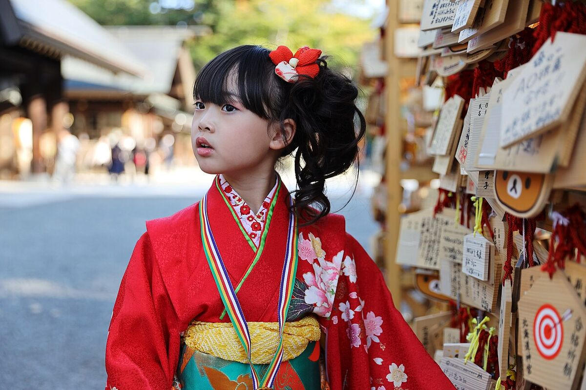

# 8. Autumn and the End of the Year

Autumn brings the harvest moon, the autumn equinox, the red leaves moving south, and the children's festival of Shichi-Go-San. The year then closes with the winter solstice and New Year's Eve. This chapter follows the second half of the year to the night before New Year.

## 8.1 The harvest moon

*Tsukimi* (月見), moon viewing, honours the **mid-autumn moon** (中秋の名月, *chūshū no meigetsu*): the moon of the 15th night of the 8th month in the old calendar (NAOJ n.d.-c).

- **Why "mid-autumn".** In the old calendar, autumn was months 7, 8 and 9, so the 15th of the 8th month was the middle of autumn (NAOJ n.d.-c).
- **From China.** Moon viewing came from China around the **9th century**. In China it is the Mid-Autumn Festival; in Korea, *Chuseok*. The Katsura Imperial Villa in Kyoto is said to have been designed with moon viewing in mind (NAOJ n.d.-c).
- **Not always full.** The old calendar's 15th night is not always the night of the astronomical full moon; the two can differ by a day or two (NAOJ n.d.-c).
- **When.** In the Gregorian calendar the date changes every year, falling **between 7 September and 8 October** (NAOJ n.d.-c).
- **Offerings.** Before the harvest, people pray for a good crop. They decorate the room with pampas grass (*susuki*) and offer **moon-viewing dumplings** (月見団子, *tsukimi dango*) and taro to the moon (Tanaka n.d.).

<figure>

<figcaption>Moon-viewing dumplings and pampas grass. <span class="credit">Image: katorisi, <a href="https://creativecommons.org/licenses/by/3.0/">CC BY 3.0</a>, via <a href="https://commons.wikimedia.org/wiki/File:Tsukimi%2Cmoon-viewing-party%2Cjapan.JPG">Wikimedia Commons</a>.</span></figcaption>
</figure>

## 8.2 The autumn equinox

The autumn equinox, around 23 September, is a national holiday "to honour ancestors and remember the dead" (Cabinet Office 2026a). Like its spring twin, it is the middle day of a *higan* week of grave visits (Chapter 6). Before 1948 it was an imperial rite for the ancestors, *Shūki kōreisai* (Cabinet Office 2026b).

## 8.3 Red leaves

*Momiji-gari* (紅葉狩り) means going out to see the red leaves. The Japan Meteorological Agency watches the maples as it watches the cherries (JMA 2020b):

- **The tree.** Mainly the ***iroha-kaede*** (いろはかえで, Japanese maple), which grows wild in the mountains from southern Tōhoku to Kyūshū and is planted in parks and gardens for its autumn colour.
- **The day.** The **colouring day** (紅葉日, *kōyō-bi*) is the first day on which, looking at the whole sample tree, most of its leaves have turned red.
- **The front moves south.** On the normals for 1991–2020, the colour starts in eastern Hokkaidō in **mid-October**, reaches Tōhoku around **20 November**, and by **30 November** Kantō, Hokuriku, Tōkai, Chūgoku, Shikoku and northern Kyūshū. The Pacific coast of Kantō and Tōkai, Kinki and southern Kyūshū follow in **early to mid-December**.

So the leaves move the opposite way to the cherry blossom, and the red-leaf season in Tokyo, Kyoto and Osaka is late: the agency's observations of 2025 were (JMA 2026c):

| City | Colouring day, 2025 | Against normal |
|---|---|---|
| Sapporo | 6 November | 9 days late |
| Sendai | 20 November | 1 day early |
| Tokyo | 23 November | 5 days early |
| Osaka | 4 December | 3 days late |
| Kyoto | 10 December | 5 days late |
| Fukuoka | 1 December | normal |

<figure>

<figcaption>Fallen maple leaves at Ryōan-ji, Kyoto, 25 November 2008. <span class="credit">Image: KimonBerlin, <a href="https://creativecommons.org/licenses/by-sa/2.0/">CC BY-SA 2.0</a>, via <a href="https://commons.wikimedia.org/wiki/File:Momiji_%28Japanese_maple%29_leaves_in_Ryoan-ji%2C_Kyoto_%283256663267%29.jpg">Wikimedia Commons</a>.</span></figcaption>
</figure>

## 8.4 Shichi-Go-San

*Shichi-go-san* (七五三), "seven-five-three", is held on **15 November** to pray for children's safe growth. Boys of 3 and 5 and girls of 3 and 7 are dressed in their best clothes and taken to a shrine. They are given *chitose-ame*, "thousand-year sweets", and the family celebrates with red rice (赤飯, *sekihan*) (Tanaka n.d.). Red food is used at celebrations because red was believed to drive away evil (Tanaka n.d.).

<figure>

<figcaption>A girl visiting a shrine in Hokkaidō for Shichi-Go-San, October 2022. <span class="credit">Image: MIKI Yoshihito, <a href="https://creativecommons.org/licenses/by/2.0/">CC BY 2.0</a>, via <a href="https://commons.wikimedia.org/wiki/File:A_girl_at_the_Hokkaido_Shinto_Shrine_for_The_Seven-Five-Three_Festival_visit%2C_Hokkaido%3B_October_2022_%2802%29.jpg">Wikimedia Commons</a>.</span></figcaption>
</figure>

## 8.5 Two November holidays

- **Culture Day, 3 November**, "to love freedom and peace and promote culture" (Cabinet Office 2026a). Before 1948 it was *Meijisetsu*, the Meiji emperor's birthday (Cabinet Office 2026b).
- **Labour Thanksgiving Day, 23 November**, "to honour work, celebrate production and thank one another" (Cabinet Office 2026a). Before 1948 it was the date of *Niiname-sai* (新嘗祭), the imperial harvest rite (Cabinet Office 2026b).

## 8.6 The winter solstice

*Tōji* (冬至), the winter solstice, is the shortest day of the year: 22 December in 2026 (NAOJ 2025). Tanaka describes its customs (Tanaka n.d.):

- **Foods with "n".** Eating foods whose names contain the sound *n* is said to bring luck (*un*). Mainly pumpkin (*nankin*) and daikon (*daikon*) are cooked.
- **A citron bath.** People take a bath with *yuzu* citrons floating in it, *yuzu-yu* (ゆず湯). For Japanese bathing, see the [Bathing handbook](../bathing/00-start.md).

## 8.7 New Year's Eve

*Ōmisoka* (大晦日), the night of 31 December, is when people stay awake to welcome the god of the year (Tanaka n.d.):

- **The temple bells.** People listen to *joya no kane* (除夜の鐘), the temple bells rung on New Year's Eve.
- **Year-crossing noodles.** They eat *toshikoshi soba* (年越しそば), buckwheat noodles: thin and long, for a long life.

With that, the cycle returns to Chapter 5.

## Self-check

```quiz
? Between which dates can the mid-autumn moon fall?
- Between 7 September and 8 October *
- Always on 15 August
- Always on the autumn equinox
> It follows the old calendar (NAOJ n.d.-c).

? Which way does the red-leaf front move?
- From north to south, from mid-October to December *
- From south to north, like the cherry blossom
- It starts everywhere on the same day
> JMA 2020b.

? Which children are taken to the shrine at Shichi-Go-San?
- Boys of 3 and 5, girls of 3 and 7 *
- All children of 7, 5 and 3 months
- Only first-born sons
> On 15 November (Tanaka n.d.).

? Why are toshikoshi soba eaten on New Year's Eve?
- Thin, long noodles, for a long life *
- Buckwheat is harvested on 31 December
- To keep warm while waiting for the bells
> Tanaka n.d.
```

## Sources for this chapter

1. **Cabinet Office 2026a.** See [Chapter 1](01-calendars.md).
2. **Cabinet Office 2026b.** See [Chapter 3](03-holidays.md).
3. **JMA 2020b.** Japan Meteorological Agency. かえでの紅葉日 (Maple colouring day: method and normal-date map, 1991–2020). [jma.go.jp](https://www.data.jma.go.jp/sakura/data/kaede2020.pdf).
4. **JMA 2026c.** Japan Meteorological Agency. かえでの紅葉日 (2025年–2026年) (Maple colouring days, 2025–2026), checked November 2026. [jma.go.jp](https://www.data.jma.go.jp/sakura/data/phn_014.html).
5. **NAOJ 2025.** See [Chapter 2](02-solar-terms.md).
6. **NAOJ n.d.-c.** National Astronomical Observatory of Japan. 暦Wiki: 中秋の名月とは (Calendar wiki: what is the mid-autumn moon?). [nao.ac.jp](https://eco.mtk.nao.ac.jp/koyomi/wiki/C3E6BDA9A4CECCBEB7EEA4C8A4CF.html).
7. **Tanaka n.d.** See [Chapter 1](01-calendars.md).

➡️ Next: [Chapter 9: What a matsuri is](09-matsuri.md)
