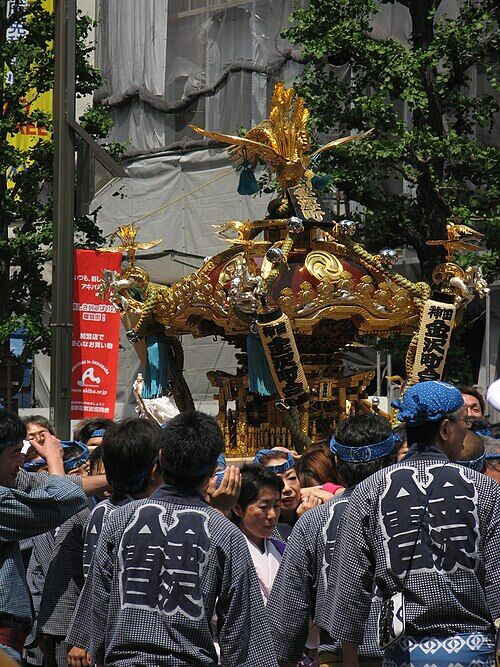
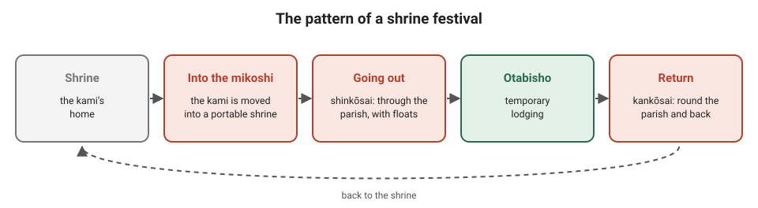
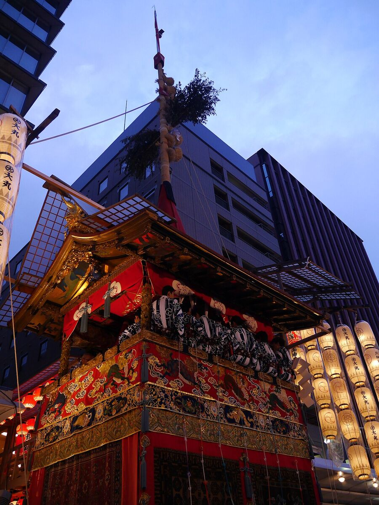

# 9. What a Matsuri Is

*Matsuri* (祭り) is usually translated "festival", but it starts with a shrine and its *kami*. This chapter explains the parts of a shrine festival (the procession of the *kami*, the portable shrine, the floats) and the 37 float festivals that UNESCO now lists.

## 9.1 A day for the gods

Japanese life distinguishes ordinary days from **special days**, *hare* (ハレ). On such days people offer food to the gods and then eat together with them, a shared meal of gods and people (神人共食, *shinjin kyōshoku*) (Tanaka n.d.). A *matsuri* is the great *hare* day of a shrine and its community. Tanaka lists festivals connected with shrine rites (祭礼, *sairei*) among Japan's annual events, alongside the *sekku* and Bon (Tanaka n.d.).

For who the *kami* are, and how shrines and Buddhism came apart, see the folklore handbook: [Folklore, Chapter 1](../folklore/01-kami.md) and [Chapter 5](../folklore/05-separation.md).

## 9.2 The procession of the *kami*

At the heart of many festivals the *kami* leaves the shrine and travels through its parish. The examples in this handbook show the pattern:

- **Into a portable shrine.** At the Tenjin Matsuri in Osaka, the deity, the scholar Sugawara no Michizane, "is moved from the shrine to a portable shrine and carried through the streets" (JNTO n.d.-a). The portable shrine is a ***mikoshi*** (神輿), carried on poles on the shoulders of a team of bearers.
- **Out and back.** At the Gion Matsuri in Kyoto, the procession of the floats on 17 July goes with the *shinkōsai* (神幸祭), when the *kami* go out, and the procession of 24 July with the *kankōsai* (還幸祭), when they return (Kyoto City 2019). During the festival, the *mikoshi* are purified with water from the Kamo River in the *mikoshi-arai* rite (Kyoto City 2026). For the return, the *kami* are taken from their temporary lodging, the *otabisho* (御旅所), carried round the parish in the *mikoshi*, and brought back to the shrine (Satō 2016).
- **Through the whole district.** At the Kanda Matsuri in Tokyo, more than **200** *mikoshi* are carried, and the routes run far beyond the shrine, to Ōtemachi, Marunouchi and Nihonbashi (JNTO n.d.-b).

<figure>

<figcaption>A <em>mikoshi</em> carried through the streets at the Kanda Matsuri. <span class="credit">Image: Jose Fernando from Tokyo, Japan, <a href="https://creativecommons.org/licenses/by-sa/2.0/">CC BY-SA 2.0</a>, via <a href="https://commons.wikimedia.org/wiki/File:Kanda_Matsuri_2009-2_Mikoshi_in_Akihabara.jpg">Wikimedia Commons</a>.</span></figcaption>
</figure>

<figure class="diagram">

<figcaption>The pattern of a shrine festival, from the examples in this chapter (JNTO n.d.-a; Kyoto City 2019; Satō 2016). Every festival has its own form. <span class="credit">Diagram drawn for this handbook from the sources cited in the chapter.</span></figcaption>
</figure>

## 9.3 Floats: *yama*, *hoko*, *yatai*

Many festivals add floats to the procession. The three words in UNESCO's listing name different kinds of float (UNESCO 2025). The Gion examples are from Satō Hirotaka's study of its floats (Satō 2016):

- ***Hoko*** (鉾): at Gion, wheeled floats that are pulled. Each carries a tall pole (真木, *shingi*) with a symbolic head ornament.
- ***Yama*** (山): at Gion, the pulled *hikiyama* (曳山) carry a pine tree, and the smaller *kakiyama* (舁山) are carried on shoulders, with a sacred figure or a small shrine building on top. The *kasaboko* (傘鉾) is an umbrella-shaped float, also carried.
- ***Yatai*** (屋台): at Murakami in Niigata, for example, the 19 *yatai* are two-storey floats on two wheels, accompanied by *hayashi* music (Bunka-chō 2025).
- Other names are used locally, such as *dashi* (山車) in Kawagoe and Sawara, or *danjiri* in Ueno (Bunka-chō 2016).

Gion's floats are assembled each July. At the *Kanko-boko*, the float is assembled "without nails, using only rope", a technique called *nawagarami* (縄がらみ) (Kyoto City 2026).

<figure>

<figcaption>The <em>Naginata-boko</em>, which leads the Gion Matsuri procession. <span class="credit">Image: Hahifuheho, <a href="https://creativecommons.org/publicdomain/zero/1.0/">CC0</a>, via <a href="https://commons.wikimedia.org/wiki/File:Naginatahoko_at_Gion_Matsuri_Yoiyama.jpg">Wikimedia Commons</a>.</span></figcaption>
</figure>

## 9.4 Thirty-seven float festivals on the UNESCO list

In **2016** UNESCO inscribed "Yama, Hoko, Yatai, float festivals in Japan" on its Representative List of the Intangible Cultural Heritage of Humanity (UNESCO 2025). The Agency for Cultural Affairs explains how it was built (Bunka-chō 2016):

- **Thirty-three festivals.** The listing grouped **33** float festivals, each already designated by the state as an Important Intangible Folk Cultural Property between 1977 and 2015.
- **An extension.** It extended two listings of 2009: the *Hitachi Furyūmono* of Ibaraki and the Gion Matsuri floats of Kyoto.
- **From north to south.** The 33 run from Hachinohe in Aomori and Kakunodate in Akita to Karatsu in Saga and Yatsushiro in Kumamoto. They include the Takayama festival in Gifu, the Chichibu festival in Saitama, the Hakata Gion Yamakasa in Fukuoka and the Gion Matsuri.

In **2025** four more were added: the *Ofune* festival of Hitachi-Ōtsu (a wooden ship carrying a *mikoshi*, slid and rocked along the road on wooden frames), the *yatai* of Murakami (19 floats), the *hikiyama* and *tsukiyama* of Hōjōzu in Imizu (13 floats, decorated with flowers by day and lanterns by night) and the *hikiyama* of Ōtsu (13 floats with mechanical puppets) (Bunka-chō 2025; UNESCO 2025). That makes **37**.

UNESCO describes what they share (UNESCO 2025):

- **Prayer.** The festivals are held every year "to pray to the gods for peace and protection from natural disasters".
- **Everyone.** "People of all ages and genders share responsibility" for every step, from designing and building the floats to running the event.
- **Passing it on.** Older bearers pass on their knowledge and skills to the less experienced, including through formal classes, and communities share the special skills needed to make and repair floats.
- **Community.** The broad effort needed to prepare a festival "promotes cooperation and social cohesion".

## 9.5 Who runs a festival

A festival is run by its neighbourhood. At Gion, each float belongs to a **float town** (山鉾町, *yamaboko-chō*), a block of the city centre, and is kept by a **preservation association** (保存会, *hozonkai*). The geographer Satō Hirotaka studied all 33 floats then in use (Satō 2016):

- **Thirty-three floats.** In 2014 the *Ōfune-boko* returned to the procession for the first time in **150 years**, bringing the number of floats to 33. At the time of the study, two lost in fires had not yet been rebuilt.
- **A shrinking centre.** Population change in the city centre makes it hard to keep traditional urban festivals going. The study looks at how float towns have rebuilt the social, financial and physical base of their festival.

Children still play a part. At Gion, most floats now carry a doll in place of the sacred child (稚児, *chigo*), but at the *Ayagasa-boko* and the *Naginata-boko* real children still serve. In 2026 six children aged 5 to 7 were *chigo* of the *Ayagasa-boko* (Kyoto City 2026).

## Self-check

```quiz
? What is a mikoshi?
- A portable shrine that carries the kami through the streets *
- A float with musicians on two storeys
- The festival's food stall
> JNTO n.d.-a.

? What is UNESCO's float festival listing made of?
- 33 festivals in 2016, with 4 more added in 2025 *
- Only the Gion Matsuri
- Every festival in Japan
> Bunka-chō 2016; Bunka-chō 2025.

? Who keeps each Gion float?
- A preservation association of its float town *
- The national government
- A private company
> Satō 2016.

? What returned to the Gion procession in 2014?
- The Ōfune-boko, after 150 years *
- The first float made of steel
- Women bearers, for the first time
> Satō 2016.
```

## Sources for this chapter

1. **Bunka-chō 2016.** Agency for Cultural Affairs 文化庁. 「山・鉾・屋台行事」のユネスコ無形文化遺産代表一覧表への記載に関する評価機関による勧告について (On the recommendation of the evaluation body for Yama, Hoko, Yatai), press release, 31 October 2016, with the list of 33 festivals. [bunka.go.jp](https://www.bunka.go.jp/koho_hodo_oshirase/hodohappyo/pdf/2016103101.pdf).
2. **Bunka-chō 2025.** Agency for Cultural Affairs. 「山・鉾・屋台行事」拡張提案追加対象案件（４件） (Yama, Hoko, Yatai: four festivals proposed for the extension). [bunka.go.jp](https://www.bunka.go.jp/seisaku/bunkazai/shokai/mukei_bunka_isan/pdf/94383201_04.pdf).
3. **JNTO n.d.-a.** Japan National Tourism Organization. *Tenjin Festival*. [japan.travel](https://www.japan.travel/en/spot/30/).
4. **JNTO n.d.-b.** Japan National Tourism Organization. *Kanda Festival*. [japan.travel](https://www.japan.travel/en/spot/392/).
5. **Kyoto City 2019.** See [Chapter 7](07-summer.md).
6. **Kyoto City 2026.** Kyoto City. 京都歳時記2026（7月・上） (Kyoto almanac 2026, early July). [city.kyoto.lg.jp](https://www.city.kyoto.lg.jp/sogo/page/0000354440.html).
7. **Satō 2016.** Satō Hirotaka 佐藤弘隆. 京都祇園祭の山鉾行事における運営基盤の再構築：現代都市における祭礼の継承 (Rebuilding the operating base of the Gion Matsuri float events: passing on a festival in a modern city). *Japanese Journal of Human Geography* (人文地理) 2016;68(3):273–296. [J-STAGE](https://www.jstage.jst.go.jp/article/jjhg/68/3/68_273/_article/-char/en).
8. **Tanaka n.d.** See [Chapter 1](01-calendars.md).
9. **UNESCO 2025.** UNESCO Intangible Cultural Heritage. *Yama, Hoko, Yatai, float festivals in Japan*, inscribed 2016, extended 2025. [ich.unesco.org](https://ich.unesco.org/en/RL/yama-hoko-yatai-float-festivals-in-japan-01059).

➡️ Next: [Chapter 10: The great festivals](10-great-festivals.md)
