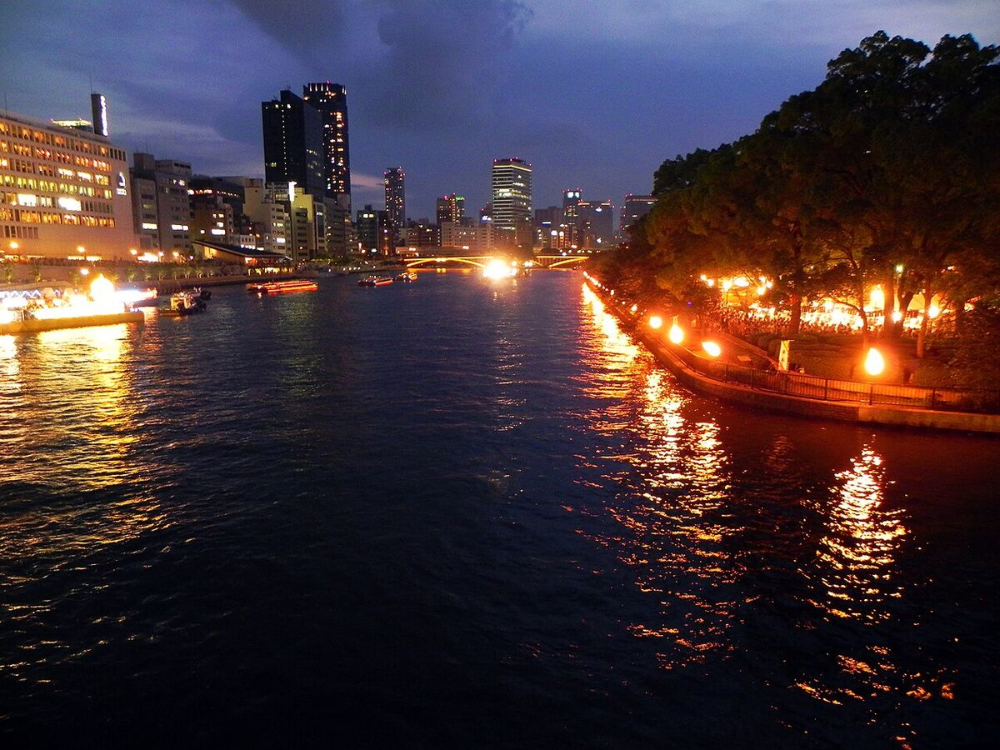
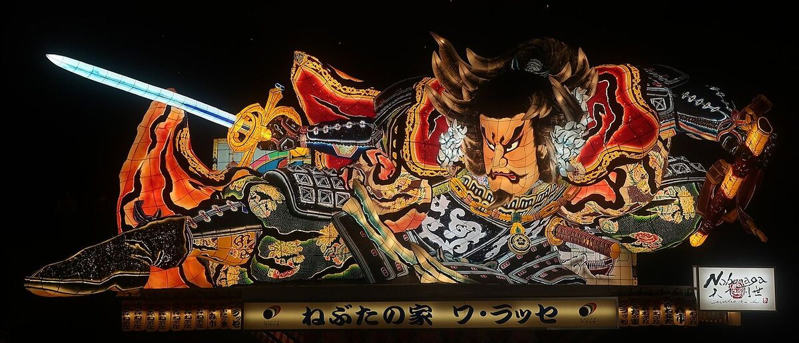
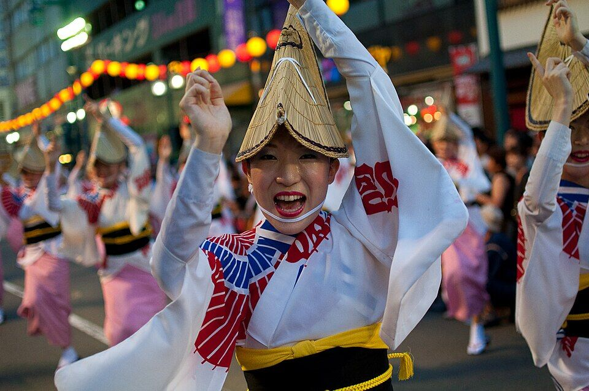
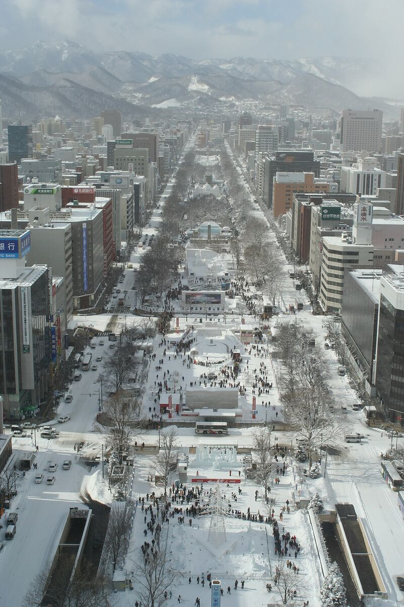

# 10. The Great Festivals

This chapter describes a handful of the best-known festivals, from Kyoto's month-long Gion Matsuri to the snow sculptures of Sapporo, and ends with a table of dates.

> ⚠️ **About the dates.** Festival dates and programmes change, and festivals are sometimes cancelled. The dates below come from the organisers, city governments and the Japan National Tourism Organization, and were checked in **November 2026**. **Always check the organiser's own website before you travel.** This handbook is not connected with any festival or organiser.

## 10.1 Kyoto

Kyoto City counts the **Gion Matsuri**, with Tokyo's Kanda Matsuri and Osaka's Tenjin Matsuri, among the three great festivals of Japan. It describes Kyoto's own three great festivals and the Bon fires (Kyoto City 2019):

- **Aoi Matsuri** (葵祭, 15 May), the festival of the Kamigamo and Shimogamo shrines. Its origin is placed in the reign of Emperor Kinmei, about 1,400 years ago. A procession in Heian court dress, led by the imperial messenger, recalls the old capital. The name comes from the *aoi* (hollyhock) leaves that decorate the shrines and are worn by everyone taking part.
- **Gion Matsuri** (祇園祭, 1–31 July), the festival of Yasaka Shrine. It began as a rite to drive away the epidemics of the Heian period. By the shrine's tradition, in **869** sixty-six halberds were set up and the *mikoshi* were sent to the Shinsen-en garden. In the Muromachi period the townspeople of lower Kyoto began to add floats; in the Edo period the floats were hung with imported textiles and the finest Kyoto crafts. The high points are the evenings of the 14th to 16th, with the *kon-chiki-chin* of the Gion music, and the float procession of the **17th**; then the evenings of the 21st to 23rd and the second procession on the **24th**.
- **Jidai Matsuri** (時代祭, 22 October), the "Festival of the Ages", begun in **1895** for the 1,100th anniversary of the move of the capital to Kyoto. Processions in the costume of each period, over more than a thousand years, walk from the Imperial Palace to Heian Shrine.
- **Gozan no okuribi** (16 August), described in Chapter 7.

In 2026 the order of the Gion floats was drawn by lot at Kyoto City Hall: the first float would be the *Kakkyo-yama* on the 17th and the *Koi-yama* on the 24th. Floats that always go in a set place, the *kuji-torazu*, do not draw (Kyoto City 2026).

## 10.2 Osaka: Tenjin Matsuri

The **Tenjin Matsuri** (天神祭) of Osaka Tenmangū shrine, on **24–25 July**, "is over a thousand years old, and honors Sugawara Michizane, the Japanese deity of scholarship and learning" (JNTO n.d.-a):

- **24 July.** Rites at the shrine and the river, a lion dance, and prayers for Osaka's safety and prosperity. Drummers in red hats signal the start.
- **25 July, afternoon.** A procession of floats, portable shrines, lion dancers and umbrella dancers fills the streets from 3:30 p.m.
- **25 July, night.** The *mikoshi* are loaded onto boats near Nakanoshima Park, and a **parade of about 100 boats**, some with bonfires, travels the Ōkawa river. Noh and *bunraku* puppet plays are performed on floating stages, and fireworks end the procession.

Nearest stations: JR Ōsakatenmangū and Minami-Morimachi on the Tanimachi and Sakaisuji subway lines (JNTO n.d.-a).

<figure>

<figcaption>The boat procession of the Tenjin Matsuri on the Ōkawa river. <span class="credit">Image: Tomi Mäkitalo, <a href="https://creativecommons.org/licenses/by-sa/3.0/">CC BY-SA 3.0</a>, via <a href="https://commons.wikimedia.org/wiki/File:Tenjin_Matsuri%2C_Boat_Procession_-_panoramio.jpg">Wikimedia Commons</a>.</span></figcaption>
</figure>

## 10.3 Tokyo: Kanda Matsuri and Sannō Matsuri

Tokyo's two great shrine festivals take turns (JNTO n.d.-b; JNTO n.d.-c):

- **Kanda Matsuri** (神田祭), of Kanda Shrine (Kanda Myōjin) near Akihabara and Ochanomizu, is held in **odd-numbered years**, on the weekend before 15 May. Saturday is mainly for the parades, Sunday for the *mikoshi*, more than 200 of which are carried to the shrine. It "has been celebrated for 1300 years since the founding of Kanda-jinja Shrine", and in the Edo period the Tokugawa shogunate held it "with great fanfare and reverence" (JNTO n.d.-b).
- **Sannō Matsuri** (山王祭), of Hie Shrine, is held from **7 to 17 June** in **even-numbered years**. Its main event, the *Shinkōsai*, is a 300-metre procession with two imperial carriages and a *mikoshi*, winding through central Tokyo for nine hours. In the Edo period the *mikoshi* were paraded for the shoguns to see (JNTO n.d.-c).

## 10.4 Aomori: Nebuta

The **Aomori Nebuta Festival** (青森ねぶた祭), from **2 to 7 August**, is a parade of huge lantern floats, *nebuta*, about **9 metres wide, 7 metres deep and 5 metres high**, mostly showing warriors, historical figures and kabuki characters (Aomori Nebuta 2026):

- **Origin.** "Said to have originated as a variant of the Tanabata Festival, though the authenticity of the story is uncertain."
- **How a *nebuta* is made.** Its designer, a *nebutashi* (ねぶた師, *nebuta* master), plans it in winter. By May the frame of wood and wire is built; light bulbs go inside; it is covered with Japanese paper, outlined in black ink, patterned with melted candle wax, and painted.
- **Music and dancers.** Drums, flutes and hand cymbals play the *nebuta-bayashi*, and dancers called ***haneto*** (跳人) bounce along to cries of "*Rassera, rassera*".
- **The last day.** On 7 August, award-winning *nebuta* are carried round Aomori harbour on boats, with fireworks.

Anyone in the official *haneto* costume can join the dancing: see Chapter 11.

<figure>

<figcaption>A <em>nebuta</em> float in Aomori. <span class="credit">Image: Hiart, <a href="https://creativecommons.org/publicdomain/zero/1.0/">CC0</a>, via <a href="https://commons.wikimedia.org/wiki/File:2025_Aomori_Nebuta_Festival_float_1.jpg">Wikimedia Commons</a>.</span></figcaption>
</figure>

## 10.5 Tokushima: Awa Odori

The **Awa Odori** (阿波おどり) is a dance festival said to have a history of more than **400 years**. In Tokushima city it is held each year in mid-August and draws more than **a million** visitors from Japan and abroad (Tokushima City 2026). Towns elsewhere hold their own Awa Odori, such as Kōenji in Tokyo (Tokushima City 2026).

- **Three theories of its origin** (JNTO n.d.-d): a local form of the Bon dance; a celebration of the completion of Tokushima Castle, built by Hachisuka Iemasa in 1587, when the lord gave sake to the townspeople and they danced regardless of rank; or the *furyū* dances (Chapter 7), from a record of a *furyū* dance at Shōzui Castle in 1578.
- **Its name.** Tokushima city began promoting it as a tourist event in the early Shōwa period, when it got its present name (JNTO n.d.-d).
- **Dancing in a *ren*.** Dancers belong to groups called ***ren*** (連). Graceful women's dances and vigorous men's dances are danced to a band of instruments (*narimono*), on paid and free stages around the city (Tokushima City 2018).
- **The saying.** "The dancing fool and the watching fool are both fools, so why not dance?" (JNTO n.d.-d).

<figure>

<figcaption>Dancers at the Awa Odori in Tokushima. <span class="credit">Image: Stemu2000 www.stefansblog.com, <a href="https://creativecommons.org/licenses/by/3.0/">CC BY 3.0</a>, via <a href="https://commons.wikimedia.org/wiki/File:Awa_Odori_Tokushima_Aug2009.jpg">Wikimedia Commons</a>.</span></figcaption>
</figure>

## 10.6 Sapporo: the Snow Festival

The **Sapporo Snow Festival** (さっぽろ雪まつり) is a winter festival of snow and ice sculptures (Sapporo Snow Festival n.d.):

- **1950.** Local junior and senior high school students put **six snow statues** in Ōdōri Park. With a snowball fight and other events, some 50,000 people came.
- **1953.** The first giant snow statue, **15 metres** high.
- **1955.** The Self-Defense Forces joined in to build large statues. By 1959, 2,500 people were building them, and visitors began coming from Honshū.
- **1972.** The Sapporo Winter Olympics made the festival known worldwide. In **1974** the International Snow Sculpture Contest began.
- **Today.** The main sites are Ōdōri Park and, since 1983, Susukino, with its ice sculptures.

<figure>

<figcaption>Ōdōri Park, the main site of the Sapporo Snow Festival, seen from the Sapporo TV Tower in February 2007. <span class="credit">Image: Eckhard Pecher, <a href="https://creativecommons.org/licenses/by/2.5/">CC BY 2.5</a>, via <a href="https://commons.wikimedia.org/wiki/File:Odori_Park_Sapporo_Snow_Festival_2007.JPG">Wikimedia Commons</a>.</span></figcaption>
</figure>

## 10.7 Dates at a glance

Checked in November 2026. Fixed-date festivals are held on the same dates every year unless the organiser announces otherwise.

| Festival | Place | When | Source |
|---|---|---|---|
| Sapporo Snow Festival | Sapporo | 4–11 February 2027 (Ōdōri and Susukino sites) | Sapporo Snow Festival n.d. |
| Aoi Matsuri | Kyoto | 15 May | Kyoto City 2019 |
| Kanda Matsuri | Tokyo | weekend before 15 May, odd-numbered years (next: 2027) | JNTO n.d.-b |
| Sannō Matsuri | Tokyo | 7–17 June, even-numbered years (next: 2028) | JNTO n.d.-c |
| Gion Matsuri | Kyoto | 1–31 July; float processions 17 and 24 July | Kyoto City 2019 |
| Tenjin Matsuri | Osaka | 24–25 July; boats on the night of the 25th | JNTO n.d.-a |
| Sumidagawa fireworks | Tokyo | last Saturday of July | JNTO n.d.-f |
| Aomori Nebuta | Aomori | 2–7 August (eve festival 1 August) | Aomori Nebuta 2026 |
| Sendai Tanabata | Sendai | 6–8 August | JNTO n.d.-e |
| Awa Odori | Tokushima | 11–15 August | Tokushima City 2026 |
| Gujō Odori, all-night dancing | Gujō | 13–16 August | Bunka-chō 2022b |
| Gozan no okuribi | Kyoto | 16 August, from 8 p.m. | Kyoto City 2019 |
| Nishimonai Bon Odori | Ugo, Akita | 16–18 August | Bunka-chō 2022b |
| Jidai Matsuri | Kyoto | 22 October | Kyoto City 2019 |

The Japan National Tourism Organization gives the Awa Odori as **12–15 August** (JNTO n.d.-d); Tokushima City says "from 11 to 15 August every year" (Tokushima City 2026). Check the year's programme.

## Self-check

```quiz
? When are the Gion Matsuri float processions?
- 17 and 24 July *
- 1 and 31 July
- 15 May
> Kyoto City 2019.

? In which years is the main Kanda Matsuri held?
- Odd-numbered years *
- Every year
- Even-numbered years
> It alternates with the Sannō Matsuri (JNTO n.d.-b).

? What are haneto?
- The dancers who bounce along with the Nebuta floats *
- The lantern-makers of Aomori
- The boats of the Tenjin Matsuri
> Aomori Nebuta 2026.

? How did the Sapporo Snow Festival begin?
- Students built six snow statues in Ōdōri Park in 1950 *
- For the 1972 Winter Olympics
- As a samurai winter rite
> Sapporo Snow Festival n.d.
```

## Sources for this chapter

1. **Aomori Nebuta 2026.** See [Chapter 7](07-summer.md).
2. **Bunka-chō 2022b.** See [Chapter 7](07-summer.md).
3. **JNTO n.d.-a.** See [Chapter 9](09-matsuri.md).
4. **JNTO n.d.-b.** See [Chapter 9](09-matsuri.md).
5. **JNTO n.d.-c.** Japan National Tourism Organization. *Sanno Matsuri*. [japan.travel](https://www.japan.travel/en/spot/399/).
6. **JNTO n.d.-d.** Japan National Tourism Organization. *Awa Odori Festival*. [japan.travel](https://www.japan.travel/en/spot/203/).
7. **JNTO n.d.-e.** See [Chapter 1](01-calendars.md).
8. **JNTO n.d.-f.** See [Chapter 7](07-summer.md).
9. **Kyoto City 2019.** See [Chapter 7](07-summer.md).
10. **Kyoto City 2026.** See [Chapter 9](09-matsuri.md).
11. **Sapporo Snow Festival n.d.** Sapporo Snow Festival Executive Committee さっぽろ雪まつり実行委員会. さっぽろ雪まつりの歴史 (History of the Sapporo Snow Festival) and home page, checked November 2026. [snowfes.com](https://www.snowfes.com/about/history/).
12. **Tokushima City 2018.** Tokushima City 徳島市. 阿波おどり Guide Map 2018. [city.tokushima.tokushima.jp](https://www.city.tokushima.tokushima.jp/kankou/awaodori/kaisai/2018/2018guide.files/kenbutsuguideura.pdf).
13. **Tokushima City 2026.** Tokushima City. 阿波おどり (Awa Odori), checked November 2026. [city.tokushima.tokushima.jp](https://www.city.tokushima.tokushima.jp/kankou/awaodori/).

➡️ Next: [Chapter 11: Going to a festival](11-visiting.md)
