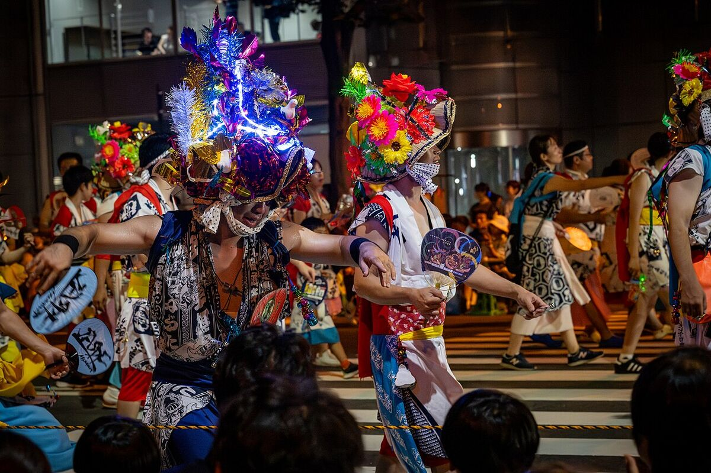
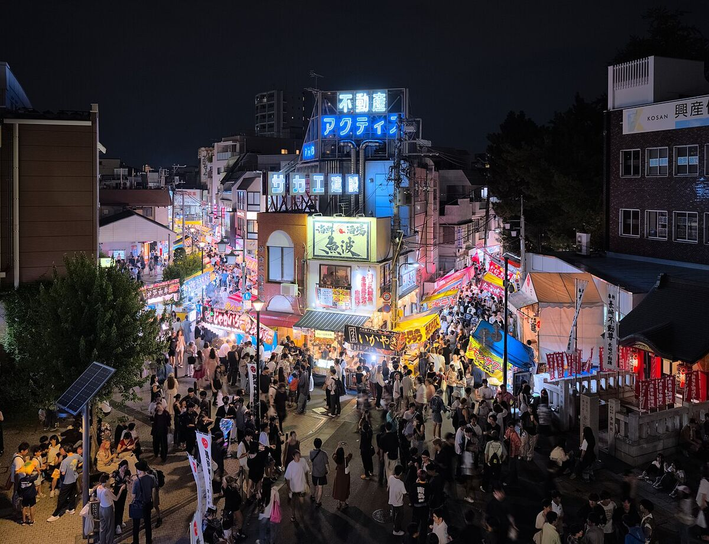

# 11. Going to a Festival

The festivals in this handbook are held in the streets, where anyone can watch. This chapter covers how to watch, how to join in, the food stalls, and how to stay safe in the crowds.

## 11.1 Watching

- **Paid seats.** Big festivals sell seats along the route. At the Aomori Nebuta, the organisers advise buying them in advance; any left over are sold on the day. You can watch from anywhere else on the route, but it is usually crowded (Aomori Nebuta 2026). Tokushima's Awa Odori has both paid and free dance stages (Tokushima City 2018). The Sumidagawa fireworks, an urban display, have no grandstand seats at all (JNTO n.d.-f).
- **Crowds near the shrine.** At the Kanda Matsuri "you may find it difficult to get near the shrine or even on some of the major streets". The Japan National Tourism Organization suggests checking at the station for the latest information about crowds and viewing places (JNTO n.d.-b).
- **Rain.** The Aomori Nebuta goes ahead in rain: the *nebuta* are covered with large plastic sheets. Wear a raincoat and do not open an umbrella, which blocks other people's view (Aomori Nebuta 2026).
- **What to wear.** Clothes that are easy to walk in (JNTO n.d.-f).

## 11.2 Joining in

Some festivals invite visitors to take part:

- **Aomori Nebuta: become a *haneto*.** "Anyone can join the dance as long as they wear a *haneto* costume." There is no need to book: you join any *nebuta* group at the start of the route. Costumes are sold at department stores in Aomori, and some shops rent them and help you put them on (Aomori Nebuta 2026). The costume:
  - a *hanagasa*, a straw hat with artificial flowers;
  - a white-based *yukata*, with the hem rolled up to the knee, over a pink or light-blue *okoshi* underskirt;
  - a brightly coloured sash over the shoulder, a *shigoki* band round the waist, and a tin water flask, the *gagashiko*;
  - white split-toed *tabi* socks and straw *zōri* sandals, tied on with a cloth so they do not come off while dancing.
- **Awa Odori: the *niwaka-ren*.** You normally dance with a registered *ren*. If you are not in one, you can join the ***niwaka-ren*** (にわか連), the "instant troupe": no costume is needed, and you can take a lesson from a famous troupe first. If you miss the festival, the Awa Odori Kaikan in central Tokushima has performances all year, and the dancers teach visitors the steps (JNTO n.d.-d).
- **Tenjin Matsuri.** Visitors "are welcome to put on a *yukata* (traditional summer wear) and *geta* (traditional shoes) and join in" (JNTO n.d.-a).

<figure>

<figcaption><em>Haneto</em> dancers at the Aomori Nebuta Festival. <span class="credit">Image: U.S. Air Force photo by Airman 1st Class Andre Medina, Public domain, via <a href="https://commons.wikimedia.org/wiki/File:Nebuta_Festival_2025-_Strengthening_Mission%2C_Culture%2C_and_Community_Together_%289253842%29.jpg">Wikimedia Commons</a>.</span></figcaption>
</figure>

## 11.3 Food stalls

Festivals bring rows of street stalls, ***yatai*** (屋台) or ***roten*** (露店). At the Awa Odori, "numerous street food stalls known as *yatai* appear around the river areas" (JNTO n.d.-d). The same word, *yatai*, names the festival floats of Chapter 9.

The geographer Nakamura Shūsaku describes the markets of festivals and temple fairs (縁日市, *ennichi-ichi*) as the main stage of the travelling street traders called ***tekiya*** (テキヤ), and studied how they move from market to market (Nakamura 1999).

<figure>

<figcaption>Food stalls at a festival. <span class="credit">Image: Daniel Lu (User:dllu), <a href="https://creativecommons.org/licenses/by-sa/4.0/">CC BY-SA 4.0</a>, via <a href="https://commons.wikimedia.org/wiki/File:Shiinamachi_night_festival_Toshima_Tokyo_2024_dllu.jpg">Wikimedia Commons</a>.</span></figcaption>
</figure>

## 11.4 Crowds: the lesson of Akashi

Festival crowds can kill. On **21 July 2001**, at the 32nd Akashi City Summer Festival in Hyōgo prefecture, the city's own report records (Akashi City 2002a):

- **What happened.** Between about 8:45 and 8:50 p.m., on the **Asagiri footbridge**, which linked JR Asagiri station with the fireworks site on the shore, people heading to the fireworks and people heading home pushed against each other and fell.
- **The toll.** **Eleven people died**, nine of them under 10 years old and two over 70, and **247 were injured**.
- **The crowd.** The investigating committee estimated that just before the fall the crowd density around the spot was **13 to 15 people per square metre**. By its calculation, that put a pressure of about **300 to 540 kg** on each metre of the crowd (Akashi City 2002b).
- **The cause.** The committee, set up by the city as an independent body of outside experts, traced the accident to the **preparations**: from the decision to hold the fireworks on that shore onwards. Its report was handed to the city on 30 January 2002, with recommendations to prevent a repeat (Akashi City 2002a).

**Advice.** At a big festival, follow the staff and police, use the routes and one-way systems they set, and do not push into a crowd that has stopped moving. Leave early or late rather than with everyone else, especially with children.

## 11.5 Heat

Summer festivals are held in the hottest weeks of the year. Drink water, use shade and take breaks: see [Lesson 8](../lessons/08-pitfalls.md) on heatstroke.

## Self-check

```quiz
? How do you join the Nebuta dancing as a haneto?
- Wear the haneto costume and join a group at the start of the route; no booking needed *
- Apply a year ahead to the city
- Only residents of Aomori may dance
> Aomori Nebuta 2026.

? What is the niwaka-ren at the Awa Odori?
- An "instant troupe" that visitors can join without a costume *
- The fastest dance troupe
- The festival's paid seating
> JNTO n.d.-d.

? What should you not do in the rain at the Nebuta?
- Open an umbrella *
- Wear a raincoat
- Watch from paid seats
> Umbrellas block other people's view (Aomori Nebuta 2026).

? Where did the 2001 Akashi accident happen?
- On a footbridge between the station and the fireworks site *
- On a boat during a river procession
- Inside a shrine
> Eleven people died (Akashi City 2002a).
```

## Sources for this chapter

1. **Akashi City 2002a.** Akashi City 明石市. 明石市民夏まつり事故 (The Akashi City Summer Festival accident), updated 1 February 2002. [city.akashi.lg.jp](https://www.city.akashi.lg.jp/anzen/anshin/matsurijiko/index.html).
2. **Akashi City 2002b.** Akashi City Summer Festival Accident Investigation Committee 明石市民夏まつり事故調査委員会. 第32回明石市民夏まつりにおける花火大会事故調査報告書 (Report on the fireworks accident at the 32nd Akashi City Summer Festival), part 2: technical analysis, January 2002. [city.akashi.lg.jp](https://www.city.akashi.lg.jp/documents/1976/honpen4.pdf).
3. **Aomori Nebuta 2026.** See [Chapter 7](07-summer.md).
4. **JNTO n.d.-a.** See [Chapter 9](09-matsuri.md).
5. **JNTO n.d.-b.** See [Chapter 9](09-matsuri.md).
6. **JNTO n.d.-d.** See [Chapter 10](10-great-festivals.md).
7. **JNTO n.d.-f.** See [Chapter 7](07-summer.md).
8. **Nakamura 1999.** Nakamura Shūsaku 中村周作. 縁日市露店商の空間行動と生成過程 (The spatial behaviour and formation of street vendors at temple-fair markets). *Geographical Sciences* (地理科学) 1999;54(4):280–296. [J-STAGE](https://www.jstage.jst.go.jp/article/chirikagaku/54/4/54_KJ00003720195/_article/-char/en).
9. **Tokushima City 2018.** See [Chapter 10](10-great-festivals.md).

➡️ Next: [Chapter 12: Festival and season Japanese](12-language.md)
