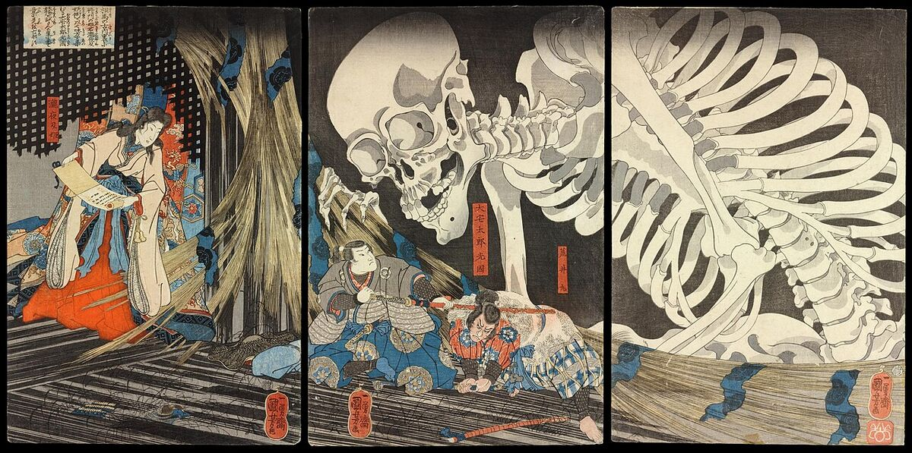

# Kami, Ghosts and Yōkai: A Folklore Handbook

This handbook is about the invisible inhabitants of Japan: the **kami** worshipped at shrines, the **buddhas** they were joined to for a thousand years, the **dead** who return as ancestors, as vengeful spirits and as ghosts, and the crowd of strange beings called **yōkai**. It does not treat them as fairy tales. It follows how each idea arose, who wrote it down, who drew it, which rituals answered it and how it changed, from the eighth-century chronicles to Edo-period woodblock prints and to the 2020 pandemic.

It is written for a reader who wants to understand and is ready to read closely. Chapters are long, dates and names are given where the sources give them, and where scholars disagree, both positions are shown.

<figure>

<figcaption>Utagawa Kuniyoshi, <em>Takiyasha the Witch and the Skeleton Spectre</em>, colour woodblock triptych, about 1844. Princess Takiyasha summons a skeleton spectre to frighten the warrior Mitsukuni. Image: Utagawa Kuniyoshi, Public domain, via <a href="https://commons.wikimedia.org/wiki/File:Takiyasha_the_Witch_and_the_Skeleton_Spectre%2C_by_Utagawa_Kuniyoshi.jpg">Wikimedia Commons</a>.</figcaption>
</figure>

## How this handbook treats facts

- **Every factual statement comes from a named source**, cited in brackets, such as (Kuroda 1996), and listed at the end of each chapter.
- **Three kinds of source are used.**
  - **Peer-reviewed scholarship**, above all the *Japanese Journal of Religious Studies* and *Contemporary Religions in Japan* (Nanzan Institute for Religion and Culture), research published by the International Research Center for Japanese Studies (Nichibunken), and papers on J-STAGE.
  - **Primary texts in public-domain editions**, chiefly Lafcadio Hearn's retellings of Japanese ghost stories (1894–1904). They are quoted as what they are: one writer's record of what he read and heard.
  - **Official bodies**: Japan's Agency for Cultural Affairs, for religious statistics.
- **Encyclopaedias, blogs and popular websites are not used as sources.** Terms are linked to Wikipedia (marked ↗) only as further reading.
- **Where the sources are silent**, the handbook says so instead of filling the gap with popular lore. Much of what circulates about yōkai online has no traceable source, and this handbook leaves it out.
- **Folklore changes.** A belief described for one village or one century is not presented as "what the Japanese believe". The text says where and when.

## Pictures

The pictures are woodblock prints, illustrated books, painted scrolls and photographs that are in the public domain or under free licences, each credited in its caption and again on the [sources page](15-sources.md). Several diagrams were drawn for this handbook from the cited sources.

## The three parts

### Part I: Kami and buddhas

| Chapter | What it explains |
|---|---|
| [1. Kami and the word "Shinto"](01-kami.md) | What a kami is; why the word "Shinto" is younger and more slippery than it looks; shrines and believers today |
| [2. Myths and the Land of Yomi](02-myths.md) | The Kojiki and Nihon shoki; Izanagi's visit to the dead; why pollution enters the myths |
| [3. Pollution and purification](03-purity.md) | *Kegare* and *harae*; the Great Purification; paper substitutes that carry away a year's impurity |
| [4. Kami and buddhas together](04-kami-buddhas.md) | A thousand years of combination: kami who need salvation, buddhas who appear as kami (*honji suijaku*) |
| [5. The separation of 1868](05-separation.md) | How the Meiji state pulled kami and buddhas apart, and what remained |

### Part II: The dead and their ghosts

| Chapter | What it explains |
|---|---|
| [6. Ancestors, Bon and the afterlife](06-ancestors.md) | How the dead become ancestors; the forgotten dead; the six realms and the kings of hell |
| [7. Vengeful spirits](07-vengeful.md) | *Goryō* and *onryō*: the wronged dead who send epidemics, and how they became gods |
| [8. How the yūrei took shape](08-yurei.md) | Why the white-robed, legless ghost is an Edo-period creation |
| [9. A field guide to ghosts](09-ghost-types.md) | The kinds of ghost and spirit, how each comes into being and the folklore around it |

### Part III: Yōkai

| Chapter | What it explains |
|---|---|
| [10. What a yōkai is](10-yokai.md) | The word, the definitions, and how yōkai went from feared to named to entertaining |
| [11. Night parades and tool spirits](11-night-parade.md) | *Hyakki yagyō* scrolls, *tsukumogami* and the illustrated catalogues |
| [12. A yōkai bestiary](12-bestiary.md) | Oni, tengu, foxes and tanuki, kappa, mermaids and prophetic beasts |
| [13. Yōkai in modern Japan](13-yokai-today.md) | "Doctor Monster", the 1960s yōkai boom, *kamikakushi* and Amabie in the pandemic |

Finally, a [glossary](14-glossary.md) and the [complete list of sources and image credits](15-sources.md).

➡️ Begin with [Chapter 1: Kami and the word "Shinto"](01-kami.md)
