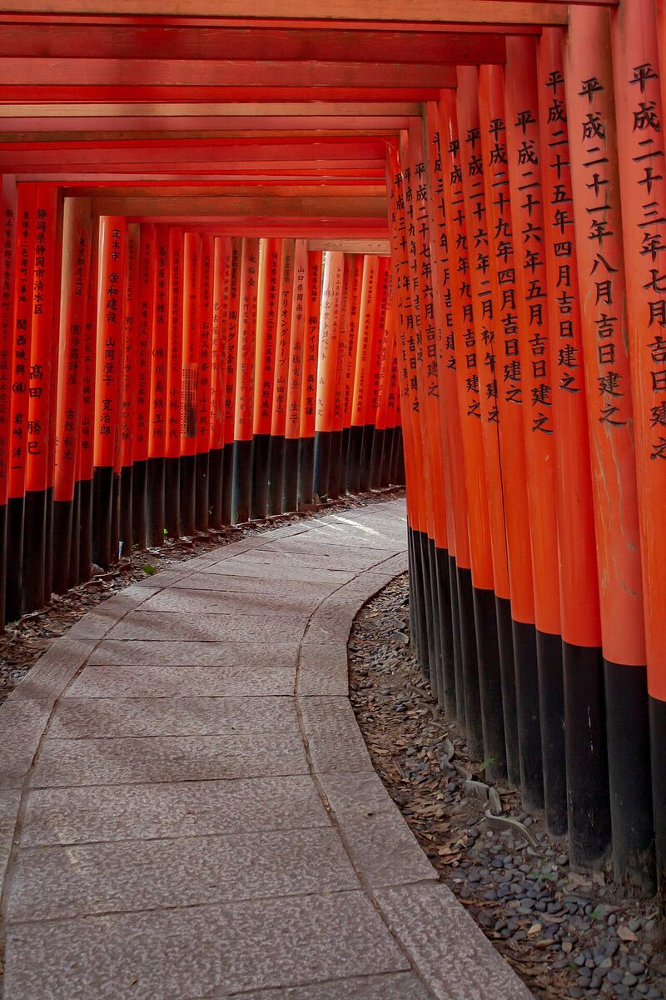
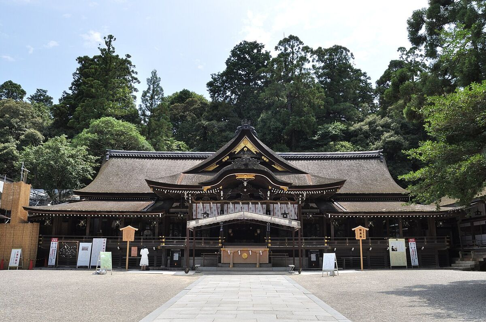

# 1. Kami and the Word "Shinto"

Most visitors meet Japanese religion as a gate: two upright posts and two crossbeams, standing before a shrine. Behind the gate lives a **[kami](https://en.wikipedia.org/wiki/Kami)**. This chapter asks two questions that turn out to be harder than they look. What is a kami? And what do we mean when we call the worship of kami "[Shinto](https://en.wikipedia.org/wiki/Shinto)"?

<figure>

<figcaption>The “thousand gates” (<em>senbon torii</em>) of Fushimi Inari Taisha in Kyoto, the head shrine of Inari (Chapters 4 and 12). <span class="credit">Image: Jason Zhang, <a href="https://creativecommons.org/licenses/by-sa/3.0/">CC BY-SA 3.0</a>, via <a href="https://commons.wikimedia.org/wiki/File:Fushimi_Inari-taisha_senbon-torii%2C_August_2019.jpg">Wikimedia Commons</a>.</span></figcaption>
</figure>

## 1.1 What the word kami does not mean

English usually translates *kami* (神) as "god" or "deity". Timothy Vance warns that such translations "are likely to be misleading unless supplemented by some such explanation". For that reason, writers in English long tried to explain the word through its origin (Vance 1983).

The most popular explanation was that *kami*, "god", comes from *kami*, "above" (上), and so means something superior. Vance quotes a typical postwar textbook: "The literal translation of the character by which it is represented is 'above'" (Vance 1983). That etymology does not survive the evidence of the oldest Japanese writing:

- Scholars of the eighth-century script, above all the linguist **Hashimoto Shinkichi** (1882–1945), showed that Nara-period Japanese distinguished sounds that later merged. Hashimoto called the two series *kō* and *otsu* (Vance 1983).
- It is generally agreed that Nara-period Japanese had **eight vowels**, against the five of later Japanese (Vance 1983).
- *Kami* "above" was written with a *kō*-type *mi*, *kami* "god" with an *otsu*-type *mi*. The two words were pronounced differently, which makes it "virtually certain that they are etymologically distinct" (Vance 1983). One reconstruction gives the Nara-period pronunciation of "god" as something like *kamwi* (Vance 1983, citing Yamamoto 1933).

Vance concludes that "the question of the etymology of 'kami' remains open" (Vance 1983). The word cannot be explained by taking it apart. It has to be understood from how it was used.

## 1.2 What a kami can be

The eighteenth-century scholar **[Motoori Norinaga](https://en.wikipedia.org/wiki/Motoori_Norinaga)** (1730–1801) gave the definition that later scholars keep returning to. As Hirota Ryūhei summarises it, Norinaga held that "not only the primordial deities but also 'such things as dragons, *kotama* (wood spirits), foxes, and so forth' are kami, because they are in some aspect superhuman and extraordinary" (Hirota 2021).

For Norinaga, then, a kami is defined by what it does to people: it is extraordinary and awe-inspiring. Being good is not part of the definition. A Shinto scholar of the twentieth century, Hirai Naofusa of [Kokugakuin University](https://en.wikipedia.org/wiki/Kokugakuin_University), quotes two of Norinaga's poems to convey this sense of wonder. In one, "To deny the existence of the mysterious is a foolish attitude"; in the other, "Heaven and earth themselves are mysterious" (Hirai 1960). Hirai describes the kami of shrine worship as many and varied:

> There are wise kami, kami of great strength, kami of rich humor. In the mountains are mountain kami, in the sea sea kami. There are philosophical and wisdom kami, as well as historical personages worshipped as kami. (Hirai 1960)

He adds that Shinto "does not preach a monistic god behind these kami" (Hirai 1960). Hirai writes as a Shinto theologian, so his text shows how shrine Shinto describes itself, not a neutral historical account.

Kuroda Toshio adds a detail from the ancient texts that matters greatly for later chapters. A single kami could be described by its different aspects: *aramitama* (violent spirit), *nigimitama* (peaceful spirit), *sakimitama* (benevolent spirit) and *kushimitama* (awe-inspiring spirit). These terms "do not refer to different beings or kami, but reportedly refer to different aspects of the function or efficacy of a given kami" (Kuroda 1996a). The same power can rage or protect. Chapter 7 shows how this idea let the angry dead become gods.

## 1.3 Is "Shinto" a religion, or a word?

The word **Shinto** (神道, "the way of the kami") is usually explained as the name of "Japan's indigenous religion", taken to cover "everything that has to do with native deities (kami) or shrines, from imperial ritual to folk religion" (Teeuwen and Scheid 2002). That is the definition shrine Shinto itself prefers. Historians have challenged it sharply.

### The traditional view

Miyaji Naokazu, a professor of Shinto at Tokyo Imperial University, wrote that the word Shinto "did not exist at first". In his account it was coined "about the middle of the 7th century in order to distinguish it from Buddhism, a foreign religion", while "the substance was very ancient" (Miyaji 1966). Miyaji divided Shinto into **[State Shinto](https://en.wikipedia.org/wiki/State_Shinto), Popular Shinto, Shrine Shinto and Sectarian Shinto** (Miyaji 1966). His essay, published posthumously, reflects the views of the pre-war Shinto establishment; its talk of a "racial religion" belongs to that period.

### Kuroda's challenge

In 1981 the historian **Kuroda Toshio** argued the opposite, and his view "has since formed the departing point of most Western studies of Shinto" (Teeuwen and Scheid 2002). Mark Teeuwen and Bernhard Scheid summarise his argument:

- Until at least the [Kamakura period](https://en.wikipedia.org/wiki/Kamakura_period) (1185–1333), the word *Shinto* was used "more or less as a synonym for kami", not as the name of a religion.
- Kami worship was "a well-integrated constituent" of the dominant Buddhist system of the time, the exoteric–esoteric (*kenmitsu*) schools. "Temple-shrine complexes, where kami and buddhas were worshiped side by side, were paradigmatic."
- Self-professed forms of Shinto emerged only towards the end of the medieval period, and were favoured in the early-modern period by anti-Buddhist Confucian scholars, while popular kami practice "remained subsumed within Buddhism".
- Only in the [Meiji period](https://en.wikipedia.org/wiki/Meiji_era), through "repressive Restoration politics", did "Shinto achieve for the first time the status of an independent religion, distorted though it was" (Kuroda 1981, quoted in Teeuwen and Scheid 2002).

Kuroda did not claim that kami or shrines were recent inventions. What he rejected was "the existence of Shinto as an autonomous system parallel to kenmitsu Buddhism" (Teeuwen and Scheid 2002). He called Shinto "no more than a ghost image produced by a word linking together unrelated phenomena" (Kuroda 1981, quoted in Teeuwen 2002).

### Where the word came from

Mark Teeuwen traced the history of the word itself (Teeuwen 2002):

- The word was created from an earlier Buddhist term, ***jindō***, used for example in the *[Nihon shoki](https://en.wikipedia.org/wiki/Nihon_Shoki)* (720) "as a collective noun referring to 'the realm of the (non-Buddhist) deities'".
- The reading ***shintō*** first occurs in the context of esoteric initiations into knowledge about the kami, "probably in the fourteenth century".
- It took shape in a discourse that drew on Buddhist ideas of original enlightenment (*hongaku*) and on Yin-Yang cosmology.

Teeuwen and Scheid therefore propose to use "Shinto" only as "a collective term for various attempts made in different historical periods to unify kami practices and beliefs" (Teeuwen and Scheid 2002). Shrines and kami are concrete things in the landscape; Shinto is an idea that has had to be "produced actively every time it has been used" (Teeuwen 2002).

> **Two views, both in the sources.** Miyaji dates the word to the seventh century and treats Shinto as an unbroken native religion. Teeuwen finds the reading *shintō* only from about the fourteenth century and treats it as a concept built in stages. This handbook follows the historians for history, but shows the shrine view where it describes how Shinto understands itself.

## 1.4 The shrine and the state

Allan Grapard examined the oldest list of shrines, the register in ancient Japanese law to which the imperial government made offerings in the Nara and Heian periods. He found that the register is not a neutral map of kami worship. Its shrines reflect political and military strategy, competition between priestly houses, and Buddhism. The central government "took control of these shrines and their cults in a strategy of territorial and social control", which "must have profoundly transformed pre-existing practices" (Grapard 2002). Grapard also notes that "quite a few important sites" named in the myths are missing from the register, partly because "kami names and their genealogies differ in *[Kojiki](https://en.wikipedia.org/wiki/Kojiki)* and *Nihon shoki*" (Grapard 2002).

The point for a reader is a warning. The earliest written evidence about kami was produced by a court with its own aims. It shows what the state wanted to control, not necessarily what villagers worshipped.

<figure>

<figcaption>The worship hall (<em>haiden</em>) of Ōmiwa Shrine, Nara Prefecture. There is no main sanctuary behind it: the mountain itself is the body of the kami (Antoni 1995). <span class="credit">Image: Ocdp, <a href="https://creativecommons.org/publicdomain/zero/1.0/">CC0</a>, via <a href="https://commons.wikimedia.org/wiki/File:Omiwa-jinja_Haiden_001.jpg">Wikimedia Commons</a>.</span></figcaption>
</figure>

A striking example of a very old kind of worship is **[Ōmiwa Shrine](https://en.wikipedia.org/wiki/%C5%8Cmiwa_Shrine)** in Nara Prefecture. Its kami, [Ōmononushi](https://en.wikipedia.org/wiki/%C5%8Cmononushi), is worshipped without a main sanctuary building. "The divine mountain Miwayama is itself the *shintai*" (the body of the kami), so "religious adoration is directed straight to the mountain" (Antoni 1995). The shrine claims to be the oldest in Japan, a claim Klaus Antoni calls "doubtful (and controversial as well)" (Antoni 1995).

## 1.5 Kami worship today

The [Agency for Cultural Affairs](https://en.wikipedia.org/wiki/Agency_for_Cultural_Affairs) publishes an annual survey of religious corporations. Its figures for 31 December 2024 (Agency for Cultural Affairs 2025):

| | Shinto lineage | Buddhist lineage | Christian lineage | Other | Total |
|---|---|---|---|---|---|
| Religious corporations | 84,137 | 76,657 | 4,864 | 12,879 | 178,537 |
| Declared adherents | 86,359,612 | 80,463,918 | 1,872,320 | 6,358,197 | 175,054,047 |

Two cautions come with these numbers. First, the agency notes that each religious body defines and counts its adherents in its own way, as shrine parishioners (*ujiko*), temple members (*danto*), believers and so on (Agency for Cultural Affairs 2025). Second, the same people are counted by shrines and by temples, which is why the total runs to 175 million. Teeuwen and Scheid point to the paradox behind it: "most Japanese are involved in some form of shrine practice (at least in the form of *[hatsumōde](https://en.wikipedia.org/wiki/Hatsum%C5%8Dde)*)", the New Year shrine visit, "while at the same time 'Shinto' seems to mean nothing to them" (Teeuwen and Scheid 2002).

## 1.6 Check yourself

```quiz
title: Chapter 1 self-check
? Why is the old etymology "kami = above" rejected?
- In Nara-period Japanese the two words had different vowels, so they were different words *
- The character for kami was borrowed from Chinese
- The word kami appears only after 1868
> Kami "above" had a kō-type mi and kami "god" an otsu-type mi (Vance 1983).

? According to Norinaga, what makes something a kami?
- It is superhuman or extraordinary, whether good or not *
- It is the ancestor of the emperor
- It is enshrined in a registered shrine
> Norinaga counted dragons, wood spirits and foxes among the kami (Hirota 2021).

? What did Kuroda Toshio argue about Shinto?
- It became an independent religion only in the Meiji period; earlier, kami worship lay inside Buddhism *
- Kami and shrines are Meiji inventions
- Shinto existed unchanged since prehistory
> Kuroda did not deny the antiquity of kami cults, only the existence of an autonomous Shinto system.

? From which earlier term was the word "Shinto" developed?
- The Buddhist term jindō, "the realm of the (non-Buddhist) deities" *
- The Chinese word for emperor
- The name of the Ise shrine
> The reading shintō appears in esoteric initiations, probably in the fourteenth century (Teeuwen 2002).

? Why does Ōmiwa Shrine have no main sanctuary for its kami?
- The mountain itself is the body of the kami *
- It was destroyed in 1868
- Its kami lives in a statue in the hall
> Worship is directed straight to Mt. Miwa (Antoni 1995).

? Why do Japan's declared religious adherents total about 175 million?
- People are counted by both shrines and temples, and each body counts in its own way *
- Foreign tourists are included
- The figure includes the dead
> The Agency for Cultural Affairs notes that each body defines adherents differently.
```

## Sources for this chapter

1. **Vance 1983.** Vance TJ. The etymology of *kami*. *Japanese Journal of Religious Studies* 1983;10(4):277–288. [Nanzan](https://nirc.nanzan-u.ac.jp/journal/6/article/634/pdf/download).
2. **Hirota 2021.** Hirota Ryūhei. Traversing the natural, supernatural, and paranormal: yōkai in postwar Japan. *Japanese Journal of Religious Studies* 2021;48(2):321–339. doi:[10.18874/jjrs.48.2.2021.321-339](https://doi.org/10.18874/jjrs.48.2.2021.321-339).
3. **Hirai 1960.** Hirai Naofusa. The principles of shrine Shinto. *Contemporary Religions in Japan* 1960;1(1):39–54. [Nanzan](https://nirc.nanzan-u.ac.jp/journal/15/article/1781/pdf/download).
4. **Kuroda 1996a.** Kuroda Toshio, tr. Allan G. Grapard. The world of spirit pacification: issues of state and religion. *Japanese Journal of Religious Studies* 1996;23(3–4):321–351. [Nanzan](https://nirc.nanzan-u.ac.jp/journal/6/article/936/pdf/download).
5. **Miyaji 1966.** Miyaji Naokazu. What is Shinto? *Contemporary Religions in Japan* 1966;7(1):40–50. [Nanzan](https://nirc.nanzan-u.ac.jp/journal/15/article/1965/pdf/download).
6. **Teeuwen and Scheid 2002.** Teeuwen M, Scheid B. Tracing Shinto in the history of kami worship: editors' introduction. *Japanese Journal of Religious Studies* 2002;29(3–4):195–207. [Nanzan](https://nirc.nanzan-u.ac.jp/journal/6/article/1091/pdf/download). Source for Kuroda Toshio's 1981 argument ("Shinto in the history of Japanese religion", *Journal of Japanese Studies* 7/1), which was not read directly.
7. **Teeuwen 2002.** Teeuwen M. From *jindō* to Shinto: a concept takes shape. *Japanese Journal of Religious Studies* 2002;29(3–4):233–263. [Nanzan](https://nirc.nanzan-u.ac.jp/journal/6/article/1093/pdf/download).
8. **Grapard 2002.** Grapard AG. Shrines registered in ancient Japanese law: Shinto or not? *Japanese Journal of Religious Studies* 2002;29(3–4):209–232. [Nanzan](https://nirc.nanzan-u.ac.jp/journal/6/article/1092/pdf/download).
9. **Antoni 1995.** Antoni K. The "separation of gods and buddhas" at Ōmiwa Shrine in Meiji Japan. *Japanese Journal of Religious Studies* 1995;22(1–2):139–159. [Nanzan](https://nirc.nanzan-u.ac.jp/journal/6/article/896/pdf/download).
10. **Agency for Cultural Affairs 2025.** 文化庁 (Agency for Cultural Affairs). 令和7年の宗教統計調査の結果を公表します (Results of the 2025 religious statistics survey; figures as of 31 December 2024). December 2025. [bunka.go.jp](https://www.bunka.go.jp/tokei_hakusho_shuppan/hakusho_nenjihokokusho/shukyo_nenkan/pdf/r07nenkan_gaiyo.pdf), accessed 18 November 2026.

➡️ Next: [Chapter 2: Myths and the Land of Yomi](02-myths.md)
