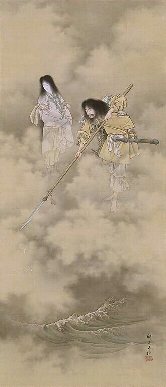
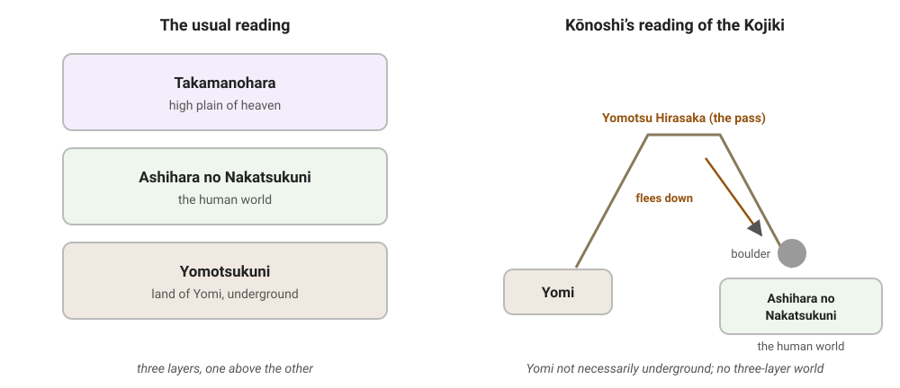
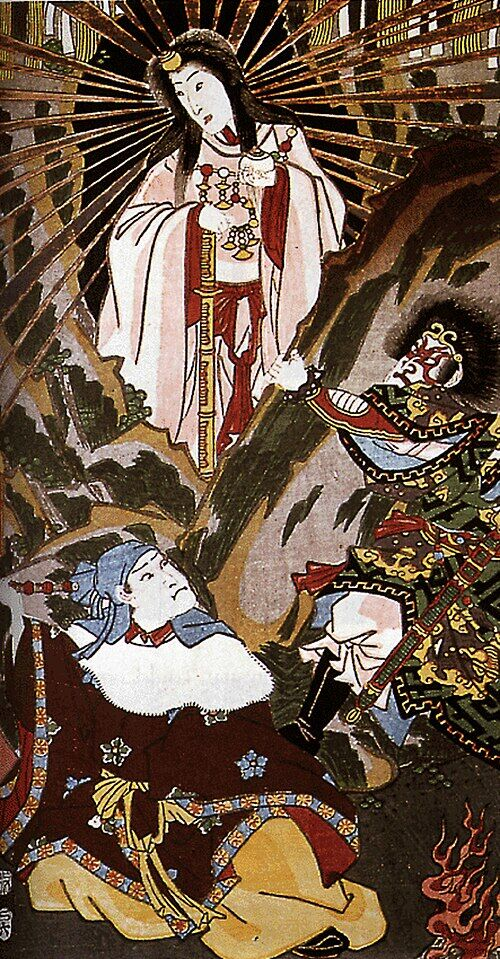

# 2. Myths and the Land of Yomi

Japan's oldest surviving books open with the age of the gods. They tell how the islands were made, how the first goddess died, and how her husband followed her into the land of the dead and fled from it. That flight is the first ghost story in Japanese literature and the origin of the idea of pollution. This chapter looks at the two chronicles, at what they say about the dead, and at how much of our reading of them comes from later interpreters.

<figure>

<figcaption>Kobayashi Eitaku, <em>Izanami and Izanagi Creating the Japanese Islands</em>, 1880s. A Meiji-period painting of the creation myth. <span class="credit">Image: Kobayashi Eitaku, Public domain, via <a href="https://commons.wikimedia.org/wiki/File:Kobayashi_Eitaku_-_Izanami_and_Izanagi_Creating_the_Japanese_Islands.jpg">Wikimedia Commons</a>.</span></figcaption>
</figure>

## 2.1 Two chronicles, two worlds

- The ***[Kojiki](https://en.wikipedia.org/wiki/Kojiki)*** (古事記, "Record of ancient matters") was compiled in **712**; the ***[Nihon shoki](https://en.wikipedia.org/wiki/Nihon_Shoki)*** (日本書紀, "Chronicles of Japan") in **720** (Grapard 2002).
- Fanny Hagin Mayer describes the *Kojiki*'s origin as the earliest record of a storyteller in Japan. **[Hieda no Are](https://en.wikipedia.org/wiki/Hieda_no_Are)**, an attendant at the court of [Emperor Tenmu](https://en.wikipedia.org/wiki/Emperor_Tenmu) (r. 672–686), recited the events of Japan's origin, and these were "put into book form in the *Kojiki* in 712 by Oho-no-Yasumaro at the command of [Empress Genmei](https://en.wikipedia.org/wiki/Empress_Genmei) (reigned A.D. 707–715)". Genmei also ordered local authorities in **713** to compile the ***[Fudoki](https://en.wikipedia.org/wiki/Fudoki)***, local records that were to include "tales told by village elders" (Mayer 1974).
- The *Nihon shoki* was compiled as an official national history and covers "ancient mytho-history down to 696". It is the first of the Six National Histories (Grapard 2002).

The two books do not tell one story. "[Kami](https://en.wikipedia.org/wiki/Kami) names and their genealogies differ in *Kojiki* and *Nihon shoki*" (Grapard 2002). Kōnoshi Takamitsu insists that each "creates a mythical world of its own" and that one should not merge them into a single "Japanese mythology" (Kōnoshi 1984).

### Who decided that the *Kojiki* comes first

Today the *Kojiki* is usually read as *the* book of Japanese myth. Isomae Jun'ichi shows that this ranking is itself historical. From its compilation in the [Nara period](https://en.wikipedia.org/wiki/Nara_period) until the early [Edo period](https://en.wikipedia.org/wiki/Edo_period), it was the *Nihon shoki* that "continually occupied a position as a classic" (Isomae 2000). The reversal came with **[Motoori Norinaga](https://en.wikipedia.org/wiki/Motoori_Norinaga)** (1730–1801), whose great commentary, the ***Kojikiden***, preferred the *Kojiki*. Isomae argues that Norinaga's theories "continue to influence our interpretation and evaluations of these texts", and that what feel like natural readings are often "the personal ideas of the interpreters themselves" (Isomae 2000).

Norinaga also reshaped the story he was explaining:

- The *Kojiki* opens with **three deities** appearing together: Amenominakanushi, Takami Musuhi and Kami Musuhi. Norinaga "reread them as a single original deity, Musuhi no Kami" (Isomae 2000).
- He wrote that "heaven and earth, all the gods and all phenomena, were brought into existence by the creative spirits of two deities, Takami Musuhi no Kami and Kami Musuhi no Kami", and that their creativity "caused the deities [Izanagi](https://en.wikipedia.org/wiki/Izanagi) and [Izanami](https://en.wikipedia.org/wiki/Izanami) to create the land, all kinds of phenomena, and numerous gods and goddesses" (Norinaga, *Tamakushige*, quoted in Isomae 2000).
- His retelling of the myths followed the *Kojiki* "with alternate texts from the *Nihon shoki* deployed at important junctures". The oath of [Amaterasu](https://en.wikipedia.org/wiki/Amaterasu), which he took as the guarantee of an eternal imperial line, "appears not in the *Kojiki*, nor even in the main text of the *Nihon shoki*, but is taken from an alternate variant" (Isomae 2000).

## 2.2 The death of Izanami

In the *Kojiki*, Izanami and her husband Izanagi (Izanaki in Kōnoshi's spelling) give birth to the land and to many deities. After giving birth to the **fire deity**, Izanami dies and is buried on Mt. Hiba. Izanagi is not reconciled to her loss: "desiring to see her, [he] went to the Land of [Yomi](https://en.wikipedia.org/wiki/Yomi)" (*Kojiki*, quoted in Kōnoshi 1984).

This is where the realm of the dead enters Japanese writing. Kōnoshi's study of the episode establishes several points (Kōnoshi 1984):

- **The name.** *Yomi* is a Japanese word. The Chinese characters used to write it, 黄泉, literally "yellow spring(s)", the underground springs of Chinese tradition, are only a translation, and "we should not make the mistake of taking the Chinese characters used to write it too literally".
- **Where Yomi is.** Most modern commentaries place it underground, as the lowest of three layers: [Takamanohara](https://en.wikipedia.org/wiki/Takamagahara) (the high plain of heaven), Ashihara no Nakatsukuni (the central land of reed plains, the human world) and Yomotsukuni (the land of Yomi). Kōnoshi doubts both that Yomi is underground and that the myths imagine a three-layered world. Following Satō, he reads the text as saying that Izanagi flees *down* from the pass between the worlds, **[Yomotsu Hirasaka](https://en.wikipedia.org/wiki/Yomotsu_Hirasaka)**, and blocks it at the foot with a great boulder.
- **Only in the *Kojiki*.** The main text of the *Nihon shoki* has no visit to Yomi. The episode appears only in two variant versions that the *Nihon shoki* records (variants 6 and 10), "and cannot be connected to the world view" of that book. The *Kojiki*, by contrast, "clearly intended to construct a mythical world that would incorporate the Land of Yomi".
- **The flight.** As Izanagi escapes, peaches repel the eight thunder deities and the army of Yomi pursuing him.

<figure class="diagram">

<figcaption>Two readings of the Land of Yomi (Kōnoshi 1984). <span class="credit">Diagram drawn for this handbook from the sources cited in the chapter.</span></figcaption>
</figure>

## 2.3 "An unclean, polluted land"

When Izanagi returns, he exclaims: "Indeed, I have returned from an unclean, polluted land" (*Kojiki*, quoted in Kōnoshi 1984). Kōnoshi reads the line as a statement about the human world as much as about Yomi: by contrast, it confirms the value of the land Izanagi has returned to. Yomi, the "Land of the Sea" and *Ne no Katasukuni* all "appear in relationship with Ashihara no Nakatsukuni, and all guarantee the existence of Ashihara no Nakatsukuni as the central point in the world" (Kōnoshi 1984).

Here the myths join the dead with **pollution** (*[kegare](https://en.wikipedia.org/wiki/Kegare)*). Death is not evil in this story, but it is contaminating, and the living must close it off. Chapter 3 follows the rituals built on that idea.

## 2.4 More episodes the later chapters need

A few other mythic episodes recur in later belief. The sources used here mention them in passing:

- **The [Heavenly Cave](https://en.wikipedia.org/wiki/Amano-Iwato).** In the *Nihon shoki*'s main text, the misbehaviour of [Susanowo](https://en.wikipedia.org/wiki/Susanoo-no-Mikoto) ends with the sun goddess concealing herself in the cave of **Ame no Iwato** (Kōnoshi 1984). Kuroda Toshio links the "suggestive dance of [Ame-no-Uzume](https://en.wikipedia.org/wiki/Ame-no-Uzume) in the myth of the Heavenly Cave" to the dances later performed to appease the angry dead, which "together with the laughter they provoked in the audience were believed to appease the dead" (Kuroda 1996a).
- **The leech child.** A. W. Sadler, describing a Tokyo shrine's purification rite, notes that the paper figures carrying a person's impurities are floated away on the water "as Izanagi and Izanami floated the leech child off, to oblivion" (Sadler 1970).
- **The divine council.** Hirai Naofusa cites "the classical story of the divine council held in the bed of the Heavenly River (Ame-no-yasu-no-kawara)" as evidence that the many kami act in harmony (Hirai 1960).
- **Heavenly and earthly sins.** The Great Purification prayer, discussed in Chapter 3, contains a list of "heavenly sins", committed mostly by Susano-o "on his rampage in Heaven", and "earthly sins" (Sadler 1970).
- **The eight-headed serpent.** Komatsu Kazuhiko names the serpent **[Yamata no Orochi](https://en.wikipedia.org/wiki/Yamata_no_Orochi)**, "with eight heads and eight tails on one body", as the archetype of nature and animal [yōkai](https://en.wikipedia.org/wiki/Y%C5%8Dkai), born of "awe at mountains, rivers, storms and other disasters" (Komatsu 2014). Part III returns to it.

<figure>

<figcaption>Utagawa Kunisada, the sun goddess Amaterasu emerging from the Heavenly Cave (detail of a triptych), 1856. <span class="credit">Image: Utagawa Kunisada, Public domain, via <a href="https://commons.wikimedia.org/wiki/File:Amaterasu_cave_crop.jpg">Wikimedia Commons</a>.</span></figcaption>
</figure>

> **Reading the myths with care.** The myths reach us through texts compiled by a court, ranked and reread by later scholars, and retold in modern summaries that silently merge the two chronicles. When this handbook cites a myth, it says which book tells it and who is interpreting it.

## 2.5 Check yourself

```quiz
title: Chapter 2 self-check
? When were the Kojiki and the Nihon shoki compiled?
- 712 and 720 *
- 538 and 552
- 1185 and 1333
> Grapard 2002. Mayer 1974 names Hieda no Are and Ō no Yasumaro.

? Which text did Motoori Norinaga raise above the other?
- The Kojiki *
- The Nihon shoki
- The Fudoki
> Before Norinaga the Nihon shoki had been the classic (Isomae 2000).

? Why did Izanagi go to the Land of Yomi?
- To see Izanami again after she died giving birth to the fire deity *
- To fight the eight thunder deities
- To bring back the sun goddess
> Kojiki, as quoted in Kōnoshi 1984.

? What does Kōnoshi say about the main text of the Nihon shoki?
- It has no visit to Yomi; the episode is only in variants *
- It describes Yomi in more detail than the Kojiki
- It places Yomi in the sky
> Variants 6 and 10 tell the story, but the main text does not.

? What did Izanagi call the place he had escaped?
- "An unclean, polluted land" *
- "The land of eternal youth"
- "The high plain of heaven"
> The episode links death with pollution.

? What is the Chinese-character spelling of Yomi, 黄泉, literally?
- "Yellow spring(s)": a translation, not the meaning of the Japanese word *
- "Land of darkness"
- "Mountain of the dead"
> Kōnoshi warns against reading the characters literally.
```

## Sources for this chapter

1. **Grapard 2002.** See [Chapter 1](01-kami.md).
2. **Mayer 1974.** Mayer FH. Religious concepts in the Japanese folk tale. *Japanese Journal of Religious Studies* 1974;1(1):73–101. [Nanzan](https://nirc.nanzan-u.ac.jp/journal/6/article/460/pdf/download).
3. **Kōnoshi 1984.** Kōnoshi Takamitsu, tr. W. Michael Kelsey. The Land of Yomi: on the mythical world of the *Kojiki*. *Japanese Journal of Religious Studies* 1984;11(1):57–76. [Nanzan](https://nirc.nanzan-u.ac.jp/journal/6/article/643/pdf/download). Source for the quotations from the *Kojiki*.
4. **Isomae 2000.** Isomae Jun'ichi. Reappropriating the Japanese myths: Motoori Norinaga and the creation myths of the *Kojiki* and *Nihon shoki*. *Japanese Journal of Religious Studies* 2000;27(1–2):15–39. [Nanzan](https://nirc.nanzan-u.ac.jp/journal/6/article/1014/pdf/download).
5. **Kuroda 1996a.** See [Chapter 1](01-kami.md).
6. **Sadler 1970.** Sadler AW. Of talismans and shadow bodies: annual purification rites at a Tokyo shrine. *Contemporary Religions in Japan* 1970;11(3–4):181–222. [Nanzan](https://nirc.nanzan-u.ac.jp/journal/15/article/2034/pdf/download).
7. **Hirai 1960.** See [Chapter 1](01-kami.md).
8. **Komatsu 2014.** Komatsu Kazuhiko 小松和彦. 日本文化の底流で跳梁する妖怪たち (The yōkai that run riot in the undercurrents of Japanese culture). In: 『妖怪』 (*Yōkai*: catalogue of the Nichibunken collection). International Research Center for Japanese Studies, 2014: 1–4. [Nichibunken repository](https://nichibun.repo.nii.ac.jp/records/1058).

➡️ Next: [Chapter 3: Pollution and purification](03-purity.md)
