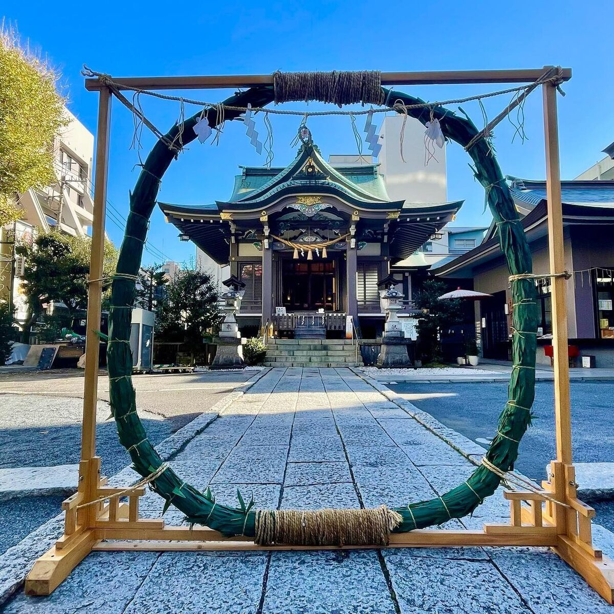
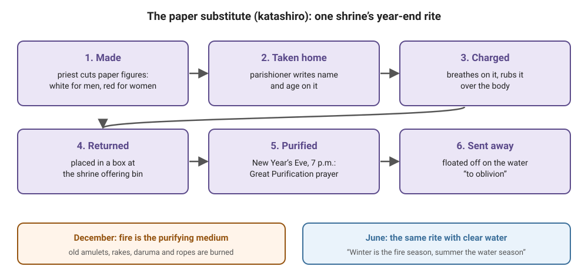

# 3. Pollution and Purification

[Izanagi](https://en.wikipedia.org/wiki/Izanagi) came back from the land of the dead calling it "unclean" and "polluted" (Chapter 2). The pair of ideas behind that cry, **pollution** (*[kegare](https://en.wikipedia.org/wiki/Kegare)*) and **purification** (*harae*, *harai*), runs through Japanese religion. It explains why the dead are dangerous, why epidemics were treated as invasions, and why a neighbourhood shrine in Tokyo still collects paper dolls every December. This chapter describes what the sources say *kegare* was, then follows one shrine's year of purification in detail.

<figure>

<figcaption>A ring of grass (<em>chinowa</em>) set up at Kashiwa Shrine, Chiba, photographed in December 2022, the season of the year-end purification described in this chapter. <span class="credit">Image: ivva イワヲ, <a href="https://creativecommons.org/licenses/by-sa/2.0/">CC BY-SA 2.0</a>, via <a href="https://commons.wikimedia.org/wiki/File:Chinowa%2C_Kashiwa_Shrine%2C_Kashiwa%2C_Chiba_-_December_2022.jpg">Wikimedia Commons</a>.</span></figcaption>
</figure>

## 3.1 What *kegare* is

Andrew Macomber defines *kegare* (穢) as "ritual pollution that was imagined to change the ontological status of the body", that is, to change what the person *is*, not only how clean they are (Macomber 2022). In his summary of the scholarship, the recognised sources of defilement were death (of humans or animals, whole or in part), involvement in burial and mourning, childbirth, menstruation and blood (Macomber 2022). Defilement spread by contact. "Defilement passes from one person (or place) to another as though it were an infectious disease", and the premodern category of "touch defilement" (*shokue*) named this transfer (Macomber 2022).

### Etymologies, and a warning about them

Two folk etymologies are often repeated (Macomber 2022):

- The historian George Sansom wrote in 1931 that "the word for a wound, *kega*, still in use, means defilement", so that wounds and sickness were themselves pollution.
- Another derives *kegare* from *ke* 気 (vital energy) and *kare* 枯れ (withering), "the idea of sickness as the dissipation of vital energy".

Macomber cautions that, according to the historian Yamamoto Kōji, such etymologies were proposed by folklore studies looking for "the essential characteristics of a timeless Japanese folk". Historical research has shown that "beliefs and practices surrounding defilement were not inflexible or immutable" (Macomber 2022). His own study shows one change in action: a disease spread by corpses, which aristocrats and monks first learned of in the late [Heian period](https://en.wikipedia.org/wiki/Heian_period), grew out of "pervasive anxieties over death defilement in a capital overflowing with dead bodies" (Macomber 2022).

> **Kegare is not sin.** None of the sources describes *kegare* as moral guilt. It is a condition that comes from contact with death, blood and birth, and it can be removed by rites. The Great Purification prayer below lists "sins" (*tsumi*) as well, but the prayer is about removing them, not about guilt.

## 3.2 The state purifies: rites against epidemics

In the spring of **863** an epidemic swept the country. Kuroda Toshio lists the court's responses, recorded in the official history *Nihon sandai jitsuroku*. Imperial banquets were halted, and on the 27th day of the first month "Great Rituals of Purification against epidemics and disasters" were held in the imperial residence and at the Kenrei and Suzaku gates of the palace. Offerings followed at the great shrines of the provinces, and sutra readings were ordered throughout the land after a report from the Bureau of Yin and Yang (Kuroda 1996a). The court, then, fought the epidemic with purification, [kami](https://en.wikipedia.org/wiki/Kami) offerings and Buddhist scripture at once. Chapter 7 tells what it tried next.

Epidemics as invaders lasted into the nineteenth century. During [smallpox](https://en.wikipedia.org/wiki/Smallpox) outbreaks in the late [Edo period](https://en.wikipedia.org/wiki/Edo_period), a travelling [Shugendō](https://en.wikipedia.org/wiki/Shugend%C5%8D) priest recorded villages where houses were surrounded with *[shimenawa](https://en.wikipedia.org/wiki/Shimenawa)* (the sacred straw rope) "hung with red paper streamers", with "long strips of red paper" inside the houses and everyone "dancing to the rhythm of drum and shamisen". Hartmut Rotermund explains the logic: rope and red streamers were "traditional folk weapons in the struggle against epidemics, imagined as evil spirits arriving from outside", and the dances were meant "to induce the demons to leave the village, taken away by the dancers" (Rotermund 2001).

## 3.3 A neighbourhood shrine's year, step by step

The most detailed account in these sources comes from A. W. Sadler, who did fieldwork at a neighbourhood shrine in Tokyo in the mid-1960s (Sadler 1970). He found a single principle running through its rites: **reciprocity**. "Something is given, and something is received."

### The autumn festival

The shrine's great annual festival (*taisai*) fell in early September and had "all the characteristics of an autumn festival, a rejoicing at the bringing in of the harvest", even in a neighbourhood of "pavement and pollution". The priest opens the sanctuary doors and calls down the kami, who "is carried through the streets and byways of each section of the shrine parish on a shoulder-borne ark by the young men". There is folk dancing, children are bought sweets and goldfish, people watch the *[kagura](https://en.wikipedia.org/wiki/Kagura)* ("mythic mime offered to the kami as a gift from his people") and drop coins in the offering box. "The kami has given to them, by emerging from the shrine and cleansing their homes and community. Now they in turn have given to him" (Sadler 1970).

### The paper substitute

The year's real purification comes at the end of December. It begins when the priest and his family prepare the ***katashiro***, "stylized paper cutouts, shaped more or less like a kimono spread flat" (Sadler 1970):

1. **Making.** Hand-cut *katashiro* for men are soft white with a rounded head; those for women are bright red with a triangular, pointed head, and slightly smaller. Some priests instead buy machine-stamped, unisex packets of five.
2. **Distributing.** A few priests deliver them to parishioners' homes; most simply make them available at the shrine.
3. **Charging.** At home the parishioner writes his name and age, or the year and month of his birth, on the figure. Then "by breathing on this shadow form or rubbing it over his body, he passes all that is threatening to health and happiness and general well-being, all that is demonic, into the paper form".
4. **Returning.** The figure goes back into a box like a ballot box fixed to the shrine's offering bin.
5. **The rite.** On **New Year's Eve at 7 p.m.** the priest places the box before the inner sanctuary and performs a purification over it, reciting a version of the ***[Ōharae](https://en.wikipedia.org/wiki/%C5%8Charae_no_Kotoba)*** (Great Purification) prayer.
6. **Disposal.** The *katashiro* will "receive the bad spirits, the onerous essences, and will then be cast on the waters and floated off, as Izanagi and [Izanami](https://en.wikipedia.org/wiki/Izanami) floated the leech child off, to oblivion".

Sadler sums up the logic: "*Kata* means shape or form; *shiro* here means substitute." The *katashiro* is "the shadow of our form", "destroyed that we may live" (Sadler 1970).

<figure class="diagram">

<figcaption>The year-end <em>katashiro</em> rite at one Tokyo shrine (Sadler 1970). <span class="credit">Diagram drawn for this handbook from the sources cited in the chapter.</span></figcaption>
</figure>

### Fire in winter, water in summer

The same rite is repeated six months later, at the summer purification in June. In the December rite fire is the purifying medium; in June, "clear water will serve". "Winter is the fire season, summer the water season." From mid-December a large wooden bin stands in the precincts, and parishioners bring their old amulets: *[o-fuda](https://en.wikipedia.org/wiki/Ofuda)* (the "name card" of the kami), *kumade* rakes for raking in good fortune, *[daruma](https://en.wikipedia.org/wiki/Daruma_doll)* dolls "one eye still blank if the wish made over it did not come true", and above all the *shimenawa* ropes that had protected the home "against demonic spirits and contaminating influences" (Sadler 1970). They are burned, and the year is cleared.

### What the Great Purification says

The prayer Sadler records is the court's ancient "Great Exorcism of the Last Day of the Sixth Month", in Donald Philippi's translation, "a translation of the ancient prayer as used in the imperial court" (Sadler 1970). It tells how the gods entrusted the land to the Sovereign Grandchild, expelled "the unruly deities in the land" and "silenced to the last leaf the rocks and the stumps of the trees, which had been able to speak". Then it turns to the sins that will appear among the people, and how they are to be swept away (Sadler 1970).

Sadler notes that the modern version used at shrines omits three passages of the court text: the opening address to the assembled princes, a closing reference to court officials and diviners, and "an itemized list of the heavenly sins (committed for the most part by the obstreperous god [Susano-o](https://en.wikipedia.org/wiki/Susanoo-no-Mikoto) when he was on his rampage in Heaven: releasing the irrigation sluices, skinning backwards, etc.), and the earthly sins (incest, white leprosy, etc.)" (Sadler 1970).

### The amulets sold at New Year

Sadler's interview with the shrine's priest lists what was sold in early January 1966: four kinds of *o-fuda* (the shrine's own, one from [Ise Jingū](https://en.wikipedia.org/wiki/Ise_Shrine), one for the year god and one for the hearth god), as a set for ¥250. There were also three kinds of *[o-mamori](https://en.wikipedia.org/wiki/Omamori)* (charms): one for the body, one for the car, and one for the sick containing an anatomy chart (Sadler 1970). The priest explained that the *o-fuda* and *o-mamori* are first offered to the kami at the sanctuary, with a purification prayer, before they are handed to parishioners (Sadler 1970).

## 3.4 What purification is for

Hirai Naofusa, writing as a [Shinto](https://en.wikipedia.org/wiki/Shinto) scholar, presents the background attitude as gratitude for "the divine blessings in even the trivial matters of daily life": "Is not the fact that everyday life is peaceful and safe in itself a proof that man is saved?" (Hirai 1960). Sadler's field account shows the same idea in practice. Purification restores a balance: impurities accumulate over half a year, they are transferred to a substitute, and the substitute is destroyed or floated away so that people can be "reborn into the new world of January, innocent and clean" (Sadler 1970).

## 3.5 Check yourself

```quiz
title: Chapter 3 self-check
? How does Macomber define kegare?
- Ritual pollution imagined to change the ontological status of the body *
- A moral sin that must be confessed
- Physical dirt
> Its sources included death, burial, childbirth, menstruation and blood (Macomber 2022).

? Why does Macomber distrust the popular etymologies of kegare?
- They come from a search for a timeless folk essence, while defilement beliefs changed over time *
- They are based on Chinese, not Japanese
- They were invented by foreign travellers
> Yamamoto Kōji, cited in Macomber 2022.

? What is a katashiro?
- A paper figure that receives a person's impurities and is then destroyed or floated away *
- A sacred straw rope
- A shrine priest's robe
> Kata means shape, shiro means substitute (Sadler 1970).

? In Sadler's shrine, which medium purified in December and which in June?
- Fire in winter, water in summer *
- Water in winter, fire in summer
- Salt in both
> "Winter is the fire season, summer the water season."

? What did the 1960s shrine version of the Great Purification leave out?
- The list of heavenly and earthly sins, and the court passages *
- The descent of the Sovereign Grandchild
- The expulsion of unruly deities
> Sadler 1970.

? How did late-Edo villagers try to drive out smallpox?
- Sacred ropes with red paper streamers, and dances to lead the demons away *
- Floating paper dolls on the river
- Fasting for forty-nine days
> Rotermund 2001.
```

## Sources for this chapter

1. **Macomber 2022.** Macomber A. Disease, defilement, and the dead: Buddhist medicine and the emergence of corpse-vector disease. *Japanese Journal of Religious Studies* 2022;49(2):231–281. doi:[10.18874/jjrs.49.2.2022.231-281](https://doi.org/10.18874/jjrs.49.2.2022.231-281).
2. **Kuroda 1996a.** See [Chapter 1](01-kami.md).
3. **Rotermund 2001.** Rotermund HO, tr. Royall Tyler. Demonic affliction or contagious disease? Changing perceptions of smallpox in the late Edo period. *Japanese Journal of Religious Studies* 2001;28(3–4):373–398. [Nanzan](https://nirc.nanzan-u.ac.jp/journal/6/article/1071/pdf/download).
4. **Sadler 1970.** See [Chapter 2](02-myths.md). Source for the Great Purification prayer in Donald Philippi's translation (*Norito*, 1959).
5. **Hirai 1960.** See [Chapter 1](01-kami.md).

➡️ Next: [Chapter 4: Kami and buddhas together](04-kami-buddhas.md)
