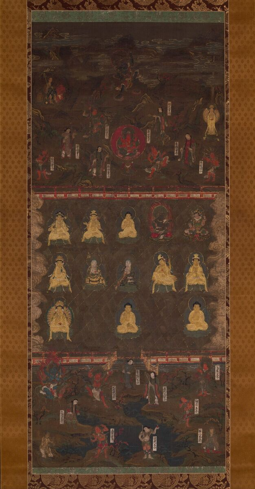
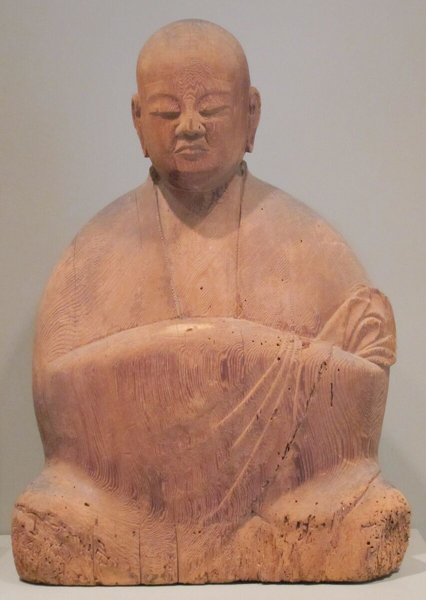
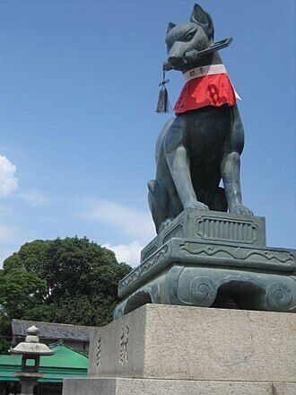

# 4. Kami and Buddhas Together

For roughly a thousand years, from the eighth century to 1868, most Japanese did not have to choose between [kami](https://en.wikipedia.org/wiki/Kami) and buddhas. Temples stood inside shrine precincts and shrines inside temples, monks served the kami, and each major kami was understood as a local appearance of a particular buddha or bodhisattva. Scholars call this **combination of kami and buddhas** *[shinbutsu shūgō](https://en.wikipedia.org/wiki/Shinbutsu-sh%C5%ABg%C5%8D)* (神仏習合), and its most developed theory ***[honji suijaku](https://en.wikipedia.org/wiki/Honji_suijaku)*** (本地垂迹), "original ground, manifested trace". This chapter explains how the combination grew, how it worked in practice, and why modern accounts have tended to hide it.

<figure>

<figcaption><em>Kumano Shrine Mandala</em>, hanging scroll, between 1333 and 1336 (Metropolitan Museum of Art). Shrine mandalas pictured a shrine's landscape as sacred ground; Tyler (1989) describes the inscriptions on those of Kasuga. <span class="credit">Image: anonymous, Public domain, via <a href="https://commons.wikimedia.org/wiki/File:Anonymous_-_Kumano_Shrine_Mandala_-_2006.521_-_Metropolitan_Museum_of_Art.jpg">Wikimedia Commons</a>.</span></figcaption>
</figure>

## 4.1 Terms

Susan Tyler distinguishes the two terms (Tyler 1989):

- ***Shinbutsu shūgō*** is "used when speaking of the early rapprochement of [Shinto](https://en.wikipedia.org/wiki/Shinto) and Buddhism".
- ***Honji suijaku*** refers to "a theory according to which the kami were treated as incarnations of the Buddhist deities", and "can be used to refer to fully developed syncretism".

Miyaji Naokazu explains the image behind *honji suijaku*. The buddha is the **substance** (*honji*, "original ground") and the kami is the **form** (*suijaku*, "trace let down"). "In order to save people the Buddha appears in various forms at any time and any place. His appearance in Japan is no other than as the kami" (Miyaji 1966).

## 4.2 How the combination developed

Miyaji describes the process as following a pattern Buddhism had already used in India, China and Korea when it met local religions: first acknowledge the local gods and reinterpret them in Buddhist terms, then bring them inside the Buddhist sphere (Miyaji 1966). In China, for example, Daoist deities came to be worshipped "as the guardian deities of temples" (Miyaji 1966).

In Japan he sees two main stages (Miyaji 1966):

| Stage | Period (Miyaji's dating) | How kami were understood | What people did |
|---|---|---|---|
| **1. Kami as beings in need of salvation** | From the later 7th to the 8th century ([Nara period](https://en.wikipedia.org/wiki/Nara_period)) | Kami live in a world above humans but "had not yet attained the absolute state of the Buddha or enlightenment", and were "not free from endless transmigration". They must hear the Buddha's teaching to reach Buddhahood. | "Sutras were chanted and copied, Buddhist priests were initiated into shrines, and stupas were erected for the kami." Shrines were built within temple precincts to protect them. |
| **2. Kami as manifestations of buddhas** | Fully developed "by the middle of the 10th century" | "The Buddha is the substance (*honji*) and kami the form (*suijaku*)." "A respective avatar was decided for each kami." | Each kami is worshipped as the local form of a named buddha or bodhisattva. |

The title **[Hachiman](https://en.wikipedia.org/wiki/Hachiman) Daibosatsu**, "Great Bodhisattva Hachiman", arose in the first stage, from the idea that a kami could take Buddhist vows (Miyaji 1966). In the second stage, Miyaji gives these pairings: the original ground of Hachiman is the buddha **[Amida](https://en.wikipedia.org/wiki/Amit%C4%81bha)**, and the kami of the Inner Shrine of **[Ise](https://en.wikipedia.org/wiki/Ise_Shrine)** is an incarnation of **[Dainichi Nyorai](https://en.wikipedia.org/wiki/Vairocana)**, the cosmic buddha (Miyaji 1966).

Miyaji's dating of Buddhism's arrival is 552, the traditional date. The editors of his article add that "present-day scholarship favors the date 538" (Miyaji 1966).

<figure>

<figcaption><em>Sōgyō Hachiman</em>: the kami Hachiman in the form of a Buddhist monk, wood, Heian period (Honolulu Museum of Art). The title “Great Bodhisattva Hachiman” arose from the idea that kami could take Buddhist vows (Miyaji 1966). <span class="credit">Image: Hiart, <a href="https://creativecommons.org/publicdomain/zero/1.0/">CC0</a>, via <a href="https://commons.wikimedia.org/wiki/File:Sogyo_Hachiman%2C_Heian_period%2C_9th_century%2C_HAA.jpg">Wikimedia Commons</a>.</span></figcaption>
</figure>

## 4.3 Paradise in a landscape: the Kasuga shrine

Tyler's research on the **[Kasuga](https://en.wikipedia.org/wiki/Kasuga-taisha)** cult in Nara shows how *honji suijaku* worked for worshippers, not only for theologians. Kasuga was the clan shrine of the Fujiwara, the leading court family (Tyler 1989).

- **Shrines as Pure Lands.** With the late-Heian interest in Buddhist paradises, "a number of Shinto shrines were rebuilt to suggest [Pure Land](https://en.wikipedia.org/wiki/Pure_Land_Buddhism) temples": [Iwashimizu Hachiman](https://en.wikipedia.org/wiki/Iwashimizu_Hachimang%C5%AB), [Itsukushima](https://en.wikipedia.org/wiki/Itsukushima_Shrine) and Kasuga among them (Tyler 1989).
- **The kami from Roshana.** A text inscribed on many Kasuga mandalas tells how the deity "moved into a *sakaki* and rode forth from Kashima upon a stag", and that "His original substance, Roshana, perfectly enlightened for all eternity, in order to save sentient beings, manifests the Daimyōjin". Tyler comments: "The Shrine landscape is the Cosmic Buddha's display" (Tyler 1989).
- **A buddha for each sanctuary.** More commonly, each of Kasuga's sanctuaries was paired with Buddhist counterparts (Tyler 1989):

| Kasuga sanctuary (kami) | Buddhist original ground (*honji*) |
|---|---|
| First: Takemikazuchi | Fukūkenjaku [Kannon](https://en.wikipedia.org/wiki/Guanyin), or Shaka |
| Second: Futsunushi | [Yakushi](https://en.wikipedia.org/wiki/Bhaisajyaguru), or [Miroku](https://en.wikipedia.org/wiki/Maitreya) |
| Third: Ame-no-koyane | [Jizō](https://en.wikipedia.org/wiki/K%E1%B9%A3itigarbha) |
| Fourth: Himegami | Jūichimen (Eleven-headed) Kannon, or Dainichi |

The "or" in each row matters. The pairings were not fixed by one authority, and they varied between sources and periods.

Tyler adds that **[Shugendō](https://en.wikipedia.org/wiki/Shugend%C5%8D)**, the mountain asceticism of the *[yamabushi](https://en.wikipedia.org/wiki/Yamabushi)*, shared the same understanding of landscape as sacred, and that both "reached full development in the twelfth century" (Tyler 1989).

## 4.4 The shrine-temple complex

The typical institution was not a shrine *or* a temple but a joined complex. Kuroda Toshio, as summarised by Teeuwen and Scheid, regarded "temple-shrine complexes, where kami and buddhas were worshiped side by side" as "paradigmatic for the religion of that time". In his view, kami worship was "a well-integrated constituent" of exoteric–esoteric (*kenmitsu*) Buddhism, not a separate religion uneasily mixed with it (Teeuwen and Scheid 2002).

### Gion in Kyoto

The complex now called Yasaka Shrine was then **[Gion](https://en.wikipedia.org/wiki/Yasaka_Shrine)**, a shrine-temple. Neil McMullin opens his study with an incident from the autumn of **974**: the administrator of Gion, a monk named Rōzan of [Kōfuku-ji](https://en.wikipedia.org/wiki/K%C5%8Dfuku-ji) (the head temple of the [Hossō](https://en.wikipedia.org/wiki/East_Asian_Yog%C4%81c%C4%81ra) school), had a branch cut from a maple belonging to Renge-ji, a branch temple of the [Tendai](https://en.wikipedia.org/wiki/Tendai) headquarters [Enryaku-ji](https://en.wikipedia.org/wiki/Enryaku-ji). The Renge-ji monks took offence (McMullin 1987). The quarrel shows Gion as a Buddhist institution, caught between two great monasteries. It enshrined **[Gozu Tennō](https://en.wikipedia.org/wiki/Gozu_Tenn%C5%8D)**, "a deity of epidemics", in Kuroda's words, and its great festival began as a ceremony to pacify the dangerous dead (Kuroda 1996a). Chapter 7 returns to it.

### Secret initiations into the kami

Fabio Rambelli describes rituals "closely related to esoteric Buddhist initiations, in which imperial and kami symbols often replace Buddhist ones", called ***jingi kanjō*** (initiations into kami matters). They were the means by which knowledge about the kami was handed down within Buddhism, "a form of applied *honji suijaku*". Rambelli stresses two points. "It was within the context of esoteric kami initiations that the first Shinto lineages took concrete shape." And these rituals "reached their largest diffusion in the early nineteenth century", which "forces us to reconsider the established image of Edo-period Shinto as a religion moving away from Buddhism" (Rambelli 2002).

### "Land of the kami"

The medieval idea that Japan is a "land of the kami" (*shinkoku*) is often read as early nationalism. Kuroda argues that medieval Shinto doctrines, including this one, "arose in Japan as part of the exoteric-esoteric system" and were "heavily influenced by the Buddhist teaching of original enlightenment (*hongaku shisō*)". In that sense it was "a construct of Buddhism" (Kuroda 1996b).

## 4.5 Living with both: Inari

The fox deity **[Inari](https://en.wikipedia.org/wiki/Inari_%C5%8Ckami)** shows how far combination reached into ordinary worship (Smyers 1996):

- All lists of Japan's "top three Inari" include **[Fushimi Inari Taisha](https://en.wikipedia.org/wiki/Fushimi_Inari-taisha)**, the shrine at the foot of Inari Mountain south of Kyoto. Most also include **[Toyokawa Inari](https://en.wikipedia.org/wiki/Toyokawa_Inari)**, which is in fact a [Sōtō Zen](https://en.wikipedia.org/wiki/S%C5%8Dt%C5%8D) temple, Myōgon-ji (Aichi Prefecture).
- The third varies by region. Kyushu people tend to name Yūtoku Inari in Saga. Some lists include Saijō Inari, which is the [Nichiren](https://en.wikipedia.org/wiki/Nichiren_Buddhism) temple Myōkyō-ji.
- At Fushimi, "the identity of the kami has varied enormously over time", and the traditions of its Buddhist original grounds (*honji-butsu*) "also varied over time".

<figure>

<figcaption>A stone fox holding a key in its mouth at the gate of Fushimi Inari Taisha. Hearn noted that Inari's foxes hold keys because Inari gives wealth (Hearn 1894). <span class="credit">Image: Geoffrey.landis, Public domain, via <a href="https://commons.wikimedia.org/wiki/File:Inari-kitsune_fox_in_front_of_an_Inari_shrine_with_a_key_in_its_mouth.jpg">Wikimedia Commons</a>.</span></figcaption>
</figure>

## 4.6 Why modern accounts hide the combination

Tyler argues that the habit of studying Shinto separately from Buddhism "is due not to a study of history, but to an overemphasis on doctrine to define religion and to the motives for the strict separation of Shinto and Buddhism, both in fact and in scholarship, from early Meiji until the end of the Second World War". She points out that "institutional mingling was pervasive enough to occasion widespread destruction when the religions were declared separate", and that "personal devotion was a complicated and effective partaking of both Shinto and Buddhism" (Tyler 1989). Chapter 5 describes that separation.

Miyaji, writing from inside the Shinto tradition, still judges the combination as mixed: "Shinto gave shelter to Buddhism only to have the entire house occupied by the latter", yet it also "gained to no small extent" from Buddhism's teachings (Miyaji 1966).

## 4.7 Check yourself

```quiz
title: Chapter 4 self-check
? In honji suijaku, what is the "original ground" (honji)?
- The buddha or bodhisattva, of which the kami is the local manifestation *
- The kami's shrine building
- The emperor's ancestor
> The buddha is the substance, the kami the form (Miyaji 1966).

? In Miyaji's first stage, how were kami understood?
- As beings above humans but still bound by karma, who needed the Buddha's teaching *
- As identical to buddhas
- As demons to be destroyed
> Hence sutras chanted for kami and stupas erected for them.

? Which buddha is named as the original ground of the Inner Shrine of Ise?
- Dainichi Nyorai *
- Amida
- Jizō
> Miyaji 1966. Hachiman's original ground is Amida.

? What does the Kasuga example show about the pairings of kami and buddhas?
- They varied: several sanctuaries had two possible Buddhist counterparts *
- They were fixed by imperial decree in 712
- Only the emperor could know them
> Tyler 1989.

? What is Toyokawa Inari?
- A Sōtō Zen temple counted among the top Inari sites *
- A Shinto shrine on Inari Mountain
- A fox statue in Kyoto
> Smyers 1996.

? According to Tyler, why do many books treat Shinto as separate from Buddhism?
- Because of the doctrinal focus and the Meiji-to-1945 policy of separating them *
- Because the two never met
- Because Buddhism arrived only in the 19th century
> Tyler 1989.
```

## Sources for this chapter

1. **Tyler 1989.** Tyler S. *Honji suijaku* faith. *Japanese Journal of Religious Studies* 1989;16(2–3):227–250. [Nanzan](https://nirc.nanzan-u.ac.jp/journal/6/article/756/pdf/download).
2. **Miyaji 1966.** See [Chapter 1](01-kami.md).
3. **Teeuwen and Scheid 2002.** See [Chapter 1](01-kami.md).
4. **McMullin 1987.** McMullin N. The Enryaku-ji and the Gion shrine-temple complex in the mid-Heian period. *Japanese Journal of Religious Studies* 1987;14(2–3):161–184. [Nanzan](https://nirc.nanzan-u.ac.jp/journal/6/article/706/pdf/download).
5. **Kuroda 1996a.** See [Chapter 1](01-kami.md).
6. **Rambelli 2002.** Rambelli F. The ritual world of Buddhist "Shinto": the *Reikiki* and initiations on kami-related matters (*jingi kanjō*) in late medieval and early-modern Japan. *Japanese Journal of Religious Studies* 2002;29(3–4):265–297. [Nanzan](https://nirc.nanzan-u.ac.jp/journal/6/article/1094/pdf/download).
7. **Kuroda 1996b.** Kuroda Toshio, tr. Fabio Rambelli. The discourse on the "land of kami" (*shinkoku*) in medieval Japan: national consciousness and international awareness. *Japanese Journal of Religious Studies* 1996;23(3–4):353–385. [Nanzan](https://nirc.nanzan-u.ac.jp/journal/6/article/937/pdf/download).
8. **Smyers 1996.** Smyers KA. "My own Inari": personalization of the deity in Inari worship. *Japanese Journal of Religious Studies* 1996;23(1–2):85–116. [Nanzan](https://nirc.nanzan-u.ac.jp/journal/6/article/918/pdf/download).

➡️ Next: [Chapter 5: The separation of 1868](05-separation.md)
