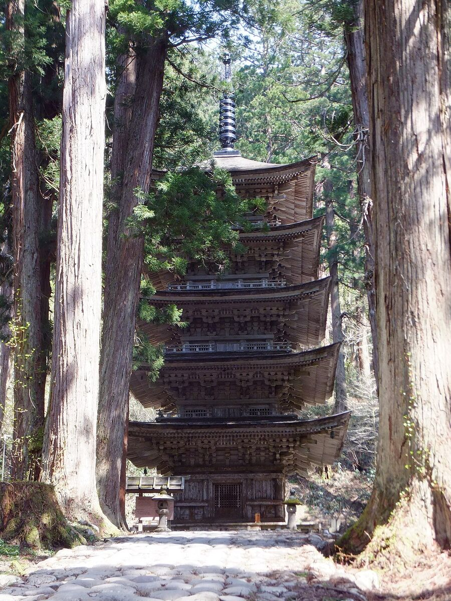
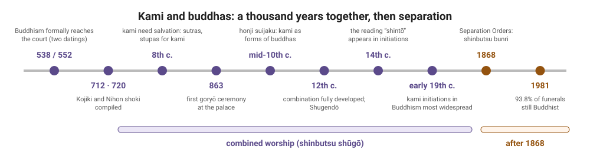

# 5. The Separation of 1868

In the spring of 1868, a few months after the restoration of imperial rule, the new Meiji government began to issue orders that undid a thousand years of combined worship. Buddhist statues were removed from shrines, monks who served [kami](https://en.wikipedia.org/wiki/Kami) had to become [Shinto](https://en.wikipedia.org/wiki/Shinto) priests or leave, and the word *[gongen](https://en.wikipedia.org/wiki/Gongen)* ("provisional manifestation", the title of kami understood as buddhas) was erased. This chapter follows that **separation of kami and buddhas** (*[shinbutsu bunri](https://en.wikipedia.org/wiki/Shinbutsu_bunri)*) at two sacred mountains, and asks what it changed.

<figure>

<figcaption>The five-storied pagoda on Mt. Haguro, built in the fourteenth century. A Buddhist pagoda that still stands on the shrine mountain after 1868 (Chapter 5). <span class="credit">Image: 掬茶, <a href="https://creativecommons.org/licenses/by-sa/4.0/">CC BY-SA 4.0</a>, via <a href="https://commons.wikimedia.org/wiki/File:Five-storied_pagoda%2C_Mt.Haguro.jpg">Wikimedia Commons</a>.</span></figcaption>
</figure>

## 5.1 What the orders were

- **Klaus Antoni:** *shinbutsu bunri* means "the separation of Shinto and Buddhism (actually the expulsion of Buddhism from syncretic Shinto-Buddhist sanctuaries) that occurred from the spring of 1868". He calls it "one of the central events in the formation of modern Japanese Shinto" (Antoni 1995).
- **Gaynor Sekimori:** in 1868 the government "enacted a series of laws, often called the 'Separation Orders,' which was to raise 'Shinto' to the status of a state cult to embody the ideals of the new order". She adds that "this Shinto did not reflect even the practices of local communities, let alone the contemporary religious matrix of kami-buddha combination", so it "was necessary to 'clarify' what was and was not Shinto". Legislation in 1868 and 1869 changed "the matrix of the kami-buddha combination (*[shinbutsu shūgō](https://en.wikipedia.org/wiki/Shinbutsu-sh%C5%ABg%C5%8D)*) that had been the hallmark of Japanese religion" (Sekimori 2005).

Sekimori stresses what the edicts did *not* do. They "did not attack freedom of belief as such", but "sought to impose a 'correct' interpretation of the objects of belief through the control of ritual space". Ritualists could accept the changes and keep the space, or refuse and lose it (Sekimori 2005).

## 5.2 What changed on the ground

Sekimori lists the effects on ordinary people (Sekimori 2005):

- Communities "had to deal with the disposal of Buddhist statues from shrine precincts".
- They were "prevailed upon to follow Shinto rather than Buddhist funerary customs".
- Pilgrims to sacred mountains "no longer recognized the divinities to whom they were being asked to give their prayers", and were scolded for asking for the traditional rituals.

The vocabulary of combination was literally covered over. At a Kumano shrine near Sarugakyō in Gunma Prefecture, the word *gongen* (権現) on a wooden nameboard "has been covered with a small piece of wood with 'Ōkami'", "great kami", written on it (Sekimori 2005).

<figure class="diagram">

<figcaption>Kami and buddhas: dates from the sources cited in Chapters 1–5. <span class="credit">Diagram drawn for this handbook from the sources cited in the chapter.</span></figcaption>
</figure>

## 5.3 Hagurosan: a mountain of yamabushi

**[Hagurosan](https://en.wikipedia.org/wiki/Mount_Haguro)**, one of the Three Mountains of Dewa in northern Japan, was a great centre of **[Shugendō](https://en.wikipedia.org/wiki/Shugend%C5%8D)**, the mountain asceticism of the *[yamabushi](https://en.wikipedia.org/wiki/Yamabushi)*. It first appears in the national record in the chronicle *Azuma kagami* in 1209, though its religious identity "can be dated to the [Heian period](https://en.wikipedia.org/wiki/Heian_period)" (Sekimori 2005). Shugendō "was predicated on kami-buddha combination", so its shrine-temple complexes "in particular were targeted for reform" (Sekimori 2005).

What happened there, in Sekimori's account (Sekimori 2005):

1. **Petition.** Hagurosan petitioned the central government to have its Buddhist identity recognised. When this was refused, it sent a number of its statues for safekeeping to the nearby Takadera.
2. **Conversion.** The main temple, Jakkōji, was turned *de facto* into Ideha Shrine under a local intermediary, Nishikawa Sugao.
3. **Choice.** Around **twenty per cent** of the *shugenja* (Shugendō practitioners) of the village of Tōge chose to affiliate with the new shrine: "those in a social and economic position to be able to benefit from their decision". "The majority of shugenja simply gave up their calling, since the new order had nothing to offer them."
4. **Survival.** Descendants of those who joined the shrine still run pilgrims' lodgings and are affiliated with what is now **[Dewa Sanzan](https://en.wikipedia.org/wiki/Three_Mountains_of_Dewa) Jinja**. They "openly recite the Heart Sutra as well as the post-Meiji shrine liturgy when conducting pilgrims", and many are reputed to keep Buddhist images hidden.

A memorandum by a Haguro monk of about 1871 records the bewilderment: "Have the kami deserted us?… What will happen now? We can only pray that everything will return to what it was before" (Sekimori 2005).

Sekimori compares the Separation Orders to the English Reformation. In both, change that "was not demanded or welcomed locally" nevertheless took place. Most local reactions were neither heroic resistance nor enthusiasm, and "a reluctance to act often stemmed from what was probably laziness rather than any more exalted motivation" (Sekimori 2005).

## 5.4 Ōmiwa: an ancient shrine and its temples

Antoni studies the same events at **[Ōmiwa Shrine](https://en.wikipedia.org/wiki/%C5%8Cmiwa_Shrine)**, at the foot of [Mt. Miwa](https://en.wikipedia.org/wiki/Mount_Miwa) in the Nara Basin. The mountain is the body of its kami, [Ōmononushi](https://en.wikipedia.org/wiki/%C5%8Cmononushi), a manifestation of the great god of Izumo, [Ōkuninushi](https://en.wikipedia.org/wiki/%C5%8Ckuninushi) (Antoni 1995). The shrine calls itself *moto-Ise*, "original [Ise](https://en.wikipedia.org/wiki/Ise_Shrine)", because the *Nihongi* places early worship of [Amaterasu](https://en.wikipedia.org/wiki/Amaterasu) at nearby Kasanui. These ties to the imperial house gave it national standing, which "increased in times of strengthened imperial rule and waned in times of imperial decline" (Antoni 1995). Antoni uses the shrine to show what happened to religious institutions throughout Japan in the years from 1868 to the early 1870s (Antoni 1995).

## 5.5 Destruction: Amidaji

The separation was not always a matter of renaming. Naoko Gunji describes the accompanying turmoil of ***[haibutsu kishaku](https://en.wikipedia.org/wiki/Haibutsu_kishaku)*** (the movement to abolish Buddhism) as including "the removal of Buddhist images, scriptures, implements, and buildings from religious complexes". "Among the temples completely destroyed during this turmoil was **Amidaji**, the imperial mortuary temple for [Emperor Antoku](https://en.wikipedia.org/wiki/Emperor_Antoku)" (r. 1180–1185), the child emperor drowned with the Heike clan (Chapter 7). Unusually, it "was immediately replaced by the Shinto shrine Akamagū, which is now called [Akama Jingū](https://en.wikipedia.org/wiki/Akama_Shrine)" (Gunji 2011). Gunji shows how the government then redefined "the notion of pollution and sanctity involved in imperial mausolea", and how political goals shaped the new shrine and its rituals, "which have survived to this day" (Gunji 2011).

> **What the sources here do not cover.** National figures for the temples closed or statues destroyed during *haibutsu kishaku* are not given in the sources used for this chapter, so none are given here.

## 5.6 The theory behind it

Why did the new government care? Kuroda Toshio's argument, summarised by Teeuwen and Scheid, is that Shinto "achieved for the first time the status of an independent religion, distorted though it was", only through these "repressive Restoration politics". Cut off from Buddhism, Shinto was also cut off from "high-level religious philosophy", and so "declined to the state of a religion that disavowed being a religion" (Kuroda 1981, quoted in Teeuwen and Scheid 2002). That last phrase points to the [State Shinto](https://en.wikipedia.org/wiki/State_Shinto) of the following decades, in which shrine rites were treated as national ceremony rather than religion.

Susan Tyler draws the scholarly consequence. The strict separation "both in fact and in scholarship, from early Meiji until the end of the Second World War" is why many books still treat Shinto as if it had always stood apart from Buddhism (Tyler 1989).

## 5.7 After the separation: the dead stayed Buddhist

The separation reorganised shrines, but it did not move the dead. Surveys a century later still found Buddhism in charge of death:

- In a 1981 survey by the Japan Housewives Association, **93.8 per cent** of respondents had held Buddhist funerals (423 of 451) and **3.9 per cent** Shinto ones (Fujii 1983).
- Fujii Masao explains that this "big difference clearly brings out one of the key features of Buddhism in Japan", its long history of acculturation (Fujii 1983).

Part II of this handbook follows the dead into that Buddhist world, where kami and buddhas still meet.

## 5.8 Check yourself

```quiz
title: Chapter 5 self-check
? What did shinbutsu bunri mean in practice, according to Antoni?
- The expulsion of Buddhism from combined Shinto-Buddhist sanctuaries, from spring 1868 *
- The banning of Shinto
- The merging of all temples into shrines in 712
> Antoni 1995.

? According to Sekimori, what did the Separation Orders control?
- Ritual space: who could use it and for what *
- Private belief, which was forbidden
- The price of amulets
> They imposed a "correct" interpretation through control of ritual space.

? What happened to the word gongen on a Kumano shrine nameboard in Gunma?
- It was covered with a piece of wood reading Ōkami *
- It was gilded
- It was moved to a temple
> Sekimori 2005.

? What did most shugenja at Tōge do after the separation?
- Gave up their calling *
- Joined the new shrine
- Emigrated to Brazil
> About 20 per cent affiliated with Ideha Shrine.

? What do some guides at Dewa Sanzan Jinja still recite with pilgrims?
- The Heart Sutra, alongside the shrine liturgy *
- Only the Great Purification
- Nothing; recitation is banned
> Sekimori 2005.

? What happened to Amidaji, the mortuary temple of Emperor Antoku?
- It was destroyed and replaced by the Shinto shrine Akamagū, now Akama Jingū *
- It became a Zen temple
- It was moved to Kyoto
> Gunji 2011.

? In the 1981 survey cited by Fujii, what share of funerals were Buddhist?
- 93.8 per cent *
- About half
- 3.9 per cent
> Shinto funerals were 3.9 per cent (Fujii 1983).
```

## Sources for this chapter

1. **Antoni 1995.** See [Chapter 1](01-kami.md).
2. **Sekimori 2005.** Sekimori G. Paper fowl and wooden fish: the separation of kami and buddha worship in Haguro Shugendō, 1869–1875. *Japanese Journal of Religious Studies* 2005;32(2):197–234. [Nanzan](https://nirc.nanzan-u.ac.jp/journal/6/article/1176/pdf/download).
3. **Teeuwen and Scheid 2002.** See [Chapter 1](01-kami.md).
4. **Tyler 1989.** See [Chapter 4](04-kami-buddhas.md).
5. **Gunji 2011.** See [Chapter 7](07-vengeful.md).
6. **Fujii 1983.** Fujii Masao. Maintenance and change in Japanese traditional funerals and death-related behavior. *Japanese Journal of Religious Studies* 1983;10(1):39–64. [Nanzan](https://nirc.nanzan-u.ac.jp/journal/6/article/624/pdf/download).

➡️ Next: [Chapter 6: Ancestors, Bon and the afterlife](06-ancestors.md)
