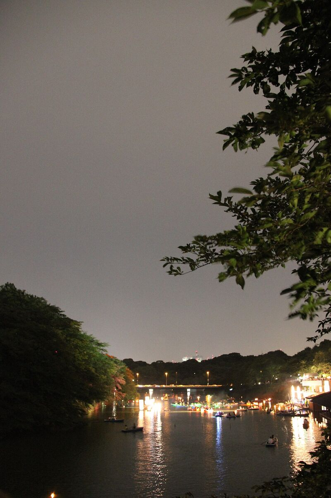
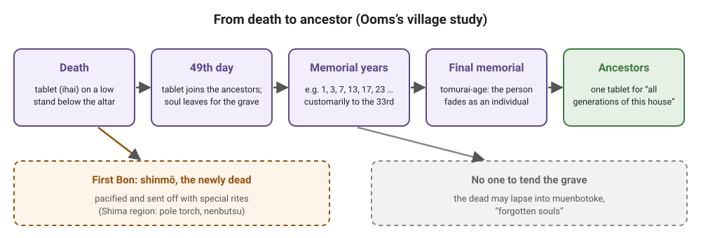
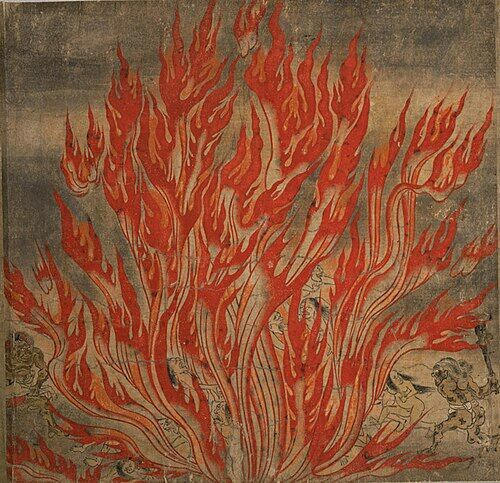

# 6. Ancestors, Bon and the Afterlife

Before there are ghosts, there are the dead who are cared for. Most Japanese dead are not feared at all. They become **ancestors**, are fed and spoken to at the household altar, come home in summer, and are slowly forgotten as individuals. Ghosts and vengeful spirits, the subject of the next three chapters, are the dead for whom this process fails. This chapter describes the normal path first, then the Buddhist map of where the dead can go.

<figure>

<figcaption>Floating lanterns (<em>tōrō nagashi</em>) on the water at night, photographed in 2012. <span class="credit">Image: Laika ac from USA, <a href="https://creativecommons.org/licenses/by-sa/2.0/">CC BY-SA 2.0</a>, via <a href="https://commons.wikimedia.org/wiki/File:Laika_ac_Toro_Nagashi_%287573839186%29.jpg">Wikimedia Commons</a>.</span></figcaption>
</figure>

## 6.1 Remembering the dead

Herman Ooms opens his 1960s study of ancestor worship in a village called Nagasawa with a contrast. Following the scholar of religion Gerardus van der Leeuw, he writes that "in the West … we are inclined to erase the dead man altogether from our roll: he no longer counts". Cultures such as China and Japan, by contrast, "have built stronger defenses against the erosive work of time and cherish the memory of the dead through the ages", and "the dead souls of these cultures are the object of individual ritual commemoration for many years" (Ooms 1967).

## 6.2 From new dead to ancestor

Ooms followed what actually happened in Nagasawa's households (Ooms 1967):

1. **The first 49 days.** The tablet bearing the dead person's name (*[ihai](https://en.wikipedia.org/wiki/Spirit_tablet)*) is placed, often with a photograph, on a low stand under the family altar.
2. **The 49th day.** "The new *ihai* joins those of the ancestors on the family shelf while the soul leaves the house for the grave". From then on, the dead person is "treated indiscriminately together with the other ancestors except on some special occasions".
3. **Memorial years.** Households differed. Some observed services in the 1st, 3rd, 7th, 13th, 17th and 23rd years, some skipped or combined them, and some insisted on continuing "until the customary 33rd year". In one family the last service was in the 13th year, while elsewhere a 100th anniversary is observed.
4. **The final memorial (*tomurai-age*).** It "seems to symbolize the fact that the deceased, as an individual person, faded from the memory of the living and joined the anonymous world of ancestors". Ideally a single tablet for "all generations of the ancestors of this house" then replaces the individual one. Ooms links this to the theory of the folklorist **[Yanagita Kunio](https://en.wikipedia.org/wiki/Kunio_Yanagita)**: "the individual soul is then taken up into the anonymous world of the ancestors".

<figure class="diagram">

<figcaption>From death to ancestor (Ooms 1967; Kawakami 1988). <span class="credit">Diagram drawn for this handbook from the sources cited in the chapter.</span></figcaption>
</figure>

### The forgotten dead

Not everyone reaches the ancestors. Ooms names the **muenbotoke**, "forgotten souls", dead with no one to tend them. A family who moved far from its family temple, so that "no proper visits can be paid to the grave of the ancestors", risked letting its ancestors "lapse into the unhappy state of *muenbotoke*". He also reports a custom of offering only water, for which villagers gave no explanation. One possible reason, from the research of H. Miura and T. Ōshima, is that "water is an offering limited to wandering or unsettled spirits or *muenbotoke*" (Ooms 1967).

## 6.3 Bon: when the dead come home

In Ooms's village calendar, the summer festival of the dead, **[Bon](https://en.wikipedia.org/wiki/Obon)** (*o-bon*), ran as follows (Ooms 1967):

| Date (August) | Event |
|---|---|
| 5 | ***[Segaki](https://en.wikipedia.org/wiki/Segaki)***, a gathering of parishioners at the village temple |
| Before the 13th | A temporary altar is built in each house |
| 13 | **Welcome fire** |
| 14–15 | A Buddhist priest recites a sutra in each house; offerings are made |
| 16 | **Sending-off fire** |

The temporary altar, the ***shōrōdana*** ("shelf for the souls"), is "low and bright", unlike the "high and dark" everyday family altar. Children "can playfully clap their hands in prayer, ring the chime and make offerings to the *hotoke* (dead)". On the 14th and 15th, offerings are made morning, noon and night: "rice, water, two pieces of hemp and three sticks of incense". The priest's visit is "a short rite lasting no more than 3 or 4 minutes to which very few people pay attention" (Ooms 1967).

### The newly dead: *shinmō* and the first Bon

The dead of the past year are treated apart. In the Shima region of Mie Prefecture, they are called ***shinmō*** (新亡), "the spirits of people who died in the preceding year" (Kawakami 1988).

- **First Bon.** Their "first Bon observances" (*hatsubon gyōji*) are held at three levels: the house of the recently deceased, the temple, and the local community. What marks the Shima region is that "emphasis is still laid upon the rites sponsored by the community" (Yahata 1988).
- **Sending them off.** In the five Kamo villages of Toba City, on the evening of 15 August "the young people make music, chant the *nenbutsu* and at the end of the festival put fire to the *hashiramatsu*", a tall pole torch. These rites, *dainenbutsu* and *hashiramatsu*, are "conducted for sending off the spirits" (Kawakami 1988).
- **Pacifying them.** Kawakami adds that in the Bon season "folk performing arts for pacifying and sending off the spirits of the dead all over Japan can be witnessed" (Kawakami 1988).

The word *pacifying* matters. Even the ordinary dead, in their first year, are handled with care. Chapter 7 shows what happens when the dead cannot be pacified.

## 6.4 The Buddhist map: six realms and their judges

Buddhism gave the dead a geography. [Lafcadio Hearn](https://en.wikipedia.org/wiki/Lafcadio_Hearn), writing in 1902 about popular Buddhist belief, lists the lower realms of rebirth in order: "Above the Jigokudō [the hells] is the Gakidō, or World of Hungry Spirits; above the Gakidō is the Chikushōdō, or World of Animals; and above this, again, is the Shuradō, a region of perpetual fighting and slaughter" (Hearn 1902). Together with the realms above them, these make up the **[six realms](https://en.wikipedia.org/wiki/Six_Paths)** of rebirth (*rokudō*) (Wakabayashi 2009).

Who decides where a soul goes? Haruko Wakabayashi describes the **[Ten Kings of Hell](https://en.wikipedia.org/wiki/Diyu)**, "who preside at the entrance of the afterworld assigning souls to one or another of the six realms of existence" (Wakabayashi 2009). The best-known is **[Enma](https://en.wikipedia.org/wiki/Yama_%28Buddhism%29)**, at whose court the dead are judged.

### A courtier in hell

Medieval Japan gave one of these judges a human face. **[Ono no Takamura](https://en.wikipedia.org/wiki/Ono_no_Takamura)** (802–852) was a scholar, poet and courtier of the early [Heian period](https://en.wikipedia.org/wiki/Heian_period), but "he appears in Heian- and Kamakura-period *setsuwa* [tales] as an official of Enma's court", famed "for having traveled freely between this world and the afterworld" (Wakabayashi 2009). The illustrated scrolls of Chikurinji, a [Shingon](https://en.wikipedia.org/wiki/Shingon_Buddhism) temple in Hiroshima Prefecture dated to the [Muromachi period](https://en.wikipedia.org/wiki/Muromachi_period), go further (Wakabayashi 2009):

- They make Takamura **Sōtei-ō, the third of the Ten Kings**.
- His father-in-law, Ono no Yoshisuke, dies suddenly and is taken to Enma's court, where he sees the dead condemned. He tours the Eight Great Hells, the Eight Cold Hells and the Four Additional Hells, and is saved from being pushed into a great hell by the third king, who turns out to be Takamura.
- The scroll says that the hole where Takamura disappeared "is called the Crossroads of the Six Realms (*rokudō no tsuji*), and is believed to be right above the palace of Enma. People of Kyoto gather here and celebrate the *urabon* every year during the seventh month". *Urabon* is the Bon festival of the dead.

<figure>

<figcaption><em>Jigoku zōshi</em> (Hell Scroll), twelfth century, Tokyo National Museum. Hell is the lowest of the six realms (Chapter 6). <span class="credit">Image: Unknown author, Public domain, via <a href="https://commons.wikimedia.org/wiki/File:Jigoku-Zoshi.jpg">Wikimedia Commons</a>.</span></figcaption>
</figure>

## 6.5 Where kami and buddhas meet the dead

Herman Ooms notes that Japanese scholars of the subject have tended to explain ancestor worship in two ways: by reducing "[Shinto](https://en.wikipedia.org/wiki/Shinto) elements to ancestor worship", and by relating it to the extended family (*dōzoku*) (Ooms 1967). David Doerner, building on Yanagita Kunio's research, studied "life after death as it is found in folk Shinto" through the concept of the ancestor (Doerner 1977). These studies take up an idea that runs through Yanagita's work: after the last memorial, the ancestor merges into a collective that is close to a [kami](https://en.wikipedia.org/wiki/Kami). As Ooms reports it, that is a theory. What can be observed is the gradual move of the dead from individual tablets to a shared one.

## 6.6 Check yourself

```quiz
title: Chapter 6 self-check
? What happens on the 49th day after a death, in Ooms's village?
- The new tablet joins the ancestors on the family altar and the soul leaves for the grave *
- The body is cremated
- The dead person becomes a kami
> Ooms 1967.

? What does the final memorial (tomurai-age) symbolise?
- The dead person fading as an individual and joining the anonymous ancestors *
- The family leaving the village
- The start of Bon
> Ooms links it to Yanagita Kunio's theory.

? What are muenbotoke?
- Forgotten souls with no one to tend them *
- Ancestors of the imperial family
- Statues of Jizō
> A family that moved away risked letting its ancestors become muenbotoke.

? What are shinmō?
- The spirits of people who died in the past year *
- The welcome fires of Bon
- Kami of the mountains
> Kawakami 1988; their first Bon is hatsubon.

? Who assigns souls to the six realms?
- The Ten Kings of Hell, including Enma *
- The ancestors
- The local kami
> Wakabayashi 2009.

? Which courtier was said to serve in Enma's court?
- Ono no Takamura *
- Sugawara no Michizane
- Taira no Masakado
> He is the third king, Sōtei-ō, in the Chikurinji scrolls.
```

## Sources for this chapter

1. **Ooms 1967.** Ooms H. The religion of the household: a case study of ancestor worship in Japan. *Contemporary Religions in Japan* 1967;8(3–4):201–333. [Nanzan](https://nirc.nanzan-u.ac.jp/journal/15/article/1991/pdf/download).
2. **Kawakami 1988.** Kawakami Mitsuyo. The view of spirits as seen in the Bon observances of the Shima region. *Japanese Journal of Religious Studies* 1988;15(2–3):121–130. [Nanzan](https://nirc.nanzan-u.ac.jp/journal/6/article/729/pdf/download).
3. **Yahata 1988.** Yahata Takatsune. *Shinmō* (spirits of the recently deceased) and community: Bon observances in a Japanese village. *Japanese Journal of Religious Studies* 1988;15(2–3):131–136. [Nanzan](https://nirc.nanzan-u.ac.jp/journal/6/article/730/pdf/download).
4. **Hearn 1902.** Hearn L. *Kottō: Being Japanese Curios, with Sundry Cobwebs*. New York: Macmillan, 1902. Chapter "Gaki". [Project Gutenberg #55473](https://www.gutenberg.org/ebooks/55473).
5. **Wakabayashi 2009.** Wakabayashi H. Officials of the afterworld: Ono no Takamura and the Ten Kings of Hell in the *Chikurinji engi* illustrated scrolls. *Japanese Journal of Religious Studies* 2009;36(2):319–349. [Nanzan](https://nirc.nanzan-u.ac.jp/journal/6/article/1282/pdf/download).
6. **Doerner 1977.** Doerner DL. Comparative analysis of life after death in folk Shinto and Christianity. *Japanese Journal of Religious Studies* 1977;4(2):151–182. [Nanzan](https://nirc.nanzan-u.ac.jp/journal/6/article/516/pdf/download).

➡️ Next: [Chapter 7: Vengeful spirits](07-vengeful.md)
