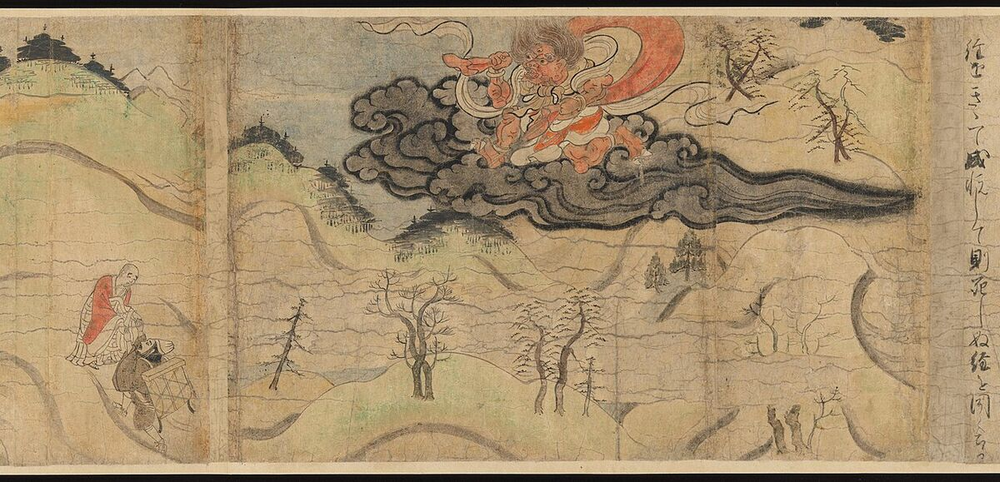
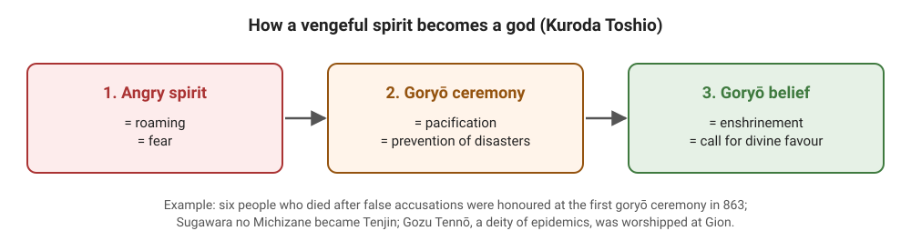
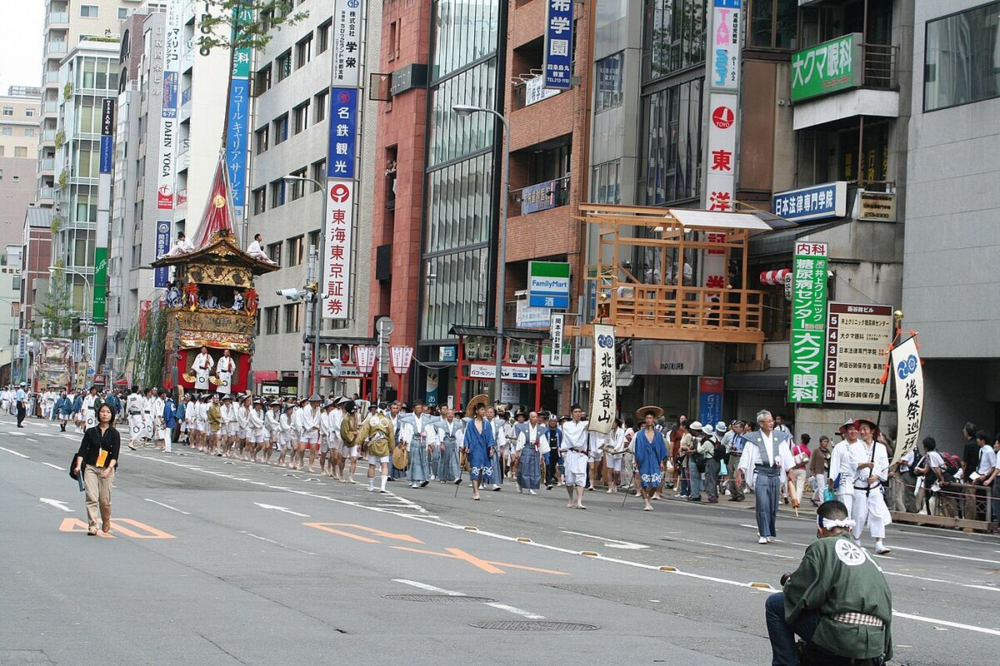
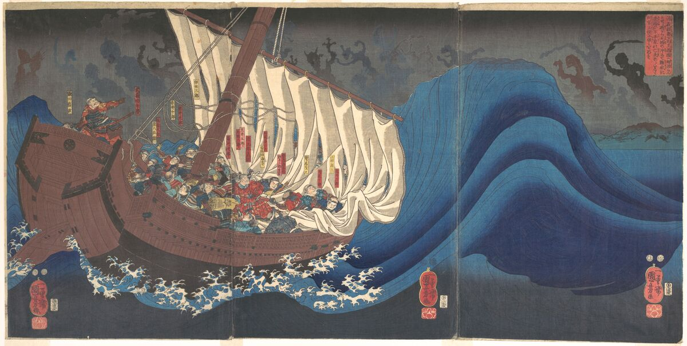

# 7. Vengeful Spirits

Some of the dead do not settle. People who died wronged (falsely accused, exiled, defeated) were believed to strike back at the living with disease, fire and lightning. Japanese has two words for them. ***[Onryō](https://en.wikipedia.org/wiki/Onry%C5%8D)*** (怨霊), "resentful spirit", names the danger. ***[Goryō](https://en.wikipedia.org/wiki/Gory%C5%8D)*** (御霊), "august spirit", names the same spirits once they are honoured and pacified. This chapter traces how the court learned to turn the first into the second, and why some of Japan's most popular gods began as angry ghosts.

<figure>

<figcaption><em>Illustrated Legends of the Kitano Tenjin Shrine</em> (<em>Kitano Tenjin engi emaki</em>), late thirteenth century, Metropolitan Museum of Art. The scrolls tell the legend of Sugawara no Michizane, worshipped as Tenjin. <span class="credit">Image: Unknown artist, <a href="https://creativecommons.org/publicdomain/zero/1.0/">CC0</a>, via <a href="https://commons.wikimedia.org/wiki/File:%E5%8C%97%E9%87%8E%E5%A4%A9%E7%A5%9E%E7%B8%81%E8%B5%B7%E7%B5%B5%E5%B7%BB-Illustrated_Legends_of_the_Kitano_Tenjin_Shrine_%28Kitano_Tenjin_engi_emaki%29_MET_DP244653.jpg">Wikimedia Commons</a>.</span></figcaption>
</figure>

## 7.1 The first *goryō* ceremony, 863

The word *goryō* first appears in the official history *Nihon sandai jitsuroku*, in an entry for the 20th day of the 5th month of **863** (Jōgan 5). On that day the court held the first ***goryō-e***, a *goryō* ceremony, in the Shinsen'en garden within the palace compounds. The reason was an epidemic that had swept the country that spring, killing many peasants (Kuroda 1996a). Chapter 3 described the purification rites and sutra readings the court had already tried. The *goryō-e* was something new.

Kuroda Toshio lists its distinctive features, following the *Sandai jitsuroku* (Kuroda 1996a):

1. **Six named spirits.** Six sanctuaries were set up, with flowers and fruit offered on tables and mats. They were dedicated to **Emperor Sudō, Imperial Prince Iyo, Fujiwara no Yoshiko, Fujiwara no Nakanari, Tachibana no Hayanari and Fun'ya no Miyatamaro**, "all of whom had lost their lives after being falsely accused of political intrigues".
2. **Buddhist lectures.** A monk lectured on two scriptures believed to prevent disasters and protect the imperial line "through the remission of sins".
3. **Dance and music.** Court musicians, the children of warriors close to the imperial household and the children of nobles danced, and there were performances of *gigaku* and *sangaku*.
4. **Open gates.** "The four gates of the Shinsen'en were opened to commoners, and the ceremony was celebrated in front of a massive audience."

The chronicle explains why these six were chosen: "Due to political machinations, these innocent spirits were transformed into vengeful ones (*enkon*) that cause disease… In recent times epidemics have been raging and people have died in large numbers; the population believes these disasters to be caused by these *goryō*" (Kuroda 1996a). It also says that such celebrations followed "folkways" that had spread "in recent times" from around the capital to the provinces. Kuroda reads this as the start of "a new interaction between the religious consciousness of the commoners and that of the ruling establishment" (Kuroda 1996a).

## 7.2 How a vengeful spirit is made

Kuroda draws a general rule from these cases: "mere death is not enough to create a *goryō*; rather, the particular circumstances of the death give rise to emotions in the spirit that determine its fundamental attributes" (Kuroda 1996a). The ingredients, as the sources describe them:

- **An unjust death.** False accusation, exile, defeat in a political struggle.
- **Strong emotion carried into death.** Resentment, the "vengeful feelings of those on the losing side".
- **Calamity afterwards.** Epidemic, disaster or sudden deaths among the living, which people attribute to the dead.
- **Public talk.** Kuroda notes that "the vengeful feelings of those on the losing side of political struggles were the subject of rumor among the ordinary people". The government therefore "had to be constantly apprehensive of the 'dangerous link' between the common people and the *goryō*" (Kuroda 1996a).

Yoshino Tomomi gives a definition from the popular imagination of the twelfth century: "vengeful spirits are those spirits that do not stay in their own separate world and whose powers have bearings on the world of the living" (Yoshino 2022).

## 7.3 From threat to protector

The striking thing about *goryō* is that they became gods worth praying to. Kuroda explains the mechanism with the old idea, met in Chapter 1, that a [kami](https://en.wikipedia.org/wiki/Kami) has different aspects, violent and peaceful, which "do not refer to different beings". A *goryō* is "a deification of a function". Once the spirit's power over disease was recognised, that power could be worshipped (Kuroda 1996a).

He summarises the development in three steps (Kuroda 1996a):

<figure class="diagram">

<figcaption>Kuroda Toshio's three steps of <em>goryō</em> belief (Kuroda 1996a). <span class="credit">Diagram drawn for this handbook from the sources cited in the chapter.</span></figcaption>
</figure>

1. **Angry spirit** = roaming = fear
2. **Goryō ceremony** = pacification = prevention of disasters
3. **Goryō belief system** = enshrinement = call for divine favour

"The *goryō*, which at first were appeased in rites to prevent further disasters, gradually came to be worshiped as benefactors because of their control over the functions of which they were manifestations" (Kuroda 1996a). Yet "as long as these deities were worshiped by common people", the "violent and unpredictable sentiments" did not vanish from their nature (Kuroda 1996a).

### Why dance and laughter?

Music, dance and comic performances were part of the *goryō* rites from the start. Kuroda connects them with [Ame-no-Uzume](https://en.wikipedia.org/wiki/Ame-no-Uzume)'s dance before the [Heavenly Cave](https://en.wikipedia.org/wiki/Amano-Iwato) and with the dances of the court's rites of spirit recall: "they were probably intended for thaumaturgic purposes in that they, together with the laughter they provoked in the audience, were believed to appease the dead". The same character runs through the *furyū* and *dengaku* songs and dances performed at the *goryō* ceremonies of [Gion](https://en.wikipedia.org/wiki/Yasaka_Shrine) and Kitano (Kuroda 1996a).

## 7.4 Gion: the god of epidemics

Of all the forms *goryō* worship took, Kuroda singles out two as "particularly famous": the *goryō* ceremonies of **Gion** and **Kitano** (Kuroda 1996a). The Gion ceremony was dedicated to **[Gozu Tennō](https://en.wikipedia.org/wiki/Gozu_Tenn%C5%8D)**, "a deity of epidemics", who "in Japan is an almost imaginary figure" (Kuroda 1996a). Gion was then a Buddhist shrine-temple complex in Kyoto (McMullin 1987; Chapter 4). The modern Gion festival of Kyoto has been studied as a living tradition in its own right (Teeuwen 2021).

<figure>

<figcaption>A float in the procession of Kyoto's Gion festival, 17 July 2009. Gion was the site of one of the two most famous <em>goryō</em> ceremonies (Kuroda 1996a). <span class="credit">Image: Corpse Reviver, <a href="https://creativecommons.org/licenses/by/3.0/">CC BY 3.0</a>, via <a href="https://commons.wikimedia.org/wiki/File:Kyoto_Gion_Matsuri_J09_076.jpg">Wikimedia Commons</a>.</span></figcaption>
</figure>

## 7.5 Kitano: Sugawara no Michizane

The Kitano ceremony was dedicated to **[Sugawara no Michizane](https://en.wikipedia.org/wiki/Sugawara_no_Michizane)** (845–903), "a vengeful spirit" (Kuroda 1996a). Michizane was a scholar and minister who died in disgrace. As a deity he is **[Tenjin](https://en.wikipedia.org/wiki/Tenjin_%28kami%29)**, worshipped at Kitano in Kyoto and at Tenmangū shrines across Japan. Kuroda gives his divine title as **Tenman Jizaiten** (Kuroda 1996a).

The thirteenth-century illustrated scrolls of the Kitano shrine, the ***[Kitano Tenjin engi](https://en.wikipedia.org/wiki/Kitano_Tenmang%C5%AB)***, tell his legend. Haruko Wakabayashi notes that in these scrolls the monk Nichizō is taken on a tour of the [six realms](https://en.wikipedia.org/wiki/Six_Paths) "by an [oni](https://en.wikipedia.org/wiki/Oni) (who presumably is the spirit of Sugawara no Michizane, turned into a thunder god after his death)" (Wakabayashi 2009). The Metropolitan Museum of Art holds sections of a version of about 1300, with scenes titled "Courtiers Visit Sugawara no Michizane's Mortuary Temple" and "Possession of the Shamaness Tajihi no Ayako by the Spirit of Sugawara no Michizane" (Metropolitan Museum of Art).

### Michizane and a rebellion

A vengeful spirit could also be enlisted in politics. In the 12th month of 939, **[Taira no Masakado](https://en.wikipedia.org/wiki/Taira_no_Masakado)**, leader of "the first major warrior rebellion against the central government", proclaimed himself "New Emperor" at the provincial office of Kōzuke. According to the war tale *Shōmonki*, probably written in the eleventh century, a prostitute possessed by a kami announced that the decree of enthronement given to Masakado by the Great Bodhisattva **[Hachiman](https://en.wikipedia.org/wiki/Hachiman)** had been received from "the spirit of the Minister of the Left, Second Rank, Sugawara". Kuroda notes that this cannot be verified, but that the author of the *Shōmonki* clearly imagined that Michizane's *goryō* had helped instigate a rebellion with Hachiman's agreement (Kuroda 1996a).

## 7.6 Retired Emperor Sutoku

The most feared vengeful spirit of the twelfth century was an emperor. **Retired Emperor [Sutoku](https://en.wikipedia.org/wiki/Emperor_Sutoku)** (1119–1164), a lover of *waka* poetry, was defeated in the **[Hōgen Rebellion](https://en.wikipedia.org/wiki/H%C5%8Dgen_rebellion) of 1156**, exiled to Sanuki and died there. When an imperial poetry anthology was being planned, "Sutoku was widely believed to be a vengeful spirit (*onryō*) who was wreaking havoc and causing many calamities" (Yoshino 2022).

Yoshino Tomomi shows how poetry itself became a means of pacification (Yoshino 2022):

- The anthology ***[Senzai wakashū](https://en.wikipedia.org/wiki/Senzai_Wakash%C5%AB)*** was "the first of the imperial anthologies to include spirit pacification among its major themes".
- It was commissioned by **Retired Emperor [Go-Shirakawa](https://en.wikipedia.org/wiki/Emperor_Go-Shirakawa)** (1127–1192), Sutoku's brother, "the very person who was responsible for banishing Sutoku to Sanuki and effectively causing his death".
- He gave the task to **[Fujiwara no Shunzei](https://en.wikipedia.org/wiki/Fujiwara_no_Shunzei)** (1114–1204), "for whom Sutoku was a great patron".
- Scholars cited by Yoshino read the anthology as a means "to soothe the vengeful spirit" of Sutoku, "as an offering for Sutoku" and "as part of a political measure against the Taira clan".

## 7.7 The drowned Heike

The Taira (Heike) clan, Go-Shirakawa's later enemies, became the most famous ghosts of all. In 1904 [Lafcadio Hearn](https://en.wikipedia.org/wiki/Lafcadio_Hearn) retold their legend in "The Story of Mimi-nashi-Hōichi" (Hearn 1904):

> More than seven hundred years ago, at [Dan-no-ura](https://en.wikipedia.org/wiki/Battle_of_Dan-no-ura), in the Straits of Shimonoséki, was fought the last battle of the long contest between the Heiké, or Taira clan, and the Genji, or Minamoto clan. There the Heiké perished utterly, with their women and children, and their infant emperor likewise—now remembered as Antoku Tennō. And that sea and shore have been haunted for seven hundred years.

Hearn lists the hauntings he was told of:

- **[Heike crabs](https://en.wikipedia.org/wiki/Heikegani)**, "which have human faces on their backs, and are said to be the spirits of the Heiké warriors".
- **Ghost lights**: "on dark nights thousands of ghostly fires hover about the beach, or flit above the waves", called *oni-bi*, "demon-fires".
- **A noise of battle**: "whenever the winds are up, a sound of great shouting comes from that sea".
- **Danger at sea**: the Heike "would rise about ships passing in the night, and try to sink them", and "watch for swimmers, to pull them down".

The remedy was the familiar one: "It was in order to appease those dead that the Buddhist temple, Amidaji, was built at Akamagaséki", with monuments inscribed with the names of the drowned emperor and his vassals and regular Buddhist services. After that "the Heiké gave less trouble than before", but they "had not found the perfect peace" (Hearn 1904). The story then tells how the blind biwa player Hōichi, famed for reciting the war of the Heike and Genji, was summoned at night to perform for the ghosts themselves.

<figure>

<figcaption>Utagawa Kuniyoshi, <em>Ghosts of the Taira at Daimotsu Bay</em>, woodblock triptych, 1843–47, Metropolitan Museum of Art. <span class="credit">Image: The Metropolitan Museum of Art, <a href="https://creativecommons.org/publicdomain/zero/1.0/">CC0</a>, via <a href="https://www.metmuseum.org/art/collection/search/55743">The Met Open Access</a>.</span></figcaption>
</figure>

Amidaji was the imperial mortuary temple of **[Emperor Antoku](https://en.wikipedia.org/wiki/Emperor_Antoku)** (r. 1180–1185). In the early [Meiji period](https://en.wikipedia.org/wiki/Meiji_era) it was "completely destroyed" in the anti-Buddhist turmoil and immediately replaced by a [Shinto](https://en.wikipedia.org/wiki/Shinto) shrine, Akamagū, now called **[Akama Jingū](https://en.wikipedia.org/wiki/Akama_Shrine)** (Gunji 2011). The temple built to pacify the Heike thus became a case of the separation described in Chapter 5.

## 7.8 The modern echo: Yasukuni

Kuroda wrote his essay with a contemporary question in mind. The ceremonies at **[Yasukuni Shrine](https://en.wikipedia.org/wiki/Yasukuni_Shrine)**, which honours Japan's war dead, are often classed with the *goryō* cults. Kuroda explains why: like them, Yasukuni is "dedicated to the spirits of people (*hito*), rather than to the kami worshiped in the rites associated with the imperial house or Shrine Shinto" (Kuroda 1996a). He uses the history of spirit pacification to show that the political use of the dead has a long past, and he warns against treating it as a timeless "Japanese religious consciousness" (Kuroda 1996a).

## 7.9 Check yourself

```quiz
title: Chapter 7 self-check
? Why did the court hold the first goryō ceremony in 863?
- An epidemic was blamed on the spirits of six people who died after false accusations *
- To celebrate a victory
- To mark the founding of a temple
> Nihon sandai jitsuroku, as discussed in Kuroda 1996a.

? According to Kuroda, is death alone enough to create a goryō?
- No: the circumstances of the death and the emotions they cause decide it *
- Yes: every dead person becomes a goryō
- Only emperors can become goryō
> Kuroda 1996a.

? What is the third step in Kuroda's scheme?
- Enshrinement and calling for divine favour *
- Fear of the roaming spirit
- Burning the spirit's tablet
> Angry spirit → pacification → enshrinement.

? Which deity was honoured at the Gion goryō ceremony?
- Gozu Tennō, a deity of epidemics *
- Sugawara no Michizane
- Amaterasu
> The Kitano ceremony honoured Michizane.

? Why was the Senzai wakashū anthology significant?
- It was the first imperial anthology to include spirit pacification, aimed at Sutoku's vengeful spirit *
- It was the first written record of yōkai
- It banned the worship of Tenjin
> Yoshino 2022.

? In Hearn's retelling, what was built to appease the drowned Heike?
- The Buddhist temple Amidaji at Akamagaseki *
- Ise Jingū
- Kitano shrine
> With monuments and regular services.
```

## Sources for this chapter

1. **Kuroda 1996a.** See [Chapter 1](01-kami.md). Source for the quotations from the *Nihon sandai jitsuroku* and the *Shōmonki*.
2. **Yoshino 2022.** Yoshino Tomomi. Spirit pacification in imperial waka anthologies: the *Senzai wakashū* and *Shinkokin wakashū*. *Japanese Journal of Religious Studies* 2022;49(2):199–214. doi:[10.18874/jjrs.49.2.2022.199-214](https://doi.org/10.18874/jjrs.49.2.2022.199-214).
3. **McMullin 1987.** See [Chapter 4](04-kami-buddhas.md).
4. **Teeuwen 2021.** Teeuwen M. Faith as authenticity: Kyoto's Gion festival in 2020. *Japanese Journal of Religious Studies* 2021;48(1):125–163. [Nanzan](https://nirc.nanzan-u.ac.jp/journal/6/article/1541/pdf/download). Cited for its subject only.
5. **Wakabayashi 2009.** See [Chapter 6](06-ancestors.md).
6. **Metropolitan Museum of Art.** *Illustrated Legends of the Kitano Tenjin Shrine (Kitano Tenjin engi emaki)*, late 13th century, object 45428; scenes 53188 and 670955, ca. 1300. [metmuseum.org](https://www.metmuseum.org/art/collection/search/45428), accessed 18 November 2026. Cited for object titles and dates.
7. **Hearn 1904.** Hearn L. *Kwaidan: Stories and Studies of Strange Things*. Boston and New York: Houghton Mifflin, 1904. "The Story of Mimi-nashi-Hōichi". [Project Gutenberg #1210](https://www.gutenberg.org/ebooks/1210).
8. **Gunji 2011.** Gunji N. Redesigning the death rite and redesignating the tomb: the separation of kami and Buddhist deities at the mortuary site for Emperor Antoku. *Japanese Journal of Religious Studies* 2011;38(1):55–92. [Nanzan](https://nirc.nanzan-u.ac.jp/journal/6/article/1322/pdf/download).

➡️ Next: [Chapter 8: How the yūrei took shape](08-yurei.md)
