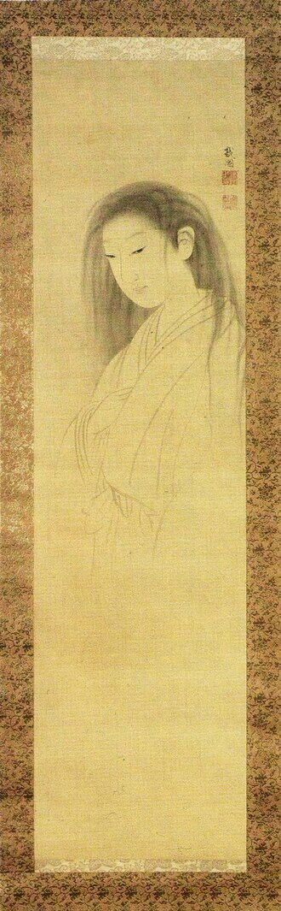
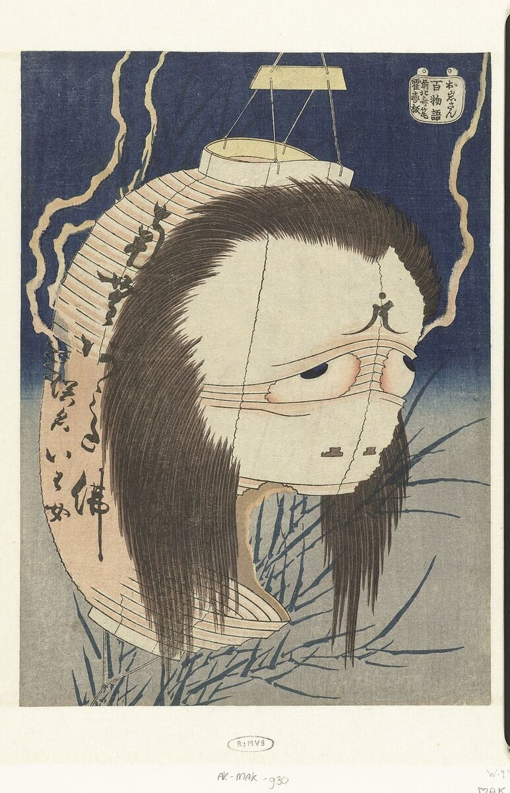
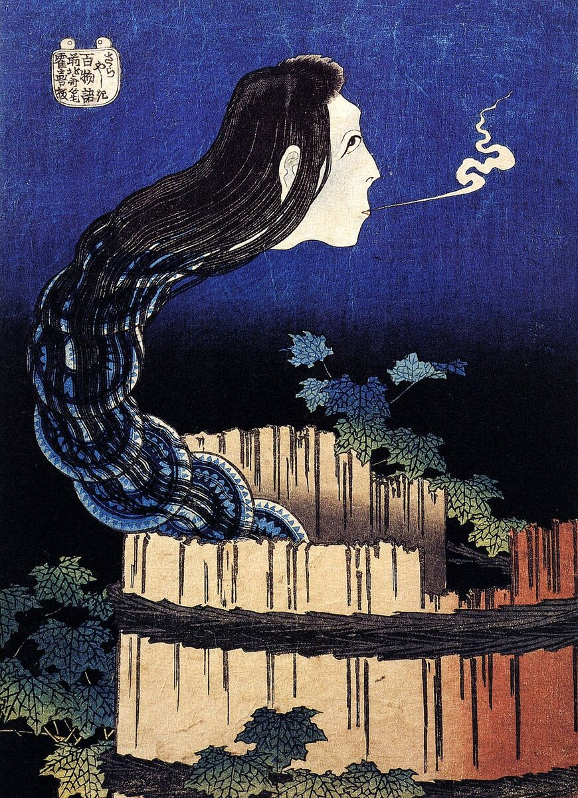
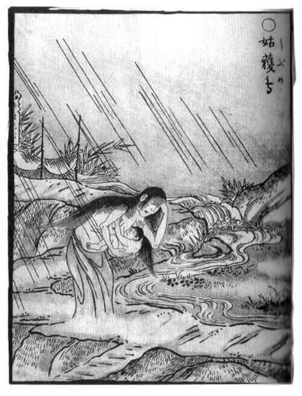

# 8. How the Yūrei Took Shape

Ask anyone in Japan to draw a ghost and you will get the same figure: a woman in a white burial robe, long black hair loose over her face, hands hanging limply from the wrists, and no feet. This chapter shows, following the folklorist Tsutsumi Kunihiko, that this figure is not ancient. It was assembled in the **[Edo period](https://en.wikipedia.org/wiki/Edo_period)** (1603–1868) by publishers, playwrights, painters and preachers, and it then flowed back into the "true" ghost stories that villagers told one another.

<figure>

<figcaption>Maruyama Ōkyo, <em>The Ghost of Oyuki</em>, hanging scroll, eighteenth century. A pale woman in white with loose hair whose figure fades away below: the image Tsutsumi traces to the Edo period. <span class="credit">Image: Maruyama Ōkyo, Public domain, via <a href="https://commons.wikimedia.org/wiki/File:Oyuki.jpg">Wikimedia Commons</a>.</span></figcaption>
</figure>

## 8.1 What a *yūrei* is

Tsutsumi uses two definitions together (Tsutsumi 2015):

- **Suwa Haruo:** a *[yūrei](https://en.wikipedia.org/wiki/Y%C5%ABrei)* is "something that lives in the other world, the world of the dead, a human being who after death appears in human form".
- **Komatsu Kazuhiko:** a *yūrei* is "a special type of dead spirit" that drags along "its personal history from life".

A *yūrei* is therefore a particular dead person, recognisable, still caught up in the events and attachments of their life. That distinguishes it from the *[goryō](https://en.wikipedia.org/wiki/Gory%C5%8D)* of Chapter 7, which are honoured as functions and gods, and from the [yōkai](https://en.wikipedia.org/wiki/Y%C5%8Dkai) of Part III, which are not usually the dead at all.

## 8.2 The ghost was once not frightening

Tsutsumi traces the word and the image (Tsutsumi 2015):

- **The word is old.** 幽霊 already appears in the Heian-period courtier's diary *Chūyūki*, in an entry for **1089**. There it means only "the soul of a dead person", not a resentful spirit that returns to this world.
- **[Noh](https://en.wikipedia.org/wiki/Noh) ghosts were sad, not terrifying.** Medieval noh plays are full of dead people who reappear as *yūrei*, but they are not harmful. Following Tashiro Keiichirō, Tsutsumi notes that the ghosts in [Zeami](https://en.wikipedia.org/wiki/Zeami_Motokiyo)'s "dream" noh, such as the warrior in *Yorimasa*, are "not the kind of dead spirit that frightens the audience". Only about seventy years after Zeami, in plays of Kanze Kojirō Nobumitsu such as ***[Funa Benkei](https://en.wikipedia.org/wiki/Funa_Benkei)***, does a "cursing ghost" appear.
- **The fixed form came late.** The standard figure, in burial clothes, appearing under a tree in the graveyard and uttering grudges, "had to wait for the age of Edo commoner culture".

## 8.3 The Edo factory of ghosts

Three things came together in the seventeenth century (Tsutsumi 2015).

### Print

In Kyoto, Osaka and Edo, "the flourishing of publishing culture" produced a stream of illustrated books of strange tales as popular entertainment.

### Theatre

At the same time, urban theatres staged plays built around the frenzy of female spirits, and made the summer *[onryō](https://en.wikipedia.org/wiki/Onry%C5%8D)* play a seasonal custom of city life. Tsutsumi notes the view of the theatre historian Hattori Yukio that the **footless ghost** "is not unrelated to the staging of female spirits appearing out of smoke and fire". Together, books and stage tipped the "gender balance" of ghosts towards **women** from the seventeenth century on.

### Preaching

The third ingredient was Buddhism. Behind the shogunate's religious policy, funerary Buddhism spread to commoners from the medieval to the early modern period, and preaching monks carried the ideas of "the other world", "lost souls" and "resentful spirits" into everyday life. Tsutsumi argues that the history of these preachers "who walked about loudly preaching the pacification of the dead" lies behind the popular conviction that "unsaved ghosts", produced by a dead person's attachment, really appear.

<figure>

<figcaption>Katsushika Hokusai, <em>O-Iwa</em>, the lantern ghost, from the series <em>Hyaku monogatari</em> (One Hundred Ghost Stories), about 1830 (Rijksmuseum). <span class="credit">Image: Rijksmuseum, <a href="https://creativecommons.org/publicdomain/zero/1.0/">CC0</a>, via <a href="https://commons.wikimedia.org/wiki/File:O-Iwa_het_lantaarn_spook_O-iwa-san_%28titel_op_object%29_Honderd_verhalen_%28serietitel%29_Hyaku_monogatari_%28serietitel_op_object%29%2C_AK-MAK-930.jpg">Wikimedia Commons</a>.</span></figcaption>
</figure>

Tsutsumi's conclusion: "chronologically speaking, most of today's image of the ghost is a relatively new cultural phenomenon whose home is the fictional world created by Edo *[kaidan](https://en.wikipedia.org/wiki/Kaidan)*" (Tsutsumi 2015). The Edo influence went beyond the ghost's appearance to the shape of the story. The pattern in which a ghost appears because of deep attachment, or to take revenge on whoever killed it, "took root among the people … entirely as a result of the wide circulation of Edo *kaidan*" (Tsutsumi 2015).

## 8.4 The image, as villagers described it

Tsutsumi quotes twentieth-century local folklore records that sound like ancient belief. From the folklore volume of the history of Nagano Prefecture (Tsutsumi 2015):

- A ghost appears "when the dead cannot rest", "in white burial dress with a triangular paper on the forehead", "under the willow in the graveyard".
- "Those who bore a grudge in life, or souls that have lost their way, become ghosts. They take the form of women, hold both hands limply hanging in front of them, and have no feet."

Every element of these "folk" descriptions matches the Edo fiction and stage figure.

<figure>

<figcaption>Katsushika Hokusai, <em>Sarayashiki</em>, from the series <em>Hyaku monogatari</em>, about 1831: a woman's ghost rising from a well. <span class="credit">Image: Hokusai, Public domain, via <a href="https://commons.wikimedia.org/wiki/File:Hokusai_Sarayashiki.jpg">Wikimedia Commons</a>.</span></figcaption>
</figure>

## 8.5 How fiction became folklore: three case studies

Tsutsumi used the **[Nichibunken](https://en.wikipedia.org/wiki/International_Research_Center_for_Japanese_Studies) database of strange phenomena and yōkai** (怪異・妖怪伝承データベース), which records folk tales collected over about a century, to show that tales told as true often descend from Edo fiction or from temple sermons (Tsutsumi 2015).

### The lacquered wife (Iwate, 1933)

A couple promised that if one died the other would never remarry, and that the dead partner would not be buried but lacquered and kept in a hall. The wife died, and the husband took a new wife. While he was away travelling, the first wife's ghost bit the new wife's throat and killed her. When he came home, the lacquered corpse's mouth was covered in blood (Tsutsumi 2015, database no. 0640476).

Tsutsumi notes that [Lafcadio Hearn](https://en.wikipedia.org/wiki/Lafcadio_Hearn) told a story of the same type ("Of a Promise Broken", 1901). The motif of the lacquered dead woman, however, goes back to the 1677 collection of strange tales ***Shokoku hyaku monogatari*** (vol. 2, no. 9), where a dying young wife begs to have her body coated in lacquer and placed in the family's Buddhist hall. The motif was adapted again in 1705. "The roots of a ghost story that entered the oral tradition of Morioka two hundred years later may lie, unexpectedly, in a nearby Edo *kaidan* text" (Tsutsumi 2015).

### The murdered woman on his back (Nagano, 1890s)

At a mountain inn in the 1890s, a lost gentleman in Western clothes asked for lodging. The innkeeper's son was so frightened that the man was sent away, and he later turned out to have murdered a young woman. The boy had seen "a young woman, covered in blood, with her hair in disarray" behind him (Tsutsumi 2015, database no. 0030430). A 1934 book of Shinshū legends retells it in vivid novelistic detail, and similar plots appear in literary works by Okamoto Kidō (1925, 1936). Tsutsumi concludes that "oral tradition and literature are two sides of one coin" (Tsutsumi 2015).

### The child-rearing ghost

The most widespread type is the ***kosodate yūrei***, the **child-rearing ghost**. In its typical form, a woman who died in pregnancy comes night after night to buy sweets, and when the grave is opened a baby is found, born in the coffin. Versions are scattered "from Tōhoku to Kyūshū" (Tsutsumi 2015):

- Tsutsumi links them to "temple monks deeply involved in the funerals of women who died in childbirth", who carried with them tales of birth in the grave. In [Sōtō Zen](https://en.wikipedia.org/wiki/S%C5%8Dt%C5%8D) temples of the medieval and early modern periods there are records of rites for "birth in the coffin".
- The story often adds that the child became a famous monk, most famously the Sōtō master **Tsūgen Jakurei** (1322–1391).
- The type is found in the Edo-period collection of karmic tales ***Inga monogatari***, edited by [Asai Ryōi](https://en.wikipedia.org/wiki/Asai_Ry%C5%8Di).
- It was still being told in the twentieth century. A 1961 account from Fukushima tells it of a real young man, born in 1924, who was then a student at Hokkaido University. The temple that vouched for the story belonged to the same Sōtō lineage (Tsutsumi 2015, database no. 0030204).

<figure>

<figcaption>Toriyama Sekien, <em>Ubume</em> (姑獲鳥), a woman holding a baby, from the illustrated catalogue <em>Gazu hyakki yagyō</em>. <span class="credit">Image: Toriyama Sekien, Public domain, via <a href="https://commons.wikimedia.org/wiki/File:SekienUbume.jpg">Wikimedia Commons</a>.</span></figcaption>
</figure>

## 8.6 What a ghost wants: attachment

Edo-period funeral manuals show how monks explained ghosts. The ***Jōdo muen indōshū*** (浄土無縁引導集) of **1713**, by the [Pure Land](https://en.wikipedia.org/wiki/Pure_Land_Buddhism) scholar-monk Shōyo Gonteki (松誉巌的), answers the question "Are there ghosts and transformations in the world?" by dividing them into **three kinds** (Tsutsumi 2015):

| Kind | What it is |
|---|---|
| ***Shinjitsu*** (真実, true) | The dead person's **last thought at death** takes form: attachment between husband and wife, or to property or the house, keeps the dead in this world |
| ***Henge*** (変化, transformation) | The work of **demons, or of foxes and [tanuki](https://en.wikipedia.org/wiki/Japanese_raccoon_dog)** taking a dead person's shape |
| ***Mōsō*** (妄想, delusion) | Nothing is really there; **the frightened mind** produces the vision |

The middle category had a folk counterpart. In a tale recorded on the Noto peninsula in 1929, the ghost of a man called Jirobei appeared in white robes every night after his death. To find out whether it was a human ghost or an animal's, the family scattered **ash**; badger (*[mujina](https://en.wikipedia.org/wiki/Mujina)*) tracks appeared, and the visits stopped (Tsutsumi 2015, database no. 2260067).

### Finding the attachment

If a ghost kept appearing, the monk's job was to find what held it. A manual of the Pure Land Nagoe lineage, copied in **1834** at Genkaku-ji in Koishikawa, Edo, instructs priests (Tsutsumi 2015):

1. First, reassure the frightened believer rationally that the dead do not appear.
2. If that fails, set up a talisman with sutra text at the gate, choose the hour of the dog (about 8 p.m.), recite the dead person's Buddhist name and "Namu [Amida](https://en.wikipedia.org/wiki/Amit%C4%81bha) Butsu".
3. If the ghost still comes, "the dead person must certainly have an attachment". Find out what it is. "Mostly treasure, tools, the house, the love of man and woman, or secret hidden things they are ashamed of."
4. Write each object of attachment on paper, wrap it around a small wooden stupa (about 15 cm) together with a text of repentance, and bury it at the grave.

A tale from Yamanashi (1989) shows the idea living on. A manservant died suddenly, but his indenture contract was not placed in the coffin. He appeared night after night with a mournful face until he said the unreturned contract bound him to the house. The contract was buried at his grave, and he never came again (Tsutsumi 2015, database no. 0450025).

### The sleeve as proof

Another type, the ***katasode yūrei*** (**one-sleeve ghost**), asks a travelling monk to tell her parents to hold memorial services, and tears off a sleeve as proof. Its roots go back to the *Hokke genki* and to the noh play *Utō*, set in the mountain hells of Tateyama. Dainenbutsu-ji in Hirano, Osaka, kept the "sleeve of the dead" as a treasure, with an illustrated scroll of its origin dated **1724** (Tsutsumi 2015).

## 8.7 Ghosts of love: the peony lantern

Not every returning dead person is hostile. In 1899 Lafcadio Hearn summarised the "ghostly part" of the *[Botan-dōrō](https://en.wikipedia.org/wiki/Botan_D%C5%8Dr%C5%8D)* ("Peony Lantern"), a romance by the storyteller **[Enchō](https://en.wikipedia.org/wiki/San'y%C5%ABtei_Ench%C5%8D)**, "inspired by a Chinese tale" and then a hit of the Tokyo stage (Hearn 1899):

- O-Tsuyu, daughter of a *hatamoto* (a high-ranking direct retainer of the shogun) in Ushigome, Edo, falls in love with the young samurai Hagiwara Shinzaburō and whispers: "Remember! If you do not come to see me again, I shall certainly die!" He is prevented from visiting, and she pines away and dies.
- Later, at the Festival of the Dead, she comes to him at night with her maid, who carries "a beautiful lantern decorated with peony-flowers", and their love resumes.
- An advisor tells him: "the people who have been coming here, night after night, are dead!… The lips of the dead have touched you!" He adds that the dead woman "has no desire to injure you out of hate…: she is influenced, on the contrary, by the most passionate affection for you".
- The protection offered is Buddhist: a small image that is "especially a *shiryō-yoké*, which protects the living from the dead", a sutra to recite every night, and a package of *[o-fuda](https://en.wikipedia.org/wiki/Ofuda)* to paste "over every opening of your house".

Here the danger is love, not resentment: attachment again, as the monks' manuals taught.

## 8.8 Check yourself

```quiz
title: Chapter 8 self-check
? What did the word yūrei mean in the Chūyūki diary of 1089?
- Simply the soul of a dead person *
- A resentful spirit that returns to harm the living
- A fox in disguise
> The vengeful meaning came later (Tsutsumi 2015).

? According to Tsutsumi, when did the white-robed, legless female ghost become the standard image?
- In the Edo period, through print, theatre and preaching *
- In the Nara period
- After 1945
> Most of today's ghost image comes from Edo kaidan.

? What links the legless ghost to the theatre?
- The staging of female spirits rising out of smoke *
- Actors were forbidden to show their feet
- Ghosts were played by puppets
> Hattori Yukio, as cited by Tsutsumi.

? Who spread the tale type of the child-rearing ghost?
- Monks involved in the funerals of women who died in childbirth *
- Kabuki actors in Edo
- Foreign missionaries
> Sōtō Zen temples kept rites for birth in the coffin.

? In the 1713 funeral manual, what is a "true" (shinjitsu) ghost?
- The dead person's last thought at death, held by attachment *
- A fox or tanuki in disguise
- A vision produced by fear
> The other two kinds are transformation and delusion.

? How did one Yamanashi tale end its ghost's visits?
- By burying the servant's indenture contract at his grave *
- By scattering ash
- By building a shrine
> The object of attachment had to be found.
```

## Sources for this chapter

1. **Tsutsumi 2015.** Tsutsumi Kunihiko 堤邦彦. 「幽霊」の古層：江戸の庶民文化にはじまるもの (The ancient strata of the "yūrei": what began in Edo commoner culture). In: 怪異・妖怪文化の伝統と創造：ウチとソトの視点から (Proceedings of the 45th International Research Symposium, Nichibunken, 2014). International Research Center for Japanese Studies, 2015: 193–206. [Nichibunken repository](https://nichibun.repo.nii.ac.jp/records/2166). Source for the database tales, the Edo funeral manuals and the views of Suwa, Komatsu, Tashiro and Hattori.
2. **Hearn 1899.** Hearn L. *In Ghostly Japan*. Boston: Little, Brown, 1899. "A Passional Karma". [Project Gutenberg #8128](https://www.gutenberg.org/ebooks/8128).

➡️ Next: [Chapter 9: A field guide to ghosts](09-ghost-types.md)
