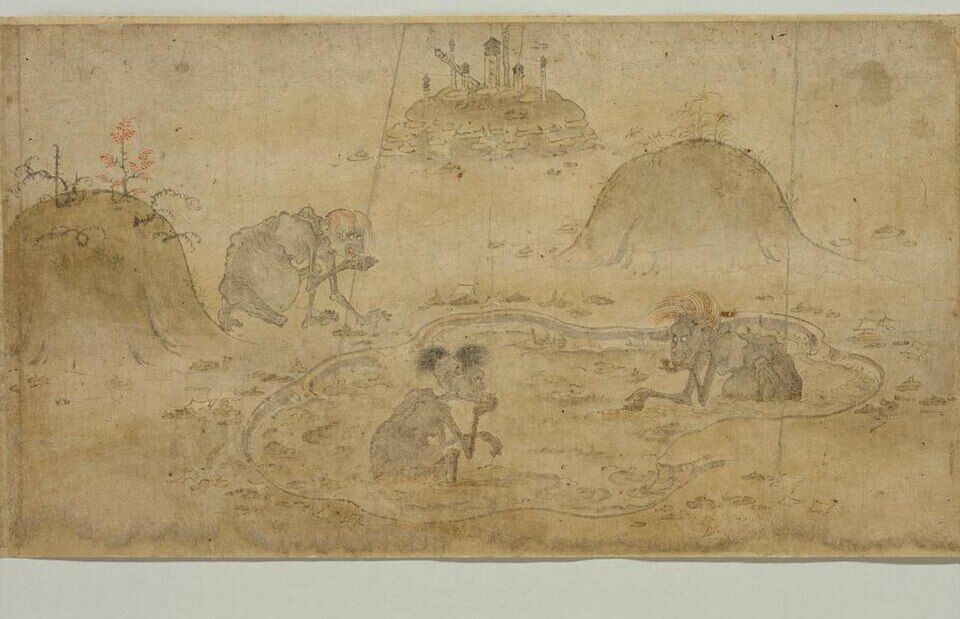

# 9. A Field Guide to Ghosts

Japanese has many words for the dead who do not rest, and they are not synonyms. Each names a different way of coming into being: a wronged death, an unfinished love, a neglected grave, greed, even the anger of someone still alive. This chapter gathers the types met so far, and some new ones, into a single guide. For each it gives the name, how it comes into existence according to the sources, and the folklore told about it.

## 9.1 The guide at a glance

| Type | Literally | How it comes into being | What it does | Remedy in the sources | Chapter |
|---|---|---|---|---|---|
| ***[Yūrei](https://en.wikipedia.org/wiki/Y%C5%ABrei)*** 幽霊 | "dim spirit" | A particular dead person held in this world by attachment at the moment of death | Appears in human form, usually to one person; in Edo form a woman in white, without feet | Find the attachment; memorial rites, sutras, burying the object at the grave | 8 |
| ***[Onryō](https://en.wikipedia.org/wiki/Onry%C5%8D)*** 怨霊 | "resentful spirit" | Death in injustice (false accusation, exile, defeat), with resentment | Sends epidemics and calamities on society | Pacification rites, then enshrinement | 7 |
| ***[Goryō](https://en.wikipedia.org/wiki/Gory%C5%8D)*** 御霊 | "august spirit" | An *onryō* once it is recognised and honoured | Becomes a protector of the function it once caused | Worship ([Gion](https://en.wikipedia.org/wiki/Yasaka_Shrine), Kitano) | 7 |
| ***[Ikiryō](https://en.wikipedia.org/wiki/Ikiry%C5%8D)*** 生霊 | "living spirit" | Detaches from a **living** person under anger | Haunts and torments the person who caused the anger; seen only by its victim | Separate the two people | 9.2 |
| ***[Shiryō](https://en.wikipedia.org/wiki/Shiry%C5%8D)*** 死霊 | "dead spirit" | A dead person returns with grief and anger | Speaks through a possessed living person | Grant its demand | 9.3 |
| ***[Gaki](https://en.wikipedia.org/wiki/Preta)*** 餓鬼 | "hungry ghost" | Rebirth in the realm of hungry spirits through greed or impiety | Insatiable hunger; some eat corpses or appear as wandering fires | *[Segaki](https://en.wikipedia.org/wiki/Segaki)* (feeding the hungry ghosts) | 9.4 |
| ***Muenbotoke*** 無縁仏 | "dead without ties" | No descendants left to tend the grave | Wanders, unsettled | Offerings by others; water | 6 |
| ***Shinmō*** 新亡 | "newly dead" | Died since the last [Bon](https://en.wikipedia.org/wiki/Obon) | Must be pacified and sent off at the first Bon | *Hatsubon* rites | 6 |
| ***Kosodate yūrei*** 子育て幽霊 | "child-rearing ghost" | A woman who died pregnant, whose child is born in the grave | Buys sweets at night to feed the baby | The child is found and raised | 8 |
| ***Katasode yūrei*** 片袖幽霊 | "one-sleeve ghost" | A dead woman whose family neglects her memorial rites | Asks a travelling monk to tell her parents; gives a torn sleeve as proof | Memorial services | 8 |
| Shape-shifted "ghost" | — | Not a ghost: a fox, [tanuki](https://en.wikipedia.org/wiki/Japanese_raccoon_dog) or badger (*[mujina](https://en.wikipedia.org/wiki/Mujina)*) taking a dead person's form | Deceives | Scatter ash to see the tracks | 8 |

## 9.2 The living ghost: *ikiryō*

The most unsettling idea in the guide is that one does not have to die to haunt someone. [Lafcadio Hearn](https://en.wikipedia.org/wiki/Lafcadio_Hearn) defines *ikiryō* as "literally, 'living spirit',—that is to say, the ghost of a person still alive. An *ikiryō* may detach itself from the body under the influence of anger, and proceed to haunt and torment the individual by whom the anger was caused". He adds that "an *ikiryō* is seen only by the person haunted" (Hearn 1902).

His story "Ikiryō", from Edo, shows how it works (Hearn 1902):

- In the Reiganjima quarter of Edo, the porcelain merchant Kihei had a head clerk, Rokubei, who hired his own capable young nephew as an assistant.
- About seven months later the nephew fell mysteriously ill. Physicians suspected "some secret grief".
- The cause was the merchant's wife. Fearing that the clever new clerk would mislead her son and take over the business, she confessed: "Night and day I have been wishing evil to that clerk."
- Kihei sent the clerk away with his uncle to run a branch shop in another city. "And thereafter the *ikiryō* ceased to torment the young man, who soon recovered his health."

Nobody accuses the wife of witchcraft. Her hatred acted on its own, and the cure was distance.

## 9.3 The dead who speak: *shiryō*

Hearn's companion story "Shiryō" shows a dead man returning through a living body (Hearn 1902):

- When Nomoto Yajiyémon, a district official (*daikwan*) in Echizen, died, his clerks plotted to cheat his family, forging a report that he had died with debts beyond his estate. His widow and children were sentenced to banishment.
- As the order was read, a maidservant was "seized with convulsions and shudderings, like a person possessed", and declared: "It is not a girl who is speaking to you; it is I,—Yajiyémon,… returned to you from the dead. In grief and great anger do I return."
- In his voice and in his very handwriting, she went through all the account books "without making a single error", proving that there had been a surplus, not a debt.
- Then she said, "Now everything is finished… So I shall go back to the place from which I came", and fell into a deathlike sleep.

Here the angry dead behaves like a *goryō* in miniature: wronged, furious, and pacified once justice is done.

## 9.4 Hungry ghosts: *gaki*

The ***gaki*** come from Buddhist cosmology, not from local belief. They are the inhabitants of the **Gakidō**, the "World of Hungry Spirits", one of the [six realms](https://en.wikipedia.org/wiki/Six_Paths) of rebirth (Chapter 6). Hearn's 1902 essay "Gaki" draws on a Buddhist scripture, the *Shōbō-nen-jo-kyō* (Hearn 1902):

- "Roughly counting… we find thirty-six classes of *gaki*; but should we attempt to distinguish all the different varieties, we should find them to be innumerable."
- The classes fall into two orders: those who stay in the Gakidō itself "and are, therefore, never seen by mankind", and those who live in the human world.
- "A majority of the thirty-six kinds of gaki are associated with putrescence, disease, and death." Hearn lists the Blood-suckers (*jiki-ketsu-gaki*), Flesh-eaters, Poison-eaters, Wind-eaters, Smell-eaters and Fire-eaters; the *shikkō-gaki* "who devour corpses and cause pestilence"; the *shinen-gaki* "who appear by night as wandering fires"; the Needle-mouthed (*shin-ko-gaki*); and the Cauldron-bodied, "each a living furnace". There are even "Doctrine-eaters" (*jiki-hō-gaki*).
- Popular speech linked them with insects: "Flies, on the other hand, are especially identified with the world of hungry ghosts." Hearn heard people say of flies, "How like *gaki* they are!"

<figure>

<figcaption><em>Gaki zōshi</em> (Scroll of Hungry Ghosts), late twelfth century, Tokyo National Museum (section). <span class="credit">Image: Unknown artist, Public domain, via <a href="https://commons.wikimedia.org/wiki/File:Gaki_zoshi_-_Tokyo_-_part_5.jpeg">Wikimedia Commons</a>.</span></figcaption>
</figure>

### A priest who became a corpse-eater

Hearn's story "[Jikininki](https://en.wikipedia.org/wiki/Jikininki)" (1904) shows how one becomes a hungry ghost. The Zen master **[Musō Kokushi](https://en.wikipedia.org/wiki/Mus%C5%8D_Soseki)**, lost in the mountains of Mino, finds a village where a corpse lying in wake is devoured at night by a terrible shape. The next day a hermit he had met reveals himself as that shape: "I am a *jikininki*,—an eater of human flesh." Once the only priest in the region, he had performed funeral rites "only as a matter of business", thinking "only of the food and the clothes that my sacred profession enabled me to gain". "Because of this selfish impiety I was reborn, immediately after my death, into the state of a *jikininki*." He begs Musō to perform a **Segaki service**, the Buddhist rite of feeding the hungry ghosts, for him (Hearn 1904).

The same rite appears in ordinary village life. In Ooms's village, the summer calendar began on 5 August with a *segaki* gathering at the temple (Ooms 1967).

## 9.5 The dead at sea

The drowned Heike of Chapter 7 add a group of their own. Hearn records the strange crabs "which have human faces on their backs, and are said to be the spirits of the Heiké warriors", the **ghostly fires** (*oni-bi*, "demon-fires") that hover over the waves, and the dead who "would rise about ships passing in the night, and try to sink them" (Hearn 1904).

## 9.6 New categories from the 1960s

The ghost vocabulary is still growing. Hirota Ryūhei shows that two terms now in everyday use come from a writer of the late-1960s [yōkai](https://en.wikipedia.org/wiki/Y%C5%8Dkai) and occult boom. An article by Nakaoka Toshiya in the girls' weekly *Shōjo furendo* (1968) "introduced such categories as the earthbound (*jibakurei* 地縛霊) and the floating spirit (*fuyūrei* 浮遊霊)" to explain horror stories sent in by young readers. Hirota notes that these concepts "are still widely used in common parlance (for instance, 'jiba' in [Jibanyan](https://en.wikipedia.org/wiki/Yo-kai_Watch) comes from *jibakurei*)" (Hirota 2021).

He also notes a point about words: "the inclusive term *[obake](https://en.wikipedia.org/wiki/Obake)* was used more frequently than either *yūrei* (ghost) or *yōkai* until the sixties", and in the popular magazines of that decade ghosts "manifested themselves to readers more often than yōkai" (Hirota 2021).

## 9.7 Check yourself

```quiz
title: Chapter 9 self-check
? What is an ikiryō?
- The spirit of a living person, detached by anger, that torments the one who caused it *
- The spirit of a drowned warrior
- A hungry ghost that eats corpses
> Hearn 1902: it is seen only by the person haunted.

? In Hearn's "Ikiryō", how was the young clerk cured?
- He was sent away to a branch shop, out of reach of the wife's hatred *
- A priest exorcised him
- He married the merchant's daughter
> The ikiryō ceased once the two were separated.

? How did the dead official in "Shiryō" prove the clerks' fraud?
- Speaking through a possessed maid, he went through the accounts in his own handwriting *
- He appeared in a dream to the magistrate
- He left a written will in the grave
> Hearn 1902.

? According to the scripture Hearn cites, how many principal classes of gaki are there?
- Thirty-six *
- Six
- One hundred and eight
> Most are associated with putrescence, disease and death.

? Why did the priest in "Jikininki" become a corpse-eater?
- He performed funeral rites only for gain *
- He was murdered
- He ate meat in a temple
> He begs Musō for a Segaki service.

? Where do the terms jibakurei and fuyūrei come from?
- A 1968 magazine article by Nakaoka Toshiya *
- The Kojiki
- Edo funeral manuals
> Hirota 2021.
```

## Sources for this chapter

1. **Hearn 1902.** See [Chapter 6](06-ancestors.md). Stories "Ikiryō" and "Shiryō" and the essay "Gaki".
2. **Hearn 1904.** See [Chapter 7](07-vengeful.md). Stories "Jikininki" and "The Story of Mimi-nashi-Hōichi".
3. **Ooms 1967.** See [Chapter 6](06-ancestors.md).
4. **Hirota 2021.** See [Chapter 1](01-kami.md).
5. **Tsutsumi 2015.** See [Chapter 8](08-yurei.md). Source for the *kosodate*, *katasode* and shape-shifter entries in the table.
6. **Kuroda 1996a.** See [Chapter 1](01-kami.md). Source for the *onryō* and *goryō* entries.
7. **Kawakami 1988.** See [Chapter 6](06-ancestors.md). Source for the *shinmō* entry.

➡️ Next: [Chapter 10: What a yōkai is](10-yokai.md)
