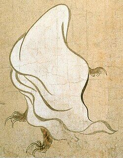
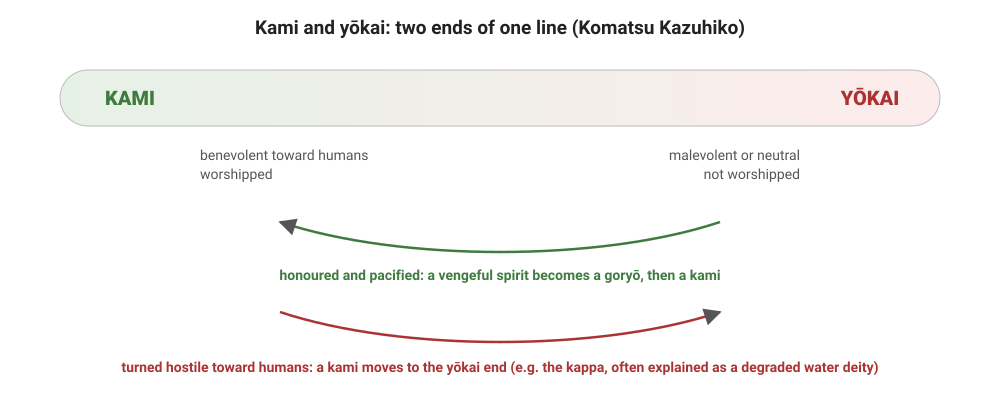
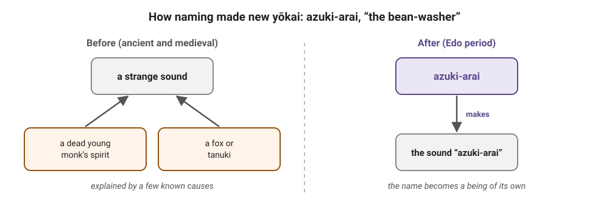
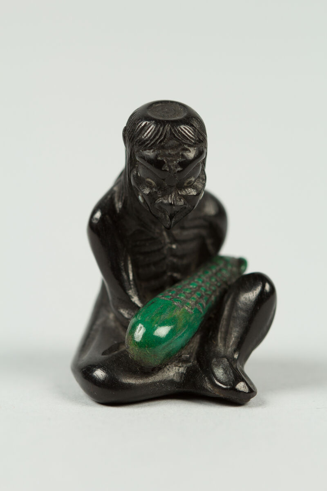

# 10. What a Yōkai Is

***[Yōkai](https://en.wikipedia.org/wiki/Y%C5%8Dkai)*** (妖怪) is usually translated "monster", "spirit" or "goblin", and none of these fit. The category covers a river creature that wants to wrestle, a [tanuki](https://en.wikipedia.org/wiki/Japanese_raccoon_dog) with an enormous scrotum, an umbrella with one eye, a sound of beans being washed in the dark, and the god of a mountain who has turned against people. This chapter explains where the word comes from, how scholars have tried to define it, and the two great turning points in its history: when yōkai were **named**, and when they became **entertainment**.

<figure>

<figcaption>A cloth-like monster from the <em>Hyakki yagyō emaki</em> attributed to Tosa Mitsunobu (d. 1525), one of the scrolls of the night procession of a hundred demons (Chapter 11). <span class="credit">Image: 土佐光信 (Tosa Mitsunobu, Japanese, †1525), Public domain, via <a href="https://commons.wikimedia.org/wiki/File:Mitsunobu_cloth-like_monster.jpg">Wikimedia Commons</a>.</span></figcaption>
</figure>

## 10.1 A young word for old things

Komatsu Kazuhiko, the leading scholar of the subject, points out that the word *yōkai* is itself recent as an everyday term. It "began to be used as an academic term in the [Meiji period](https://en.wikipedia.org/wiki/Meiji_era)", and as a word of daily speech it is "still immature". Other words "circulate far more widely: *[obake](https://en.wikipedia.org/wiki/Obake)*, *bakemono*, *henge*, *[oni](https://en.wikipedia.org/wiki/Oni)*, *mamono*, *ayakashi*". In the [Edo period](https://en.wikipedia.org/wiki/Edo_period), when yōkai culture "came into full flower", the usual word was ***bakemono*** (化物, "changing thing"), as in titles like "Bakemono-zukushi" (catalogue of monsters) or "bakemono-banashi" (monster tales) (Komatsu 2014).

Hirota Ryūhei confirms this from the twentieth century: "the inclusive term *obake* was used more frequently than either *[yūrei](https://en.wikipedia.org/wiki/Y%C5%ABrei)* (ghost) or *yōkai* until the sixties" (Hirota 2021).

## 10.2 Why yōkai exist: Komatsu's answer

Komatsu opens with a general claim: "Yōkai exist in every era and in every country. When people encounter mysterious events that human knowledge cannot immediately explain, they create imaginary beings, that is, yōkai, to explain them." But yōkai do not look the same everywhere: "yōkai born of anxiety and awe take on distinctive shapes after passing through the filter of each country's history and culture" (Komatsu 2014).

And they are everywhere in Japanese culture: "Whatever angle you approach Japanese culture from, you are bound to meet yōkai", because they are not confined to [Shinto](https://en.wikipedia.org/wiki/Shinto) and Buddhism but reach into "literature and painting, theatre, comics, animation, and even toys and everyday goods" (Komatsu 2014).

## 10.3 Definitions: yōkai and kami on one line

Folklore studies long defined yōkai simply as **malevolent supernatural beings**. Hirota observes that "a survey of these studies reveals that most instances of yōkai do not fit this definition" (Hirota 2021).

The definition most widely accepted today is Komatsu's. Hirota summarises its two main points (Hirota 2021):

1. "Yōkai is a supernatural force or entity that is malevolent or neutral toward human beings. This is in contrast to benevolent entities, which are categorized as [kami](https://en.wikipedia.org/wiki/Kami)."
2. "Yōkai and kami are at the opposite poles of the same continuum, and so when a given supernatural entity changes its attitude toward humans, its position in the continuum shifts toward the other side: a kami becomes a yōkai and vice versa."

Takahashi Ayako and Fujii Shūhei restate Komatsu's view: strange and mysterious phenomena are divided into desirable and undesirable ones. The first become objects of faith and worship, the second become yōkai. "The difference between kami that are worshipped and yōkai that are not is therefore always ambiguous" (Takahashi and Fujii 2022).

<figure class="diagram">

<figcaption>Komatsu Kazuhiko's continuum of kami and yōkai (Hirota 2021). <span class="credit">Diagram drawn for this handbook from the sources cited in the chapter.</span></figcaption>
</figure>

This continuum connects Part III with Part II. A wronged dead person who sends plague is a terrifying force. Once honoured as a *[goryō](https://en.wikipedia.org/wiki/Gory%C5%8D)*, it becomes a kami (Chapter 7). Komatsu's model allows the same movement in reverse: when a kami's attitude to humans turns hostile, it moves to the yōkai end. The common theory that the [kappa](https://en.wikipedia.org/wiki/Kappa_%28folklore%29) is a degraded water deity (Chapter 12) is an example of that direction. Hirota adds that Komatsu's theory "has recently been criticized" (Hirota 2021).

### Were yōkai supernatural at all?

Hirota's own argument is that calling yōkai "supernatural" is itself a historical development. In mid-nineteenth-century sources, "yōkai and *bakemono* (monsters) are categorized as *shōrui* (living things) along with ordinary animals". Learned men of the seventeenth and eighteenth centuries, the Shinto theologian Watarai Nobuyoshi (1615–1690), the Confucian Arai Hakuseki (1657–1725) and the scholar of national learning Kamo no Mabuchi (1697–1769), "refused to rank yōkai alongside deities" (Hirota 2021).

The belief that yōkai are simply animals survived. Hirota cites a researcher who was asked in 1990, "Do you know the scientific name for a kappa?" For that elderly person, "a kappa 'is an animal, and its reality is as evident as that of dogs or cats'". Another informant "did not believe in deities but was certain of the mysterious power of the fox" (Hirota 2021).

According to Hirota, yōkai were moved into an "otherworld" in three stages (Hirota 2021):

1. **Early nineteenth century.** The national-learning (*[kokugaku](https://en.wikipedia.org/wiki/Kokugaku)*) scholar **[Hirata Atsutane](https://en.wikipedia.org/wiki/Hirata_Atsutane)** (1776–1843) "put the spirits of pestilence, ghosts, and mysterious foxes into the realm of the kami", in a hidden world (*yūmei* 幽冥) that shares space with the visible one and whose occupants "can see our world and exercise influence on us". [Motoori Norinaga](https://en.wikipedia.org/wiki/Motoori_Norinaga) had already counted "such things as dragons, *kotama* (wood spirits), foxes, and so forth" as kami (Chapter 1).
2. **Around 1900.** The Western concept of "the supernatural" was imported into Japanese literary criticism.
3. **The late 1960s.** The "yōkai boom" in manga and magazines (Chapter 13) mixed the natural, supernatural and paranormal.

## 10.4 From a few great powers to countless named things

The most important change in yōkai history, for Komatsu, happened in the Edo period (Komatsu 2014).

**Before.** "Until the ancient and medieval periods, the kinds of yōkai were limited to oni, great serpents and dragons, foxes, centipedes, spiders and the like." Strange events were explained by tying them to "a limited set of yōkai beings: spirits, oni and [tengu](https://en.wikipedia.org/wiki/Tengu), foxes and tanuki".

**After.** In the Edo period "their number increased sharply", because that way of thinking "receded" and was replaced by "the individuation and subdivision of yōkai through **naming**".

Komatsu's example is ***[azuki-arai](https://en.wikipedia.org/wiki/Azukiarai)***, the "bean-washer". "Originally it was a strange sound said to be caused by the spirit of a young monk who had died, or by a fox or tanuki." Once the sound was given the name *azuki-arai*, "the explanation that it was the ghost of a young monk or the work of foxes and tanuki fell away", and a new being called *azuki-arai* was understood to make the sound called *azuki-arai* (Komatsu 2014).

<figure class="diagram">

<figcaption>How naming created new yōkai (Komatsu 2014). <span class="credit">Diagram drawn for this handbook from the sources cited in the chapter.</span></figcaption>
</figure>

## 10.5 From fear to fun

The second change, also mid-Edo, was "decisive": **entertainment**. "Until then, yōkai had been born of awe, anxiety and fear of phenomena and beings beyond human knowledge. But the townspeople of Edo, with the development of rational thinking, realised that many of them were imaginary, and began to treat yōkai as objects of entertainment." Cut loose from religion and belief, people "could create yōkai for fun", and "yōkai multiplied without limit" (Komatsu 2014).

Komatsu lists where they went: "picture books, novels, *[nishiki-e](https://en.wikipedia.org/wiki/Nishiki-e)* prints, theatre, toys, and even kimono designs and ornaments". Pill cases (*[inrō](https://en.wikipedia.org/wiki/Inro)*), combs, [netsuke](https://en.wikipedia.org/wiki/Netsuke) and tobacco pouches carried oni and foxes from legends and plays, "also as charms against evil". "Wearing such things must have been *iki*", stylish (Komatsu 2014).

<figure>

<figcaption><em>Kappa with a cucumber</em>, wooden netsuke, nineteenth century, Metropolitan Museum of Art. Yōkai moved onto everyday objects such as netsuke (Komatsu 2014). <span class="credit">Image: The Metropolitan Museum of Art, <a href="https://creativecommons.org/publicdomain/zero/1.0/">CC0</a>, via <a href="https://www.metmuseum.org/art/collection/search/59126">The Met Open Access</a>.</span></figcaption>
</figure>

Takahashi and Fujii cite the folklorist Kagawa's theory of "two turning points": the Edo period and the arrival of the manga artist **[Mizuki Shigeru](https://en.wikipedia.org/wiki/Shigeru_Mizuki)** in the 1960s. Through Edo painters and Mizuki's manga, yōkai became characters, and their existence and power were no longer believed in (Takahashi and Fujii 2022). Chapter 13 shows why Takahashi and Fujii think this account is incomplete.

## 10.6 Decline and survival

Komatsu ends with a balance. "Yōkai as objects of faith, or as beings held to be real, have followed a history of decline. But Japanese yōkai, building on their tradition and history, have kept multiplying by moving their field of activity to fiction and entertainment, and still run riot across the Japanese archipelago today, sometimes even flying overseas" (Komatsu 2014).

## 10.7 Check yourself

```quiz
title: Chapter 10 self-check
? What was the usual Edo-period word for these creatures?
- Bakemono *
- Yōkai
- Kami
> The word yōkai became common only from the Meiji period as an academic term (Komatsu 2014).

? In Komatsu's definition, what separates yōkai from kami?
- Their attitude to humans: malevolent or neutral beings are yōkai, benevolent ones are kami *
- Yōkai are animals, kami are humans
- Kami are Shinto, yōkai are Buddhist
> And one can turn into the other (Hirota 2021).

? What happened to azuki-arai once it was named?
- The older explanations (a dead monk's spirit, foxes) fell away, and the name became a being *
- It was banned by the shogunate
- It became a kami
> Komatsu's example of individuation through naming.

? What was the second great change in Edo yōkai culture?
- Yōkai became entertainment, freed from religious belief *
- Yōkai were outlawed
- Yōkai were exported to China
> Komatsu 2014.

? How did mid-19th-century sources classify yōkai, according to Hirota?
- As living things, alongside ordinary animals *
- As kami
- As dead spirits
> Hirota argues the "supernatural" label is later.

? Which scholar moved foxes, ghosts and plague spirits into the hidden world of the kami?
- Hirata Atsutane *
- Arai Hakuseki
- Mizuki Shigeru
> Hirota 2021.
```

## Sources for this chapter

1. **Komatsu 2014.** See [Chapter 2](02-myths.md). Quotations translated from the Japanese.
2. **Hirota 2021.** See [Chapter 1](01-kami.md).
3. **Takahashi and Fujii 2022.** Takahashi Ayako, Fujii Shūhei. 新型コロナウイルス禍のアマビエにみる妖怪の社会的機能 (Social functions of yokai, considering Amabie as an example, during the COVID-19 calamity). *Japanese Journal of Psychology* 2022;93(1):58–64. doi:[10.4992/jjpsy.93.20340](https://doi.org/10.4992/jjpsy.93.20340).

➡️ Next: [Chapter 11: Night parades and tool spirits](11-night-parade.md)
