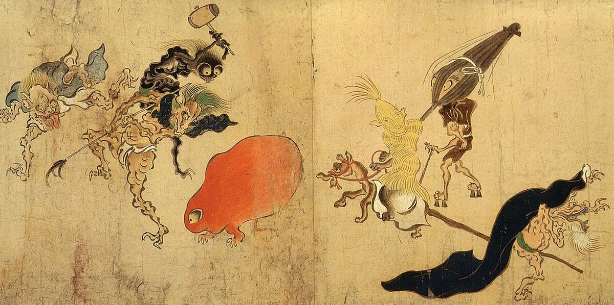
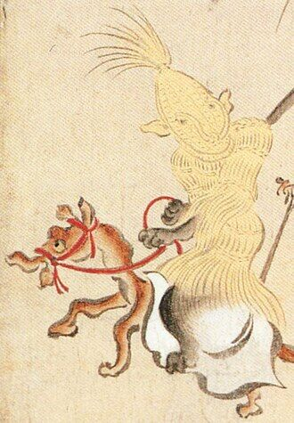
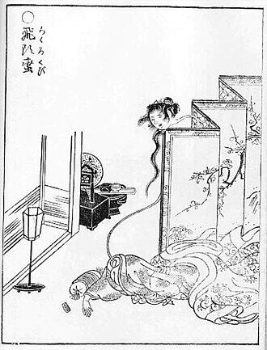

# 11. Night Parades and Tool Spirits

Two kinds of picture made Japanese [yōkai](https://en.wikipedia.org/wiki/Y%C5%8Dkai) visible. The first is the medieval handscroll of the ***[hyakki yagyō](https://en.wikipedia.org/wiki/Hyakki_Yagy%C5%8D)***, the "night procession of a hundred demons", where pots, umbrellas and sandals march in the dark. The second is the Edo-period illustrated catalogue, where each creature gets its own page and its own name. This chapter follows both, starting with the strangest idea behind the processions: that worn-out tools can come to life.

<figure>

<figcaption>Tool spirits (<em>tsukumogami</em>) from a <em>Hyakki yagyō emaki</em>, Muromachi period (1336–1573). <span class="credit">Image: Unknown author, Public domain, via <a href="https://commons.wikimedia.org/wiki/File:Hyakki-Yagyo-Emaki_Tsukumogami_1.jpg">Wikimedia Commons</a>.</span></figcaption>
</figure>

## 11.1 *Tsukumogami*: when tools grow souls

***[Tsukumogami](https://en.wikipedia.org/wiki/Tsukumogami)*** (付喪神) are "animate household objects" (Reider 2009a). Noriko Reider traces the idea (Reider 2009a):

- "Animate tools appear sporadically in the literature of the late [Heian period](https://en.wikipedia.org/wiki/Heian_period) (794–1185), [but] the application of the name *tsukumogami* to animate objects is largely a medieval phenomenon", and pictures and descriptions "increase notably in works of the medieval and Edo periods".
- The key text is a Muromachi-period (1336–1573) illustrated tale, ***Tsukumogami ki*** ("Record of tool specters"). It explains that "after a span of one hundred years *utsuwamono* or *kibutsu* (containers, tools, and instruments) receive souls, and, like all things with individual souls, develop independent spirits and thus became prone to tricking people".

Komatsu Kazuhiko places them in the family of the [oni](https://en.wikipedia.org/wiki/Oni): they are "the spirits of old tools" who "tried to take revenge on humans, as oni, for being thrown away without any sign of gratitude" (Komatsu 2014).

## 11.2 The story of the *Tsukumogami ki*

Reider translated the tale in full (Reider 2009b). Its plot:

1. **The custom.** Because tools receive souls after a hundred years, "every year people bring out the old tools from their houses and discard them in the alleys before the New Year". This year-end cleaning, ***susuharai*** ("sweeping soot"), is "carried out to avoid misfortune caused by *tsukumogami* tool specters but a year short of a hundred".
2. **The grievance.** In the Kōhō era (964–967), the discarded tools meet in the alleys: "We have faithfully served the houses as furniture and utensils for a long time. Instead of getting the reward that is our due, we are abandoned in the alleys to be kicked by oxen and horses… Whatever it takes, we should become specters and exact vengeance."
3. **A dissenting voice.** A Buddhist rosary, "Ichiren Novice", urges them to "return hostility with benevolence". A club called "Rough John" beats him nearly to death.
4. **The method.** "Professor Classical Chinese Literature" explains that things take shape through yin and yang. On ***[setsubun](https://en.wikipedia.org/wiki/Setsubun)***, "when yin and yang change their places", they must "leave our bodies to the hands of a creation god (*zōkashin*). Then we will surely become specters."
5. **The transformation.** They become monsters. In an illustration, one jokes about an oni made from a flute who "was afraid of soybean vines", and another boasts: "If someone throws soybeans at me, I will pick them up and eat them as fine tea confections" (soybeans are thrown at oni on *setsubun*).
6. **Defeat.** After they terrorise the capital, a great Buddhist rite is held in the palace. The emperor sees "seven or eight extraordinary-looking armed divine boys", attendants of two Wisdom Kings (Fudō and Gōzanze), flying out "to conquer the evil specters".
7. **Salvation.** Converted, the tools take up religious lives. They visit Ichiren, who forgives even the club, and in the end they attain Buddhahood through [Shingon](https://en.wikipedia.org/wiki/Shingon_Buddhism).

### What the story is for

Reider argues that the author's "principal motivation … was to spread the doctrines of Shingon Esoteric Buddhism to a variety of audiences", by "capitalizing upon pre-existing spiritual beliefs in *tsukumogami*". The text "emphasizes that the Shingon teachings enable even such nonsentient beings as tools and containers to attain enlightenment" (Reider 2009a). Its genre, *[otogizōshi](https://en.wikipedia.org/wiki/Otogi-z%C5%8Dshi)*, consists of short tales "written from the fourteenth to the seventeenth century for the purpose of both entertainment and moral or religious edification" (Reider 2009a).

Reider also cites Fabio Rambelli's view that the tale "tries to reduce the effects of commodification by introducing a ritual dimension in the disposal of used, exhausted objects", which let Buddhist institutions extend their memorial services (*kuyō*) to things (Reider 2009a).

## 11.3 The hundred demons by night

The ***hyakki yagyō*** is older than the tool spirits. Reider notes that Heian works such as the *[Ōkagami](https://en.wikipedia.org/wiki/%C5%8Ckagami)* (ca. 1085–1125) and the *[Konjaku monogatari](https://en.wikipedia.org/wiki/Konjaku_Monogatarish%C5%AB) shū* (ca. 1120) "describe *hyakki yagyō*", the procession of demons at night. In the *Konjaku*, a charm of the Sonshō Dhāraṇī protects a regent from the demons (Reider 2009a).

From the [Muromachi period](https://en.wikipedia.org/wiki/Muromachi_period), "several picture scrolls titled *Hyakki yagyō emaki* (handscrolls of night processions of one hundred demons) were created, many of which are generally considered to be portrayals of a festival parade scene from *Tsukumogami ki*" (Reider 2009a). Reider adds a pun. The character for a vessel or tool, 器, and the character for a demon, 鬼, can both be read *ki*. "Thus, *hyakki yagyō*, 'the night procession of one hundred demons,' could also be" a night procession of a hundred *vessels* (Reider 2009a).

<figure>

<figcaption>A sandal spirit from the <em>Hyakki yagyō emaki</em> attributed to Tosa Mitsunobu (d. 1525). <span class="credit">Image: 土佐光信 (Tosa Mitsunobu, Japanese, †1525), Public domain, via <a href="https://commons.wikimedia.org/wiki/File:Hyakki_Yako_Emaki_Sandal_Spirit.jpg">Wikimedia Commons</a>.</span></figcaption>
</figure>

The [Nichibunken](https://en.wikipedia.org/wiki/International_Research_Center_for_Japanese_Studies) collection shows how long the genre lasted (Nichibunken 2021):

- ***Hyakki no zu*** ("Picture of one hundred demons"), by Yoshimitsu. It shows "spirits of antiquities like a handled basin and a wooden stupa, as well as frog and turban-shell yōkai, long-nosed and other goblins". The "eerie black clouds with grotesque creatures squirming in them in the second half of the scroll are superb".
- ***Kokkei hyakki-yakō emaki*** ("The comical night parade of one hundred demons") by Yamamoto Kōichi, **1900**. It "emphasizes the humor by adding scenes of farting".
- ***[Bakemono](https://en.wikipedia.org/wiki/Obake) konrei emaki*** ("A monster wedding"). It follows a monster couple from matchmaking and wedding to childbirth and the baby's first shrine visit, with "humorous touches" showing "the subtle differences of their life from that of a human couple".
- ***Yōkai shiki fūzoku emaki*** ("Yōkai pleasures of the four seasons") by Hanabusa Itchō. Yōkai enjoy kite flying, the Boys' Festival, the summer purification, Tanabata, the welcome fires for ancestors at [Bon](https://en.wikipedia.org/wiki/Obon), and the year-end singers. "A valuable source for studying Edo-period culture."

The last two scrolls show yōkai doing exactly what people do: marrying, celebrating festivals, purifying themselves. By then they were entertainment (Chapter 10).

## 11.4 From procession to catalogue

The second form is the illustrated **catalogue**, in which every yōkai has its own picture and name. This matches the Edo habit of naming that Komatsu describes (Chapter 10).

- **Kanō-school scrolls.** The ***Bakemono zukushi emaki*** ("Compilation of monsters") in the Nichibunken collection "is much like an illustrated guide to monsters, each given a name. The Kanō-school painters produced many such handscrolls" (Nichibunken 2021).
- **Regional scrolls.** The ***Shokoku yōkai zukan*** ("Yōkai of the provinces") "shows individual yōkai and stories related to them", including some found in Kanō-school scrolls and some unique creatures, such as Kebō, with "human head, two arms and four legs with black claws, torso thickly covered with hair" (Nichibunken 2021).
- **[Toriyama Sekien](https://en.wikipedia.org/wiki/Toriyama_Sekien).** The best-known catalogues are the printed books of **Toriyama Sekien** (1712–1788) (Hirota 2021). The Metropolitan Museum of Art holds his *Hyakki shūi* ("One hundred monsters ancient and modern, supplement"), dated spring **1781** (Metropolitan Museum of Art, object 78693). Two centuries later the manga artist [Mizuki Shigeru](https://en.wikipedia.org/wiki/Shigeru_Mizuki) wrote that he had "collected paintings by Toriyama Sekien" to draw his yōkai (Hirota 2021).

<figure>

<figcaption>Toriyama Sekien, <em>Rokurokubi</em>, from <em>Gazu hyakki yagyō</em>. In Sekien's catalogues every creature has its own page and name. <span class="credit">Image: Toriyama Sekien, Public domain, via <a href="https://commons.wikimedia.org/wiki/File:SekienRokurokubi.jpg">Wikimedia Commons</a>.</span></figcaption>
</figure>

## 11.5 Tools still have souls

The idea behind *tsukumogami* still has religious practice built on it: memorial services for objects, which Rambelli links to the tale (Reider 2009a). Reider also cites the critic Shibusawa Tatsuhiko, who called material objects a "second nature" and argued that "as material civilization progresses, man becomes more skeptical and souls/spirits become separated from the materials in which they were believed to reside", only to find new homes in more complex tools (Reider 2009a).

## 11.6 Check yourself

```quiz
title: Chapter 11 self-check
? According to the Tsukumogami ki, when do tools receive souls?
- After about a hundred years of service *
- On the day they are made
- When they are offered at a shrine
> Hence the year-end cleaning that throws them out a year short (Reider 2009b).

? What year-end custom does the tale explain?
- Susuharai, "sweeping soot", throwing old tools into the alleys *
- Setsubun bean-throwing
- The Bon welcome fire
> Reider 2009b.

? On what night do the tools transform?
- Setsubun, when yin and yang change places *
- New Year's Day
- The 15th of August
> They leave their bodies to the creation god.

? What was the author's main purpose, according to Reider?
- To spread Shingon teaching that even tools can attain Buddhahood *
- To warn against buying new furniture
- To record a real event of 964
> The tale capitalised on existing belief in tsukumogami.

? What pun links tools and demons in hyakki yagyō?
- 器 (vessel) and 鬼 (demon) can both be read ki *
- Both words mean "night"
- Both are written with the character for fire
> Reider 2009a.

? What kind of work is the Bakemono zukushi emaki?
- An illustrated guide in which each monster has a name *
- A Buddhist sutra
- A list of shrines
> Kanō-school painters produced many (Nichibunken 2021).
```

## Sources for this chapter

1. **Reider 2009a.** Reider NT. Animating objects: *Tsukumogami ki* and the medieval illustration of Shingon truth. *Japanese Journal of Religious Studies* 2009;36(2):231–257. [Nanzan](https://nirc.nanzan-u.ac.jp/journal/6/article/1278/pdf/download).
2. **Reider 2009b.** Reider NT, tr. *Tsukumogami ki* (The record of tool specters). *Japanese Journal of Religious Studies* 2009;36(2), online supplement: 1–19. [Nanzan](https://nirc.nanzan-u.ac.jp/journal/6/article/1275/pdf/download).
3. **Komatsu 2014.** See [Chapter 2](02-myths.md).
4. **Nichibunken 2021.** International Research Center for Japanese Studies. *Yokai Arrive from Kyoto: The Collection of the International Research Center for Japanese Studies* (exhibition pamphlet, Yumoto Kōichi Memorial Japan Yōkai Museum, Miyoshi, 15 October–22 December 2020). Supervised by Komatsu Kazuhiko; commentary by Kiba Takatoshi; English translation supervised by Lawrence E. Marceau. Kyoto: Nichibunken, 2021. [Nichibunken repository](https://nichibun.repo.nii.ac.jp/records/7750).
5. **Hirota 2021.** See [Chapter 1](01-kami.md).
6. **Metropolitan Museum of Art.** Toriyama Sekien, *Hyakki shūi* (One Hundred Monsters Ancient and Modern), 1781, object 78693. [metmuseum.org](https://www.metmuseum.org/art/collection/search/78693), accessed 18 November 2026. Cited for title and date.

➡️ Next: [Chapter 12: A yōkai bestiary](12-bestiary.md)
