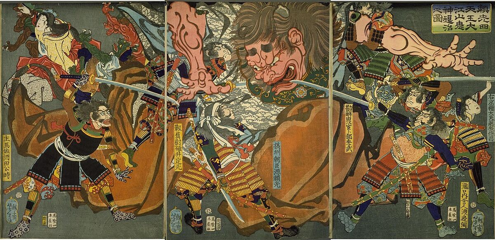
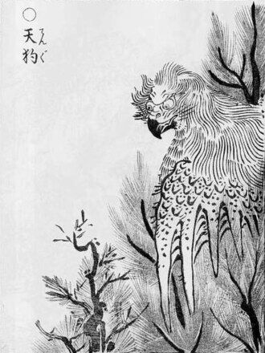
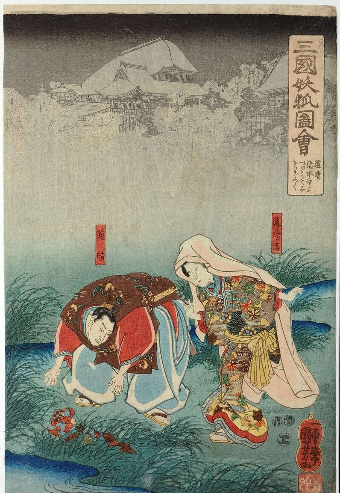
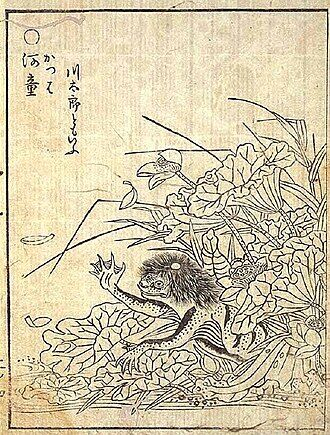
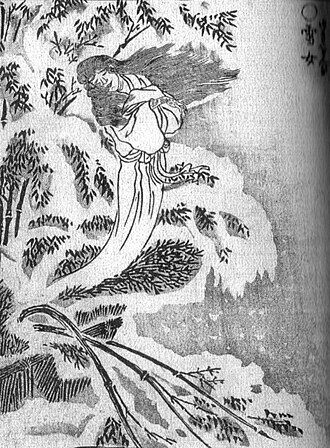
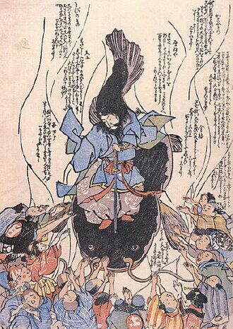

# 12. A Yōkai Bestiary

This chapter is a bestiary in the old sense: a catalogue of creatures, each with its origins, its habits and the stories told about it. It is not a complete list, which would be impossible, since the [Edo period](https://en.wikipedia.org/wiki/Edo_period) alone named hundreds (Chapter 10). It covers the [yōkai](https://en.wikipedia.org/wiki/Y%C5%8Dkai) that the sources examine closely, and for each it separates what scholars have established from the stories themselves.

## 12.1 Oni

The ***[oni](https://en.wikipedia.org/wiki/Oni)*** (鬼), usually translated "demon" or "ogre", is the oldest and most varied of the great yōkai. Komatsu Kazuhiko writes that the Japanese oni, "born under the influence of the Chinese *gui* (鬼)", has held people's imagination "from ancient times to the present" alongside serpents and dragons (Komatsu 2014).

### How one becomes an oni

Komatsu stresses that the oni's appearance is known to every Japanese, but "how an oni came to be an oni varies endlessly" (Komatsu 2014):

- **The dead** become oni.
- **The living** can become oni while still alive.
- **Natural forces**, the fury of epidemics, thunder and wind, were pictured as oni.
- **Outsiders and foreigners** were represented as oni.
- **Inhabitants of other worlds**, the wardens of hell and the people of the Dragon Palace, were drawn as oni.
- In the medieval period **tool spirits** (*[tsukumogami](https://en.wikipedia.org/wiki/Tsukumogami)*) joined them (Chapter 11). "In this way, many of the yōkai of the medieval period are descendants of the oni."

The old, too, could turn. Noriko Reider cites a tale in the *[Konjaku monogatari](https://en.wikipedia.org/wiki/Konjaku_Monogatarish%C5%AB) shū* (ca. 1120) of a woman who grows extremely old and becomes an oni. Its narrator concludes that "when parents become extremely old they always turn into oni and try to eat even their own children" (Reider 2009a).

### Famous oni

- **[Shuten-dōji](https://en.wikipedia.org/wiki/Shuten-d%C5%8Dji).** "The oni or demon leader of Mt. Ōe" began abducting young women from Kyoto. The warrior **[Minamoto no Yorimitsu](https://en.wikipedia.org/wiki/Minamoto_no_Yorimitsu)** (Raikō) and his four lieutenants, the *shitennō*, were sent against him. "Disguising themselves as *[yamabushi](https://en.wikipedia.org/wiki/Yamabushi)* mountain monks", and helped by [kami](https://en.wikipedia.org/wiki/Kami) and buddhas, they "finally beat the demon, cutting off its head" ([Nichibunken](https://en.wikipedia.org/wiki/International_Research_Center_for_Japanese_Studies) 2021).
- **The oni of the Suzaku Gate.** In the *Haseo zōshi*, the Heian scholar Ki no Haseo beats an oni of the Suzaku Gate at the board game *sugoroku* and wins a beautiful woman. She has been assembled "from the dead bodies of beauties" and will become a real human in a hundred days. Haseo cannot wait, and when he takes her to bed before the time she "turns into water and flows away" (Nichibunken 2021).

<figure>

<figcaption>Tsukioka Yoshitoshi, Raikō and his four lieutenants destroying the demon of Mt. Ōe, woodblock triptych, 1864 (National Diet Library). <span class="credit">Image: Yoshitoshi, Public domain, via <a href="https://commons.wikimedia.org/wiki/File:NDL-DC_1310286-Tsukioka_Yoshitoshi-%E9%A0%BC%E5%85%89%E5%9B%9B%E5%A4%A9%E7%8E%8B%E5%A4%A7%E6%B1%9F%E5%B1%B1%E9%AC%BC%E7%A5%9E%E9%80%80%E6%B2%BB%E4%B9%8B%E5%9B%B3-%E5%85%83%E6%B2%BB1-cmb.jpg">Wikimedia Commons</a>.</span></figcaption>
</figure>

### Oni and soybeans

Throwing soybeans at oni on *[setsubun](https://en.wikipedia.org/wiki/Setsubun)* is old enough to be joked about in a medieval tale. In the *Tsukumogami ki* illustrations, a tool that has become an oni boasts: "If someone throws soybeans at me, I will pick them up and eat them as fine tea confections" (Reider 2009b).

## 12.2 Tengu

The ***[tengu](https://en.wikipedia.org/wiki/Tengu)*** (天狗) today is "the long-nosed, red-faced supernatural trickster who is usually dressed like a *yamabushi*", sometimes "winged and [with] birdlike facial features" (Hansen 2010). Its history is long.

### From a shooting star to a mountain trickster

Wilburn Hansen traces the word (Hansen 2010):

| Period | What *tengu* meant |
|---|---|
| Chinese *Shiji* (1st century BCE) and *[Nihon shoki](https://en.wikipedia.org/wiki/Nihon_Shoki)* (720) | The characters mean "dog from the heavens"; the word "appears to refer to a type of shooting star which was said to be a kind of dog when it landed on earth" |
| [Heian period](https://en.wikipedia.org/wiki/Heian_period) (*Genji monogatari*) | "A supernatural trickster living in the mountains" |
| Early 12th century (*Konjaku monogatari shū*) | Associated "with deluded Buddhist priests who worshiped tengu and eventually turned into them" |
| [Kamakura period](https://en.wikipedia.org/wiki/Kamakura_period) (*Tengu zōshi*, 1296) | Wicked priests, "even the most eminent monks", shown as "corrupt birdlike tengu" |
| Afterwards | "More closely associated with *yamabushi*" and [Shugendō](https://en.wikipedia.org/wiki/Shugend%C5%8D) |

### Pride makes a tengu

Komatsu explains that the tengu "was nurtured within Buddhist culture". It first appeared to destroy Buddhism and drag monks down into the realm of demons, later turned against royal power, and in folk belief became "a somewhat foolish mountain yōkai that causes people to be spirited away (*[kamikakushi](https://en.wikipedia.org/wiki/Spirit_away)*)" (Komatsu 2014).

The key Buddhist idea was that **pride and attachment** make tengu (Kimbrough 2012; Wakabayashi 2002):

- In 1239 the priest Keisei recorded an interview with the Great Tengu of Mt. Hira, which was possessing a 21-year-old woman in his brother's household. The tengu explained that "the arrogant, and those with deep attachments" are prone to become tengu (Kimbrough 2012).
- In a version of the *[Heike monogatari](https://en.wikipedia.org/wiki/The_Tale_of_the_Heike)* copied in 1309–10, the Sumiyoshi Deity tells Retired Emperor [Go-Shirakawa](https://en.wikipedia.org/wiki/Emperor_Go-Shirakawa) that "the arrogant and impious who are certain to become tengu after they die" already attract swarms of tengu in this life (Kimbrough 2012).
- The seven scrolls of the ***Tengu zōshi*** (1296) use tengu to criticise the great temples. Monks "who could not get rid of their arrogance or attachment would fall into the realm of tengu and become tengu themselves" (Wakabayashi 2002).

In the *Tale of the Handcart Priest* (16th or early 17th century), a Zen priest begins "to feel a little pride", which draws **Tarōbō of Mt. Atago**, whom the Sumiyoshi Deity calls "the greatest tengu in all of Japan". Keller Kimbrough reads the long battle of magic that follows as an allegory of the priest's struggle with "his own 'demons' of conceit" (Kimbrough 2012).

<figure>

<figcaption>Toriyama Sekien, <em>Tengu</em>, from his illustrated yōkai catalogues. <span class="credit">Image: Toriyama Sekien, Public domain, via <a href="https://commons.wikimedia.org/wiki/File:SekienTengu.jpg">Wikimedia Commons</a>.</span></figcaption>
</figure>

### A tengu's apprentice

In 1821 the nativist scholar **[Hirata Atsutane](https://en.wikipedia.org/wiki/Hirata_Atsutane)** questioned a boy named Torakichi who claimed to have grown up as an apprentice to a tengu, a *yamabushi* living in the "Other World". Atsutane recorded the conversations in *Senkyō ibun*, which Hansen calls "a pseudo-ethnography of that Other World", and used the boy to support his theories of native Japanese superiority (Hansen 2010).

## 12.3 Foxes

The fox (*[kitsune](https://en.wikipedia.org/wiki/Kitsune)* 狐) is two things at once: the messenger of the rice deity [Inari](https://en.wikipedia.org/wiki/Inari_%C5%8Ckami), and a shape-shifter that deceives and possesses.

### Inari's foxes

[Lafcadio Hearn](https://en.wikipedia.org/wiki/Lafcadio_Hearn), travelling in the 1890s, found stone foxes "by every shady wayside and in every ancient grove", usually "a pair of these, facing each other", at shrines of **Inari**. He reports that Inari's ancient name is the August-Spirit-of-Food of the *[Kojiki](https://en.wikipedia.org/wiki/Kojiki)*, and that "the conception of the fox as a supernatural being does not seem to have been introduced into Japan before the tenth or eleventh century". In the vast precincts of the old shrine of Izumo, "you cannot find the image of a fox". Inari was worshipped as a healer and a giver of wealth, "therefore his foxes are sometimes represented holding keys in their mouths" (Hearn 1894).

### The deceiving fox

Komatsu describes fox and [tanuki](https://en.wikipedia.org/wiki/Japanese_raccoon_dog) as "real animals that were also fantastic animals", "created under Chinese influence". Knowing the art of transformation and inheriting part of the character of oni and tengu, they "took the road of the trickster, disguising themselves as people and things to bewitch people". When contrasted, "the fox was given a cunning image, the tanuki a comic one" (Komatsu 2014). Reider notes that "demonic old animals" appear in the tale *[Tamamo no mae](https://en.wikipedia.org/wiki/Tamamo-no-Mae)* ("Lady Tamamo") and the [noh](https://en.wikipedia.org/wiki/Noh) play *[Sesshōseki](https://en.wikipedia.org/wiki/Sessho-seki)* ("The killing stone") (Reider 2009a).

<figure>

<figcaption>Utagawa Kuniyoshi, from <em>Sangoku yōko zue</em> (The Magic Fox of Three Countries), 1849–50: a couple finds the baby who will become Tamamo-no-mae (British Museum). <span class="credit">Image: Utagawa Kuniyoshi (歌川国芳), Public domain, via <a href="https://commons.wikimedia.org/wiki/File:Sangoku_yoko_zue_%E4%B8%89%E5%9B%BD%E5%A6%96%E7%8B%90%E5%9B%B3%E4%BC%9A_%28The_Magic_Fox_of_Three_Countries%29_%28BM_2008%2C3037.07005%29.jpg">Wikimedia Commons</a>.</span></figcaption>
</figure>

### Fox possession

The darkest side of fox belief is ***kitsune-tsuki***, fox possession. Hearn describes it as possession "tormenting [people] into madness". Among the signs reported to him were "a moving lump under the skin", speaking unknown languages, and eating "a great deal, alleging that not they, but the possessing foxes, are hungry". "It not infrequently happens that the victims of fox-possession are cruelly treated by their relatives—being severely burned and beaten in the hope that the fox may be thus driven away." The exorcist "argues with the fox, who speaks through the mouth of the possessed" (Hearn 1894).

Hearn also records a popular classification of foxes: four "Superior Sorts" with supernatural powers (Byakko, Kokko, Jenko and Reiko) and the worst, the ***ninko*** or "man-fox", "especially the fox of demoniacal possession". He adds that "it is more than doubtful whether the popular notions about different classes of foxes … were ever much more clearly established than they are now, except in the books of old literati" (Hearn 1894).

### Fox-owning families

The belief had social consequences. In 1960 the psychologist Nomura Akira described the ***kitsune-mochi***, "fox-possessed" families, in the San'in region of western Japan (Izumo, Hōki, Oki). They were set apart by no physical, caste or class mark, only by the belief that they "keep these mysterious foxes" ("generally it is said that they keep seventy-five foxes per family"). The belief governed marriage: families avoided marrying into them (Nomura 1960). In seven villages of Izumo, 591 of 3,518 lineages (16.8 per cent) were considered "possessed", ranging from none in one village to 45.9 per cent in another (Nomura 1960, citing Ishizuka). Folklorists traced the stigma to families once tied to divine service who lost their standing; social scientists, to land conflicts with newly rich families who had settled around 1720 (Nomura 1960).

## 12.4 Tanuki and badgers

The **tanuki** (raccoon dog) is the fox's comic twin (Komatsu 2014). Its best-known attribute is anatomical. A print by [Utagawa Kuniyoshi](https://en.wikipedia.org/wiki/Utagawa_Kuniyoshi) in the Nichibunken collection shows tanuki "proud of their scrotums, which are said to be as large as eight tatami mats", using them as hats, treasure bags and even a sea bream to impersonate the Seven Gods of Good Luck (Nichibunken 2021).

Badgers (*[mujina](https://en.wikipedia.org/wiki/Mujina)*) appear as shape-shifters too. In Hearn's "Mujina", a creature on the Kii-no-kuni-zaka slope in Tokyo shows a late-night walker a face with no features (Hearn 1904). Chapter 8 described the Noto tale in which ash scattered on the floor revealed badger tracks where a "ghost" had walked (Tsutsumi 2015).

## 12.5 Kappa

The ***[kappa](https://en.wikipedia.org/wiki/Kappa_%28folklore%29)*** (河童), a river creature, is "an imaginary animal" and a yōkai "typical of Japanese folk stories" (Takemura 2008).

- **[Sumo](https://en.wikipedia.org/wiki/Sumo) and drowning.** Traditions from many regions say that kappa love sumo. "When it finds a person by the river it insists on wrestling, and then drags them into the river" (Takemura 2008).
- **Everywhere the same.** Takemura quotes [Yanagita Kunio](https://en.wikipedia.org/wiki/Kunio_Yanagita)'s puzzlement that across regions where customs differ and dialects sometimes need interpreting, "only the monster called *kappa* keeps repeating the same tricks everywhere, as if stamped with a seal" (Takemura 2008).
- **A fallen god?** "The prevailing theory is that the kappa is a degraded form of a water deity", a decline or transformation of river-related belief (Takemura 2008). This fits Komatsu's continuum of kami and yōkai (Chapter 10).
- **Other names.** In Kyushu the kappa is also called ***hyōsube***. Takemura argues for a link through this name to the legendary first sumo wrestler, [Nomi no Sukune](https://en.wikipedia.org/wiki/Nomi_no_Sukune). That argument is his own hypothesis (Takemura 2008).
- **Cucumbers.** "Cucumbers are a favorite of kappa" (Nichibunken 2021).
- **An animal, not a god.** As Chapter 10 noted, one elderly person asked in 1990 for the kappa's "scientific name", regarding it as "an animal" as real "as dogs or cats" (Hirota 2021).

<figure>

<figcaption>Toriyama Sekien, a kappa, from his illustrated yōkai catalogues. <span class="credit">Image: Toriyama Sekien, Public domain, via <a href="https://commons.wikimedia.org/wiki/File:Kappa_jap_myth.jpg">Wikimedia Commons</a>.</span></figcaption>
</figure>

## 12.6 Snow women and flying heads

Two yōkai are known in the West mainly through Lafcadio Hearn's *[Kwaidan](https://en.wikipedia.org/wiki/Kwaidan:_Stories_and_Studies_of_Strange_Things)* (1904):

- ***[Yuki-onna](https://en.wikipedia.org/wiki/Yuki-onna)***, the Woman of the Snow. Two woodcutters of Musashi Province shelter in a ferryman's hut in a snowstorm. A woman in white breathes on the old man, Mosaku, who dies. She spares the young Minokichi on condition that he never speak of it. Years later he marries a beautiful woman called O-Yuki and has children with her. One evening he tells her about that night. She cries, "It was I—I—I! Yuki it was!", spares him for the children's sake, and "melted into a bright white mist" (Hearn 1904).
- ***[Rokuro-kubi](https://en.wikipedia.org/wiki/Rokurokubi)***. Hearn's warrior-priest Kwairyō discovers a household of *rokuro-kubi* whose heads leave their bodies at night. He follows "the book *Sōshinki*", which says that "if one find the body of a Rokuro-Kubi without its head, and remove the body to another place, the head will never be able to join itself again to the neck" (Hearn 1904).

Hearn presents these as stories he had read or been told, not as surveys of belief.

<figure>

<figcaption>Toriyama Sekien, <em>Yuki-onna</em> (the Woman of the Snow), from <em>Gazu hyakki yagyō</em>. <span class="credit">Image: Toriyama Sekien, Public domain, via <a href="https://commons.wikimedia.org/wiki/File:SekienYukionna.jpg">Wikimedia Commons</a>.</span></figcaption>
</figure>

## 12.7 Serpents, centipedes and earthquake catfish

The oldest yōkai are animals of enormous size (Komatsu 2014; Nichibunken 2021):

- **The eight-headed serpent** ***[Yamata no Orochi](https://en.wikipedia.org/wiki/Yamata_no_Orochi)*** of the myths, "with eight heads and eight tails on one body", is "the representative nature and animal yōkai, born of awe at mountains, rivers, storms and other upheavals". Komatsu traces the serpent-and-dragon line on to ape gods, the cryptid *tsuchinoko* and even Godzilla (Komatsu 2014).
- **The giant centipede of Mt. Mikami.** The warrior [Tawara no Tōta](https://en.wikipedia.org/wiki/Fujiwara_no_Hidesato) (Fujiwara no Hidesato) "crossed dauntlessly over a giant serpent" on the Seta Bridge in Ōmi. The serpent was "an incarnation of the Dragon God", who asked him to destroy "a monster centipede inhabiting Mt. Mikami". In reward he received "a straw rice bag that would endlessly produce rice" and an invitation to the Dragon Palace (Nichibunken 2021).
- **The earthquake catfish (*namazu*).** "A massive earthquake that hit the Kantō region in the tenth month of 1855 (Ansei 2) was rumored to have been caused by the stirrings of a giant catfish under the pivot stone at the [Kashima Jingū](https://en.wikipedia.org/wiki/Kashima_Shrine) Shrine." The flood of **catfish prints** (*namazu-e*) that followed showed people "punishing the catfish", "criticizing the wealthy and those who became rich from post-quake reconstruction", and "hoping for social reform". "People were trying to laugh away the disaster" (Nichibunken 2021).

<figure>

<figcaption>A catfish print (<em>namazu-e</em>) of 1855: the god of Kashima holds down the earthquake catfish with his sword. <span class="credit">Image: Unknown author, Public domain, via <a href="https://commons.wikimedia.org/wiki/File:Namazu-e_-_Kashima_controls_namazu.jpg">Wikimedia Commons</a>.</span></figcaption>
</figure>

## 12.8 Mermaids and prophetic beasts

### The human-fish

The ***[ningyo](https://en.wikipedia.org/wiki/Ningyo)*** (人魚), "a hybrid aquatic creature with a human face and a fish body", was for most of its history not a seductive mermaid but an **omen** (Castiglioni 2021):

- The first record is in the *Nihon shoki*. In the summer of **619**, in the reign of [Empress Suiko](https://en.wikipedia.org/wiki/Empress_Suiko), a creature with human features was seen in the Gamō River in Ōmi. In the autumn a fisherman in Settsu netted something "similar to a child", "neither a human being nor a fish".
- In a tenth-century compilation of legends of [Prince Shōtoku](https://en.wikipedia.org/wiki/Prince_Sh%C5%8Dtoku), the governor of Ōmi reports the creature, and the prince replies: "It will provoke natural calamities."
- "The atmosphere of the encounter … is extremely gloomy and negative as in all the other classical and medieval period written and visual sources." In the Edo period, *ningyo* specimens were shown as curiosities (*misemono*), still with "their aura of mysterious natural omens" but in "a ludic atmosphere".

### Beasts that bring warnings

A group of creatures appear, warn of disaster, tell how to avoid it, and vanish. Takahashi and Fujii call them **prophetic beasts** (*yogenjū*). They include ***[Amabie](https://en.wikipedia.org/wiki/Amabie)***, the ***[kudan](https://en.wikipedia.org/wiki/Kudan_%28y%C5%8Dkai%29)***, the *ningyo* and the *jinja-hime* (Takahashi and Fujii 2022). Pictures of them circulated during epidemics: sellers of prophetic-beast pictures were reported during the **[cholera](https://en.wikipedia.org/wiki/Cholera)** epidemics of **1858** and **1882** (Takahashi and Fujii 2022). Chapter 13 follows Amabie into 2020.

The Chinese ***[hakutaku](https://en.wikipedia.org/wiki/Bai_Ze)*** (Ch. *baize*), "said to appear before a virtuous king", belongs to the same protective family. It is "often depicted as a lion with three eyes on its face and three more eyes on both sides of its body", and in the Edo period its picture was carried "as travelers' charms to protect them against accidents and illness" (Nichibunken 2021).

## 12.9 The sorcerer's servant: *shikigami*

The ***[shikigami](https://en.wikipedia.org/wiki/Shikigami)*** of the Yin-Yang masters (*[onmyōji](https://en.wikipedia.org/wiki/Onmy%C5%8Dji)*) is a modern favourite of fiction. Carolyn Pang shows that scholars disagree about what it even is: "a metaphorical reference to *shikisen* (an augury using astrological calculations and an augury instrument)", "a type of magical curse", or "a supernatural being". The disagreement exists because the *shikigami* changed shape across Japanese classical literature (Pang 2013).

## 12.10 Check yourself

```quiz
title: Chapter 12 self-check
? According to Komatsu, which of these can become an oni?
- The dead, the living, epidemics and storms, and outsiders *
- Only Buddhist monks
- Only foreigners
> And, from the medieval period, discarded tools.

? What did the word tengu originally refer to in the Shiji and the Nihon shoki?
- A kind of shooting star said to become a dog on landing *
- A long-nosed mountain monk
- A crow
> Hansen 2010.

? What makes a person become a tengu, in medieval Buddhist texts?
- Arrogance and deep attachment *
- Dying in the mountains
- Eating meat
> Kimbrough 2012; Wakabayashi 2002.

? When does Hearn say the fox became a supernatural being in Japan?
- Not before the tenth or eleventh century *
- In the Jōmon period
- After 1868
> There is no fox image at the old shrine of Izumo (Hearn 1894).

? What set kitsune-mochi families apart, according to Nomura?
- Only the belief that they kept foxes; it governed marriage *
- Their occupation
- Their place of residence
> In seven Izumo villages, 16.8 per cent of lineages were labelled.

? What is the prevailing scholarly theory of the kappa's origin?
- A degraded water deity *
- A Portuguese sailor
- A fossil
> Takemura 2008.

? What did the ningyo mean in classical and medieval sources?
- A gloomy omen of calamity *
- Good luck at sea
- Eternal youth
> Castiglioni 2021.
```

## Sources for this chapter

1. **Komatsu 2014.** See [Chapter 2](02-myths.md).
2. **Reider 2009a; Reider 2009b.** See [Chapter 11](11-night-parade.md).
3. **Nichibunken 2021.** See [Chapter 11](11-night-parade.md).
4. **Hansen 2010.** Hansen W. Dancing as if possessed: a coming out party in Edo spirit society. *Japanese Journal of Religious Studies* 2010;37(2):275–294. [Nanzan](https://nirc.nanzan-u.ac.jp/journal/6/article/1307/pdf/download).
5. **Kimbrough 2012.** Kimbrough RK. Battling tengu, battling conceit: visualizing abstraction in *The Tale of the Handcart Priest*. *Japanese Journal of Religious Studies* 2012;39(2):275–305. [Nanzan](https://nirc.nanzan-u.ac.jp/journal/6/article/1353/pdf/download).
6. **Wakabayashi 2002.** Wakabayashi H. The dharma for sovereigns and warriors: Onjō-ji's claim for legitimacy in *Tengu zōshi*. *Japanese Journal of Religious Studies* 2002;29(1–2):35–66. [Nanzan](https://nirc.nanzan-u.ac.jp/journal/6/article/1075/pdf/download).
7. **Hearn 1894.** Hearn L. *Glimpses of Unfamiliar Japan* (first series). Boston and New York: Houghton Mifflin, 1894. Chapter 15, "Kitsune". [Project Gutenberg #8130](https://www.gutenberg.org/ebooks/8130).
8. **Nomura 1960.** Nomura A. Fox possession: the functioning of social prejudice originating from primitive belief. *Psychologia* 1960;3(4):234–242. doi:[10.2117/psysoc.1960.234](https://doi.org/10.2117/psysoc.1960.234).
9. **Hearn 1904.** See [Chapter 7](07-vengeful.md). Stories "Mujina", "Yuki-Onna" and "Rokuro-Kubi".
10. **Tsutsumi 2015.** See [Chapter 8](08-yurei.md).
11. **Takemura 2008.** Takemura Masaya 竹村匡弥. 「河童が相撲を取りたがる」という伝承に関する研究 (A study on the oral tradition that "kappa want to play sumo"). *Japan Journal of Sport History* (スポーツ史研究) 2008;21:29–42. doi:[10.19010/jjshjb.21.0_29](https://doi.org/10.19010/jjshjb.21.0_29). Quotations translated from the Japanese.
12. **Hirota 2021.** See [Chapter 1](01-kami.md).
13. **Castiglioni 2021.** Castiglioni A. The human-fish: animality, teratology, and religion in premodern Japan. *Japanese Journal of Religious Studies* 2021;48(1):1–44. doi:[10.18874/jjrs.48.1.2021.1-44](https://doi.org/10.18874/jjrs.48.1.2021.1-44).
14. **Takahashi and Fujii 2022.** See [Chapter 10](10-yokai.md).
15. **Pang 2013.** Pang C. Uncovering *shikigami*: the search for the spirit servant of Onmyōdō. *Japanese Journal of Religious Studies* 2013;40(1):99–129. [Nanzan](https://nirc.nanzan-u.ac.jp/journal/6/article/1366/pdf/download).

➡️ Next: [Chapter 13: Yōkai in modern Japan](13-yokai-today.md)
