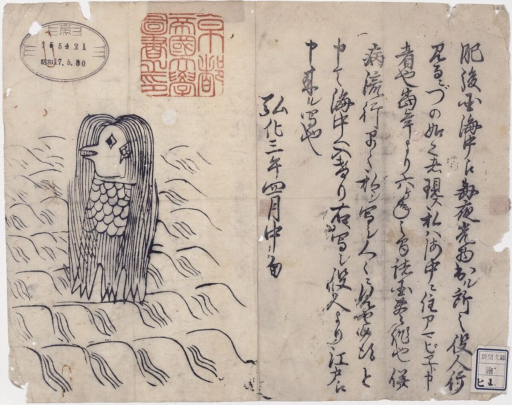
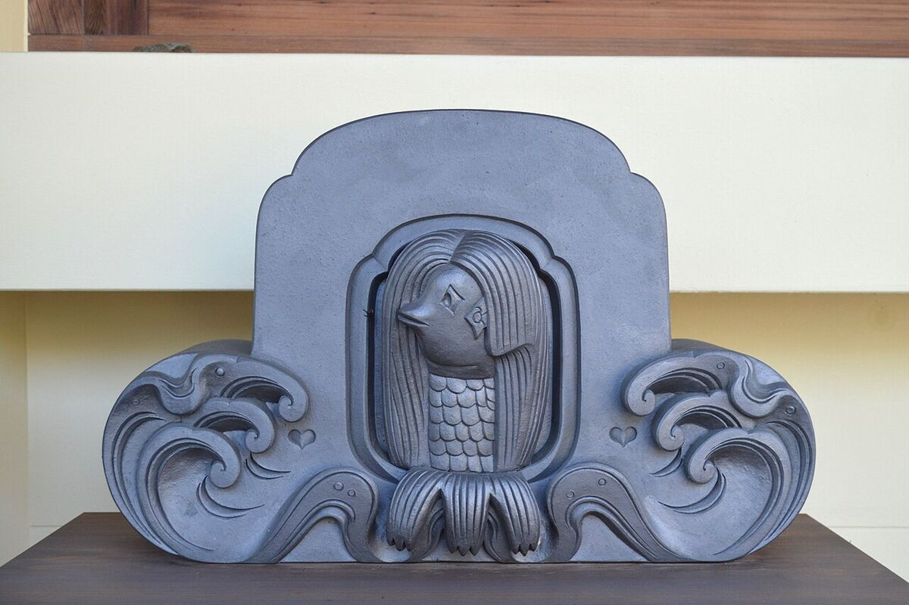

# 13. Yōkai in Modern Japan

Modern Japan tried to abolish its [yōkai](https://en.wikipedia.org/wiki/Y%C5%8Dkai), then studied them, then sold them, and in 2020 asked one of them for help. This chapter follows the creatures through four modern episodes: a Buddhist philosopher's campaign against superstition, the folklorist who collected tales of the vanished, the manga boom of the 1960s, and the pandemic mermaid [Amabie](https://en.wikipedia.org/wiki/Amabie).

<figure>

<figcaption>The 1846 broadsheet (<em>kawaraban</em>) of Amabie, the creature that appeared off Higo and foretold disease (Takahashi and Fujii 2022). <span class="credit">Image: Unknown author, Public domain, via <a href="https://commons.wikimedia.org/wiki/File:Higo_Amabie.jpg">Wikimedia Commons</a>.</span></figcaption>
</figure>

## 13.1 "Doctor Monster" against the monsters

The first modern expert on yōkai wanted them gone. **[Inoue Enryō](https://en.wikipedia.org/wiki/Inoue_Enry%C5%8D)** (1858–1919), a Buddhist philosopher and educator, was popularly known as **"Doctor Monster"** (*Yōkai Hakase* 妖怪博士) (Josephson 2006). Jason Josephson summarises his career (Josephson 2006):

- He founded the Tetsugakukan ("Philosophy Hall"), which became **[Tōyō University](https://en.wikipedia.org/wiki/Toyo_University)**, and turned his Fushigi Kenkyūkai ("mystery research society") into the **Yōkai Kenkyūkai**, "the monster investigation society", "dedicated to the elimination of superstitions".
- He received a doctorate from Tokyo Imperial University in 1896 and became "a prominent educator and popular author".
- "Since at least 1887 he had been advocating the elimination of superstitions as an important aspect of his attempt to modernize Buddhism."
- In *Meishin to shūkyō* ("Superstition and religion"), the first forty chapters argue "against the existence of monsters and curses". His summary: "monsters [*yōkai*] are nothing but superstition, and to the same degree we could say superstitions are nothing but monsters."

Josephson's point is that the campaign was also about Buddhism. Inoue divided traditional Buddhism into "superstition", which was "deemed 'not really Buddhism' and purged", and "religion", which "was made to accord with Westernized ideas of religion". Even the apotropaic rites and exorcisms of Buddhist temples were, for him, "superstitious accretions" (Josephson 2006). Andrea Castiglioni calls Inoue "the father of Japanese teratology (*yōkaigaku*)", the study of monsters, who believed that studying yōkai was necessary "in order to make Japan a modern country" (Castiglioni 2021).

## 13.2 Yanagita Kunio and the vanished

The founder of Japanese folklore studies took the opposite path: he collected what people believed.

- **Background.** **[Yanagita Kunio](https://en.wikipedia.org/wiki/Kunio_Yanagita)** was born in 1875 in a small village in western Japan. His father, a physician, also "studied the Chinese classics and the National Learning of [Hirata Atsutane](https://en.wikipedia.org/wiki/Hirata_Atsutane)". At university Yanagita majored in agricultural administration, out of "a desire to help Japanese people, the majority of whom were farmers, to overcome their poverty and attendant sufferings" (Mori 1980).
- **A childhood image.** Mori Kōichi relates a memory Yanagita never forgot. As a child he saw a votive picture of a mother killing her newborn baby, whose shadow had "ogre-like horns", beside a weeping [Jizō](https://en.wikipedia.org/wiki/K%E1%B9%A3itigarbha). "I still remember that I shivered with fear," he wrote (Mori 1980).
- **Belief, not literature.** As Chapter 8 showed, Yanagita insisted in 1910 that a ghost story is research material only if "the teller himself tells it believing it to be a true story" (Yanagita, quoted in Tsutsumi 2015). He disapproved of studies of theatrical ghosts as a return to the city, away from the countryside where folklore had to be sought (Tsutsumi 2015).

### *Kamikakushi*: spirited away

One phenomenon Yanagita documented was ***[kamikakushi](https://en.wikipedia.org/wiki/Spirit_away)*** (神隠し), literally "being hidden by a deity". Birgit Staemmler gives its core definition: "the sudden and mysterious disappearance of individuals attributed to their abduction by some supernatural being", for which "spirited away" is "a reasonably good English translation" (Staemmler 2005).

- "Yanagita Kunio collected quite a few reports on kamikakushi from various areas of Japan dating from around the turn of the nineteenth to the twentieth century" (Staemmler 2005).
- In the classic pattern, the abductee is often male and past puberty, and "often returns mentally deranged" (Staemmler 2005). Komatsu names the folk [tengu](https://en.wikipedia.org/wiki/Tengu) as a typical abductor (Komatsu 2014; Chapter 12).
- After that period kamikakushi "seems to have drifted somewhat into oblivion", perhaps because of urbanisation, until it "regained popularity" after [Miyazaki Hayao](https://en.wikipedia.org/wiki/Hayao_Miyazaki)'s anime ***Sen to Chihiro no kamikakushi*** (*[Spirited Away](https://en.wikipedia.org/wiki/Spirited_Away)*, 2001) (Staemmler 2005).
- In that film, "Chihiro is the central character and a female, pre-puberty heroine who matures through the adventure", and "no abduction takes place". She and her parents "simply get lost", a motif that reappears in online discussions of *kamikakushi* (Staemmler 2005).

## 13.3 The 1960s yōkai boom

Japan's high-growth years, "from the mid-fifties to the early seventies", brought television and weekly magazines, and with them "the 'yōkai boom'". Hirota Ryūhei describes it (Hirota 2021):

- **[Mizuki Shigeru](https://en.wikipedia.org/wiki/Shigeru_Mizuki)** (1922–2015) created ***[Gegege no Kitarō](https://en.wikipedia.org/wiki/GeGeGe_no_Kitar%C5%8D)***, "the most renowned yōkai creation of this period", serialised in the weekly *Shōnen magajin* (Boy's Magazine) from **1965**, with an anime adaptation.
- From 1966 to the 2010s Mizuki supplied magazines with illustrations of yōkai "with brief descriptions of how each yōkai was described in folklore or literature". In 1968 he published ***Nippon yōkai taizen*** (The complete book of Japanese yōkai), "nearly a hundred illustrated pages" in a special issue of *Shōnen magajin*.
- In its preface Mizuki said he had "collected paintings by [Toriyama Sekien](https://en.wikipedia.org/wiki/Toriyama_Sekien) (1712–1788) and read volumes of folklore". In fact "he read Yanagita's book and visited Fujisawa", a writer on folklore whose work Hirota also discusses, "to obtain information about yōkai".
- Mizuki "has widely been thought of as a specialist on yōkai despite the fact that he is a manga artist and not a scholar".
- Other writers of the boom, such as Saitō Morihiro, Ōtomo Shōji and Nakaoka Toshiya, wrote about *kaiki*, "anything weird, strange, mysterious, monstrous". Saitō warned readers that "uncanny yōkai are inhabiting every corner of Japan! They may be near you".
- Writers of the boom described yōkai as coming "from another world". The **occult boom** of the 1970s "grew out of this previous period".

Hirota argues that the boom "straddled a premodern folk community and a modernized popular society", and is the main source of today's habit of treating yōkai as "supernatural" beings of another world (Hirota 2021).

## 13.4 Amabie and the pandemic

In 2020 a nineteenth-century yōkai became a public-health mascot.

**The original.** Amabie is "a folkloric mermaid-like creature" known from a single printed broadsheet (*[kawaraban](https://en.wikipedia.org/wiki/Japanese_newspapers)*) in the collection of **Kyoto University Library**. It tells that a creature calling itself Amabie appeared in the sea off **Higo** (Kumamoto Prefecture) and said that there would be six years of good harvests, but that disease would spread, so "copy my image and show it to people". Then it vanished into the sea (Takahashi and Fujii 2022, citing Nagano 2009).

**The revival.** During COVID-19, Amabie "spread mainly through social media". It was used by the **Ministry of Health, Labour and Welfare** as a character to encourage people to stay at home, and it was among the winners of a national new-words-of-the-year award (Takahashi and Fujii 2022).

**What it shows.** Takahashi Ayako and Fujii Shūhei studied newspaper and magazine coverage (2018–2020) and surveyed attitudes. Their conclusions (Takahashi and Fujii 2022):

- The standard view, after Kagawa, is that the [Edo period](https://en.wikipedia.org/wiki/Edo_period) and Mizuki turned yōkai into pure entertainment, characters whose existence and powers were no longer believed in.
- Amabie "has been attracting public attention for its historic ability to repulse plagues" and "therefore seems to have social functions other than entertainment".
- "With the expectations that Amabie could drive the plague off, Amabie evoked not only positive but also negative impressions, and for that reason, it might be accepted as a Yōkai."
- "The function of Yōkai may change depending on the situation."

<figure>

<figcaption>Amabie as a roof-end tile at Nakayama Shinmeisha, Hekinan, Aichi Prefecture (photographed December 2023). <span class="credit">Image: Asturio Cantabrio, <a href="https://creativecommons.org/licenses/by-sa/4.0/">CC BY-SA 4.0</a>, via <a href="https://commons.wikimedia.org/wiki/File:Nakayama-shinmeisha_amabie_ac_%281%29.jpg">Wikimedia Commons</a>.</span></figcaption>
</figure>

## 13.5 Back to the beginning

The handbook began with [kami](https://en.wikipedia.org/wiki/Kami) and ended with a mermaid on a ministry poster. The sources suggest that these are not as far apart as they seem:

- Kami were powers that could rage or protect (Chapter 1).
- The wronged dead could be pacified into gods (Chapter 7).
- Yōkai sit at the other end of a continuum with kami (Chapter 10).
- In 2020 a figure from a nineteenth-century broadsheet was again asked to "drive the plague off", as the court had once asked the *[goryō](https://en.wikipedia.org/wiki/Gory%C5%8D)* of 863.

## 13.6 Check yourself

```quiz
title: Chapter 13 self-check
? Why was Inoue Enryō called "Doctor Monster"?
- He studied yōkai in order to abolish them as superstition *
- He drew yōkai for children's magazines
- He claimed to be a tengu's apprentice
> He founded a Yōkai Kenkyūkai devoted to eliminating superstition (Josephson 2006).

? What did Yanagita Kunio require of a ghost story for it to count as research material?
- That the teller believed it to be true *
- That it appear in an Edo book
- That it be set in a city
> Yanagita 1910, quoted in Tsutsumi 2015.

? What is the core meaning of kamikakushi?
- A sudden disappearance blamed on abduction by a supernatural being *
- A kami hiding inside a shrine
- A mask used in festivals
> Staemmler 2005.

? Where did Mizuki Shigeru actually get much of his yōkai information?
- From Yanagita's book and visits to Fujisawa, a writer on folklore *
- Only from Toriyama Sekien
- From Edo funeral manuals
> Hirota 2021.

? How is the original Amabie known?
- From a single broadsheet (kawaraban) in Kyoto University Library *
- From the Kojiki
- From Hearn's Kwaidan
> It appeared off Higo and asked people to copy its image.

? What did Takahashi and Fujii conclude about Amabie?
- It had a social function beyond entertainment, and yōkai functions change with the situation *
- It is purely a commercial character
- It was invented in 2020
> Takahashi and Fujii 2022.
```

## Sources for this chapter

1. **Josephson 2006.** Josephson JĀ. When Buddhism became a "religion": religion and superstition in the writings of Inoue Enryō. *Japanese Journal of Religious Studies* 2006;33(1):143–168. [Nanzan](https://nirc.nanzan-u.ac.jp/journal/6/article/1189/pdf/download).
2. **Castiglioni 2021.** See [Chapter 12](12-bestiary.md).
3. **Mori 1980.** Mori Kōichi. Yanagita Kunio: an interpretive study. *Japanese Journal of Religious Studies* 1980;7(2–3):83–115. [Nanzan](https://nirc.nanzan-u.ac.jp/journal/6/article/577/pdf/download).
4. **Tsutsumi 2015.** See [Chapter 8](08-yurei.md).
5. **Staemmler 2005.** Staemmler B. Virtual *kamikakushi*: an element of folk belief in changing times and media. *Japanese Journal of Religious Studies* 2005;32(2):341–352. [Nanzan](https://nirc.nanzan-u.ac.jp/journal/6/article/1182/pdf/download).
6. **Komatsu 2014.** See [Chapter 2](02-myths.md).
7. **Hirota 2021.** See [Chapter 1](01-kami.md).
8. **Takahashi and Fujii 2022.** See [Chapter 10](10-yokai.md). Quotations from the English abstract; other details translated from the Japanese.

➡️ Next: [Glossary](14-glossary.md)
