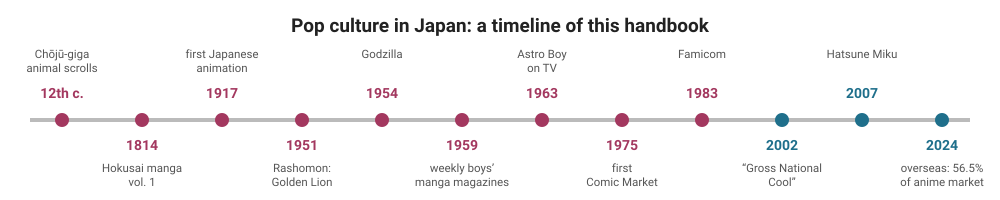

# Manga, Anime and Beyond: A Pop Culture Handbook

This handbook is about the popular culture that brings many people to Japan and to the Japanese language: manga, anime, film, monsters and special effects, video games, popular music, *kawaii*, fan culture, and the places where all of these can be visited. It treats them as history and as industry, not as a list of favourite titles. It explains:

- where the forms came from;
- who made them and how they are paid for;
- what scholars have found out about them;
- what a traveller needs to know.

It is written for a reader who wants to understand and is ready to read closely. Dates and names are given where the sources give them. Where scholars disagree, both positions are shown.

<figure class="diagram">

<figcaption>A timeline of the events in this handbook, from the <em>Chōjū-giga</em> to an anime market earning more than half its revenue abroad. Diagram drawn for this handbook from the sources cited in the chapter.</figcaption>
</figure>

## How this handbook treats facts

- **Every factual statement comes from a named source**, cited in brackets, such as (Hosogaya 2019), and listed at the end of each chapter.
- **Four kinds of source are used:**
  - **Peer-reviewed scholarship.** Mostly papers on J-STAGE, the *Japanese Journal of Religious Studies*, *Japan Review* and other publications of the International Research Center for Japanese Studies (Nichibunken), and the *Electronic Journal of Contemporary Japanese Studies*. Many are in Japanese; quotations from them are translated.
  - **Official bodies and industry associations:**
    - the National Film Archive of Japan;
    - the Motion Picture Producers Association of Japan (Eiren);
    - the Association of Japanese Animations;
    - Japan's Cabinet Office;
    - the Comic Market Committee;
    - Nintendo's company history.
  - **Museums and festivals**, for the titles and dates of works and awards: the Metropolitan Museum of Art, the Ghibli Museum and the Festival de Cannes.
- **Encyclopaedias, fan wikis, blogs and news sites are not used as sources.** Terms are linked to Wikipedia (marked ↗) only as further reading.
- **Where the sources are silent**, the handbook says so instead of filling the gap. Much of what circulates about pop culture online has no traceable source.
- **Numbers carry dates.** Markets, prices and rules change quickly, so every figure is given with its year. Practical information is dated November 2026.

## Pictures

Manga panels, anime stills, game screens and character designs are protected by copyright, so this handbook shows **none of them**. Instead it uses:

- **public-domain picture scrolls, prints and illustrated books**, the ancestors of manga;
- **public-domain portraits** of film directors and performers;
- **freely licensed photographs** of places, objects and events.

Pictures in which copyrighted characters were prominent were left out. Every picture is credited in its caption and again on the [sources page](16-sources.md). Nine diagrams were drawn for this handbook from the cited sources.

## The four parts

### Part I: Pictures that tell stories

| Chapter | What it explains |
|---|---|
| [1. Before manga](01-edo-roots.md) | Picture scrolls, the *Chōjū-giga*, Edo picture books, Hokusai and how the word *manga* got its meaning |
| [2. Manga](02-manga.md) | Rental manga, Tezuka, the weekly magazine system, readerships and the market |
| [3. Anime](03-anime.md) | From "trick films" to *Astro Boy*; the production committee; the anime economy in numbers |
| [4. Symbols and stock voices](04-shorthand.md) | Manga marks on faces and *yakuwarigo*, the role language of fiction |

### Part II: Screens and stages

| Chapter | What it explains |
|---|---|
| [5. Cinema beyond monsters](05-cinema.md) | The studios, the golden age, Mizoguchi, Ozu and Kurosawa, ghosts on film, Kore-eda, Hamaguchi and *Kokuhō* |
| [6. Monsters and special effects](06-kaiju.md) | *Godzilla* and the atomic age, Tsuburaya's miniatures, the physics of a falling building, TV heroes |
| [7. Video games](07-games.md) | From playing cards to the Famicom, arcades, and the Japanese RPG |
| [8. Music](08-music.md) | *Enka*'s political origins, idols and their rules, city pop, Hatsune Miku |

### Part III: Fans and society

| Chapter | What it explains |
|---|---|
| [9. Kawaii and character culture](09-kawaii.md) | Where *kawaii* comes from, what makes things look cute, local mascots |
| [10. Otaku and fandom](10-otaku.md) | *Dōjinshi*, the Comic Market, Akihabara, cosplay |
| [11. Pop culture, religion and folklore](11-sacred.md) | Anime "pilgrimages", a shrine transformed by fans, Mizuki Shigeru's town, *Demon Slayer*'s oni |
| [12. Cool Japan](12-cool-japan.md) | How the state discovered pop culture, and how to judge the result |

### Part IV: For the traveller and learner

| Chapter | What it explains |
|---|---|
| [13. A traveller's guide](13-travel.md) | Museums, Comiket, shopping districts, game centres and pilgrimage towns, with official rules and dates |
| [14. Language for fans](14-language.md) | Which anime Japanese is fiction, what research says about "men's" and "women's" speech, and key vocabulary |

Finally, a [glossary](15-glossary.md) and the [complete list of sources and image credits](16-sources.md).

This handbook connects with the course's [Folklore handbook](../folklore/00-start.md), especially for ghosts, yōkai and oni.

➡️ Begin with [Chapter 1: Before manga](01-edo-roots.md)
