# 1. Before Manga: Scrolls, Picture Books and Prints

Modern manga did not appear from nowhere in 1945. Japan has a very long history of telling stories with pictures and words together. That history runs from twelfth-century picture scrolls, through the cheap illustrated books of Edo, to the Meiji satire magazines that first gave the word *manga* its modern meaning. This chapter follows that line. It also shows where the line breaks: the panel-by-panel comic as we know it arrived from Europe and America.

The main guide is Hosogaya Atsushi of the Manga Department at Tokyo Polytechnic University. He sums up the question in one sentence: "What elements, from inside and from outside, made manga into manga?" (Hosogaya 2019).

## 1.1 Picture scrolls: stories that scroll sideways

The oldest surviving Japanese picture stories are ***[emakimono](https://en.wikipedia.org/wiki/Emakimono)***, hand-scrolls that combine painted scenes with written text. The surviving examples begin with the so-called "four great picture scrolls" of the late twelfth century (Hosogaya 2019):

| Scroll | What it shows | What it teaches a manga reader |
|---|---|---|
| *[Genji monogatari emaki](https://en.wikipedia.org/wiki/Genji_Monogatari_Emaki)* | Scenes from *The Tale of Genji*, each preceded by a passage of the text | Houses are seen from above with the roofs removed, and Hosogaya compares the roofless outlines to manga panels that mark changes of scene |
| *[Shigisan engi emaki](https://en.wikipedia.org/wiki/Shigisan-engi)* | The miracles of the monk Myōren, including a flying storehouse | Characters and even buildings fly across the scroll at high speed: "fantasy action" made for sideways scrolling |
| *[Ban Dainagon ekotoba](https://en.wikipedia.org/wiki/Ban_Dainagon_Ekotoba)* | The burning of the Ōtenmon gate and the political scandal after it | A crowd rushes towards a fire still out of sight. One scene shows several moments of a quarrel in a single picture |
| *[Chōjū jinbutsu giga](https://en.wikipedia.org/wiki/Ch%C5%8Dj%C5%AB-jinbutsu-giga)* | Animals behaving like people | Called the "root of manga"; see below |

Two techniques in these scrolls look very modern:

- **Reading direction as storytelling.** Scrolls are unrolled from right to left, so characters move to the left towards what comes next. Characters who face the other way meet the reader as a surprise, such as the monk waiting at the top of the mountain or the guardian spirit that suddenly flies in.
- **Several moments in one picture** (*iji dōzu*). In the *Ban Dainagon* scroll, a quarrel between servants' children, the parent who interferes and the rumour that gives away the real arsonist all happen inside one scene. It is the turning point of the story (Hosogaya 2019).

Hosogaya also points to how the Genji scroll draws its people: faces that are hard to read, often seen from behind. Readers who already knew the story could then project themselves onto the characters (Hosogaya 2019).

<figure>
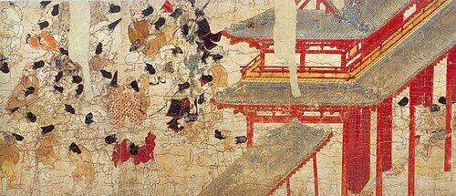
<figcaption>A crowd hurries towards the burning Ōtenmon gate, from the <em>Ban Dainagon ekotoba</em>, a twelfth-century picture scroll attributed to Tokiwa Mitsunaga. The viewer unrolls the scroll from right to left, following the crowd towards the fire. <span class="credit">Image: Tokiwa Mitsunaga, Public domain, via <a href="https://commons.wikimedia.org/wiki/File:Ban_Dainagon_Ekotoba_-_Crowd_and_a_gate.jpg">Wikimedia Commons</a>.</span></figcaption>
</figure>

<figure>
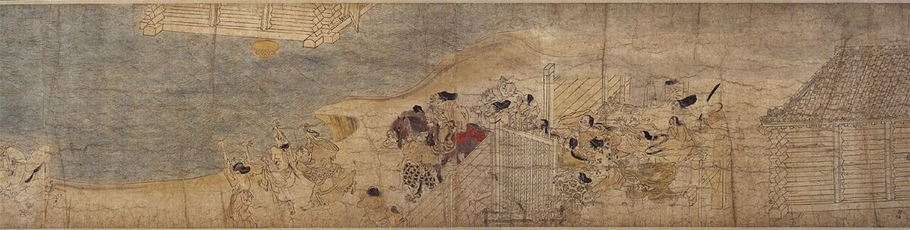
<figcaption>The "flying granary" scene from the first scroll of the <em>Shigisan engi emaki</em>, twelfth century. Hosogaya calls the scroll a masterpiece of "fantasy action" made for sideways scrolling. <span class="credit">Image: Unknown author, Public domain, via <a href="https://commons.wikimedia.org/wiki/File:Tobikura_no_maki_%28flying_storchouse%29.jpg">Wikimedia Commons</a>.</span></figcaption>
</figure>

## 1.2 The *Chōjū-giga*: frogs, rabbits and speed lines

The *Chōjū jinbutsu giga* ("Frolicking animals and people") belongs to Kōzan-ji, a temple in Kyoto. It is a National Treasure, and it is in fact four separate scrolls that were put together later. The first two are thought to date from the end of the Heian period. The first scroll, with its rabbits, frogs and monkeys, is the one usually called the "root of manga" (Hosogaya 2019).

It is unusual for its time in several ways (Hosogaya 2019):

- **No text at all**, and **no colour**. It is drawn in ink lines only (*hakubyō*).
- **Animals behaving entirely like humans.** They swim, play, hold an archery contest and wrestle. Hosogaya notes that this is different from the modern habit of turning everything into a human-like character.
- **Leading the eye.** A strange object and something scattered on the ground make the viewer wonder what is ahead. Further along, a fox spectator appears, and then the rabbits and frogs at an archery match: the object was a target made of a large butterbur leaf.
- **Lines for invisible things.** Lines are drawn behind flying arrows to show motion. There is a shout coming from a frog's mouth after it wins a sumo bout, and something like chanting from the mouth of a monkey dressed as a monk. A later copy preserves a lost scene of animals doing the high jump, with speed lines behind them.

The scroll was traditionally attributed to the monk [Toba Sōjō](https://en.wikipedia.org/wiki/Toba_S%C5%8Dj%C5%8D). Hosogaya calls the attribution doubtful, but notes that court diaries record Toba Sōjō as famous for comic, exaggerated drawings. The earliest known claim that the scroll is the root of manga comes from a Taishō-period book, Hosokibara Seiki's *History of Japanese Manga* (Hosogaya 2019).

<figure>
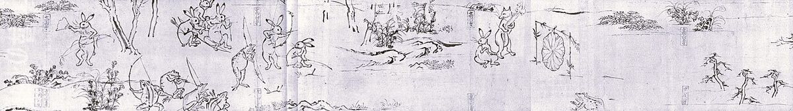
<figcaption>Rabbits and frogs at an archery contest, from the first scroll of the <em>Chōjū jinbutsu giga</em> (Kōzan-ji, Kyoto), late Heian period. Lines behind the flying arrows show motion. <span class="credit">Image: Unknown artist (traditionally attributed to Toba Sōjō), Public domain, via <a href="https://commons.wikimedia.org/wiki/File:Chouju_1st_scroll-02.jpg">Wikimedia Commons</a>.</span></figcaption>
</figure>

<figure>
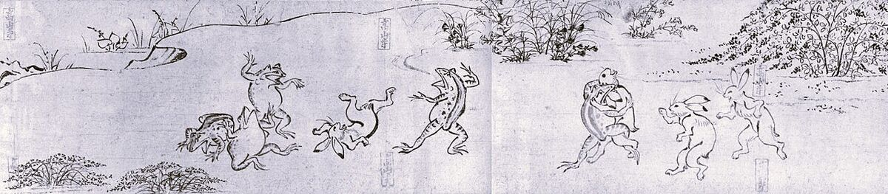
<figcaption>A frog wins a sumo bout against a rabbit, from the same scroll. The scroll uses no text and no colour. <span class="credit">Image: Unknown artist (traditionally attributed to Toba Sōjō), Public domain, via <a href="https://commons.wikimedia.org/wiki/File:Chouju_1st_scroll-05.jpg">Wikimedia Commons</a>.</span></figcaption>
</figure>

## 1.3 Words inside the picture

In the earliest scrolls, text and pictures were kept apart: a passage of writing, then a painted scene. In the Muromachi-period ***[otogi-zōshi](https://en.wikipedia.org/wiki/Otogi-z%C5%8Dshi)*** scrolls, such as the *Mouse Tale* and *Urashima* scrolls, something new happened (Hosogaya 2019):

- **Explanations, characters' names and even their spoken lines** were written into the picture, next to the speaker. These are called *gachūshi* ("words in the picture"). Hosogaya calls them "the prototype of the modern manga speech balloon."
- **The drawings became simpler** and look like the work of amateurs. Hosogaya says they are almost "*hetauma*" (deliberately clumsy) or like "*yuru-kyara*" (Chapter 9).

He also notes a habit that sounds very modern: medieval court women who read picture scrolls of romances sometimes made their own. "You make the scroll you want to see yourself," he writes, comparing it to amateur *dōjinshi* (Chapter 10).

## 1.4 Edo: picture books for a paying public

Mass entertainment on paper needed things the medieval world lacked: a buying public, money and a distribution network. These arrived in the [Edo period](https://en.wikipedia.org/wiki/Edo_period) (1603–1868), as Kyoto, Osaka and then Edo grew into great commercial cities (Hosogaya 2019).

- **The first illustrated commercial book.** In the early seventeenth century, the Kyoto merchant Suminokura Soan financed the *[Saga-bon](https://en.wikipedia.org/wiki/Saga-bon)*. These were luxurious printed editions of the classics, with type based on [Hon'ami Kōetsu](https://en.wikipedia.org/wiki/Hon%27ami_K%C5%8Detsu)'s calligraphy. The Saga-bon *Ise monogatari* was the first in the series to include woodblock illustrations. It was reprinted so often that the printers switched from movable type to cheaper whole-page woodblocks.
- **Toba-e books.** From the 1720s, first in Kyoto, books made entirely of humorous drawings sold enormously all over Japan. Their figures had faces reduced to dots and lines and absurdly long arms and legs. The name *toba-e* ("Toba pictures") honours Toba Sōjō, and until the Meiji period it was a more common word than *manga* for this kind of drawing. The French caricaturist [Georges Bigot](https://en.wikipedia.org/wiki/Georges_Ferdinand_Bigot), who worked in Meiji Japan, even called his magazine *TOBAE*.
- **Characters before manga.** Ōtsu-e, hand-painted souvenir pictures sold to travellers near Kyoto, featured humorous monkeys and oni. At the end of the seventeenth century, the puppet-theatre hero Kinpira became a popular subject with his own bold drawing style (Hosogaya 2019).

### *Kibyōshi*: the gag manga of Edo

The most manga-like books of the Edo period were the ***[kibyōshi](https://en.wikipedia.org/wiki/Kiby%C5%8Dshi)*** ("yellow covers"). They were satirical stories for adults in which text and picture worked together on every page. The genre grew out of *akahon* ("red books"), illustrated stories for children, and suddenly raised them to an adult level (Hosogaya 2019).

- The book that started the boom was *[Kinkin sensei eiga no yume](https://en.wikipedia.org/wiki/Kinkin_sensei_eiga_no_yume)* by [Koikawa Harumachi](https://en.wikipedia.org/wiki/Koikawa_Harumachi), who wrote the text and drew the pictures. Its nonsense gags come from the interplay of text and image. It has no panels and no balloons, but Hosogaya calls it a work that "can be called a gag manga of the Edo period".
- The publisher [Tsutaya Jūzaburō](https://en.wikipedia.org/wiki/Tsutaya_J%C5%ABzabur%C5%8D) used popular writers such as [Santō Kyōden](https://en.wikipedia.org/wiki/Sant%C5%8D_Ky%C5%8Dden). Kyōden also drew under the name Kitao Masanobu and invented the characters *zendama* and *akudama*, a "good spirit" and an "evil spirit" who steer the human heart. They became a craze.
- **Censorship ended the boom.** The books began to carry criticism of the shogunate, and some authors were samurai. The authorities cracked down, and publishers and print artists were severely punished (Hosogaya 2019).

<figure>
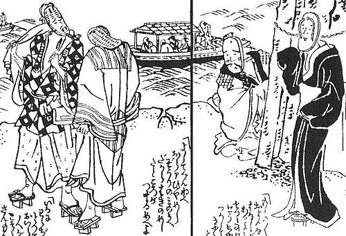
<figcaption>A page from a <em>kibyōshi</em>, <em>Unshidai Izumo engumi</em> by Jippensha Ikku, 1800. Text and pictures share the page. <span class="credit">Image: Jippensha Ikku, Public domain, via <a href="https://commons.wikimedia.org/wiki/File:Kibyoshi_Unshidai_Izumoengumi.jpg">Wikimedia Commons</a>.</span></figcaption>
</figure>

### The print and the star

The same publishers made stars. ***[Ukiyo-e](https://en.wikipedia.org/wiki/Ukiyo-e)*** prints had two main genres from the start: **pictures of beautiful women** and **pictures of kabuki actors**, sold as souvenirs of famous performances. Tsutaya Jūzaburō launched the mysterious [Tōshūsai Sharaku](https://en.wikipedia.org/wiki/T%C5%8Dsh%C5%ABsai_Sharaku), whose large-head actor portraits were "unprecedentedly unique" (Hosogaya 2019). The Metropolitan Museum of Art dates its Sharaku portrait of the actor Ōtani Oniji III to 1794 (Metropolitan Museum of Art, n.d.-a).

<figure>
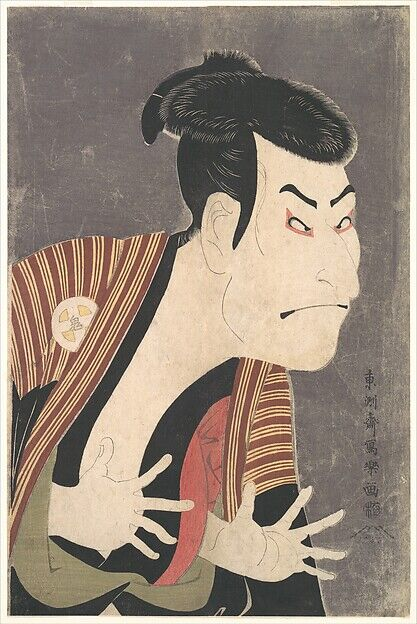
<figcaption>Tōshūsai Sharaku, <em>Kabuki Actor Ōtani Oniji III as Yakko Edobei</em>, 1794. One of the large-head actor portraits launched by the publisher Tsutaya Jūzaburō. <span class="credit">Image: The Metropolitan Museum of Art, <a href="https://creativecommons.org/publicdomain/zero/1.0/">CC0</a>, via <a href="https://www.metmuseum.org/art/collection/search/37358">The Met Open Access</a>.</span></figcaption>
</figure>

## 1.5 Hokusai and the word *manga*

The word ***manga*** (漫画) was first used in earnest in the early nineteenth century, for [Katsushika Hokusai](https://en.wikipedia.org/wiki/Hokusai)'s best-selling *[Hokusai manga](https://en.wikipedia.org/wiki/Hokusai_Manga)* in fifteen volumes. Hosogaya stresses that Hokusai did not mean what we mean (Hosogaya 2019):

- **It meant something like "sketches drawn as the fancy takes you".** The related word *manpitsu* (漫筆) meant writing "without any particular purpose". The books were planned as **drawing manuals**: model pictures of everything under the sun for Hokusai's pupils across Japan and for amateur painters.
- **Other words were more common** for humorous pictures: *toba-e*, *sōga*, *soga* and *ryakuga*. A few other books used *manga* in their titles, but the word then fell out of use until the Meiji period.
- **The modern reading is selective.** Pages in volumes 9 and 10 show comic faces in a grid, and some show a dance in sequence like an animation. They are often called forerunners of manga and animation. Hosogaya says this "is not wrong", but it over-emphasises "a very small part of the fifteen volumes".

The Met's set of all fifteen volumes is dated 1814–78. The first volume appeared in 1814, and the last volumes were published long after Hokusai's death (Metropolitan Museum of Art, n.d.-b).

<figure>
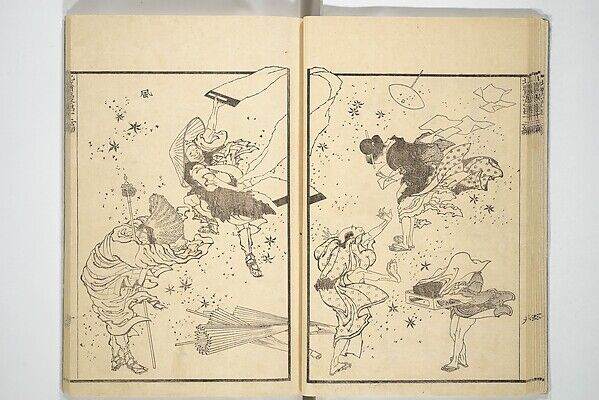
<figcaption>"Wind", from volume 12 of the <em>Hokusai manga</em> (Hokusai Sketchbooks), first published 1834. Figures, papers and an umbrella are caught in a gust. <span class="credit">Image: The Metropolitan Museum of Art, <a href="https://creativecommons.org/publicdomain/zero/1.0/">CC0</a>, via <a href="https://www.metmuseum.org/art/collection/search/78791">The Met Open Access</a>.</span></figcaption>
</figure>

<figure>
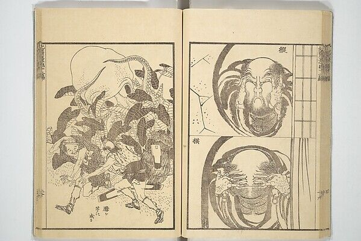
<figcaption>A page from volume 12 of the <em>Hokusai manga</em>: faces distorted vertically and horizontally, one of the comic pages often cited as forerunners of manga. <span class="credit">Image: The Metropolitan Museum of Art, <a href="https://creativecommons.org/publicdomain/zero/1.0/">CC0</a>, via <a href="https://www.metmuseum.org/art/collection/search/78791">The Met Open Access</a>.</span></figcaption>
</figure>

### Hokusai the illustrator

Hosogaya argues that Hokusai's real link to modern manga lies elsewhere: in his roughly **1,400 illustrated books**. In them he invented ways to draw what the eye cannot see (Hosogaya 2019):

- **Explosions and flashes of light**, drawn as radiating lines, for example in [Takizawa Bakin](https://en.wikipedia.org/wiki/Kyokutei_Bakin)'s novel *[Chinsetsu yumiharizuki](https://en.wikipedia.org/wiki/Chinsetsu_Yumiharizuki)*.
- **Ghosts and other things that should not exist**, given form purely through line.
- **Bloody battles and spectacular action** (Hosogaya 2019).

Speed lines and flowing water had a tradition reaching back to the scrolls, but "it may be fair to say that Hokusai brought them together" (Hosogaya 2019).

## 1.6 Meiji: satire, *ponchi-e* and the modern word

The decisive change came from abroad (Hosogaya 2019).

1. **Japan Punch.** In the foreign settlement at Yokohama, the Englishman [Charles Wirgman](https://en.wikipedia.org/wiki/Charles_Wirgman) launched the satirical magazine *Japan Punch* in the spirit of Victorian *Punch* cartoons. It inspired Japanese satire magazines after the Restoration, such as *Marumaru chinbun*. From *Punch* came the word ***ponchi-e*** ("Punch pictures") for cheap, funny picture books divided into panels.
2. **Bigot and *TOBAE*.** Georges Bigot satirised the Meiji government's westernising diplomacy.
3. **Danger.** The satirist [Miyatake Gaikotsu](https://en.wikipedia.org/wiki/Miyatake_Gaikotsu) was prosecuted for lèse-majesté over a parody of the promulgation of the Meiji Constitution.
4. **The new meaning of *manga*.** As newspapers adopted satirical drawings, the old word was revived for them. Imaizumi Ippyō and then [Kitazawa Rakuten](https://en.wikipedia.org/wiki/Kitazawa_Rakuten) pushed the term. Rakuten ran a cartoon section in the newspaper *Jiji shinpō*, later the separate *Jiji manga*, and founded the full-colour satire magazine *[Tokyo Puck](https://en.wikipedia.org/wiki/Tokyo_Puck)*, named after an American magazine. "At last the modern meaning of the name manga began to take root."

The old title survived alongside the new meaning. In 1881 the painter [Kawanabe Kyōsai](https://en.wikipedia.org/wiki/Kawanabe_Ky%C5%8Dsai) published a woodblock-printed sketchbook called *Kyōsai manga* (Metropolitan Museum of Art, n.d.-c), in the tradition of Hokusai's model books.

<figure>
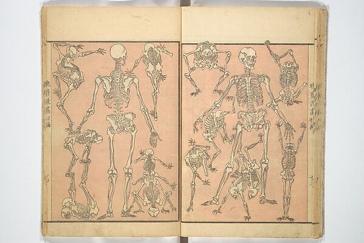
<figcaption>A spread from Kawanabe Kyōsai's sketchbook <em>Kyōsai manga</em>, 1881, which kept the word <em>manga</em> in a book title in the Meiji period. <span class="credit">Image: The Metropolitan Museum of Art, <a href="https://creativecommons.org/publicdomain/zero/1.0/">CC0</a>, via <a href="https://www.metmuseum.org/art/collection/search/78667">The Met Open Access</a>.</span></figcaption>
</figure>

<figure>
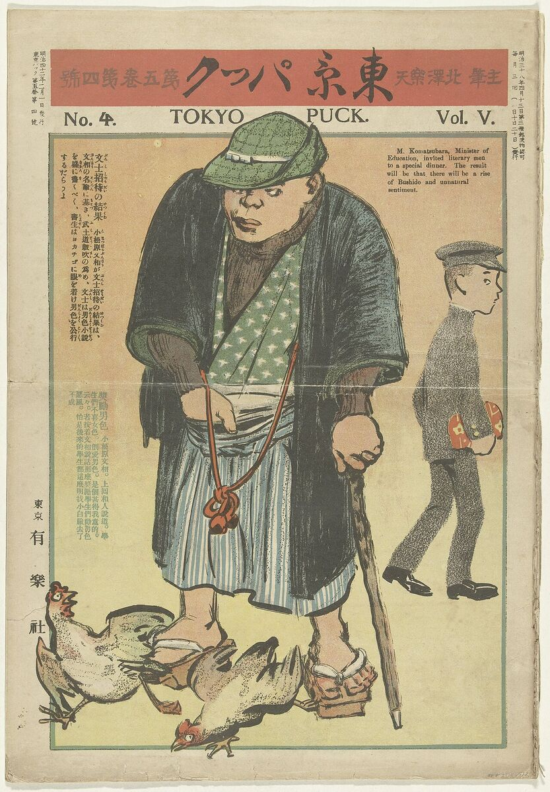
<figcaption>Cover of <em>Tokyo Puck</em>, February 1909, the full-colour satirical magazine founded by Kitazawa Rakuten. <span class="credit">Image: Rijksmuseum, <a href="https://creativecommons.org/publicdomain/zero/1.0/">CC0</a>, via <a href="https://commons.wikimedia.org/wiki/File:Tokyo_Puck_-_Februari_1909%2C_RP-P-2005-572.jpg">Wikimedia Commons</a>.</span></figcaption>
</figure>

The **newspaper strip** followed. *Jiji shinpō* serialised *Tagosaku to Mokubē*, a panel comic with recurring characters, and a sister magazine of *Marumaru chinbun* printed eight-panel satirical strips. Hosogaya notes that both reflect "the influence of Western newspaper cartoons" (Hosogaya 2019).

<figure>
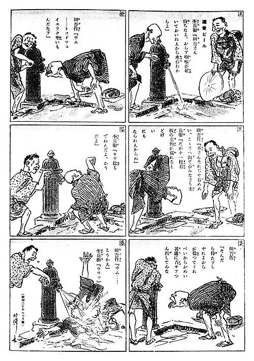
<figcaption>Kitazawa Rakuten's strip <em>Tagosaku to Mokubē</em>: two country men on a sightseeing trip to Tokyo, told in panels with recurring characters. <span class="credit">Image: Kitazawa Rakuten, Public domain, via <a href="https://commons.wikimedia.org/wiki/File:Tagosaku_to_Mokube_no_Tokyo_Kenbutsu.jpg">Wikimedia Commons</a>.</span></figcaption>
</figure>

### Western comics, Japanese newspapers

For comparison, Hosogaya traces the Western line (Hosogaya 2019):

- [Rodolphe Töpffer](https://en.wikipedia.org/wiki/Rodolphe_T%C3%B6pffer)'s panel gag stories in Geneva in the late 1820s.
- [Wilhelm Busch](https://en.wikipedia.org/wiki/Wilhelm_Busch)'s *[Max und Moritz](https://en.wikipedia.org/wiki/Max_and_Moritz)* in Germany.
- The American newspaper strip, above all *[The Yellow Kid](https://en.wikipedia.org/wiki/The_Yellow_Kid)*, which had everything modern manga has: panels, speech balloons, a popular character, serialisation in mass media and merchandising.

In Japan, [Okamoto Ippei](https://en.wikipedia.org/wiki/Ippei_Okamoto) of the *Asahi* newspaper set the style of *manga manbun*, illustrated humorous reportage. He organised cartoonists' associations and events, raised their social standing and, by one account, was better known than the prime minister. After the 1923 earthquake, Asō Yutaka's newspaper strip *Nonki na tōsan* ("Easygoing Dad") and the children's strip *Shō-chan no bōken* ("The Adventures of Shō-chan") became hits, with films, stage versions and merchandise. Both characters were modelled on *Bringing Up Father*, an American strip by George McManus that ran in translation in Japanese newspapers. "The start of Japanese panel manga took place under Western influence" (Hosogaya 2019).

## 1.7 Norakuro, and what Tezuka changed

The first great best-selling manga came from an imported film. A young cartoonist who had seen *[Felix the Cat](https://en.wikipedia.org/wiki/Felix_the_Cat)* turned the black cat into a black stray dog who joins the army, blunders constantly and is promoted anyway. This was [Tagawa Suihō](https://en.wikipedia.org/wiki/Suih%C5%8D_Tagawa)'s *[Norakuro](https://en.wikipedia.org/wiki/Norakuro)*, serialised in the boys' magazine *[Shōnen kurabu](https://en.wikipedia.org/wiki/Sh%C5%8Dnen_Club)* of the publisher now called Kōdansha. Its hardbound collected volumes were full-colour, cloth-bound and boxed, which was extraordinary at the time (Hosogaya 2019).

Yet *Norakuro*'s panels are "geometrically neat and tame". Above all, the "camera work" is ordinary: the reader's eye stays fixed as if watching a stage. Before the war there were not even close-up panels. The great change came with [Tezuka Osamu](https://en.wikipedia.org/wiki/Osamu_Tezuka) (Chapter 2). His drawing was called "cinematic" for its dynamic movement and its close attention to faces and feelings, as if a film camera were at work inside the book. Even a manga he drew as a teenager just before the end of the war, *Shōri no hi made* ("Until the Day of Victory"), uses cinematic camera work. It includes the realistic death of a Japanese boy in a strafing attack, which Hosogaya sees as the starting point of Tezuka's lifelong theme of life and death (Hosogaya 2019).

## 1.8 What the history shows

| Feature of modern manga | Earliest form described in the sources |
|---|---|
| Story told by pictures and text together | Twelfth-century *emakimono* |
| Speed lines and lines for invisible things | *Chōjū-giga*, first scroll |
| Words written next to the speaker | Muromachi *otogi-zōshi* scrolls (*gachūshi*) |
| Cheap, mass-produced comic books | Edo *toba-e* books and *kibyōshi* |
| The word *manga* | Hokusai's sketchbooks (from 1814), in a different sense |
| *Manga* meaning satirical cartoons | Meiji newspapers; Kitazawa Rakuten |
| Panels, balloons, serial characters | Western newspaper strips, adopted from the late Meiji period |
| Cinematic camera work | Tezuka Osamu, from the 1940s |

Hosogaya's conclusion: "Many of the elements of today's manga came not only from domestic factors but from Western influences" (Hosogaya 2019).

```quiz
title: Chapter 1 self-check
? Which early scroll is often called the "root of manga"?
- Chōjū jinbutsu giga *
- Genji monogatari emaki
- Hokusai manga
> Its first scroll shows animals behaving like people, with speed lines (Hosogaya 2019).

? What did Hokusai mean by the word manga?
- Sketches drawn as the fancy takes you, published as drawing manuals *
- Satirical newspaper cartoons
- Stories told in panels with speech balloons
> The modern sense came only in the Meiji period.

? What are gachūshi?
- Words written inside the picture next to a character, a forerunner of the speech balloon *
- Colour woodblock prints of actors
- Speed lines drawn behind arrows
> They appear in Muromachi otogi-zōshi scrolls.

? What were kibyōshi?
- Illustrated satirical books for adults in the Edo period *
- Picture scrolls painted for the Heian court
- Meiji newspaper strips
> Kinkin sensei eiga no yume started the boom; censorship ended it.

? Who popularised the modern word manga for newspaper cartoons and founded Tokyo Puck?
- Kitazawa Rakuten *
- Tagawa Suihō
- Charles Wirgman
> Wirgman's Japan Punch inspired the satire magazines; Rakuten made "manga" the standard word.

? Which imported character inspired Norakuro?
- Felix the Cat *
- The Yellow Kid
- Mickey Mouse
> Tagawa Suihō turned the black cat into a black dog who joins the army.
```

## Sources for this chapter

1. **Hosogaya 2019.** Hosogaya Atsushi 細萱敦. 絵巻物から絵草紙そしてマンガへの流れ (Contents stream from emakimono and ezōshi to manga). *Journal of the Imaging Society of Japan* 2019;58(5):513–522. doi:[10.11370/isj.58.513](https://doi.org/10.11370/isj.58.513). Quotations translated from the Japanese.
2. **Metropolitan Museum of Art, n.d.-a.** Tōshūsai Sharaku, *Kabuki Actor Ōtani Oniji III as Yakko Edobei*, 1794. Woodblock print; ink, colour and white mica on paper. Accession record 37358. [The Met](https://www.metmuseum.org/art/collection/search/37358).
3. **Metropolitan Museum of Art, n.d.-b.** Katsushika Hokusai, *Transmitting the Spirit, Revealing the Form of Things: Hokusai Sketchbooks (Denshin kaishu: Hokusai manga)*, volumes 1–15, 1814–78. Set of fifteen woodblock-printed books. Accession record 78791. [The Met](https://www.metmuseum.org/art/collection/search/78791).
4. **Metropolitan Museum of Art, n.d.-c.** Kawanabe Kyōsai, *Kyōsai Sketchbook (Kyōsai manga)*, 1881. Woodblock-printed book. Accession record 78667. [The Met](https://www.metmuseum.org/art/collection/search/78667).

➡️ Next: [Chapter 2: Manga](02-manga.md)
